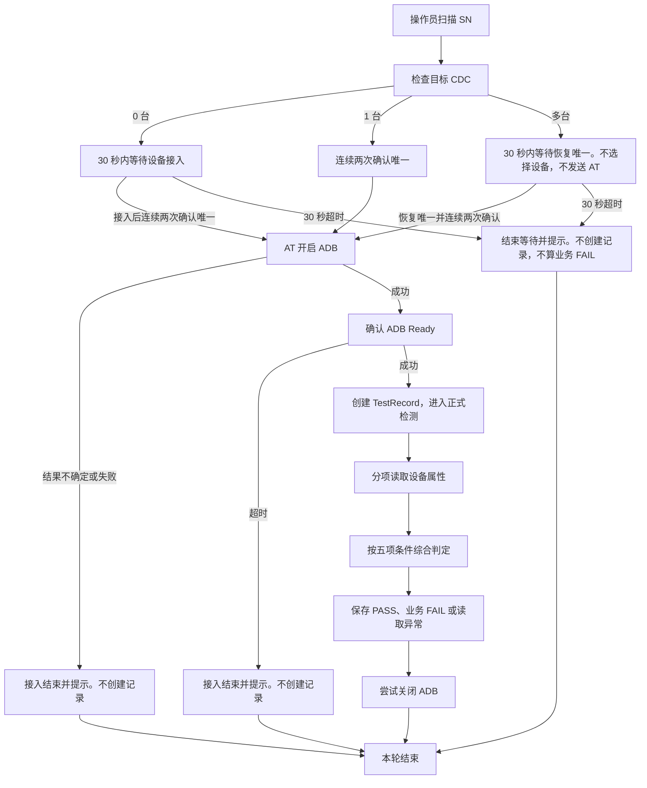
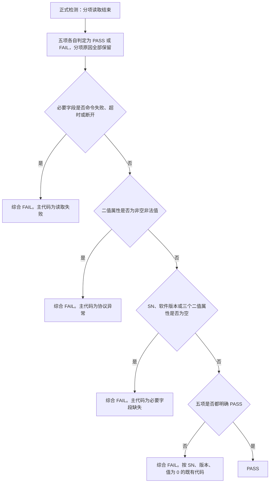
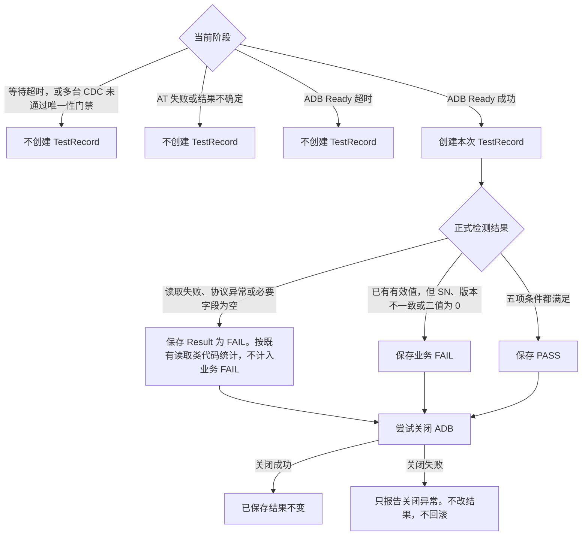

# YME009 包装上位机产品需求文档（PRD）

**文档版本：** V0.8  
**文档状态：** 讨论稿  
**项目名称：** YME009 包装上位机  
**宿主工程：** SnVerify  
**文档性质：** 产品需求定义  
**当前阶段：** 需求讨论与确认，暂不进入编码

---

## 0. 文档说明

### 0.1 编写目的

本文档定义 YME009 包装工位上位机的业务目标、操作流程、批次参数、设备信息读取、检测判定、结果记录和导出要求。

YME009 基于现有 SnVerify 上位机工程新增产品能力，不独立开发一套新的上位机系统。

本文档作为 YME009 产品需求的讨论基线。后续需求调整应以本文档为依据，明确记录已确认决策和变更内容。

### 0.2 需求状态约定

本文档中的内容分为三类：

- **已确认：** 已经讨论并得到明确确认的业务规则或技术边界。
- **待确认：** 需要业务方、设备端或进一步验证才能确定的事项。
- **技术参考：** 已有工程中的实现情况，仅用于指导后续设计，不代表 YME009 已确定采用相同实现。

### 0.3 当前阶段约束

当前阶段先完成产品需求定义。

在设备侧指令、通信方式和必要的业务规则尚未确认之前，不开始编码，不自行假设设备协议。

---

## 1. 项目背景与目标

### 1.1 项目背景

YME009 包装工位位于设备生产测试完成之后、正式包装之前。

包装操作员通过扫码枪扫描设备标签上的 SN，上位机根据扫描的 SN 获取对应设备信息及已有生产测试结果，检查设备是否满足包装要求。

该工位的主要职责是核验设备是否已经完成规定的生产测试和老化要求，以及设备身份、软件版本是否符合当前订单要求。

### 1.2 项目目标

基于 SnVerify 现有上位机框架，增加 YME009 包装检测产品，实现以下能力：

1. 支持操作员输入项目名，并创建和管理包装检测批次。项目名与产品类型 YME009 分开保存。
2. 支持通过扫码枪扫描设备 SN，触发单台设备检测。
3. 扫码时设备已接入则直接进入设备接入和读取；未接入则等待插入，等待上限 30 秒。
4. 读取设备 SN、软件版本、IMEI1、IMEI2、WiFi MAC。
5. 读取产测结果、重启老化结果和恢复出厂老化结果。
6. 根据批次目标软件版本和上述判定项给出综合结果。
7. 展示设备信息、检测项目结果及最终 PASS / FAIL。
8. 保存检测记录，并支持批次记录查询和导出。

### 1.3 核心业务定位

YME009 是包装前的结果核验工位，不是生产测试工位，也不是老化测试工位。

上位机只读取设备已经产生的测试结果，不负责启动或执行这些测试。

---

## 2. 项目范围

### 2.1 本期范围

| 功能 | 需求 |
|---|---|
| 产品接入 | 在 SnVerify 中新增产品类型 YME009，不取消操作员输入的项目名 |
| 批次管理 | 沿用现有项目名、订单号及 TestSession 机制，不新建独立批次系统 |
| 批次参数 | 设置目标软件版本。不设置目标老化次数 |
| 扫码检测 | 扫描 SN 后触发单台设备检测 |
| 设备接入 | CDC 发现、唯一性门禁、AT 开启 ADB、ADB Ready 之后才进入正式检测。0 台或多台目标 CDC 都在 30 秒窗口内等待。记录保存后再尝试关闭 ADB |
| 设备信息 | 读取 SN、软件版本、IMEI1、IMEI2、WiFi MAC |
| 生产结果 | 读取产测结果，属性 `persist.sys.yl.cit`。精确为 `1` 才 PASS，其余情况该项 FAIL |
| 老化结果 | 分别读取重启老化和恢复出厂老化。精确为 `1` 才 PASS，其余情况该项 FAIL。不比较老化次数 |
| 综合判定 | 五项都明确通过才 PASS，任一项不是明确通过则综合 FAIL。综合结果只有 PASS / FAIL。读取异常与协议异常的综合主原因优先级不变，统计口径仍分开 |
| 结果展示 | 展示设备信息和检测结果 |
| 数据记录 | 每次实际完成的检测新增一条记录；同一 SN 可有多条记录，不覆盖历史 |
| 数据导出 | 导出和统计要区分业务 FAIL 与设备读取异常。同一 SN 的完整历史是否全部导出仍待确认 |

### 2.2 本期不包含

1. 不执行设备生产测试。
2. 不启动设备老化流程。
3. 不修改设备已有的产测结果。
4. 不修改设备已有的老化结果。
5. 不重新建设独立批次管理系统。
6. 不重构 SnVerify 现有通用批次、扫码、记录和导出框架。
7. 不改变 SOLTAG25、KM001、KM008 的现有业务行为、结果分类、PASS/FAIL 统计口径和导出分桶、去重行为。
8. 不将 SMT/CIT 工位的测试业务流程引入包装工位。

### 2.3 设计原则

- 尽量复用 SnVerify 已有能力。
- YME009 的特殊业务规则由 YME009 专属逻辑承载。
- 不为了 YME009 对现有产品进行不必要的修改。
- 设备通信机制以实际设备验证结果为准。
- 业务判定规则与设备通信实现分离。

---

## 3. 用户角色与使用场景

### 3.1 用户角色

**包装操作员**

负责创建或选择订单批次、扫描设备 SN、查看检测结果，并根据检测结果决定是否允许设备进入包装流程。

### 3.2 主要使用场景

1. 操作员选择产品类型 YME009。
2. 输入项目名和订单号，设置目标软件版本。不输入目标老化次数。
3. 开始本次包装检测。同一项目名和订单号下可以再次开始，每次新建检测会话。
4. 扫描设备标签上的 SN。
5. 上位机连接设备并读取信息。
6. 上位机自动判断是否符合包装要求。
7. 操作员根据 PASS / FAIL 结果处理设备。
8. 继续扫描下一台设备。

---

## 4. 批次管理

### 4.1 项目名与产品类型

**已确认（D01、D02）：保留项目名，并且项目名与产品类型不是同一个概念。**

YME009 沿用 SnVerify 现有的项目名输入机制。项目名仍由操作员输入，不因为增加 YME009 而取消。

| 名称 | 含义 | 来源 |
|---|---|---|
| `ProductCode = YME009` | 产品类型。系统据此识别 YME009 的检测流程 | 产品注册，不是操作员每次填写的项目名 |
| `ProductName` | 项目名 | 操作员输入 |

二者含义不同，不得混淆。选择 YME009 不代替填写项目名，填写项目名也不改变产品类型。

### 4.2 批次标识

**已确认（D03）：YME009 的批次号就是 SnVerify 现有的订单号。**

订单号作为本次包装核验批次的身份标识。不新增独立的批次编号，也不另建批次数据系统。

现有 SnVerify 使用项目名、订单和 TestSession 组织检测记录。YME009 沿用这一组织方式。

### 4.3 批次参数

开始一次检测会话时，需要设置以下参数：

| 参数 | 必填 | 说明 |
|---|---|---|
| 项目名 | 是 | 操作员输入的项目名，对应 `ProductName`，不是 `ProductCode` |
| 订单号（批次号） | 是 | 当前包装检测批次的业务标识 |
| 目标软件版本 | 是 | 本批次要求设备满足的软件版本 |

### 4.4 参数规则

1. 开始检测前必须填写项目名。
2. 开始检测前必须填写订单号。
3. 开始检测前必须填写目标软件版本。
4. 不配置目标老化次数，也不读取或比较老化次数。
5. 同一项目名、同一订单号下的所有设备、所有 TestSession，使用相同的目标软件版本。
6. 检测过程中不得因为某台设备的结果而自动修改批次参数。
7. 每台设备的检测结果应关联到当前项目名、当前订单及其目标软件版本。
8. **已确认（D04）：** 同一项目名、同一订单号下，允许多次开始测试。每次开始测试都创建新的 TestSession，不复用旧 TestSession。
9. **现行批次标准：** 目标软件版本是 Session 级配置快照，但在同一项目名、同一订单号范围内必须保持一致。不同 TestSession 不得出现另一个目标软件版本。
10. **现行批次标准：** 如果需要改变目标软件版本，必须使用新的订单号。不允许在同一订单号下改变目标软件版本。

第 17.1 节 D05、D06 的原句和 Confirmed 状态保留，不改写。这两条原句里的「目标老化次数」不再执行。现行规则只保留其中的目标软件版本。

本次未规定操作员尝试在同一订单下提交另一个目标软件版本时的界面文案。规则本身是不允许改变该订单已有的目标软件版本。

### 4.5 批次与检测记录关系

沿用 SnVerify 现有数据关系：

`Product → Order → TestSession → TestRecord`

其中：

- `ProductCode` 为 `YME009` 时，表示该产品类型及其检测流程。
- `ProductName` 为操作员输入的项目名。
- Order 对应包装批次，订单号即批次号。同一项目名下的订单号标识一个批次。
- TestSession 对应一次「开始测试」。同一项目名、同一订单号可以有多个 TestSession，每次开始新建一条，不复用旧会话。
- TestRecord 对应一次实际完成的单台设备检测。同一 SN 可以有多条记录。
- VerificationParameter 保存该 TestSession 的目标软件版本快照。同一项目名、同一订单号下，这些快照中的目标软件版本必须一致。不再保存目标老化次数。

### 4.6 SessionName 规则

沿用现有 SessionName 生成机制：

`{订单号}_{yyyyMMdd_HHmmss}`

例如：

`ORD001_20260126_143000`

需要区分：

- 界面中的「当前订单」显示订单号。
- SessionName 是检测会话的内部名称。
- 导出文件名、Excel 汇总页和日志名称使用 SessionName。

SessionName 不等于数据库中 Order 表的整型主键。

---

## 5. 单台设备检测流程

### 5.1 流程说明

一次扫码对应一台设备的一轮检测。

操作员扫描设备 SN 后，上位机开始本轮检测。设备是否已经接入，决定后续的设备准备过程。

### 5.2 业务流程

1. 操作员扫描设备标签上的 SN。
2. 上位机获取扫码 SN。此时还不创建 TestRecord。
3. 检查目标 CDC。0 台或多台都不满足唯一条件时，进入最多 30 秒的等待。
4. 连续两次确认唯一目标 CDC 后，发送 AT 开启 ADB，再确认 ADB Ready。
5. 只有 ADB Ready 正常，才进入正式检测并创建本次 TestRecord。
6. 分项读取设备信息和测试结果。某一个独立字段读取失败，不终止其他独立字段的读取。
7. 全部读取完成后，再执行综合判定，并保存这条 TestRecord。
8. 展示本轮检测结果。
9. 记录保存后尝试关闭 ADB。关闭失败只报告异常，不改变已保存结果。
10. 本轮结束，操作员可以扫描下一台设备。接入阶段失败则不保存 TestRecord，直接结束本轮并提示。

**整体检测流程示意**

下图只复述本节及 D10、D13、D14、D15 已确认的顺序。等待期间能否取消、等待期间再次扫码，仍待确认，图中不画。

对应决策：D10、D11、D13、D14、D15。图只帮助阅读，规则以正文为准。未在图中表达的待确认项：等待期间取消、等待期间再次扫码。图中没有推导出的新规则。

### 5.3 扫码规则

- 扫码枪扫描设备 SN 后触发检测。
- 一次扫码只对应一台设备。
- 扫码 SN 是本轮检测的身份核验基准。
- 已经创建的 TestRecord 必须保存本轮扫码 SN。接入阶段没有创建记录时，不补写一条空记录。
- 本轮检测未结束时，再次扫码的界面提示仍待确认。
- **已确认（D08 的边界）：** 现有流程在检测处理中再次收到扫码时，存在过程锁并忽略新的扫码。D08 不取消该过程锁，也不要求支持并行检测。检测忙碌期间如何提示操作员，仍按后续需求讨论处理。

### 5.4 设备等待规则

**已确认（D11）：**

1. 扫码时目标设备已经接入，直接进入设备接入及读取流程。
2. 扫码时没有设备接入，等待设备插入。
3. 等待时间为 30 秒。
4. 30 秒内设备接入，立即进入设备接入及读取流程。
5. 30 秒仍没有设备接入，结束本次等待任务并提示操作员。
6. 等待超时不判定为设备业务 FAIL。
7. 等待超时不创建 TestRecord。
8. 30 秒不适用于 AT、ADB Ready 或字段读取。

第 17.1 节 D11 原句保留。D15 在不改写该原句的前提下，把同一个 30 秒窗口同时用于下面三种等待，仍然不用于 AT、ADB Ready 或属性读取：

- 0 台目标 CDC：等待设备接入。
- 1 台目标 CDC：执行连续两次唯一性确认。
- 多台目标 CDC：不自动选择、不发送 AT，等待恢复为唯一目标 CDC。30 秒内恢复并连续两次确认唯一后，继续接入。30 秒内始终未满足条件，结束等待并提示操作员，不创建 TestRecord，不归类为业务 FAIL。

ADB Ready 成功之后的读取异常仍按 D09 保存 TestRecord。

以下细节仍待确认：

- 等待期间是否允许取消本轮检测。
- 等待期间再次扫码如何处理。

### 5.5 设备接入顺序

**已确认（D10）：** YME009 不沿用 SnVerify 当前通用 `CheckMultipleDevices` 的多设备警告策略。设备接入以 YunkeProductionTester 已有流程为技术依据，阶段顺序是：

1. CDC 设备发现。
2. 目标 CDC 唯一性门禁。
3. AT 指令开启 ADB。
4. ADB Ready 确认。
5. ADB Ready 正常后，创建本次 TestRecord，再执行 YME009 设备信息读取和判定。
6. 检测结果保存后，尝试关闭 ADB。

**已确认（D13）：** CDC 唯一性门禁、AT 开启 ADB、ADB Ready 确认都属于设备接入阶段。AT 已发送但结果不确定或失败，以及 ADB Ready 超时，都不创建 TestRecord。等待插入超时、多台 CDC 未通过唯一性门禁，也不创建 TestRecord。只有 ADB Ready 正常，才进入正式检测并创建记录。此后的必要属性读取异常按 D09 保存 `Result=FAIL`；属性读取成功但业务条件不满足，保存业务 FAIL。D13 不改变 D09 的数据模型和 FailReason 区分方式。

**已确认（D14）：** 正常检测在结果保存后尝试关闭 ADB。读取异常在异常 TestRecord 保存后尝试关闭 ADB。不要求关闭成功。关闭失败只报告异常，不改变已保存结果，不回滚记录，也不是本次 PASS 的条件。关闭是收尾动作，不是检测结果成立的前置条件。本次不定义关闭失败后的自动恢复。

多台目标 CDC 时：不自动选择其中一台，不发送 AT，不进入读取。等待恢复的时限按 D15 为 30 秒。只有连续两次确认唯一目标 CDC，才允许进入 AT。

这是 YME009 专属行为，不修改 SnVerify 全局多设备处理。接入层的抽象、接口和各产品实现方式留待技术设计，本次不规定。CDC 识别条件、AT 命令原文和异常恢复以后续源码核实为准，本文档不写入未核实的命令或识别常量。采用该接入顺序不等于引入 SMT/CIT 的测试业务。

---

## 6. 设备信息读取

### 6.1 读取字段

包装检测需要读取以下信息：

| 字段 | Android 属性 | 是否参与综合判定 |
|---|---|---|
| 设备 SN | `sys.skyroam.osi.sn` | 是 |
| 软件版本 | `ro.build.display.id` | 是 |
| IMEI1 | `sys.skyroam.imei1` | 否 |
| IMEI2 | `sys.skyroam.imei2` | 否 |
| WiFi MAC | `persist.sys.wifi.mac` | 否 |
| 产测结果 | `persist.sys.yl.cit` | 是 |
| 重启老化结果 | `persist.sys.yl.aging.reboot` | 是 |
| 恢复出厂老化结果 | `persist.sys.yl.aging.reset` | 是 |

### 6.2 字段业务含义

**SN**

设备自身身份标识，必须与操作员扫描的 SN 一致。

**软件版本**

设备当前实际运行的软件版本，必须与批次目标软件版本一致。

**IMEI1、IMEI2**

设备身份信息，用于结果展示、记录和追溯，不参与综合判定。对应 `sys.skyroam.imei1` 和 `sys.skyroam.imei2`。

**WiFi MAC**

用于结果展示、记录和追溯，不参与综合判定。对应 `persist.sys.wifi.mac`。

**产测结果**

读取 `persist.sys.yl.cit`。该项业务判定只有 PASS / FAIL。精确为 `1` 才 PASS。精确为 `0` 是 FAIL，原因是测试失败。空值是 FAIL，原因是未测试。其他非空值是 FAIL，原因是数据异常，无法识别。读取失败、超时或断开是 FAIL，原因是读取异常。空值不得按 `0`，非空非法值不得按测试失败。原始值和 `Ok`、`Missing`、`ProtocolInvalid`、`CommandFailed`、`TimedOut`、`Disconnected` 等技术状态继续保留。见 D17。

**老化结果**

核验两项独立结果，不再使用批次目标老化次数，也不比较实际老化次数。

| 属性 | 含义 | 已确认取值 |
|---|---|---|
| `persist.sys.yl.aging.reboot` | 重启老化结果 | 精确为 `1` 才 PASS，其余情况该项 FAIL |
| `persist.sys.yl.aging.reset` | 恢复出厂老化结果 | 精确为 `1` 才 PASS，其余情况该项 FAIL |

两项都精确为 `1`，老化检测才通过。任一项不是精确的 `1`，该项为 FAIL。两项分别读取、分别保留原始值和技术状态。`0` 的原因是测试失败；空值的原因是未测试；其他非空值的原因是数据异常，无法识别；读取失败、超时或断开的原因是读取异常。空值不得按 `0`，非空非法值不得按测试失败。见 D17。

这三项二值规则只适用于 `persist.sys.yl.cit`、`persist.sys.yl.aging.reboot`、`persist.sys.yl.aging.reset`。不扩展到 SN、软件版本、IMEI、MAC。SN 不一致的原因是 SN 不匹配，软件版本不一致的原因是软件版本不匹配。综合主失败原因按 D18 的优先级只选一个；其余失败项的分项原因仍然保留。

### 6.3 已明确的 Android 属性

下列属性键已经明确。它们不是 AT 命令，也不表示 ADB 读取命令、读取顺序、超时和异常返回已经核实。

| Android 属性 | 含义 | 业务用途 |
|---|---|---|
| `persist.sys.yl.cit` | 产测结果 | 综合判定。精确为 `1` 才 PASS，其余情况该项 FAIL |
| `persist.sys.wifi.mac` | WiFi MAC | 展示、追溯 |
| `sys.skyroam.osi.sn` | 设备 SN | 综合判定 |
| `sys.skyroam.imei1` | IMEI1 | 展示、追溯 |
| `sys.skyroam.imei2` | IMEI2 | 展示、追溯 |
| `ro.build.display.id` | 软件版本号 | 综合判定 |
| `persist.sys.yl.aging.reboot` | 重启老化结果 | 综合判定。精确为 `1` 才 PASS，其余情况该项 FAIL |
| `persist.sys.yl.aging.reset` | 恢复出厂老化结果 | 综合判定。精确为 `1` 才 PASS，其余情况该项 FAIL |

### 6.4 读取实现仍待核实

ADB 读取实现、读取顺序、超时和返回异常留待后续源码调研。本文档不把属性键写成 AT 命令，也不用其他产品的命令代替。

仍待补充的是：

- 实际读取命令及返回格式。
- 单字段超时和异常返回的通信表现。空值、非空非法值和读取失败的业务判定及技术状态已由 D17 确认。
- 字段之间是否存在必须先执行的通信依赖。

---

## 7. 综合判定规则

### 7.1 PASS 条件

一台设备必须同时满足以下五项条件，最终结果才为 PASS：

| 序号 | 判定项目 | PASS 条件 | 其他情况 |
|---|---|---|---|
| 1 | SN 匹配 | 扫码 SN 与设备 SN 一致（`sys.skyroam.osi.sn`） | FAIL，原因是 SN 不匹配 |
| 2 | 软件版本 | 实际软件版本与批次目标软件版本一致（`ro.build.display.id`） | FAIL，原因是软件版本不匹配 |
| 3 | 产测结果 | `persist.sys.yl.cit` 精确为 `1` | FAIL |
| 4 | 重启老化 | `persist.sys.yl.aging.reboot` 精确为 `1` | FAIL |
| 5 | 恢复出厂老化 | `persist.sys.yl.aging.reset` 精确为 `1` | FAIL |

三项二值属性的 FAIL 原因：`1` 以外的 `0` 是测试失败；空值是未测试；其他非空值是数据异常，无法识别；读取失败、超时或断开是读取异常。

综合判定逻辑：

`PASS = SN匹配 AND 软件版本匹配 AND 产测精确为1 AND 重启老化精确为1 AND 恢复出厂老化精确为1`

只有五项都明确满足上表 PASS 条件，综合结果才是 PASS。任一项不是明确 PASS，综合结果就是 FAIL。IMEI1、IMEI2、WiFi MAC 不参与综合判定。

**综合判定示意**

下图只复述正式检测开始之后的分类。五项分项业务判定都只有 PASS / FAIL。产测和两项老化的空值不得按 `0`，非空非法值不得按测试失败。SN、软件版本、IMEI、MAC 不套用这套 `1` / `0` 规则。

对应决策：D07、D09、D12、D17、D18。D16 原句保留，状态为 Superseded。IMEI1、IMEI2、WiFi MAC 只展示和追溯，不进入上图的判定。多个条件同时存在时，综合主原因只取 D18 的最高优先级；图中没有推导出该顺序以外的新代码。

### 7.2 FAIL 的两类情况

**已确认（D09）：** 综合结果字段只有 `PASS` 和 `FAIL`。正常业务判定失败和设备读取异常都保存为 `Result=FAIL`。二者不是同一种统计对象，用 `FailReason` 中稳定的失败代码区分。具体代码清单和技术实现留待后续技术设计，本文档不规定枚举名或代码名。

**业务检测 FAIL**

必要判定数据已经读到，但业务条件不满足。计入设备业务 FAIL 数量，并计入设备业务通过率的分母。例如：

- 扫码 SN 与设备 SN 不一致，原因是 SN 不匹配。
- 设备软件版本与目标软件版本不一致，原因是软件版本不匹配。
- 产测结果成功读到 `0`，原因是测试失败。
- 重启老化结果成功读到 `0`，原因是测试失败。
- 恢复出厂老化结果成功读到 `0`，原因是测试失败。

空值的分项业务判定是 FAIL，原因是未测试。其他非空非法值的分项业务判定是 FAIL，原因是数据异常，无法识别。二者都不是值为 `0` 的测试失败。见 D17。读取失败、超时、断开的分项业务判定是 FAIL，原因是读取异常。

**设备读取异常**

这里只指 ADB Ready 已经成功、正式检测已经开始之后，命令失败、超时、断开，或二值属性读到非空非法值。必须保存 TestRecord。综合主原因按读取异常或协议异常处理，不计入业务 FAIL 数量和业务通过率分母。例如：

- 必要属性读取命令失败、超时或断开。
- 二值属性成功返回非空、但又不是 `0` 或 `1` 的值。
- 设备读取过程中断开。

AT 执行结果不确定或失败、ADB Ready 超时，属于接入阶段异常，不创建 TestRecord，也不计入上述读取异常数量。

IMEI1、IMEI2 和 WiFi MAC 不参与综合判定。它们读取失败或缺失时，保留各自的读取结果和状态，不因此把综合结果判为 FAIL。五项必要判定项均已成功读取且都满足时，综合结果仍可为 PASS。这种情况不是上面的设备读取异常。

0 台或多台目标 CDC 的 30 秒等待超时，按 D11、D15 处理：不判定为业务 FAIL，不创建 TestRecord，也不归入设备读取异常。30 秒不用于 AT、ADB Ready 或属性读取。

**已确认（D12）：** 同一次检测中，如果同时存在必要字段读取失败，以及其他已经能够判断的业务条件不满足，本次统一归类为设备读取异常。

1. 保留本次 TestRecord。
2. `Result=FAIL`。
3. `FailReason` 使用读取异常类别的稳定代码。
4. 不计入业务 FAIL 数量。
5. 不计入设备业务通过率的分母。
6. 其他已发现的业务判定失败信息可以保留用于诊断，但不改变本次记录的主分类。

D12 不新增数据库字段或异常表，沿用 D09 的记录模型和统计原则。

**已确认（D18）：** 不新增 FailReason 代码。综合主失败原因按下面的顺序只选一个。分项 PASS / FAIL 和分项原因全部保留，不因为主原因只选一个就丢掉其他失败项。

| 优先级 | 条件 | 综合主失败代码 |
|---|---|---|
| 1 | 必要字段命令失败、超时或设备断开 | 现有读取失败代码 |
| 2 | 二值属性返回非空非法值 | 现有协议异常代码 |
| 3 | 任一必要字段为空，包括设备 SN、软件版本、产测、重启老化和恢复出厂老化 | 现有 `YME009_REQUIRED_VALUE_MISSING` |
| 4 | SN 不匹配 | 沿用现有 SN 不匹配代码 |
| 5 | 软件版本不匹配 | 沿用现有软件版本不匹配代码 |
| 6 | 产测、重启老化或恢复出厂老化的值为 `0` | 沿用对应的现有测试失败代码 |

`YME009_REQUIRED_VALUE_MISSING` 的适用范围扩展为上述五个必要字段未提供有效值。空值仍是 `Missing` 和分项原因「未测试」或必要字段缺失，不得按 `0`，也不得按 `ProtocolInvalid`。多个值为 `0` 时，仍按产测、重启老化、恢复出厂老化的既有顺序选择第 6 级主代码。

例如 SN 不匹配、产测为空、重启老化为 `0`、恢复出厂老化为 `1`：综合结果是 FAIL，综合主失败原因是 `YME009_REQUIRED_VALUE_MISSING`；SN 分项原因是 SN 不匹配，产测分项原因是未测试，重启老化分项原因是测试失败，恢复出厂老化为 PASS。

### 7.3 读取与判定方式

**已确认（D07）：YME009 采用分项读取、统一判定。**

该规则只属于 YME009 专属检测流程，不要求修改现有 KM001、KM008 的检测行为。

1. 尽可能读取全部需要采集的设备信息。
2. 某一个字段读取失败，不应立即终止其他独立字段的读取。
3. 每个字段应保留自己的读取结果和状态。
4. 所有读取工作完成后，再根据必要判定项统一计算综合结果。
5. 必要判定项读取失败或缺失，不允许综合 PASS。必要判定项是设备 SN、软件版本、产测结果、重启老化结果、恢复出厂老化结果。
6. IMEI1、IMEI2、WiFi MAC 属于信息展示和追溯字段，不参与综合判定。

读取命令仍以第 6.4 节为准。本节不把「继续读取其他独立字段」写成可以跳过尚未确认的通信前置条件。

产测或老化属性成功读到 `0` 时，该项 FAIL，原因是测试失败。空值时该项 FAIL，原因是未测试，不得按 `0`。其他非空非法值时该项 FAIL，原因是数据异常，无法识别，不得按测试失败。读取失败、超时或断开时该项 FAIL，原因是读取异常。不等待设备继续执行产测或老化。多个条件同时存在时，综合主原因按 D18 只取最高优先级。这些记录都在 ADB Ready 成功之后创建。

### 7.4 判定结果

只有 ADB Ready 成功并进入正式检测后，才形成需要保存的最终结果：

- PASS：五项包装条件都明确满足。
- FAIL：任一项必要检测不是明确 PASS。综合主原因按 D18 只选一个，分项仍各自保留 PASS / FAIL 和具体原因。

两条都使用结果字段 `FAIL`，并沿用 D09 保存。记录必须能通过失败原因区分是业务检测 FAIL 还是设备读取异常。接入阶段失败不形成这条记录。

---

## 8. 检测结果展示

### 8.1 展示内容

检测完成后，界面应展示：

**基础信息**

- 扫码 SN
- 设备 SN
- 软件版本
- IMEI1
- IMEI2
- WiFi MAC

**检测项目**

- SN 匹配结果
- 软件版本匹配结果
- 产测结果
- 重启老化结果
- 恢复出厂老化结果

**综合结果**

- PASS
- FAIL

### 8.2 结果展示要求

1. 综合结果应清晰、醒目，只有 PASS / FAIL。
2. 五项必要检测只显示 PASS / FAIL，不向操作员展示第三种业务判定状态。
3. 每条 FAIL 必须展示具体原因，至少区分：测试失败、未测试、数据异常无法识别、读取异常、SN 不匹配、软件版本不匹配。
4. IMEI1、IMEI2、WiFi MAC 应作为设备信息展示，不应显示为影响综合判定的检测项目。
5. 不得将尚未取得的结果，或没有明确满足通过条件的结果，显示为 PASS。
6. 技术状态和原始值继续保留，用于日志、数据库和问题追溯，不代替上一条的 PASS / FAIL 展示。综合主原因按 D18 显示一个代码，分项原因同时保留，不得互相覆盖。
7. 统计展示要分开给出 PASS 数量、业务 FAIL 数量和读取异常数量。读取异常、协议异常和必要字段缺失沿用既有读取类代码，不并入业务 FAIL 数量，也不新增统计类别。

具体 UI 布局和颜色规范待后续结合 SnVerify 现有界面确定。

---

## 9. 检测记录与数据追溯

### 9.1 记录要求

ADB Ready 正常并进入正式检测后，本次检测保存一条 TestRecord。接入阶段异常不保存。

**记录创建与异常处理示意**

下图只复述创建时机和保存后的关闭动作。业务 FAIL 与读取异常都写在现有 TestRecord 中，用 FailReason 区分，不另建异常表或字段。

对应决策：D09、D13、D14、D15、D16。接入阶段的四条不创建记录的路径，不进入 PASS、业务 FAIL 或读取异常数量。图中没有推导出的新规则。

记录至少需要包含：

- 所属产品。
- 所属订单及检测会话。
- 本轮扫码 SN。
- 设备 SN。
- 实际软件版本。
- IMEI1、IMEI2。
- WiFi MAC。
- 产测结果。
- 重启老化结果和恢复出厂老化结果。
- 批次目标软件版本。不保存目标老化次数。
- 各检测项目判定结果。
- 最终综合结果，取值为 `PASS` 或 `FAIL`。
- 失败原因。业务检测 FAIL 与设备读取异常使用不同的稳定失败代码，代码名留待技术设计。
- 检测时间。

### 9.2 数据保存原则

1. 一次实际完成的设备检测对应一条新的检测记录。
2. 记录必须关联当前项目名、当前订单和本次新建的 TestSession。
3. 应保存判定时使用的目标软件版本。同一订单下各会话的目标软件版本必须一致。
4. IMEI1、IMEI2、WiFi MAC 即使不参与判定，也必须保存其读取结果和状态。读取失败时保存失败状态，不把缺失值写成已成功读取。两项老化结果也分别保存。
5. 应能够通过订单号和设备 SN 查询检测结果。同一 SN 有多条记录时，这些记录都保留。
6. 业务检测 FAIL 和设备读取异常都要保存，不能只保存 PASS 记录。读取异常不得因为不计入业务通过率而被丢弃。
7. **已确认（D09）：** YME009 复用现有 `TestRecord` 数据模型、数据库表和现有记录保存流程。不新增异常记录表，不新增独立异常记录类型，也不为了区分这两类 FAIL 而新增数据库字段。区分方式是现有 `Result` 加 `FailReason` 中的稳定失败代码。

**已确认（D08）：YME009 的重复 SN 规则如下。**

1. YME009 不设置 SN 数据库唯一约束。
2. 每次实际完成的检测，都新增一条独立 TestRecord。
3. 不覆盖历史检测记录。
4. 同一个 SN 可以在同一订单、不同 TestSession 或不同检测轮次中产生多条记录。
5. 不设置已 PASS SN 的人工解锁机制。
6. 不设置已 PASS SN 禁止再次检测的业务规则。
7. 每次检测独立读取设备信息、独立判定。前一次 PASS 或 FAIL 不直接决定本次检测结果。
8. YME009 不直接继承 KM001/KM008 的 `SN_DUPLICATE` 拦截规则，也不继承 SOLTAG25 的全库 PASS 查重规则。

补充边界，来自对 SnVerify 当前实现的核对，不把这些实现改写成其他产品的新需求：

- 当前 `TestRecord` 表没有 SN 唯一约束。
- `SaveTestRecordAsync` 使用 INSERT，可以保存相同 SN 的多条记录。
- 现有 Phase3 的重复 PASS 拦截属于应用层规则，不是数据库限制。
- 以上八条是 YME009 自己的业务规则。不得为了实现它们而改变 SOLTAG25、KM001、KM008 的现有行为。
- D08 不取消检测处理中的过程锁，也不要求并行检测。忙碌期间的扫码提示仍待确认。

### 9.3 数据模型扩展

SnVerify 现有 TestRecord 尚无完整的 YME009 字段。

YME009 需要支持产测结果、两项老化结果、IMEI1、IMEI2、WiFi MAC 等信息的持久化。不再持久化目标老化次数或实际老化次数。

具体采用现有字段扩展还是新增字段，应在技术设计阶段结合数据库兼容性确定。这只针对上述业务值如何落库，不是 D09 的分类方案。

**已确认（D09）与上面这句话的边界：** 业务 FAIL 和设备读取异常的分类，不新增异常表、异常记录类型或专门的分类字段。D09 不关闭产测结果、老化结果、IMEI、MAC 的字段映射问题，也不要求本次修改数据库。

### 9.4 结果分类与统计

**已确认（D09）：** 以下口径只用于 YME009。不修改 KM001、KM008、SOLTAG25 的结果分类和 PASS/FAIL 统计口径。

| 统计项 | 口径 |
|---|---|
| PASS 数量 | 正常业务 PASS 的记录数量 |
| 业务 FAIL 数量 | 正常业务判定失败的记录数量 |
| 读取异常数量 | 设备读取异常的记录数量 |
| 设备业务通过率 | `PASS / (PASS + 业务 FAIL)` |

读取异常不计入业务 FAIL 数量，也不计入设备业务通过率的分母。异常记录仍属于检测追溯数据，不得因为不进入该通过率就丢弃。

等待 0 台或多台 CDC 超时、AT 失败或结果不确定、ADB Ready 超时，都不创建 TestRecord，因此不进入 PASS 数量、业务 FAIL 数量或读取异常数量。正式检测阶段的读取异常仍计入读取异常数量，不计入业务 FAIL。

---

## 10. 数据导出

### 10.1 导出要求

沿用 SnVerify 现有导出框架，增加 YME009 对应的导出列。

导出内容应能够覆盖：

- 订单号。
- 检测会话。
- 扫码 SN。
- 设备 SN。
- 软件版本及目标版本。
- IMEI1、IMEI2。
- WiFi MAC。
- 产测结果。
- 重启老化结果和恢复出厂老化结果。不导出目标老化次数或实际老化次数。
- 各项目判定结果。
- 综合 PASS / FAIL。
- 失败原因，且能区分业务检测 FAIL 与设备读取异常。
- 检测时间。

### 10.2 导出原则

1. 不得把现有 FAIL 去重行为写成 YME009 已经确认的导出规则。同一 SN 多次检测是全量导出还是沿用去重，见第 10.3 节，当前未决。D09 不关闭这个问题，也不选择其中任一方案。
2. 在导出策略确认之前，已确认的要求只到：YME009 专属字段有对应导出列，且不改变 SOLTAG25、KM001、KM008 的现有导出格式、导出行为、分桶和去重。
3. 导出文件命名沿用现有 SessionName 规则。
4. **已确认（D09）：** YME009 自己的统计和导出必须区分业务 FAIL 与设备读取异常。已经导出的 YME009 记录不得把读取异常算进业务 FAIL 数量或设备业务通过率分母。这不要求导出同一 SN 的全部历史，也不修改旧产品导出器。

具体 Excel 列顺序和格式待 UI/导出设计阶段确认。

### 10.3 待确认：同一 SN 多次检测的导出策略

**YME009 多次检测记录的导出策略需要单独确认。本次不决定最终方案，也不修改现有导出实现。**

源码审查看到的现有行为，只作为技术参考：

- 数据库和查询接口支持同一 SN 多条记录。
- 现有导出逻辑对 PASS 记录全部保留。
- 现有导出逻辑对 FAIL 记录按 `(StickerSN, DeviceSN)` 去重，只保留最早一条。

因此，现有导出实现可能无法完整呈现 YME009 同一 SN 的多次检测历史。

后续需要明确：YME009 是否要求导出每次检测的完整历史记录。在该问题关闭前，不把「导出内容必须覆盖每一次检测」或「导出沿用 FAIL 去重」写成验收条件。D09 只要求被导出的记录能区分两类 FAIL，不提前选定完整历史导出方案。

---

## 11. 设备接入与通信要求

### 11.1 基本要求

**已确认（D10、D13、D14）：** YME009 的设备接入按第 5.5 节执行。ADB Ready 成功后才创建 TestRecord 并读取。结果保存后再尝试关闭 ADB；关闭失败不改变已保存结果。

不再采用「已经处于 ADB `device` 就跳过 AT」作为 YME009 的现行规则。也不沿用 SnVerify 通用 `CheckMultipleDevices` 的只警告、不拦截策略。

### 11.2 技术依据与未核实内容

YunkeProductionTester 已有 CDC 发现、AT 开启/关闭 ADB 和 ADB Ready。YME009 采用这组阶段作为技术依据，不引入该工程的 SMT/CIT 测试业务。

该工程源码中的 CDC 识别条件包含 `VID_0E8D` 和父设备名 `M6x-66B`。这些是参考工程里的实现事实，本次不认定为 YME009 的识别条件。AT 命令原文、返回判断和异常恢复也以后续源码核实为准，不在这里抄写为已确认协议。

### 11.3 仍待核实

- YME009 实际使用的 USB/CDC 识别条件。
- AT 命令原文、结束符和成功判断。
- ADB Ready 的具体判断细节。
- 设备断开和重新连接时，除 D09 已规定的读取中断分类以外的恢复方式。

多设备时不自动选择、不发送 AT、不进入读取，已经由 D10 确认。等待恢复唯一目标 CDC 的时限由 D15 定为 30 秒，不再作为开放问题。

---

## 12. 异常处理

本节先定义需要覆盖的异常场景。具体处理方式尚未确定的，标记为待确认。

| 异常场景 | 业务要求 | 具体处理方式 |
|---|---|---|
| 扫码 SN 为空 | 不启动有效检测 | 待确认 |
| 0 台目标 CDC | 等待接入，最长 30 秒；接入并完成连续两次唯一确认后继续 | 已确认（D11、D15） |
| 多台目标 CDC | 不自动选择，不发送 AT，不进入读取。同一 30 秒窗口内等待恢复唯一目标 CDC | 已确认（D10、D15） |
| 30 秒内设备条件始终不满足 | 结束等待并提示。不判定业务 FAIL，不创建 TestRecord | 已确认（D11、D15）。30 秒不用于 AT、ADB Ready 或属性读取 |
| AT 结果不确定或失败 | 接入阶段异常。不创建 TestRecord | 已确认（D13） |
| ADB Ready 超时 | 接入阶段异常。不创建 TestRecord | 已确认（D13） |
| ADB Ready 成功后的读取命令失败，或读取过程中断开 | 正式检测阶段的设备读取异常。保存 `Result=FAIL`，不计入业务 FAIL 和业务通过率 | 已确认（D09、D13）。具体失败代码待技术设计 |
| 必要判定项读取失败或缺失 | 不得综合 PASS；不因此跳过其他仍可读取的独立字段。保存为 `Result=FAIL`，归类为读取异常，不计入业务 FAIL 和业务通过率 | 已确认（D07、D09）。具体失败代码待技术设计 |
| SN 不匹配 | 综合 FAIL | 已确认 |
| 软件版本不匹配 | 综合 FAIL | 已确认 |
| 产测标志为 0 | 综合 FAIL | 已确认 |
| 产测或老化属性成功读到 0 | 业务 FAIL | 已确认 |
| 产测或老化属性为空 | 该项 FAIL，原因是未测试。技术状态为 Missing。不得按 0，也不得按协议异常。综合主原因在没有更高优先级时使用必要字段缺失代码 | 已确认（D17、D18） |
| 产测或老化属性为其他非空非法值 | 该项 FAIL，原因是数据异常，无法识别。技术状态为 ProtocolInvalid。不得按测试失败 | 已确认（D17、D12） |
| 必要老化属性读取失败、超时或断开 | 该项 FAIL，原因是读取异常。若同时已有其他业务条件不满足，综合主原因仍按读取异常优先级 | 已确认（D09、D12、D17） |
| IMEI1、IMEI2 或 WiFi MAC 读取失败 | 不参与综合判定；字段自身保留读取结果和状态；不因此把综合结果判为 FAIL | 已确认（D07）。操作提示文案未在本次规定 |
| ADB 关闭失败 | 报告关闭异常。不改变已保存结果，不回滚，不因此把本次结果改成 FAIL 或取消 PASS | 已确认（D14）。不定义自动恢复 |
| 检测中设备断开 | 不得产生错误 PASS。读取过程中断开按设备读取异常保存为 `Result=FAIL`，不计入业务 FAIL 和业务通过率 | 分类已确认（D09）。重连等其余处理方式仍待确认（Q12） |
| 数据保存失败 | 不得显示为已成功保存 | 待确认 |

---

## 13. 与现有 SnVerify 工程的关系

### 13.1 宿主工程

YME009 新增在现有 SnVerify 工程中。

现有产品包括：

- SOLTAG25
- KM001
- KM008

YME009 应作为独立产品接入，尽量复用现有产品注册、Phase3 检测、批次、记录和导出框架。

### 13.2 产品流程

YME009 采用 Phase3 检测路径，不采用 SOLTAG25 的 Legacy 流程。

现有 Phase3 的主要调用链为：

`VerificationFlowService → ProcessCoordinator → RulePipelineExecutor → AdbDeviceService`

YME009 的设备读取和业务判定应在现有架构上扩展，不应直接把产品业务逻辑塞进通用 ViewModel。

D07 的分项读取、统一判定，以及 D08 不继承 `SN_DUPLICATE` 和全库 PASS 查重，都是 YME009 专属业务规则。实现时不得改变 KM001、KM008、SOLTAG25 的现有检测行为。本次不据此要求重构通用检测流程。

### 13.3 批次与参数

沿用现有项目名、Order、TestSession 和 VerificationParameter 机制。

同一项目名、同一订单号可以有多个 TestSession。目标软件版本按 Session 保存快照，但该订单范围内必须一致；要改目标软件版本必须换订单号。不再增加目标老化次数参数。

现有 VerificationParameter 已包含目标 Android 版本字段，可以评估复用为 YME009 目标软件版本。这仍是技术映射建议，不是已经确认的库表方案。

以上字段映射是技术实现建议，不是已经确认的库表方案。最终字段映射和数据库变更在技术设计阶段确认。本次不改数据库。

### 13.4 记录与导出

沿用 TestRecord 和 SessionExporterFactory / ProductExportRegistry 的现有扩展机制。

YME009 必须注册自己的导出列，确保已确认要导出的设备信息和检测结果有对应列。

同一 SN 的多次检测是否完整出现在导出文件中，尚未确认，见第 10.3 节。现有 FAIL 按 `(StickerSN, DeviceSN)` 去重只是当前实现，不是 YME009 的已确认导出规则。本次不修改导出代码。

D09 的读取异常分类只适用于 YME009。不修改 KM001、KM008、SOLTAG25 的结果分类、PASS/FAIL 统计口径，也不修改这些产品导出器的分桶和去重。不把该分类推广为 SnVerify 全局规则。

### 13.5 MES 边界

当前 SnVerify 生产路径中：

- MES 模式为 Disabled。
- MES Pre-Gate 未在 Phase3 的 ProcessScanAsync 中调用。
- Post-Report 在 Disabled 状态下不会执行。
- README 中关于上传杰科 MES 的描述与当前生产路径不一致。

因此，不能假设 YME009 沿用 Phase3 后会自动执行 MES 检查或结果上报。

包装工位是否需要 MES，以及需要哪些交互，待业务确认。

### 13.6 现有 Session 生命周期问题

技术调研已确认现有 Session EndTime 存在持久化缺陷：EndSession 只更新内存状态，没有将 EndTime 写入数据库。

该问题属于 SnVerify 现有实现问题，不属于 YME009 本期需求。

YME009 不得将数据库 EndTime 是否为空作为批次是否正常结束的判断依据。

本期默认不修复该问题，也不借此扩大重构范围。

---

## 14. 非功能要求

### 14.1 稳定性

- 单台设备检测过程应有明确的开始和结束状态。
- 必要判定项读取失败或缺失不得误判为 PASS。IMEI1、IMEI2、WiFi MAC 读取失败不因此否决综合 PASS。
- 数据保存失败不得被显示为已成功保存。
- 不得因 YME009 新增功能影响现有产品。

### 14.2 可追溯性

- 每台设备的检测结果应能够关联订单号。
- 应保存完整的关键设备信息和判定依据。
- FAIL 记录应能够查询失败原因，并能区分业务检测 FAIL 与设备读取异常。
- 设备业务通过率按 `PASS / (PASS + 业务 FAIL)` 计算。读取异常保留可追溯，但不进入该分母。
- 已经纳入导出的记录应与数据库中对应记录一致。同一 SN 的多次检测是否全部导出尚未确认，见 Q20，不在这里预先规定。

### 14.3 易操作性

- 操作流程以扫码为核心。
- 正常情况下无需操作员逐项手动执行检测。
- 设备未接入时能够明确提示等待状态。
- 最终 PASS / FAIL 应清晰可辨。

---

## 15. 验收标准

### 15.1 批次管理

- 能够新增产品类型 YME009。
- 能够输入项目名。项目名与 `ProductCode = YME009` 分别保存，含义不同。
- 能够输入订单号，且订单号就是批次号。
- 能够设置目标软件版本。
- 不要求、也不提供目标老化次数。
- 缺少项目名、订单号或目标软件版本时，不能正常开始。
- 同一项目名、同一订单号可以多次开始测试，每次新建 TestSession，不复用旧 Session。
- 同一项目名、同一订单号下，各 TestSession 的目标软件版本一致。
- 目标软件版本与该订单已有标准不同时，不能在该订单号下开始。改变目标软件版本必须使用新订单号。

### 15.2 扫码和设备接入

- 扫描 SN 后触发一轮设备检测。
- 扫码时目标设备已接入，直接进入设备接入及读取流程。
- 0 台目标 CDC 时等待接入；30 秒内接入并连续两次确认唯一后继续。
- 多台目标 CDC 时不自动选择、不发送 AT、不进入读取；同一 30 秒内恢复唯一并连续两次确认后继续。
- 30 秒内始终不满足设备条件时，结束等待并提示，不创建 TestRecord，不判定业务 FAIL。
- 30 秒不用于 AT、ADB Ready 或属性读取。
- AT 结果不确定或失败、ADB Ready 超时，都不创建 TestRecord。
- 只有 ADB Ready 成功才创建 TestRecord 并进入正式检测。
- 记录保存后尝试关闭 ADB。关闭失败不改变已保存结果，也不是 PASS 条件。
- 不使用 SnVerify 通用 `CheckMultipleDevices` 的只警告策略作为 YME009 门禁。
- 一轮扫码只对应一台设备。

### 15.3 设备信息读取

- 能够按已确认属性键读取设备 SN、软件版本、IMEI1、IMEI2、WiFi MAC、产测结果、重启老化结果、恢复出厂老化结果。
- 不读取、不比较实际老化次数。

ADB 命令和返回样例仍待源码调研，不作为本版已确认协议。

### 15.4 综合判定

至少覆盖以下测试场景：

| 场景 | 预期结果 |
|---|---|
| 五项条件全部满足 | PASS |
| 扫码 SN 与设备 SN 不一致 | 业务 FAIL，计入业务 FAIL 数量和业务通过率分母 |
| 软件版本不一致 | 业务 FAIL，计入业务 FAIL 数量和业务通过率分母 |
| 产测结果为 0 | 该项 FAIL，原因是测试失败。计入业务 FAIL 数量和业务通过率分母 |
| 产测或老化属性为空 | 该项 FAIL，原因是未测试。不得按 0，也不得按协议异常。技术状态为 Missing。没有更高优先级时，综合主原因使用必要字段缺失代码，不计入业务 FAIL |
| 产测或老化属性为其他非空非法值 | 该项 FAIL，原因是数据异常，无法识别。不得按测试失败。技术状态为 ProtocolInvalid |
| 重启老化为 0，且必要字段都已读到 | 该项 FAIL，原因是测试失败。计入业务 FAIL 数量和业务通过率分母 |
| 恢复出厂老化为 0，且必要字段都已读到 | 该项 FAIL，原因是测试失败。计入业务 FAIL 数量和业务通过率分母 |
| 两项老化结果都为 1，且其余必要判定也满足 | PASS |
| IMEI1、IMEI2 或 WiFi MAC 不同，但五项条件满足 | 不影响综合 PASS |
| IMEI1、IMEI2 或 WiFi MAC 读取失败，五项必要判定均已满足 | 综合 PASS；该字段保留自己的失败状态 |
| 某一独立字段读取失败 | 不因此跳过其他独立字段；全部读取结束后再统一判定 |
| 必要判定项读取失败、超时、断开或为空 | 该项 FAIL，并给出读取异常或未测试等对应原因。综合不得 PASS。保存为 `Result=FAIL`。这三类沿用既有读取类代码，不计入业务 FAIL 数量和业务通过率分母；记录保留 |
| 同时存在 SN 不匹配、产测为空和老化值为 0 | 综合 FAIL，主原因是必要字段缺失。SN 分项仍为不匹配，空值分项仍为未测试，值为 0 的分项仍为测试失败，精确为 1 的项仍为 PASS |
| AT 结果不确定或失败，或 ADB Ready 超时 | 不创建 TestRecord，不计入业务 FAIL 或读取异常数量 |
| ADB Ready 成功后读取命令失败，或读取过程中断开 | 保存为 `Result=FAIL` 的读取异常；不计入业务 FAIL 数量和业务通过率分母；不得显示成业务条件不达标 |
| 业务条件不满足，且必要判定数据已经读到 | `Result=FAIL`，计入业务 FAIL 数量和业务通过率分母 |
| 同一 SN 再次检测，且本次五项条件全部满足 | PASS。前一次 PASS 或 FAIL 不直接决定本次结果 |
| 同一 SN 再次检测，且本次业务条件不满足 | 业务 FAIL。不因曾经 PASS 而禁止检测，也不要求人工解锁 |

### 15.5 记录与导出

- PASS 记录能够保存。
- 业务检测 FAIL 和设备读取异常都保存为 `Result=FAIL`，且都新增记录，不覆盖历史。
- 不新增异常记录表、独立异常记录类型，也不为该分类新增数据库字段。
- PASS 数量、业务 FAIL 数量、读取异常数量分开统计。设备业务通过率为 `PASS / (PASS + 业务 FAIL)`。
- 读取异常不计入业务 FAIL 数量，也不计入该通过率分母。
- 等待超时、AT 失败或结果不确定、ADB Ready 超时都不创建 TestRecord。
- ADB Ready 成功后的业务 FAIL 和读取异常才保存 TestRecord。读取异常不计入业务 FAIL。
- 记录保存后关闭 ADB 失败，不改变该条结果。
- 每次实际完成的检测新增一条 TestRecord，不覆盖历史记录。
- 同一 SN 在同一订单的不同 TestSession 或不同轮次中可以各有记录，且这些记录都能查询。
- 不设置 SN 唯一约束，不设置已 PASS SN 解锁，也不因已 PASS 禁止再次检测。
- YME009 不执行 KM001/KM008 的 `SN_DUPLICATE` 拦截，也不执行 SOLTAG25 的全库 PASS 查重。SOLTAG25、KM001、KM008 原有行为保持不变。
- 设备信息和判定依据能够查询，包括 IMEI1、IMEI2、WiFi MAC 和两项老化结果。
- YME009 已确认要导出的专属字段能够导出。
- 同一 SN 多次检测是否完整进入导出文件，不作为本版验收条件，待第 10.3 节确认。
- 不影响现有产品的结果分类、统计口径、导出分桶和去重。
- YME009 导出结果能区分业务 FAIL 与读取异常。同一 SN 是否导出全部历史仍不作为验收条件。

---

## 16. 待确认事项

以下事项尚未形成最终决策，不能在实现阶段自行假设。

| 编号 | 待确认事项 | 确认来源 |
|---|---|---|
| Q01 | YME009 设备 SN 的读取指令和返回格式 | 设备端 |
| Q02 | 软件版本读取指令及字段定义 | 设备端 |
| Q03 | IMEI 读取指令及字段定义 | 设备端 |
| Q04 | MAC 读取指令及字段定义 | 设备端 |
| Q05 | 产测结果标志位读取指令及返回定义 | 设备端 |
| Q07 | 设备插入后操作系统侧是否已经出现 ADB `device`。这不改变 D10 的阶段顺序，也不能据此跳过 AT | 设备端验证 |
| Q09 | YME009 实际使用的 CDC/USB 识别条件。参考工程中的 `VID_0E8D`、`M6x-66B` 未确认为 YME009 条件 | 设备端验证 |
| Q12 | 检测中设备断开时，除读取异常分类以外的恢复方式 | 业务确认 |
| Q14 | 包装工位是否需要 MES | 业务确认 |
| Q15 | MES 如需接入，具体需要 Pre-Gate、结果上报还是两者 | 业务确认 |
| Q17 | SN 比较的大小写、空格等具体语义 | 业务确认 |
| Q19 | 检测忙碌期间再次扫码如何提示操作员。过程锁仍然保留，不要求并行检测；未决的只是提示方式 | 业务确认 |
| Q20 | YME009 是否要求导出同一 SN 每次检测的完整历史。现有导出对 PASS 全部保留，对 FAIL 按 `(StickerSN, DeviceSN)` 只保留最早一条，可能无法呈现完整历史。本次不选定方案 | 业务确认 |

### 16.1 已关闭、不再作为开放问题

| 原编号 | 原问题 | 结论 | 状态 |
|---|---|---|---|
| Q13 | IMEI/MAC 读取失败是否只记录异常 | 不参与综合判定。读取失败或缺失时保留该字段自己的读取结果和状态，不因此把综合结果判为 FAIL。必要判定项失败或缺失仍然不得 PASS | Superseded，见 D07 |
| Q18 | 同一 SN 重复扫码是否沿用 Phase3 当前重复检查规则 | 不沿用。YME009 不继承 `SN_DUPLICATE`，也不继承全库 PASS 查重；每次完成的检测新增记录，前一次结果不直接决定本次结果 | Superseded，见 D08 |
| Q06 | 实际老化次数的读取指令 | 不再读取或比较老化次数。老化改为 `persist.sys.yl.aging.reboot` 与 `persist.sys.yl.aging.reset` 两项结果 | Superseded |
| Q08 | 是否需要 AT 开启 ADB | YME009 接入顺序包含 AT 开启 ADB，以及读取后按既有流程关闭 ADB。命令原文仍待源码核实，不在本项写成已确认命令 | Superseded，见 D10 |
| Q10 | 等待设备超时时长及超时处理 | 无设备时等待 30 秒。超时提示操作员，不判定业务 FAIL，不创建 TestRecord。30 秒不用于 AT、ADB Ready 或字段读取 | Superseded，见 D11 |
| Q11 | 多设备同时连接时的选择策略 | 多台目标 CDC 时不自动选择、不发送 AT、不进入读取。连续两次确认唯一目标 CDC 后才进入 AT。不沿用通用 `CheckMultipleDevices` 警告策略 | Superseded，见 D10 |
| Q16 | 目标老化次数是否允许设置为 0 | 不再配置目标老化次数，该问题不再适用 | Superseded |

---

## 17. 需求决策基线

以下内容属于已确认事项，后续讨论中不应无依据地重新打开。

V0.1 已确认事项继续有效。第 2 条原句是「YME009 沿用现有批次、扫码、记录和导出框架。」该原句 Status 改为 Superseded，由下面的现行第 2 条替代，并与 D08、Q20 互相参照。收窄的原因是：原句可能被理解成必须继承重复 SN 拦截，或把现有 FAIL 导出去重当成 YME009 规则。现行表述如下。

1. YME009 新增在 SnVerify，不独立建设新上位机。
2. YME009 沿用现有项目名、订单、扫码、TestSession、TestRecord 和导出扩展机制。沿用框架不等于继承 KM001/KM008 的 `SN_DUPLICATE`，也不等于继承 SOLTAG25 的全库 PASS 查重，也不把现有 FAIL 导出去重定为 YME009 规则。导出历史策略见 Q20。
3. YME009 的批次号就是现有订单号。同 D03。
4. 每个批次必须配置目标软件版本。同一项目名、同一订单号下目标软件版本保持一致。D05、D06 原句保留；其中的目标老化次数不再执行。
5. 一次扫码对应一台设备的一轮检测。
6. 0 台或多台目标 CDC 都使用 30 秒等待窗口。超时不判定业务 FAIL，不创建 TestRecord。同 D11、D15。30 秒不用于 AT、ADB Ready 或属性读取。
7. 综合 PASS 必须同时满足 SN 匹配、软件版本匹配、产测精确为 1、重启老化精确为 1、恢复出厂老化精确为 1。任一项不是明确通过则为 FAIL，并给出 D17 规定的具体原因。
8. IMEI1、IMEI2 和 WiFi MAC 只用于展示、记录和追溯，不参与综合判定。读取失败时保留字段状态，不因此否决综合 PASS。同 D07。
9. 包装工位只读取既有产测和老化结果，不启动或修改这些流程。
10. 不将 SMT/CIT 业务流程引入 YME009。
11. 不因现有 Session EndTime 缺陷扩大本期范围。
12. YME009 设备接入按 D10 的阶段顺序执行，包含 AT 开启 ADB 和读取后关闭 ADB。AT 原文、CDC 识别条件和异常恢复不在本条写死。不修改 SnVerify 全局多设备处理。原句「AT 是否必须使用取决于实际接入情况，不能预先写死」不再作为现行规则。
13. 不得将 Mifi 设备的 VID_0E8D、M6x-66B 识别条件直接认定为 YME009 条件。
14. 不得假设沿用 Phase3 就自动获得 MES Pre-Gate 或 Post-Report 能力。

### 17.1 V0.2 已确认决策

来源均为用户在本次更新中的明确确认。Expression 为 Commitment。Status 为 Confirmed。这些条目不再作为开放问题。

| ID | Type | 决策 | Status | Source |
|---|---|---|---|---|
| D01 | Decision | 保留项目名。YME009 沿用 SnVerify 现有项目名输入机制，项目名仍由操作员输入，不因为增加 YME009 而取消 | Confirmed | User Explicit |
| D02 | Decision | `ProductCode = YME009` 是产品类型，是系统识别检测流程的依据。`ProductName` 是操作员输入的项目名。二者不得混淆 | Confirmed | User Explicit |
| D03 | Decision | 批次号使用现有订单号。订单号是本次包装核验批次的身份标识。不新增独立批次系统 | Confirmed | User Explicit |
| D04 | Decision | 同一项目、同一订单号下允许多次开始测试。每次开始都创建新的 TestSession，不复用旧 Session | Confirmed | User Explicit |
| D05 | Constraint | 同一项目名、同一订单号下，不同 TestSession 的目标软件版本和目标老化次数必须一致。二者是 Session 级快照，但在该订单范围内必须一致 | Confirmed | User Explicit |
| D06 | Constraint | 要改变目标软件版本或目标老化次数，必须使用新的订单号。不允许在同一订单号下改变检测标准 | Confirmed | User Explicit |
| D07 | Requirement | YME009 分项读取、统一判定：尽可能读完全部采集项；一个字段失败不立即终止其他独立字段；每个字段保留自己的结果和状态；读取完成后再统一计算综合结果；必要判定项失败或缺失不得综合 PASS；IMEI、MAC 不参与综合判定。不要求因此修改 KM001、KM008 的检测行为 | Confirmed | User Explicit |
| D08 | Decision | YME009 不设置 SN 数据库唯一约束；每次实际完成的检测新增一条 TestRecord；不覆盖历史；同一 SN 可在同一订单的不同 TestSession 或不同轮次产生多条记录；不设已 PASS 解锁，也不禁止已 PASS SN 再次检测；每次独立读取、独立判定，前一次结果不直接决定本次结果；不继承 `SN_DUPLICATE` 和 SOLTAG25 全库 PASS 查重。不得为该规则改变现有产品行为。本决策不取消检测过程锁，也不要求并行检测 | Confirmed | User Explicit |
| D09 | Decision | YME009 复用现有 TestRecord、现有表和现有保存流程。不新增异常记录表、独立异常记录类型或用于该分类的数据库字段。综合结果仍为 PASS / FAIL。业务判定失败和设备读取异常都保存为 Result=FAIL，用 FailReason 的稳定失败代码区分。读取异常必须保留记录，不计入业务 FAIL 数量，也不计入设备业务通过率 `PASS / (PASS + 业务 FAIL)` 的分母。统计和导出必须区分两类。只适用于 YME009，不改变 KM001、KM008、SOLTAG25 的分类、统计和导出。失败代码清单留待技术设计，不在本决策中命名。不决定等待超时是否保存记录，也不关闭 Q20 | Confirmed | User Explicit |
| D10 | Decision | YME009 不沿用通用 CheckMultipleDevices 的多设备警告策略。接入顺序为 CDC 发现、唯一目标 CDC 门禁、AT 开启 ADB、ADB Ready、读取、按既有流程关闭 ADB。多台目标 CDC 时不自动选择、不发送 AT、不进入读取，并等待条件恢复。连续两次确认唯一目标 CDC 后才进入 AT。不修改全局多设备机制。抽象层和具体识别条件、AT 原文留待后续设计与源码核实 | Confirmed | User Explicit |
| D11 | Decision | 扫码时已有目标设备则直接进入接入和读取。没有设备则等待插入 30 秒，期间接入立即继续。超时结束等待并提示，不判定业务 FAIL，不创建 TestRecord。30 秒只用于等待插入，不用于 AT、ADB Ready 或字段读取。读取阶段异常仍按 D09。现行规则说明：D11 原决策中关于 30 秒仅用于等待设备插入的范围，已由后续 D15 扩展。现行 30 秒等待窗口同时适用于等待设备插入和等待多台 CDC 恢复唯一性。具体规则以 D15 为准。 | Confirmed | User Explicit |
| D12 | Decision | 同一次检测同时存在必要字段读取失败和已能判断的业务条件不满足时，主分类为设备读取异常。保留 TestRecord，Result=FAIL，FailReason 用读取异常类别的稳定代码，不计入业务 FAIL 和通过率分母。已发现的业务失败可留作诊断，不改变主分类。不新增字段或异常表 | Confirmed | User Explicit |
| D13 | Decision | TestRecord 只在 ADB Ready 正常、进入正式检测后创建。AT 结果不确定或失败、ADB Ready 超时、等待插入超时、多台 CDC 未通过唯一性门禁，都不创建 TestRecord。ADB Ready 成功后的必要属性读取异常沿用 D09，保存 Result=FAIL；属性读取成功但业务条件不满足，保存业务 FAIL。不改变 D09 的数据模型和 FailReason 机制 | Confirmed | User Explicit |
| D14 | Decision | 正常结果和读取异常记录保存后都尝试关闭 ADB。不要求关闭成功。关闭失败只报告异常，不改变已保存结果，不回滚，也不是 PASS 条件。关闭是收尾动作。本次不定义关闭失败后的自动恢复 | Confirmed | User Explicit |
| D15 | Decision | 0 台、1 台、多台目标 CDC 使用同一个 30 秒等待窗口。0 台等待接入；1 台做连续两次唯一性确认；多台不自动选择、不发送 AT，等待恢复唯一。30 秒内恢复并连续两次确认后继续接入。超时结束等待并提示，不创建 TestRecord，不归类为业务 FAIL。30 秒不用于 AT、ADB Ready 或属性读取 | Confirmed | User Explicit |
| D16 | Decision | 对 persist.sys.yl.cit、persist.sys.yl.aging.reboot、persist.sys.yl.aging.reset：成功读到 1 为通过，成功读到 0 为业务 FAIL，空值、格式不合法或其他不可识别值为协议数据异常并按设备读取异常处理，读取命令失败也按设备读取异常处理。空值或非法值不得按 0。该规则不扩展到 SN、软件版本、IMEI、MAC。读取异常仍沿用 D09 保存 | Superseded，由 D17 替代。原句保留 | User Explicit |
| D17 | Decision | 五项必要检测的业务判定只有 PASS / FAIL。只有明确满足通过条件才 PASS，其余情况都 FAIL。工位对这五项只展示 PASS / FAIL，不展示第三种业务判定。每条 FAIL 必须有具体原因，至少区分测试失败、未测试、数据异常无法识别、读取异常、SN 不匹配、软件版本不匹配。三个二值属性：精确为 1 时技术状态 Ok、业务 PASS；精确为 0 时技术状态 Ok、业务 FAIL，原因是测试失败；空值时技术状态 Missing、业务 FAIL，原因是未测试；其他非空值时技术状态 ProtocolInvalid、业务 FAIL，原因是数据异常无法识别；读取失败、超时、断开保留对应技术状态，业务 FAIL，原因是读取异常。空值不得按 0，非空非法值不得按测试失败。继续保留 Ok、Missing、ProtocolInvalid、CommandFailed、TimedOut、Disconnected 和原始读取值。不改变这些技术状态的枚举、数据库字段或持久化结构。综合结果仍只有 PASS / FAIL。该二值规则不扩展到 SN、软件版本、IMEI、MAC。综合主失败原因的完整优先级以 D18 为准 | Confirmed | User Explicit |
| D18 | Decision | 不新增 FailReason 代码。现有 YME009_REQUIRED_VALUE_MISSING 扩展为统一表示必要字段未提供有效值，适用于设备 SN 为空、软件版本为空、产测为空、重启老化为空和恢复出厂老化为空。空值不得按 0，不得按 ProtocolInvalid；0 是测试失败，空值是必要字段缺失，非空非法值是协议异常。综合主失败原因优先级为：1 命令失败、超时或断开，使用现有读取失败代码；2 二值属性非空非法值，使用现有协议异常代码；3 任一上述必要字段为空，使用 YME009_REQUIRED_VALUE_MISSING；4 SN 不匹配，沿用现有代码；5 软件版本不匹配，沿用现有代码；6 三个二值属性的值为 0，沿用对应现有测试失败代码。多个条件同时存在时按该顺序只选一个主原因。分项原因独立保留。不改变 D17 的分项两态规则、技术状态和原始值保存。综合结果仍只有 PASS / FAIL | Confirmed | User Explicit |

---

## 18. 版本记录

| 版本 | 日期 | 说明 |
|---|---|---|
| V0.1 | 2026-11-21 | 建立 YME009 包装上位机 PRD 初稿，纳入已确认业务规则、技术边界及待确认事项。 |
| V0.2 | 2026-11-21 | 写入已确认决策 D01–D08。修正与项目名、同一订单多 Session、检测标准不可变、分项读取后统一判定、重复 SN 不拦截相冲突的正文和验收条件。Q13、Q18 关闭并指向 D07、D08。同一 SN 多次检测的导出策略记为 Q20，不选定方案。第 17 条第 2 条收窄为沿用框架，不再隐含继承重复拦截或 FAIL 导出去重。 |
| V0.3 | 2026-11-21 | 写入已确认决策 D09。业务判定失败与设备读取异常都保存为 Result=FAIL，用 FailReason 区分；读取异常不计入业务 FAIL 数量和设备业务通过率分母。同步判定、展示、记录、统计、导出和验收。不新增异常表或分类字段，不改变旧产品。Q10、Q20 保持开放。 |
| V0.4 | 2026-11-21 | 写入 D10、D11、D12。YME009 使用 CDC、唯一性门禁、AT、ADB Ready、读取和关闭 ADB。无设备等待 30 秒，超时不记 TestRecord。同次兼有读取失败和业务失败时主分类为读取异常。老化改为重启与恢复出厂两项结果，删除目标老化次数和次数比较。D05、D06 原句保留，现行只要求目标软件版本一致。关闭 Q06、Q08、Q10、Q11、Q16。Q20 仍开放。 |
| V0.5 | 2026-11-21 | 写入 D13–D16。TestRecord 只在 ADB Ready 成功后创建；AT 失败和 Ready 超时不建记录。记录保存后尝试关闭 ADB，关闭失败不改变结果。0 台和多台 CDC 共用 30 秒等待。产测和两项老化的空值、非法值按读取异常处理，不得按 0。D01–D12 原句保留。D09 的保存机制不变。 |
| V0.6 | 2026-11-21 | 补充三张业务流程图：整体检测流程、综合判定、TestRecord 创建与异常处理。不新增、不修改 D01–D16。 |
| V0.7 | 2026-11-23 | 写入 D17。五项必要检测的业务判定和工位展示统一为 PASS / FAIL：只有明确满足通过条件才 PASS，其余情况都 FAIL，并且 FAIL 必须给出可区分的具体原因。空值为未测试，非空非法值为数据异常，值为 0 为测试失败，读取失败、超时、断开为读取异常。D16 原句保留，状态改为 Superseded。技术状态、原始值、数据库字段和综合失败原因优先级不改。 |
| V0.8 | 2026-11-23 | 写入 D18。不新增 FailReason 代码。必要字段为空，包括设备 SN、软件版本和三个二值属性，统一使用现有 YME009_REQUIRED_VALUE_MISSING。综合主失败原因优先级明确为读取失败、协议异常、必要字段缺失、SN 不匹配、软件版本不匹配、值为 0。分项原因继续独立保留。D17 的分项两态规则不变。 |