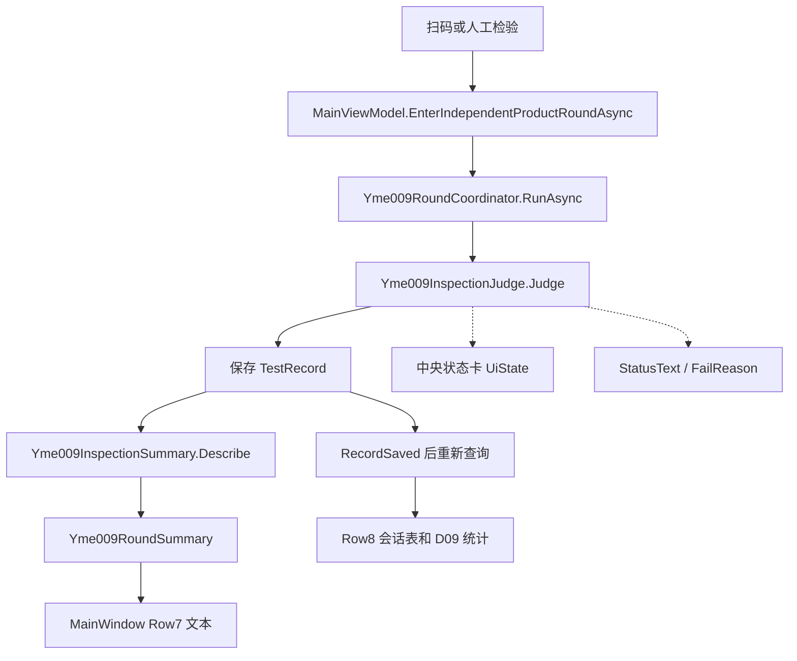
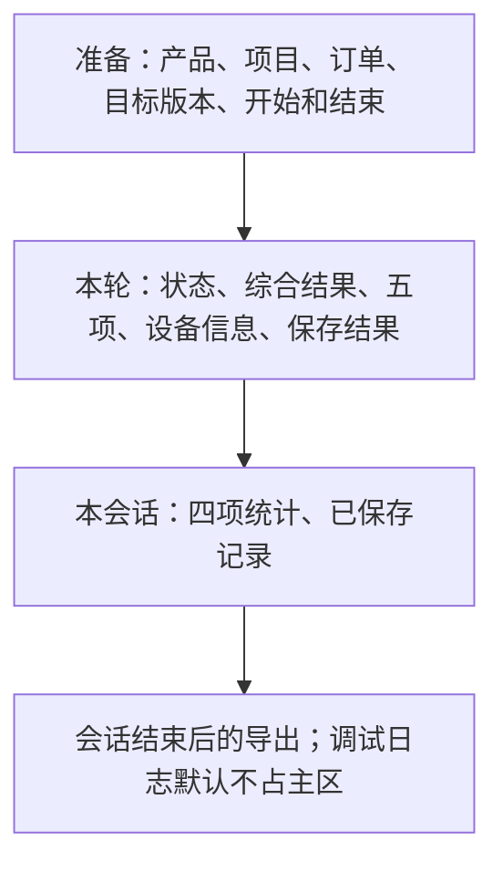

# YME009 Phase 5D 前置审查：工位 UI 与业务闭环

审查日期：2026-11-24。只读对照当前源码、PRD V0.8 与 Technical Design。未改代码、XAML、测试、数据库或既有文档。

结论先说：检测、判定、保存、本会话记录、D09 统计和独立导出已经接在业务链上。操作员主界面仍是旧产品布局。YME009 的本轮 PASS / FAIL 没有进入中央状态卡，五项结果只出现在一段摘要文本和会话历史表里。

## 1. 当前 UI 结构及源码位置

主窗口是 `SnVerify/MainWindow.xaml`。绑定对象是 `MainViewModel`。YME009 没有单独窗口。

| 区域 | XAML 位置 | 绑定 | 数据来源 | 性质 | 是否参与 YME009 交互 |
|---|---|---|---|---|---|
| 产品、项目、订单 | 顶部工具栏，约 104–236 行 | `AvailableProducts`、`SelectedProductCode`、`ProjectIdInput`、`OrderIdInput` | 产品注册与操作员输入 | 正式 | 是。开始测试前填写 |
| 检验类型 | 约 166–185 行 | `ShowLegacyVerificationTypeCombo`、`CurrentVerificationType` | 仅 Legacy 且未打开 Android 版本区时显示 | 旧产品 | YME009 不显示。`EnableAndroidVersionCheck=true`，该开关为假 |
| 开始 / 结束测试 | `StartBatchButton`、`EndBatchButton` | `StartBatchCommand`、`EndBatchCommand` | `StartBatchAsync`、`EndBatchAsync` | 正式 | 是。创建或结束 Session |
| 导出 | `ExportBatchButton`，约 224 行 | `ExportCommand` | `ExportAsync` → 聚合服务 → `Yme009SessionExporter` | 正式 | 会话进行中按钮禁用。结束后按项目或订单导出 ZIP |
| 当前订单 | 底部状态栏，约 246 行 | `CurrentOrderId` | `SessionSnapshot.OrderId` | 正式 | 是 |
| 处理中 | 状态栏，约 250 行 | `IsProcessing` | `_yme009RoundBusy` 或 `VerificationSnapshot.IsProcessing` | 正式状态的一部分 | 轮次进行时变为 True。只是布尔文本 |
| 最近结果 | 状态栏，约 254 行 | `StatusText` | 只读 `VerificationSnapshot`，见 `MainViewModel.StatusText` | 旧产品结果投影 | YME009 不写这个快照，通常一直是「等待检验」 |
| 状态消息 | 状态栏，约 258 行 | `StatusBarMessage` | 扫码开始写「正在接入设备」；结束时把整段 `OperatorText` 拼成一行 | 正式消息，表达方式像日志 | 是，但是一行长文本 |
| 调试日志 | `DebugLogExpander`，约 263–287 行，默认折叠 | `UiLogs` | `LoggingSnapshot.RecentMessages` | 开发调试 | 不驱动判定。展开后能看到接入和保存日志 |
| 中央状态卡 | 主网格 Row1，约 332–435 行 | `UiState` | `VerificationSnapshot` 的处理中、`LastResult` | 旧产品的正式 PASS / FAIL 灯 | YME009 不更新。检测结束后仍是灰色「等待扫码」 |
| 扫码框 | Row2，约 437–470 行 | `ScanInputText`、`IsScanInputVisible` | 操作员输入。YME009 因 Android 版本区打开而显示 | 正式 | 是。回车进入 `EnterIndependentProductRoundAsync` |
| 独立版本检验框 | Row2 另一块，约 472 行 | `IsVersionInputVisible` | Legacy 版本检验 | 旧产品 | YME009 隐藏 |
| 扫码 SN / 设备 SN 条 | Row3，约 510 行起 | `CurrentSn`、`DeviceSN`、`IsSnInfoVisible` | 旧检验流程的当前 SN 和设备 SN | 旧产品正式区 | YME009 会显示这块，但本轮读取结果不写这两个属性 |
| 版本信息匹配对比 | Row4，约 859 行 | `ShowVersionComparisonSection`、`ExpectedAndroidVersion`、`CurrentDeviceInfo.AndroidVersion` | 目标版本是 YME009 的正式会话参数。设备版本来自旧 `CurrentDeviceInfo` | 目标版本是正式输入；设备侧不是 YME009 结果 | 主板、充电板因开关为假而隐藏 |
| Row5 | 行定义存在，约 305 行 | 无控件 | 无 | 空行 | 否 |
| 失败原因条 | Row6，约 964–968 行 | `FailReason` | `VerificationSnapshot.FailReason` 或批次错误 | 旧产品 FAIL 文案 | YME009 通常为空，区域仍占高度 |
| 本轮摘要 | Row7，约 970–975 行 | `Yme009RoundSummary` | `Yme009RoundResult.OperatorText` | 正式本轮结果，以纯文本呈现 | 是。这是本轮五项和综合结果唯一的界面落点 |
| 本会话记录与统计 | Row8，约 977–1033 行 | `ShowYme009SessionRecords`、统计四个属性、`Yme009SessionRecords` | 保存成功后查询 `TestRecord` | 正式追溯和 D09 统计 | 只反映已保存记录，不是正在进行的本轮 |
| 人工检验 | 右侧，约 1039 行 | `StartVerifyCommand` | 与扫码相同，调用 `HandleScanInputAsync` | 正式备用入口 | 是 |
| 自检 | 右侧，约 1043 行 | `SelfCheckCommand` | 旧 ADB 自检，不走 YME009 轮次 | 旧产品辅助 | 会占用设备访问，不是包装检测 |
| 设备信息 | 右侧，约 1047 行 | 代码后置点击，无 ViewModel 命令 | 注释写明是临时调试接口 | 调试 | 不参与判定和保存 |

`ProductRegistry` 中 YME009 的 `EnableAndroidVersionCheck` 为 true。因此 `ShowAndroidVersionSection`、扫码框、SN 信息条和版本对比区一起打开。这些开关原本服务旧产品的 Android 合一检验，不是按 YME009 工位单独设计的。

## 2. 正式业务数据与测试 / 调试数据

| 数据 | 类别 | 产生位置 | 是否默认出现在工位页 | 是否改变正式判定 |
|---|---|---|---|---|
| 项目、订单、目标软件版本、扫码 SN | 正式输入 | 操作员 | 是 | 是，作为检测输入 |
| 接入停止原因 | 正式过程结果 | `Yme009RoundCoordinator.Describe` | 写入摘要和状态栏 | 不创建记录 |
| 八项原始值、读取状态、五项判定、综合结果、保存是否成功 | 正式本轮结果 | `Yme009InspectionJudge`，再由 `Yme009InspectionSummary.Describe` 串成文本 | 是，挤在 Row7 一段文字里 | 判定已完成，界面只负责显示 |
| 本会话表格和四项统计 | 正式已保存数据 | `GetTestRecordsBySessionAsync`，`Yme009SessionStatistics` | 是，Row8 | 不反向修改判定 |
| 导出工作簿 | 正式输出 | `Yme009SessionExporter` | 不在页面内展示，导出到 ZIP | 不修改判定 |
| `CurrentSn`、`DeviceSN`、`CurrentDeviceInfo` | 旧产品当前设备 | 旧检验快照 | YME009 页面上可见，但本轮不赋值 | 不参与 YME009 判定。容易被看成当前设备结果 |
| 中央状态卡、`StatusText`、Row6 `FailReason` | 旧产品结果投影 | `VerificationSnapshot` | 始终可见 | YME009 不写该快照，所以不代表本轮 PASS / FAIL |
| `UiLogs` | 开发调试 | 日志服务 | 默认折叠 | 否 |
| 自检、设备信息按钮 | 旧产品辅助 / 调试 | 各自命令或代码后置 | 右侧始终可见 | 自检会访问 ADB；设备信息按钮按注释不进入检验 |
| 自动化测试里的假记录和假 `OperatorText` | 自动化测试数据 | `SnVerify.Tests` | 不进入正式页面 | 否 |

没有发现为了演示而在正式界面写死的 PASS / FAIL 样本。操作员看到的「测试感」来自三类东西叠在同一页：旧产品的空设备区、本轮摘要里的技术状态原文，以及会话表里的原始值和读取状态。

PRD §8.2 要求技术状态和原始值保留给日志、数据库和追溯，不代替五项的 PASS / FAIL。当前摘要和会话表把两类信息放在操作员第一眼能看到的位置。

## 3. PASS / FAIL 实际数据链路及断点

链路如下。

`Yme009InspectionSummary.Describe`（`SnVerify/Services/Yme009/Yme009Inspection.cs`）已经包含扫码 SN、设备 SN、软件版本、IMEI、MAC、五项「判定=PASS/FAIL」和原因、`综合=PASS` 或 `综合=FAIL：文案`，以及是否保存。`EnterIndependentProductRoundAsync` 在轮次结束后把这段文字赋给 `Yme009RoundSummary`，并复制到 `StatusBarMessage`。保存成功才刷新会话表。

断点在投影，不在判定。

| 检查项 | 现状 |
|---|---|
| 综合 PASS / FAIL 的正式属性 | 没有单独的本轮结果属性。综合结果只在摘要字符串里 |
| SN、版本、产测、重启老化、恢复出厂判定 | 没有各自的本轮绑定属性。只在摘要字符串里 |
| 中央状态卡 | `UiState` 只看 `VerificationSnapshot`。YME009 成功或失败后不写 `LastResult`，卡片保持等待 |
| 检测过程 | `IsProcessing` 在状态栏变为 True。状态卡不进入「正在检验」。没有单独的等待设备、读取属性、保存中状态 |
| 结束后的真实结果 | 摘要和状态栏更新。状态卡、Row3 的设备 SN、Row4 的设备版本、Row6 失败原因不更新 |
| 会话历史 | Row8 是保存后的历史。不能把它当作本轮结果。保存失败时历史不增加，这是符合 5A 的 |
| 测试用 PASS / FAIL | 测试工程构造轮次结果。正式界面没有内置假结果 |

因此，业务判定是完整的，工位主结果灯是断开的。操作员若只看中央大卡片，会认为没有完成检测。

## 4. Phase 5D 功能缺口矩阵

分类含义：需要开发；已经实现、只需人工或真机验收；已经实现，但不符合正式工位表达；文档未定，待确认。

| 功能 | 文档要求 | 当前实现 | 分类 | 验收方式 |
|---|---|---|---|---|
| 本轮基础信息 | PRD §8.1：扫码 SN、设备 SN、版本、IMEI、MAC | 摘要文本有。Row3 / Row4 的旧绑定没有本轮值 | 已实现，表达不符合工位 | 人工看一轮真实或模拟结果 |
| 五项 PASS / FAIL 及原因 | PRD §8.2 第 2、3 条 | 摘要文本有。没有五项独立区域 | 已实现，表达不符合工位 | 人工核对五项与保存记录 |
| 综合结果醒目显示 | PRD §8.2 第 1 条 | 摘要有「综合=」。中央状态卡不变化 | 需要开发。补本轮到状态卡的投影，不改判定 | 人工看 PASS、业务 FAIL、读取异常三轮 |
| 技术状态不代替判定 | PRD §8.2 第 6 条 | 摘要和会话表同时突出原始值和状态 | 表达不符合工位。数据应保留，位置应后移 | 人工确认操作员第一屏只看 PASS / FAIL |
| 过程状态 | PRD 流程要求提示等待和接入失败。Technical Design 写明现有 Snapshot 没有等待态 | 只有「处理中: True」和「正在接入设备」 | 需要开发最小过程提示。具体等待文案仍宜先确认 | 真机覆盖等待、多台 CDC、AT、Ready |
| 接入失败反馈 | 不保存，并提示操作员 | 摘要和状态栏有停止原因。无独立失败灯 | 已有文字，表达不符合工位 | 真机或既有接入测试对照界面 |
| 保存成功 / 失败 | 未保存不得显示为已保存 | 摘要写「记录已保存 Id=」或「记录未保存」。只有成功才刷新历史 | 功能已实现。成功和失败都不够醒目 | 已有自动化覆盖保存失败不刷新；界面再人工看一次 |
| 本会话历史 | Phase 5A | Row8 查询并展示全部已保存行 | 功能已实现。列过多，和本轮结果贴在一起 | 人工看同一 SN 多行、空会话 |
| D09 统计 | PRD §8.2 第 7 条、Phase 5B | 标题下四项统计 | 功能已实现 | 人工核对与导出汇总一致 |
| 导出 | Phase 5C，沿用项目 / 订单 ZIP | 结束后导出按钮可用 | 功能已实现。页面没有导出结果区 | 人工导出一份 ZIP，打开明细和汇总 |
| 从扫码到下一轮 | Technical Design §6.5.6 | 代码能进入下一轮。主结果灯不复位表达，因为本来就没亮 | 业务链可人工走通；工位表达仍缺 | 真机 L4。等价环境不能代替最终 L4 |
| 检测中再次扫码的提示 | PRD 仍写待确认 | 处理中会忽略新扫码 | 待确认 | 不在本阶段自行定文案 |
| 自检、设备信息是否留在工位 | 文档未要求放在 YME009 主路径 | 右侧一直显示 | 待确认。建议从正式操作区隔离 | 产品负责人确认 |

纯列宽、颜色和字体调整不算功能缺失。中央结果灯不接收本轮结果，属于操作员无法完成「根据 PASS / FAIL 处理设备」的功能缺口。

## 5. 正式工位 UI 重组建议

建议仍使用当前主窗口，按操作顺序分成四块，不把调试信息和本轮结果堆在同一视觉中心。

| 区域 | 展示 | 数据来源 |
|---|---|---|
| 准备 | 产品、项目、订单、目标软件版本、开始、结束、当前订单 | 现有输入和 `SessionSnapshot` |
| 本轮状态 | 等待扫码、正在接入、正在读取、已完成、接入失败 | 轮次阶段。现在只有忙标志和一句状态栏文字，需要补投影 |
| 本轮综合结果 | 大号 PASS 或 FAIL，以及一个主失败文案 | `Yme009InspectionDecision.Result` 和 `FailReason` |
| 五项 | 每项只显示 PASS / FAIL 和失败原因 | 判定对象的五项结论和原因 |
| 本轮设备信息 | 扫码 SN、设备 SN、实际版本、IMEI、MAC | 本轮解析结果。信息项不显示成第六个判定项 |
| 保存结果 | 已保存或未保存。未保存时不把它写成 PASS | `Yme009RoundResult.RecordSaved`、`RecordId` |
| 本会话 | 四项统计和已保存记录 | 现有查询和 `Yme009SessionStatistics` |
| 导出 | 结束会话后的导出，以及成功或失败消息 | 现有 `ExportAsync` |
| 调试 | 日志、自检、设备信息 | 保持可用，但不占据本轮结果区 |

正常 PASS：综合灯为 PASS，五项为 PASS，信息项有值或标出未取得，保存为已保存，统计的 PASS 数增加。

业务 FAIL：综合灯为 FAIL，主文案是 SN、版本或值为 0 的业务原因。失败项显示对应原因，通过项显示 PASS。统计增加业务 FAIL，不增加读取异常。

读取异常：综合灯仍是 FAIL，主文案是读取失败、数据无法识别或必要判定数据缺失。分项保留各自原因。统计增加读取异常，不增加业务 FAIL。

接入失败：综合灯不显示 PASS，也不显示业务 FAIL。提示接入停止原因，保存状态为未保存，会话表不变。

与当前页面的差异：

- 中央状态卡改为本轮 YME009 结果，不再留在旧 `VerificationSnapshot`。
- 五项从摘要长文本拆成独立结果。摘要可以保留给日志，不再作为唯一界面。
- Row3、Row4 里不被 YME009 赋值的设备字段，在 YME009 下不冒充本轮设备信息。目标版本输入保留。
- Row8 继续做历史和统计，视觉上与本轮分开。
- 调试日志维持折叠。自检和设备信息移出主操作视线，待确认后再定是否对操作员隐藏。

## 6. 推荐的后续实施顺序

1. 只增加本轮投影：综合结果、主原因、五项、设备信息和保存状态进入正式区域，并驱动现有状态卡。不改判定、保存和查询。
2. YME009 下隐藏或停用没有本轮数据的旧设备区，避免空的「设备 SN / 设备 Android 版本」被当成结果。
3. 把本轮区域和 Row8 历史、统计分成上下两段。历史查询逻辑不动。
4. 补最小过程提示：接入中、读取中、完成、接入失败。等待设备的详细文案若未确认，先使用已经存在的接入停止原因。
5. 人工走通 PASS、业务 FAIL、读取异常、保存失败和导出 ZIP。
6. 最后做真实设备 L4。L4 不能由这次 UI 审查或自动化测试代替。

## 7. 需要产品负责人确认的问题

1. 自检和「设备信息」按钮在 YME009 正式工位上是保留、收进调试区，还是隐藏？
2. 本会话宽表是留在主窗口下半部，还是放到单独页面？功能已经具备，这是布局决定。
3. 本轮第一屏是否只显示五项 PASS / FAIL、综合结果和基础信息，原始值和读取状态只留在历史、日志和导出？
4. 30 秒等待、多台设备和 AT 不确定，是否沿用现在摘要里的短句，还是要单独的等待画面？PRD 还留有检测中再次扫码的提示未定。
5. UI 重组完成后，是否把真实设备上的完整一轮作为 Phase 5D 的验收，而不把自动化测试通过写成 L4 通过？
