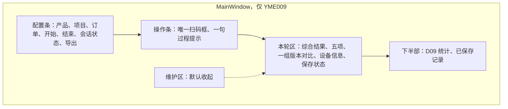
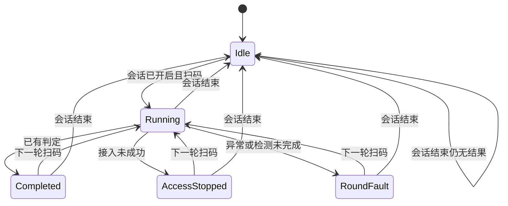

# YME009 正式工位 UI 设计基线

设计日期：2026-11-24。本文是 Phase 5D 的实施基线，合并此前的工位方案、UI 一致性约束和版本 / 设备信息修订。对照源码为当前 `MainWindow`、`MainViewModel` 和 YME009 轮次类型。不改判定、保存、统计、导出规则，也不把 YME009 改回 `ProcessCoordinator`。

本文只记录已确认决策、实现要求和验收条件。前置审查的过程不在这里重复。

## 1. 已确认边界

YME009 继续使用 `VerificationMode.Independent`，扫码入口仍是 `EnterIndependentProductRoundAsync`。

不可改变：

1. 不重写检测链，不改变 CDC / ADB 单设备工位规则。
2. 不改变八项属性的读取键和解析。
3. 不改变 D17 / D18 的判定、优先级和失败代码。
4. 不改变 `TestRecord` 的保存顺序：接入失败不插入；正式检测后先判定再保存；保存失败不得看起来像已保存。
5. 不改变 Phase 5A 的会话查询、Phase 5B 的 D09 口径、Phase 5C 的导出去重和 ZIP。
6. 不写 `VerificationSnapshot`。旧状态卡继续服务其他产品。
7. 不从 `OperatorText` 或 `Yme009RoundSummary` 解析字段，也不从会话历史反推本轮结果。
8. 不新增业务判定状态。界面上的「等待」只表示还没有判定。
9. `Decision == null` 时不显示 PASS 或 FAIL。
10. 保存失败不改变业务判定。`RecordId` 留在模型里，操作员默认不看。
11. 不影响 KM001、KM008、SOLTAG25 的界面和操作。

## 2. 已确认的界面决策

### 2.1 整体

YME009 是 SnVerify 里的产品工位，不是独立应用。保留标题为「Smartke SN校验程序」的 `MainWindow`，不新开窗口。

颜色、字号和状态语义复用 `MainWindow.xaml` 的 `Window.Resources`：通过 `#00CC00`，失败 `#FF0000`，处理中 `#0080FF`，等待 `#808080`，失败原因字 `#8B0000`，失败底衬 `#FFECEB`。主结果沿用 `ResultTextStyle`（白色加粗，不小于 48）和 `ResultCardStyle`。五项使用同一套小色块。`App.xaml` 没有主题，工程里没有第二套皮肤。按钮没有全局模板；顶部按钮保持高 28。历史表继续用现有只读 `DataGrid`，不新增行样式。

可以重排 YME009 的区域。不另建样式体系。工位控件若放在独立 XAML 中，实施时把上述样式键原样抽到共享资源，主窗口改为引用同一份，色值不变。

命令继续用 `StartBatchCommand`、`EndBatchCommand`、`ExportCommand`、`HandleScanInputAsync`。

### 2.2 页面

仍是四个区域，基准尺寸 1300×900。本轮结果区占据剩余高度并设最小高度。会话表放在主窗口下半部，限高并双向滚动。窗口变矮时先滚动历史，不把综合结果挤出可见区域。不增加独立历史页，不为检测结果增加弹窗或动画。

| 区域 | 展示 | 不放 |
|---|---|---|
| 配置条 | 现有顶部一排：项目类型、项目名、订单号、开始测试、结束测试、导出 | 第二组版本，检验类型下拉框 |
| 操作条 | `ScanInputTextBox`，以及下面第 5 节的一句提示 | 命令原文、Transport ID、日志 |
| 本轮区 | 综合结果、主原因、五项、版本对比、扫码 SN、设备 SN、IMEI、Wi-Fi MAC、保存状态 | 上一轮结论、历史选中行、主板版本、充电板版本 |
| 会话区 | 四个统计数和现有会话表 | 用历史行点亮本轮大灯，第二个导出按钮 |
| 维护区 | 调试日志、自检、设备信息调试。默认收起，任何操作员都能展开 | 不和包装检测按钮排在一起。其他产品保持现状 |

配置条的锁定规则不变：会话进行中不能改产品、项目、订单。结束测试的可执行条件不变。无记录时结束测试仍被忽略，状态栏仍是「本次操作无效/已忽略」。

### 2.3 版本

只有一组版本。

| 展示名 | 数据 | 不用 |
|---|---|---|
| 实际软件版本 | `decision.Attributes.SoftwareVersion.Text`，属性键 `ro.build.display.id` | `CurrentDeviceInfo.AndroidVersion`，标签「Android版本号」或「设备Android版本」 |
| 目标软件版本 | 本轮使用的 `ExpectedAndroidVersion`，即写入 `Yme009InspectionRequest` 的那个字符串 | 第二套软件版本字段 |

布局沿用 `MainWindow.xaml` Row4「版本信息匹配对比」的左右对照：左边目标，中间 `#DDDDDD` 分隔线，右边实际值。那一块现有控件还绑定主板、充电板和 `CurrentDeviceInfo`，YME009 工位不复用那些绑定。`EnableBoardVersionCheck` 与 `EnableChargeBoardVersionCheck` 为 false，工位里不出现这两行。

目标值用现有输入框，会话进行中 `IsVersionInputEnabled` 为假。两个值都完整换行，不用 `TextTrimming`。实际值尚未读到或 `Text` 为空时显示「未读取」。开始测试前的订单版本一致性检查保持原逻辑。

软件版本的 PASS / FAIL 只来自 `decision.SoftwareVersion` 和 `SoftwareVersionReason`。界面不比较两段文字。

### 2.4 设备信息

普通文本，不是检测项，不着色成 PASS / FAIL。

| 界面名称 | 属性键 | 字段 |
|---|---|---|
| IMEI1 | `sys.skyroam.imei1` | `Attributes.Imei1` |
| IMEI2 | `sys.skyroam.imei2` | `Attributes.Imei2` |
| Wi-Fi MAC | `persist.sys.wifi.mac` | `Attributes.WifiMac` |

三项角色都是 `Information`。目录显示名是「WiFi MAC」，界面标签用「Wi-Fi MAC」，不另取属性。`EnableWifiMacCheck` 为 false，不使用 `WifiMacLabel` 或 `CurrentDeviceInfo`。

`Text` 非空时原样显示，不脱敏、不截断。`Text` 为空或本轮尚未读到时显示「未读取」。命令失败、超时、断开时解析结果的 `Text` 就是空，因此也显示「未读取」。读取状态留在日志、数据库和历史表。

扫码 SN 来自本轮传入 `RunAsync` 的参数。设备 SN 来自 `decision.Attributes.DeviceSn`。设备 SN 还没有值时显示「未读取」，与上面三项相同，不留白。

### 2.5 本轮结果

正式区独立展示：综合 PASS / FAIL、一个主失败原因、五项 PASS / FAIL 及失败项原因、扫码 SN、设备 SN、实际软件版本、目标软件版本、IMEI1、IMEI2、Wi-Fi MAC、保存状态。

五项名称和顺序：SN 一致性、软件版本一致性、生产测试、重启老化、恢复出厂设置老化。未判定时显示「等待」。判定后只有 PASS / FAIL。失败原因使用决策对象上已有的分项文案，不新写一套。软件版本的完整原文只出现在版本对比区，五项里该项不再重复一块版本原文。其余项可以把读取值作为次要文字，但不能代替 PASS / FAIL。

综合结果只在已有判定且 `Result` 为 `PASS` 或 `FAIL` 时显示大字。主原因使用 `decision.FailReason` 和现有 `FailReasonTextResolver.Resolve`。PASS 时不显示失败原因。

保存状态与判定分开：

| 值 | 条件 | 操作员文案 |
|---|---|---|
| `None` | 没有 `decision` | 未保存记录 |
| `Saved` | `RecordSaved` 且 `RecordId > 0` | 已保存 |
| `NotSaved` | 已有 `decision` 但未保存 | 保存失败 |

检测 PASS 且未保存：仍显示 PASS，并显示「保存失败」。检测 FAIL 且已保存：仍显示 FAIL，并显示「已保存」。

`Close.Disposition == Failed` 时追加「收尾异常，本次检测结果不变」。不展示 `Close.Detail`，不改变五项和综合结果。其他关闭处置不占主结果。

### 2.6 本轮与历史

新一轮开始立即清掉上一轮的综合结果、五项、实际版本、设备 SN 和三项设备信息，目标软件版本保留。会话历史和四个统计数不清。只有 `RecordSaved == true` 才走现有的整表刷新。保存失败不插入行。

会话结束时本轮区回到未开始，历史按现有 `ClearYme009SessionRecords` 清理。会话名变化时，过期查询仍按现有 query id 丢弃。

历史表绑定 `Yme009SessionRecords`。首屏优先时间、扫码 SN、设备 SN、综合结果、失败原因，其余列靠横向滚动，不删列。单击历史行不改变本轮大灯。

### 2.7 维护区

YME009 默认收起。里面是现有调试日志 `UiLogs`、`SelfCheckCommand`、设备信息调试点击。不删除这些功能。任何操作员都可以展开，不加权限、密码或快捷键。展开后的自检和调试不得排进正常包装检测的主按钮区。KM001、KM008、SOLTAG25 仍使用现在的调试折叠区和右侧按钮。

### 2.8 导出

导出按钮留在顶部，仍绑定 `ExportCommand`，仍只在会话未进行时可执行。不增加第二个入口。选择维度、跳过 YME009 的记录类型对话框、选择文件夹和覆盖确认，都保持现有对话框。成功或失败不再只写日志：用状态栏 `StatusBarMessage` 给出一句结果，不为此新增弹窗。不改 Phase 5C 的文件内容、去重和 ZIP。

## 3. 投影模型

`Yme009RoundResult` 今天只有 `Access`、`Close`、`CleanedUp`、`OperatorText`、`RecordSaved`、`RecordId`。`Yme009InspectionDecision` 还在协调器私有结果里。

实施时做两件投影，不重算判定：

1. 轮次结果带出已经算好的 `Decision`。没有正式判定时为 null。保存失败时仍然带出该对象。
2. `MainViewModel` 持有 `Yme009WorkstationRound`，供工位绑定。只抄录字段和选择第 5 节的短句。

`Yme009RoundSummary` 可以继续写入日志对照。工位不绑定它。

轮次状态只表示最近一轮的结果，不表示现在能不能扫码。没有 `WaitingForScan`。

| 轮次状态 | 含义 |
|---|---|
| `Idle` | 还没有一轮结果。会话刚启动，或会话已经结束并清空 |
| `Running` | 本轮尚未返回。内部再用轻量进度区分接入和读取 |
| `Completed` | 已有正式判定。轮次结束后保持，直到下一轮开始或会话结束 |
| `AccessStopped` | 接入失败且没有判定。轮次结束后保持 |
| `RoundFault` | 异常导致检测未完成且没有判定。轮次结束后保持 |

扫码是否可用单独判断，不从轮次状态推导：

- 会话已经开启。
- 当前没有正在执行的轮次，也就是不是 `Running`。
- 自检沿用现有规则，自检期间仍然不能扫码。这不新增轮次状态。

| 情况 | 轮次状态 | 允许扫码 |
|---|---|---|
| 会话刚启动 | `Idle` | 是 |
| 正在检测 | `Running` | 否 |
| 检测 PASS 或 FAIL | `Completed` | 是 |
| 接入失败 | `AccessStopped` | 是 |
| 检测异常 | `RoundFault` | 是 |
| 下一轮刚开始 | `Running` | 否 |
| 会话结束 | `Idle` | 否 |

`Completed`、`AccessStopped`、`RoundFault` 在轮次返回后保持不变。下一轮扫码才进入新的 `Running`，并在进入时清除上一轮结果。会话结束才回到 `Idle` 并清空本轮展示。历史和统计不随本轮结果清除。

当前 `RunAsync` 一次返回，中间没有进度回调。要让操作员看见「正在接入设备」和「正在读取检测数据」的切换，在现有 `AccessAsync` 与属性读取之间增加只报告阶段名的通知。通知不携带判定，不改变接入、读取、判定和保存的顺序。不增加 30 秒倒计时。

| 事件 | 本轮区 | 历史和统计 |
|---|---|---|
| 会话启动成功 | 保持 `Idle`。过程提示「等待扫码」。五项为「等待」。实际版本和设备信息为「未读取」。目标版本显示已填写全文。此时允许扫码 | 按现有逻辑加载。不清除一次成功的加载 |
| 扫描新 SN | 立刻进入 `Running`，清上一轮结论。提示「正在接入设备」 | 保留 |
| 仍在等待设备 | 提示改为「正在等待设备接入」。五项仍为「等待」 | 保留，不插入 |
| 接入完成、开始读取 | 提示「正在读取检测数据」。仍不显示 PASS / FAIL | 保留 |
| 判定并且保存过程已结束 | 进入 `Completed` 并保持。一次写入综合结果、五项、设备信息和保存状态。不改回等待状态 | 仅保存成功时刷新 |
| 保存失败 | 仍是 `Completed`。判定保持原值，文案「保存失败」 | 不刷新 |
| 接入失败 | 进入 `AccessStopped` 并保持。无综合 PASS / FAIL。提示见第 5 节。保存状态为「未保存记录」 | 不刷新 |
| 检测异常且无判定 | 进入 `RoundFault` 并保持。五项为「等待」。提示「检测未完成，记录未保存」 | 不刷新 |
| 轮次已经结束 | 停在 `Completed`、`AccessStopped` 或 `RoundFault`。结果保留。因为不是 `Running`，允许扫下一台。焦点回到扫码框 | 不变 |
| 会话结束 | 回到 `Idle`，本轮区清空。不允许扫码 | 现有清空 |

## 4. 扫码

只有 `MainWindow.xaml` 中的 `ScanInputTextBox`，绑定 `ScanInputText`。回车由 `ScanInputTextBox_KeyDown` 调用 `HandleScanInputAsync`。文本中的 `\r` 或 `\n` 仍由 setter 提取首段并调用同一方法。获得焦点时仍关闭该框输入法。不建第二个扫码框，不建第二条检测链。人工检验若保留在维护区，仍调用现有 `StartVerifyCommand`。

已经存在的焦点行为必须继续有效：会话从未开始变为开始时，`FocusScanInputAndClear` 聚焦并清空；`IsProcessing` 从真变假时，`FocusScanInput` 把焦点送回该框。YME009 忙碌已经计入 `IsProcessing`。轮次结束后允许扫码，但轮次状态保持为刚结束的那一个，不因为焦点回来就变成等待状态。

现有 `IsScanInputEnabled` 在 `IsProcessing` 或自检时为假，扫码框的 `IsEnabled` 绑的就是它。WPF 里 `IsEnabled` 为假的文本框收不到键盘。因此 YME009 检测过程中不能靠禁用这个框来拦截扫码，否则扫码枪的回车到不了 `ScanInputTextBox_KeyDown`，也到不了下面的忙碌拦截。其他产品仍使用现在的禁用方式。

YME009 检测过程中的扫码框：

- `IsEnabled` 保持为真，以便收到扫码枪输入。
- 可以用 `#E0E0E0` 表示忙碌。灰色只是外观，不是 `IsEnabled="False"`。
- 自检期间仍按现有 `IsScanInputEnabled` 禁用，本条不改变自检。

检测中再次扫码要在任何新轮次开始之前拦住。源码上有两条入口，拦截必须两条都做，并且放在会改写本轮扫码 SN 或调用 `EnterIndependentProductRoundAsync` 之前：

1. `ScanInputTextBox_KeyDown` 在回车时读取框内文本，再调用 `HandleScanInputAsync`。
2. `ScanInputText` 的 setter 在文本含有 `\r` 或 `\n` 时，先把 `_scanInputText` 改成这段 SN，再调用 `HandleScanInputAsync`。今天的忙碌判断在 `HandleScanInputAsync` 内部，setter 已经先改过框内文本。

忙碌时的行为：

- 不调用检测入口，不启动第二轮。
- 不排队、不缓存第二个 SN。
- 不把这次文本写入本轮投影。本轮界面上的扫码 SN 来自本轮开始时传入的参数，不绑定扫码框的当前文本。
- 不清空已经显示的本轮结果。
- 不弹窗。
- 状态栏显示「当前设备正在检测，请等待本轮检测完成。」
- 丢掉框里这次未接受的输入，避免它留到本轮结束后被当成下一台的 SN。

`HandleScanInputAsync` 里现有的 `IsProcessing` 返回仍然留在进入独立产品轮次之前。YME009 在这条返回上补上状态栏那一句。setter 不能依赖这次返回才拦截，因为赋值已经发生。

会话未开始就回车，仍用现有 `SetBatchError("请确认当前检验已经开始")`。

## 5. 过程提示与异常短句

操作员只看业务短句。CDC、AT、ADB、Transport ID 和命令输出继续进技术日志。

| 时机 | 操作员看到 |
|---|---|
| 会话已开始，还没有任何一轮结果 | 等待扫码。这只是提示，不是轮次状态。已有 `Completed`、`AccessStopped` 或 `RoundFault` 时，提示保持该轮结果或失败短句，不改回这句话 |
| 扫码之后、读取之前 | 正在接入设备 |
| 接入阶段仍在等设备 | 正在等待设备接入 |
| 接入完成并开始读属性 | 正在读取检测数据 |
| 已有判定 | 综合 PASS 或 FAIL，另加主原因和五项 |
| 接入没有形成判定 | 下表中的失败短句 |

接入停止与短句的对应。源码枚举是 `Yme009AccessStop`，界面不显示枚举名。

| 停止 | 操作员短句 |
|---|---|
| `WaitTimedOut`、`AtNotSent`、`AtUncertain`、`AssociationFailed`、`StoppedBeforeAt`、`StoppedAfterAt`、`Unexpected` | 设备接入失败，请检查设备连接 |
| `ReadyFailed` | 设备连接未就绪，请检查设备 |

正式检测里的读取类失败仍保存为 FAIL，综合灯是 FAIL，主原因和分项原因仍用 D17 / D18 的现有文案。过程提示使用「检测数据读取异常」，不把属性键显示出来。业务 FAIL 不使用这句，避免把版本不符或值为 0 说成读取异常。

现有 `Describe` 里的「AT 未发送」「ADB 未就绪」等句子不再作为工位主提示。它们可以留在日志。

## 6. 实施架构

保留 `MainWindow`。YME009 用一块工位内容替换中间结果区；产品不是 YME009 时这块折叠，原有 Row1 至 Row7 保持原样。扫码框仍是原来的具名控件，只调整它所在的视觉位置。

`MainViewModel` 继续拥有会话、扫码、统计、导出和独立产品入口。禁止为了点亮旧灯去写 `VerificationSnapshot`，禁止在界面或 ViewModel 中调用 `Yme009InspectionJudge.Judge`，禁止改统计、导出和查询实现。

## 7. Phase 5D 实施

一次授权完成下面全部关联工作。内部可以按依赖先后做，每做完一块保持可编译、可跑相关测试，最后做全量回归。不把这些小块再拆成需要分别授权的阶段。

1. 结构化本轮投影：结果对象带出已有 `Decision`，ViewModel 建立 `Yme009WorkstationRound`。
2. 正式工位展示综合结果、主原因、五项、版本对比、设备信息和保存状态。
3. 轻量进度：接入、等待设备、读取、完成、接入失败。文案用第 5 节，不改变业务流程。
4. YME009 布局：配置条、操作条、本轮区、下半部历史。隐藏会误导的旧设备区和旧版本绑定。
5. 维护区默认收起，内容仍可用，不与包装检测混排。其他产品布局不动。
6. 会话历史和 D09 统计留在下半部，绑定现有属性。历史行不驱动本轮结果。
7. 导出按钮留在顶部。成功和失败写入状态栏。导出文件逻辑不动。
8. 扫码焦点沿用现有框。检测中再次扫码按第 4 节提示。新一轮只清本轮结果。
9. 用 KM001、KM008、SOLTAG25 核对主窗口、扫码和状态灯与改动前一致。

必须停下并报告、不得自行扩大的情况：

- 要改已确认的业务规则。
- 要改数据库结构或历史数据。
- 要改判定、保存、统计或导出逻辑。
- 要改其他产品的现有流程。
- 源码与本基线发生重大冲突，无法只做投影和布局。

## 8. Phase 5D 验收

验收与编码分开。自动化测试通过不能代替真实设备 L4。

- 人工看 PASS、业务 FAIL、读取异常、接入失败、保存失败。保存失败时历史不增加，综合结果保持判定值。
- 同一会话连续多轮：新一轮清本轮结论，历史仍在；检测中再扫码只出现第 4 节那句提示。
- 核对四个统计数与已保存记录。
- 会话结束后导出 ZIP，核对明细和汇总，并看到状态栏结果。
- KM001、KM008、SOLTAG25 回归。
- 真实设备完整一轮：等待扫码、接入、读取、结果、保存和下一轮。

## 9. 待决事项

没有。第 2 节至第 5 节的取舍都已确认，包括维护区对所有操作员开放、不显示倒计时、检测中扫码的固定短句、导出走状态栏反馈，以及版本和设备信息的展示规则。
