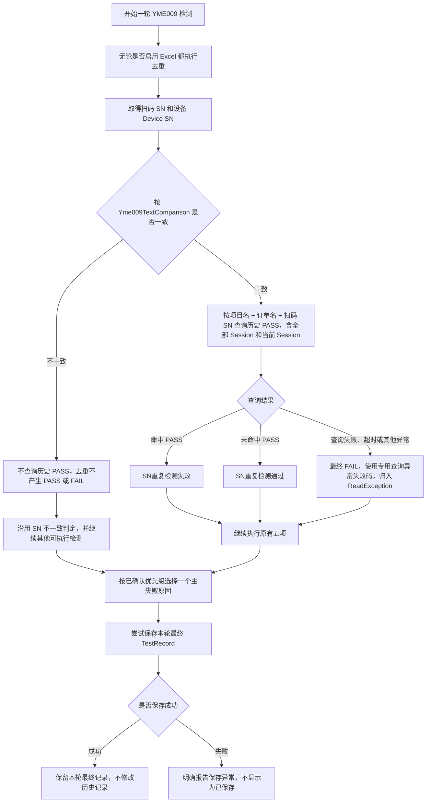
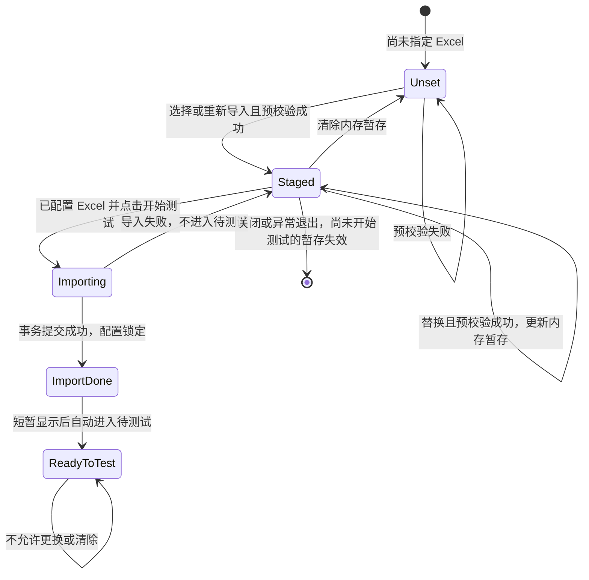
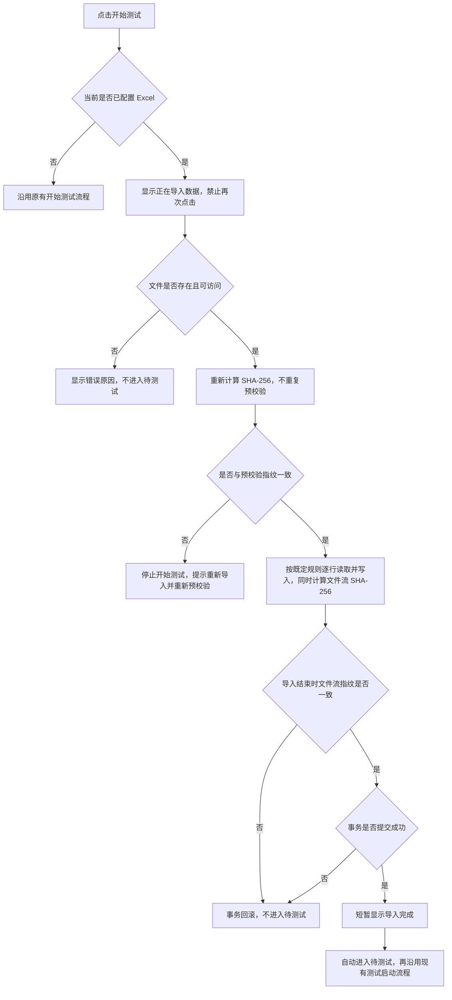
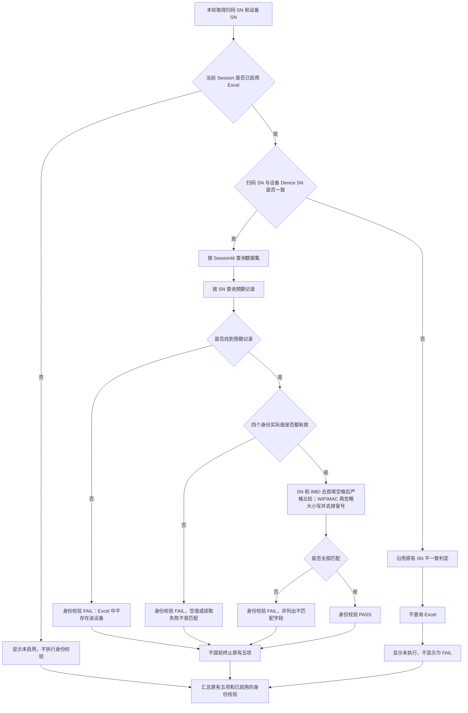

# YME009 SN PASS 去重与项目预期数据校验 PRD

**文档版本：** V1.1  
**文档状态：** 草稿，待用户审核  
**复杂度：** L2  
**项目名称：** YME009 包装上位机  
**宿主工程：** SnVerify  
**文档性质：** 两项新增需求的产品需求定义  
**当前阶段：** 固化需求，不进入编码  
**审核结论不等于开发授权**

---

## 0. 文档说明

### 0.1 编写目的

本文档只定义两项相互独立的新增需求：

1. YME009 SN PASS 去重。
2. YME009 项目预期数据 Excel 校验。

本文是新需求文档，不是 `docs/YME009-Packaging-Station-PRD.md` V0.8 的修订版。按本次任务限制，没有修改该包装 PRD、技术设计或其他既有文档。

### 0.2 状态约定

| 标记 | 含义 |
|---|---|
| 已确认 | 用户在本次需求说明中明确承诺的功能、规则或约束 |
| 源码核实结果 | 2026-11-24 对当前工作区源码的核对结果。它说明现有程序怎么做，不表示 YME009 已经决定采用该做法 |
| 待确认 | 材料没有作出选择，或现有规则相互冲突后不能代为选择 |
| 推导 | 根据措辞作出、尚未由用户确认的理解。不能当作验收规则 |

Type、Status、Source 分开记录。源码核实不是 Confirmed 决策。

### 0.3 核心未决事项

以下事项阻塞对应需求形成唯一可实施规则。正文不替它们选择答案。

| ID | 阻塞范围 | 问题 |
|---|---|---|
| OQ-015 | 空数据文件 | 只有表头、没有设备记录的 Excel 如何处理，尚未确认。本文也不把其他空数据处理写成现行规则 |
| OQ-016 | 需求 A 与需求 B 的衔接 | 需求 A 命中历史 PASS 后，是否仍继续执行需求 B，尚未确认。先执行 A 再执行 B 只是未确认建议 |

OQ-018、OQ-019 仍开放，但不阻塞开始测试前的文件暂存，也不阻塞开始测试时的写入。见第 8.1 节。

### 0.4 本次不做

- 不修改业务代码、测试、数据库和既有文档。
- 不实现去重或 Excel 导入。
- 不改原有五项检测规则，不把 IMEI、MAC 改成各自独立的判定项。
- 不冻结预期数据的表名、字段、索引和事务实现。未关联数据集的清理不再作为开放问题，见 DEC-B05。
- 不要求保存原始 Excel，不要求导入历史、版本管理或复杂追溯。

---

## 1. 背景与目标

YME009 当前一轮检测只比较本轮读取结果。`Yme009InspectionJudge.Judge` 不查询历史记录。包装 PRD V0.8 的 D08 也确认当时不继承既有产品的 PASS 查重。

本次新增两个目标：

1. YME009 具备 SN PASS 去重能力。查重范围与 KM001/KM008 相同：必须同时是相同项目名和相同订单名，覆盖该范围内全部 Session，包含当前 Session。不是只按项目名查重，也不是只查当前 Session。
2. 一个生产 Session 可以可选导入当前项目的预期数据 Excel，用一条独立测试项核对设备身份数据。

两项分别设计、分别实施、分别验收。去重不依赖 Excel，也不是 Excel 校验的前置配置。

---

## 2. 范围与边界

### 2.1 包含

- 需求 A：无论当前 Session 是否导入 Excel，都执行 SN PASS 去重。
- 需求 B：Session 级可选 Excel、导入预校验、按 Session 保存预期数据、检测时按 Session 与 SN 比对，以及独立测试项「项目预期数据校验」。

### 2.2 不包含

- 把 SN PASS 去重实现成 Excel 校验的子功能。
- 用未导入 Excel 作为跳过去重的条件。
- 改变 Excel 校验来完成去重，或改变去重来完成 Excel 校验。
- 改变原有五项的通过条件、读取方式和分项原因。
- 为 MAC、IMEI1、IMEI2 分别新增测试项。
- 修改 KM001、KM008、SOLTAG25 的现有行为。
- 原始 Excel 长期保存、导入历史和版本管理。

### 2.3 两项需求的边界

| 对比项 | SN PASS 去重 | Excel 预期数据校验 |
|---|---|---|
| 是否依赖 Excel | 否 | 是 |
| 是否依赖 Session | 不是只查当前 Session。必须同时满足相同项目名和相同订单名，再查该范围内全部 Session，并包含当前 Session 的历史 PASS | 是。预期数据按当前 Session 关联和查询 |
| 数据来源 | 历史检测记录中的 PASS | 开始测试时写入并关联到当前 Session 的预期数据 |
| 目标 | 防止重复 PASS | 校验设备身份数据 |
| 无 Excel 时 | 仍然执行 | 不执行，不因此增加 FAIL |

---

## 3. 角色与场景

**包装操作员**沿用包装 PRD 第 3.1 节的角色：创建订单批次、扫描 SN、查看结果。

新增场景：

1. 操作员开始一轮 YME009 检测。无论是否导入 Excel，都执行 SN PASS 去重。扫码 SN 与设备 Device SN 一致，且在相同项目名、相同订单名下命中历史 PASS 时，内部判定「SN重复检测」失败，失败信息为「设备SN已经检验」。本轮仍完成原有五项，综合判定后再保存一条 FAIL 记录。
2. 操作员在开始测试前选择一份预期数据 Excel。预校验只在选择或重新导入时执行。预校验失败则不能使用。预校验成功后，该文件即成为当前待用配置，不需要单独的确认使用。已配置 Excel 时，点击开始测试后现有页面依次显示「正在导入数据」「导入完成」「待测试」。事务提交成功后才进入后续测试。本 Session 检测增加「项目预期数据校验」。
3. 操作员不选择 Excel。检测不增加该身份校验，原有五项仍按既有规则判定。

---

## 4. 需求 A：YME009 SN PASS 去重

### 4.1 已确认内容

| ID | Type | Description | Status | Source | Expression | Evidence |
|---|---|---|---|---|---|---|
| REQ-A01 | Requirement | YME009 具备 SN PASS 去重能力 | Confirmed | User Explicit | Commitment | 本次说明：「YME009 需要具备 SN PASS 去重能力」 |
| REQ-A02 | Requirement | 该能力独立存在，不是 Excel 校验的子功能或前置配置 | Confirmed | User Explicit | Commitment | 本次说明：「两个需求必须在 PRD 中独立定义」 |
| REQ-A03 | Requirement | 不论当前 Session 是否导入 Excel，都必须执行 SN PASS 去重 | Confirmed | User Explicit | Commitment | 本次说明：「不论当前 Session 是否导入 Excel，都必须执行」 |
| BR-A01 | Constraint | 不增加 Excel 导入作为去重前置条件 | Confirmed | User Explicit | Commitment | 本次说明同一节 |
| BR-A02 | Constraint | 历史 FAIL、TIMEOUT 或读取异常记录不得当作历史 PASS | Confirmed | User Explicit | Commitment | 本次说明：「历史 FAIL、TIMEOUT 或读取异常记录不应被当作历史 PASS」 |
| BR-A03 | Constraint | 本次不改变 Excel 数据校验的职责和规则 | Confirmed | User Explicit | Commitment | 本次说明：「本次不改变 Excel 数据校验的职责和规则」 |
| DEC-A01 | Decision | 目标是与既有项目的对应规则保持一致；规则不一致时列出差异，不在本文选定或合并 | Superseded | User Explicit | Commitment | V0.1 原状态为 Confirmed。原证据：「与既有项目的对应规则保持一致」以及「不要擅自选择或合并」。V0.2 由 DEC-A02、DEC-A03、BR-A06、BR-A07、BR-A08、BR-A10 替代 |
| DEC-A02 | Decision | 本 PRD 的 SN PASS 去重规则，替代包装 PRD V0.8 D08 第 6–8 条及第 17 条第 2 条中与“不查重、不继承查重、前一次结果不决定本次结果”相冲突的表述。包装 PRD 文件本次不修改。该项规则自 V0.2 起以本 PRD 为依据，现行版本为 V1.1。D08 中不冲突的条款不失效 | Confirmed | User Explicit | Commitment | 本次确认：「用户确认本次 SN PASS 去重需求替代包装 PRD V0.8 D08 中与之冲突的不查重规则」 |
| DEC-A03 | Decision | 查重范围与 KM001/KM008 相同，必须同时满足相同项目名、相同订单名和扫码 SN，且只计 `Result = 'PASS'`。范围覆盖该项目名和订单名下的全部 Session，包含当前 Session。不是只按项目名查重，不是只查当前 Session，不跨项目名，不跨订单，也不是全库查重 | Confirmed | User Explicit | Commitment | V0.2：「项目名 + 订单名 + SN，跨 Session，不跨项目和订单」。V0.3 再次确认与 KM001/KM008 相同，并明确“相同项目名”不能理解成只按项目名查重 |
| BR-A04 | Constraint | 项目名指 `Product.ProductName`，不是 `ProductCode`。其他项目名、其他订单下的 PASS 不参与当前查重 | Confirmed | User Explicit | Commitment | 本次确认：「不跨项目名」「不跨订单」。项目名与产品类型的区分沿用本文已记录的源码关联 |
| BR-A06 | Constraint | 先用 YME009 现有文本比较判断扫码 SN 与设备 Device SN。两者一致才按扫码 SN 查询历史 PASS；不一致则沿用原有 SN 不一致判定，不执行该查询 | Confirmed | User Explicit | Commitment | 本次确认：「沿用 KM001/KM008 的匹配门禁」四步。比较实现见第 4.2.5 节，不另加大小写转换或模糊匹配 |
| BR-A07 | Constraint | 查询正常且命中历史 PASS 时，内部判定「SN重复检测」失败，最终综合结果必须为 FAIL。该失败不新增测试卡片 | Confirmed | User Explicit | Commitment | V0.2 确认命中后去重失败且综合不能 PASS。V0.5 确认内部名称为「SN重复检测」，且不增加独立测试项行 |
| BR-A08 | Constraint | 命中后不提前结束本轮，原有五项仍完成本轮读取和判定 | Confirmed | User Explicit | Commitment | 本次确认：「命中历史 PASS 后：去重项独立 FAIL，但继续执行原有五项检测」 |
| BR-A09 | Constraint | 扫码 SN 与设备 Device SN 一致、查询正常且未发现历史 PASS 时，去重项 PASS。去重项 PASS 本身不阻止综合 PASS | Confirmed | User Explicit | Commitment | 本次确认第 3.4 节，以及综合判定补充：「去重项 PASS，且原有五项均通过：去重项本身不阻止综合 PASS」 |
| BR-A10 | Constraint | 命中后本轮保存一条 FAIL TestRecord。不修改历史 PASS，不覆盖当前 Session 已有记录，保持每轮独立新增。保存时点见 BR-A12 | Confirmed | User Explicit | Commitment | V0.2：「命中后：新增本轮 FAIL TestRecord，不修改历史记录」。V0.3 明确该记录是综合判定后的本轮最终记录 |
| BR-A12 | Constraint | 正常命中、正常未命中、SN 不一致和查询异常都先完成本轮可执行检测，再按 BR-A14 汇总主失败原因，然后尝试保存本轮最终 TestRecord。保存失败时必须明确报告，不能显示为已保存 | Confirmed | User Explicit | Commitment | V0.3 确认正常路径在综合判定后保存。V0.5 确认 SN 不一致与查询异常也进入汇总，分别见 BR-A15、BR-A16 |
| BR-A11 | Constraint | 去重不查询 Excel 预期数据。Excel 是否启用不改变去重是否执行，也不被去重结果改变身份校验规则 | Confirmed | User Explicit | Commitment | 本次确认第 3.5 节 |
| BR-A13 | Constraint | 内部判定名称是「SN重复检测」。不在五项卡片中增加独立行。命中时 `Result = FAIL`，失败码为 `SN_DUPLICATE`，失败信息为「设备SN已经检验」。该失败码归入 YME009 的 Business 统计分类，不得归入 Unregistered。不罗列多个错误。不改变 KM001、KM008、SOLTAG25 | Confirmed | User Explicit | Commitment | V0.5 确认 OQ-010。V0.6 确认 `SN_DUPLICATE` 归入 Business |
| BR-A14 | Constraint | 多项同时失败时不罗列全部失败项。`FailReason` 只保存一个主失败原因。优先级：扫码 SN 与设备 Device SN 不一致；SN PASS 去重相关失败，包括查询异常和历史 PASS 命中；当前 Session 已启用 Excel 时的项目预期数据校验失败；原有五项失败并按 YME009 现有检测流程顺序。查询异常与历史 PASS 命中在正常流程中互斥，二者之间不再另排优先级。该优先级不要求停止后续检测 | Confirmed | User Explicit | Commitment | V0.5 确认 OQ-011。V0.6 把查询异常并入第二优先级。Excel 校验规则本身不在本条改写 |
| BR-A15 | Constraint | 扫码 SN 与设备 Device SN 不一致时不查询历史 PASS，去重不产生 PASS 或 FAIL。沿用原有 SN 不一致判定，继续其他可执行检测项。最终综合结果为 FAIL，主失败原因优先选择 SN 不一致 | Confirmed | User Explicit | Commitment | V0.5 确认 OQ-012 |
| BR-A16 | Constraint | 历史 PASS 查询失败、超时或其他查询异常不得视为未命中，也不得产生去重 PASS。最终综合结果必须为 `FAIL`，并使用专用查询异常失败码。该失败码归入 ReadException 统计分类，不得使用 `SN_DUPLICATE`。继续完成原有五项，并尝试保存本轮最终 FAIL TestRecord。保存失败时必须向操作员明确显示记录未保存。不保证数据库异常后保存成功。失败码字符串按现有命名规范在实施时确定，本条不固定候选字符串 | Confirmed | User Explicit | Commitment | V0.5 确认不得视为未命中。V0.6 确认结果为 FAIL、分类为 ReadException，且不固定失败码字符串 |

DEC-A01 的原句保留，状态改为 Superseded。需求里的内部判定称为「SN重复检测」。命中后的失败码和失败文案见 BR-A13。查询异常见 BR-A16，不视为未命中。

### 4.2 源码核实结果

核实日期：2026-11-24。以下内容只描述当前程序。

#### 4.2.1 当前产品规则并不相同

| 项目 | 入口 | 查重条件 | 范围 | 是否跨 Session | 命中后的本轮结果 | 是否停止后续检测项 | 记录写入 |
|---|---|---|---|---|---|---|---|
| KM001、KM008 | `ProcessCoordinator.ProcessScanAsync` → `RulePipelineExecutor.ExecuteAsync` | `IsStickerSnPassedInBatchAsync`：`Product.ProductName` + `Order.OrderName` + `TestRecord.StickerSN` + `Result = 'PASS'` | 该项目名下的该订单。先要求扫码 SN 与设备 SN 按 `Ordinal` 完全一致，再查扫码 SN | 是。SQL 连接该订单下的 TestSession，不限制当前 SessionId | `FAIL`，失败码 `SN_DUPLICATE`。界面经 `FailReasonTextResolver` 显示「设备SN已经检验」 | 是。规则链在此返回，不再执行该轮后续的芯片格式、芯片查重和版本校验。设备信息此前已经读取 | `SavePhase3ResultAsync` 仍新增一条 FAIL 记录 |
| SOLTAG25 | `ProcessCoordinator.StartVerificationAsync` | 扫码 SN 与设备 SN 一致时调用 `IsBindingInPassHistoryAsync`；不一致时分别调用 `IsStickerSnInPassHistoryAsync` 和 `IsDeviceSnInPassHistoryAsync`。均只计 `Result = 'PASS'` | 全部 `TestRecord`，不按产品、项目名、订单或 Session 过滤 | 是，而且跨订单、跨产品 | `FAIL`。一致且已有 PASS 时，失败原因文本是「设备SN已存在」。不一致时还有「条形码SN 已存在」「设备SN 已存在」等组合文本 | 是。命中后结束本次通过路径，不再进入通过完成 | `SaveOrUpdateFailResultAsync`：同一 Session、同一扫码 SN 下若已有非 PASS 记录，则更新该记录；若已有 PASS，则另插入一条 |
| YME009 | `MainViewModel.EnterIndependentProductRoundAsync` → `Yme009RoundCoordinator.InspectAsync` → `Yme009InspectionJudge.Judge` | 无历史 PASS 查询 | 无 | 不适用 | 不因历史 PASS 改变本轮结果 | 不适用 | `SaveTestRecordAsync` 直接 INSERT。`TestRecord(StickerSN, Result)` 只有普通索引，没有唯一约束 |

KM008 与 KM001 使用同一条 Phase3 规则链，因此 SN PASS 查重相同。KM001 另有芯片 ID 查重，KM008 的 `EnableChipIdCheck` 为 false，芯片查重不执行。YME009 本次需求没有要求新增芯片查重。

`IsStickerSnPassedInOrderAsync` 只按 `Order.OrderName` + `StickerSN` + `Result = 'PASS'` 查询，不连接 Product。当前生产调用链没有使用它。它不是 KM001 的现行规则，本文也不把它选为 YME009 规则。

Phase3 与 Legacy 有三点不能合并：

1. 范围不同：项目名 + 订单，或全库。
2. 匹配键不同：Phase3 在扫码 SN 与设备 SN 一致后只查扫码 SN；Legacy 在不一致时还会分别查扫码 SN 和设备 SN 的全库 PASS。
3. 失败表达和落库不同：`SN_DUPLICATE` / 「设备SN已经检验」并始终新增记录，或直接写中文原因并可能覆盖同 Session 的非 PASS 记录。

#### 4.2.2 YME009 当前判定与保存

当前综合判定入参只有扫码 SN、目标软件版本和本轮解析结果。通过条件仍是既有五项：扫码 SN 与设备 SN 一致、软件版本一致、产测为 1、重启老化为 1、恢复出厂老化为 1。

`Yme009InspectionRequest` 只携带内部 `SessionId` 和目标软件版本。检测流程当前不调用下列任一接口：

- `IsStickerSnPassedInBatchAsync`
- `IsStickerSnPassedInOrderAsync`
- `IsStickerSnInPassHistoryAsync`
- `IsDeviceSnInPassHistoryAsync`
- `IsBindingInPassHistoryAsync`

同一 SN 第一次 FAIL 后可以再次检测；第一次 PASS 后也可以再次检测。当前代码两次都新增记录，第二次结果只由当次读取决定。这是当前实现，尚未执行第 4.1 节的历史 PASS 查询。

#### 4.2.3 YME009 已有的关联信息

查重同时使用当前 `Product.ProductName` 和当前 `Order.OrderName`，缺一不可。检测入参目前仍只带 SessionId 和目标软件版本，项目名和订单名要从 Session 关联得到。

| 业务概念 | 当前保存方式 |
|---|---|
| 产品类型 | `Product.ProductCode = YME009` |
| 操作员输入的项目名 | `Product.ProductName`。与 ProductCode 不是同一个字段 |
| 订单 | `Order.OrderName`，并与 `ProductId` 组成唯一键 |
| 生产 Session | `TestSession.SessionName`，`TestSession.OrderId` 指向订单内部 Id |
| 检测记录 | `TestRecord.SessionId` 指向 `TestSession.Id`，保存扫码 SN、设备 SN 和 `Result` |

由 Session 业务名可以经 `GetProductNameBySessionNameAsync` 得到项目名，路径是 TestSession → Order → Product。订单名在该 Order 行上。当前 YME009 轮次入参没有直接携带项目名和订单名。

#### 4.2.4 当前代码支持情况与缺口

| 已具备 | 尚未具备 |
|---|---|
| 可按项目名 + 订单名 + 扫码 SN 查询 PASS 的接口 `IsStickerSnPassedInBatchAsync`。其 SQL 包含该订单下全部 Session，因而包含当前 Session | YME009 检测路径没有调用它。本文只确认业务范围，不冻结必须调用该接口 |
| 可按全库扫码 SN 或设备 SN 查询 PASS 的接口 | YME009 检测路径没有调用它们 |
| Session 能够关联到项目名和订单 | 轮次判定入参未携带这两项，判定函数不访问数据库 |
| 同一 SN 的多条 PASS 可以并存 | 没有 YME009 的 PASS 去重判定、失败码和工位文案 |

YME009 工位使用自己的综合结果和五项卡片，不使用 Legacy/Phase3 那块失败原因区。V0.5 确认命中文案为「设备SN已经检验」，失败码为 `SN_DUPLICATE`，并且不增加第六张卡片。V0.6 确认该失败码归入 Business 统计分类。该确认不改变 KM001、KM008、SOLTAG25 的现有规则和行为。

上表描述的是当前程序。YME009 的已确认规则见第 4.1 节：范围和门禁与 KM001/KM008 的查重条件相同，命中后继续原有五项，并且新增本轮 FAIL 记录。该规则不回写 KM001、KM008 或 SOLTAG25。

#### 4.2.5 SN 文本比较

`Yme009TextComparison.Equals` 先把 null 视为空字符串并去掉首尾空白，再做 `StringComparison.Ordinal` 比较。区分大小写，保留中间空格，不做大小写转换，也不做模糊匹配。

KM001/KM008 在 `RulePipelineExecutor` 中同样先 `Trim`，再做 `Ordinal` 比较，然后用扫码 SN 查历史 PASS。差异只在空设备 SN 的更早出口：设备 SN 为空时，Phase3 在进入 SN 匹配前返回 `ADB_READ_FAIL`。YME009 现有判定把读不到有效设备 SN 归入既有读取失败或必要字段缺失。按 BR-A06，两者不能判定为一致时，不执行历史 PASS 查询。本文不把 `ADB_READ_FAIL` 引入 YME009，也不增加 Trim 以外的归一化。

### 4.3 去重问题的关闭与保留

下列原问题已关闭。原描述保留，状态改为 Superseded，并指向 V0.2 的已确认条目。

| ID | 原问题 | Status | 指向 |
|---|---|---|---|
| OQ-001 | 是否替代包装 PRD V0.8 D08 的不查重条款 | Superseded | DEC-A02 |
| OQ-002 | 查重范围采用哪一种既有规则 | Superseded | DEC-A03、BR-A04 |
| OQ-002a | 命中后的综合结果、失败码和 UI 文案 | Superseded | 综合 FAIL 与内部判定失败见 BR-A07。失败码和文案在 V0.5 关闭，见 BR-A13 |
| OQ-002b | 命中后是否停止原有五项 | Superseded | BR-A08。命中后继续原有五项 |
| OQ-002c | 查询键和文本比较 | Superseded | BR-A06 与第 4.2.5 节。一致后用扫码 SN 查询 |
| OQ-002d | 命中后新增还是覆盖记录 | Superseded | BR-A10 |
| OQ-002e | 其他项目或其他订单的 PASS 是否计入 | Superseded | BR-A04。不计入 |
| OQ-010 | 失败码、内部名称和失败文案 | Superseded | BR-A13。内部名称「SN重复检测」，失败码 `SN_DUPLICATE`，文案「设备SN已经检验」 |
| OQ-011 | 多个检测项同时失败时的主失败原因 | Superseded | BR-A14 |
| OQ-012 | SN 不一致时是否产生去重判定 | Superseded | BR-A15。不查询，不产生去重 PASS 或 FAIL |
| OQ-013 | 历史 PASS 查询异常如何处理 | Superseded | BR-A16。不得视为未命中。V0.6 确认最终 `Result = FAIL`，专用失败码归入 ReadException |

需求 A 自 V0.5 起没有仍开放的去重问题。V0.6 只补充统计分类和查询异常规则。V0.7 不修改这些去重规则。需求 B 仍开放的问题见第 8.1 节，其中包括 OQ-016。

---

## 5. 需求 B：YME009 项目预期数据 Excel 校验

### 5.1 配置范围

| ID | Type | Description | Status | Source | Expression | Evidence |
|---|---|---|---|---|---|---|
| REQ-B01 | Requirement | Excel 是 Session 级可选配置。每次生产 Session 可以导入当前项目对应的 Excel | Confirmed | User Explicit | Commitment | 本次说明第 1 节 |
| BR-B01 | Constraint | 未指定 Excel 时，不执行新增身份数据校验，不因此增加 FAIL | Confirmed | User Explicit | Commitment | 本次说明：「未指定 Excel 时，不执行新增身份数据校验，不增加 FAIL」 |
| BR-B02 | Constraint | 开始测试后，Excel 配置锁定，不允许更换 | Confirmed | User Explicit | Commitment | 本次说明：「开始测试后，Excel 配置锁定，不允许更换」。V0.7：锁定发生在开始测试事务提交成功之后。开始失败不锁定，见 DEC-B05 |
| BR-B03 | Constraint | 当前阶段不保存原始 Excel，不做导入历史、版本管理和复杂追溯 | Confirmed | User Explicit | Commitment | 本次说明第 1 节末句 |

### 5.2 文件识别

必要列名是 `SN`、`WIFIMAC`、`IMEI1`、`IMEI2`。根据第一行表头名称识别，不依赖列顺序。

| ID | Type | Description | Status | Source | Expression | Evidence |
|---|---|---|---|---|---|---|
| BR-B04 | Constraint | 必要字段为 SN、WIFIMAC、IMEI1、IMEI2 | Confirmed | User Explicit | Commitment | 本次说明「必要字段」列表 |
| BR-B05 | Constraint | 按第一行表头名称识别，不依赖列顺序 | Confirmed | User Explicit | Commitment | 本次说明「根据第一行表头名称识别字段」 |
| BR-B06 | Constraint | 表头大小写不敏感，忽略首尾空格 | Confirmed | User Explicit | Commitment | 本次说明「表头容错」 |
| BR-B07 | Constraint | 不建设大量别名映射 | Confirmed | User Explicit | Commitment | 本次说明「不建设大量别名映射」 |
| BR-B08 | Constraint | 不参与校验的列忽略，包括 PSK、SSID、SSID_5G、QR、IMEI3 | Confirmed | User Explicit | Commitment | 本次说明「忽略其他不参与校验的列」 |

表头在去掉首尾空格并忽略大小写后，与 `SN`、`WIFIMAC`、`IMEI1`、`IMEI2` 对应。`WIFIMAC` 对应该设备的 WiFi MAC。带空格或其他写法的列名没有被确认为别名；缺少上述必要列则导入失败。

当前兼容范围只覆盖已经提供的两种表头：

| 来源 | 表头 |
|---|---|
| SOLIS_tag | SN、PSK、SSID、WIFIMAC、IMEI1、IMEI2、IMEI3、QR |
| SOLIS EDGE B / Travlfi | SN、PSK、SSID、SSID_5G、WIFIMAC、IMEI1、IMEI2 |

| ID | Type | Description | Status | Source | Expression | Evidence |
|---|---|---|---|---|---|---|
| BR-B23 | Constraint | 导入兼容以上两种表头。必要列只有 SN、WIFIMAC、IMEI1、IMEI2。PSK、SSID、SSID_5G、QR、IMEI3 忽略。不增加大量别名，也不增加 SN 长度、IMEI 长度或 MAC 格式校验 | Confirmed | User Explicit | Commitment | 本轮确认的两种实际 Excel，以及「不增加不必要的 SN 长度、IMEI 长度或 MAC 格式校验」 |

### 5.3 导入预校验

预校验只在选择 Excel 或重新导入 Excel 时执行。开始测试时不再重复预校验。预校验只确认文件能否被读取、必要数据是否完整、SN 是否唯一。

只检查以下五项：

1. 文件存在，并且能够正常打开、读取。当前只支持 `.xlsx`。
2. 必要表头 `SN`、`WIFIMAC`、`IMEI1`、`IMEI2` 均存在。
3. 表头不存在重复。表头识别忽略首尾空格和大小写。
4. 每条设备记录的四个必要字段均非空。
5. SN 去掉首尾空格后不得重复。比较区分大小写。

读取范围：

- 只读取第一个 Sheet。
- 第一行作为表头。
- 按表头名称识别必要字段，不依赖列顺序。
- 逐行读取和校验，不把全部设备记录加载到内存。
- 预校验只维护 SN 重复检查所需的集合，不保存完整设备对象集合。
- 表头只兼容第 5.2 节已经列出的两种真实表头，不增加大量别名映射。
- 忽略 `PSK`、`SSID`、`SSID_5G`、`QR`、`IMEI3` 等非必要列。

明确不做以下检查：

- SN 长度。
- IMEI 长度。
- IMEI 校验算法。
- WIFIMAC 格式。
- MAC 冒号、短横线或点号格式。
- 非必要字段完整性。
- 其他业务规则或设备身份真实性。

只有表头、没有设备记录的 Excel 如何处理，尚未确认。整行空白是否算一条设备记录，也没有确认。见 OQ-015。本文不把这两种情况写成通过或失败。

| 结果 | 已确认行为 |
|---|---|
| 失败 | 弹窗提示「导入失败」，说明具体失败原因。该文件不得成为当前待用配置 |
| 成功 | 显示文件名和记录数量。该文件即成为当前待用配置。不需要单独的「确认使用」。不把完整设备记录留在内存，也不写入 SQLite |

| ID | Type | Description | Status | Source | Expression | Evidence |
|---|---|---|---|---|---|---|
| REQ-B02 | Requirement | 选择文件后立即执行上述预校验 | Confirmed | User Explicit | Commitment | 本次说明「导入预校验」。V0.7 将检查项收束为第 5.3 节的五项，见 BR-B32。V0.8：重新导入同样执行完整预校验；开始测试不重复，见 BR-B35 |
| BR-B09 | Constraint | 校验失败的文件不得用于当前 Session | Confirmed | User Explicit | Commitment | 本次说明「不允许将该文件用于当前 Session」 |
| REQ-B03 | Requirement | 成功后加载数据、显示记录数量，并经过操作员确认才使用 | Superseded | User Explicit | Commitment | V0.1 原状态为 Confirmed。原证据是「校验成功」三条。V0.7 由 REQ-B09 替代。被替代的是单独的「确认使用」以及成功后加载完整数据 |
| REQ-B09 | Requirement | 预校验成功后显示文件名和记录数量。该文件即成为当前待用配置，不需要单独的「确认使用」 | Confirmed | User Explicit | Commitment | 本次确认：「预校验成功后，该文件即成为当前待用配置」，以及「界面显示文件名和记录数量」。替代 REQ-B03 |
| BR-B31 | Constraint | 只支持 `.xlsx`。只读取第一个 Sheet。第一行是表头。按表头名称识别，不依赖列顺序。逐行读取和校验，不把全部设备记录加载到内存 | Confirmed | User Explicit | Commitment | 本次确认第 3.1 节 |
| BR-B32 | Constraint | 预校验只做第 5.3 节列出的五项。不做 SN 长度、IMEI 长度、IMEI 校验算法、WIFIMAC 格式、MAC 冒号或短横线或点号格式、非必要字段完整性，以及其他业务规则或设备身份真实性检查 | Confirmed | User Explicit | Commitment | 本次确认：「当前预校验只负责确认文件能否被读取、必要数据是否完整、SN 是否唯一」，以及明确不增加的检查列表 |
| BR-B26 | Constraint | 导入成功后可以取消使用。取消后当前 Session 不启用预期数据校验，不留下半生效配置 | Superseded | User Explicit | Commitment | V0.4 原状态为 Confirmed，证据是 OQ-005 的确认。V0.7 由 BR-B34 替代。被替代的是依赖「确认使用」的取消，以及未关联数据集意义上的半生效配置 |
| BR-B34 | Constraint | 清除 Excel 只清除当前内存暂存，清除后不启用预期数据校验。替换时重新预校验，成功后更新内存暂存。程序关闭或异常退出后，尚未开始测试的暂存自然失效。不需要未关联 DataSet 的数据库清理 | Confirmed | User Explicit | Commitment | 本次确认第 3.4 节。替代 BR-B26 |
| BR-B35 | Constraint | 完整预校验只在选择 Excel 或重新导入 Excel 时执行。成功后记录文件路径、文件名、记录数量、SHA-256 文件指纹和校验通过状态。开始测试不再重复表头、空值、SN 重复等预校验项目 | Confirmed | User Explicit | Commitment | 本次确认：「预校验只在选择或重新导入 Excel 时执行」，以及「点击开始测试时，不再重复执行预校验」 |
| BR-B27 | Constraint | 开始测试前允许替换或清除 Excel。开始测试后不允许更换或清除。Session 运行期间的配置保持锁定 | Confirmed | User Explicit | Commitment | 本轮确认 OQ-006。V0.7：替换和清除作用于内存暂存，见 BR-B34。锁定发生在开始测试事务提交成功之后，见 DEC-B05。V0.8：导入完成和待测试期间配置已经锁定；导入失败不锁定 |

### 5.4 数据关联

开始测试前只做文件暂存。内存只保存文件路径、文件名、记录数量、SHA-256 文件指纹，以及当前文件是否通过预校验。不保存完整设备记录集合，不提前写入 DataSet 或 Device，也不建立临时表或未关联 Session 的持久化数据集。

当前已配置 Excel 时，操作员点击开始测试后不再重复预校验。开始测试只检查原始文件是否存在、是否可访问，并重新计算 SHA-256 文件指纹。

1. 文件不存在或不可访问时，立即停止，不进入「待测试」。
2. 文件指纹与预校验时不一致时，立即停止开始测试，提示操作员重新导入 Excel。重新导入时执行完整预校验。
3. 文件指纹一致时，直接进入后台异步正式导入。正式导入不再检查表头、空值、SN 重复等预校验项目。
4. 正式导入按既定解析规则逐行读取，并在同一个 SQLite 事务中创建 TestSession、创建 ExpectedDataSet、逐行写入 ExpectedDevice，把该 DataSet 关联到当前 Session。
5. 为避免指纹检查完成后、正式读取前文件又发生变化，正式导入对实际读取的文件流同步计算 SHA-256，并在导入结束时与预校验指纹核对。不一致则事务回滚，阻止测试启动。不为这个核对再完整读取文件一遍。
6. 事务提交成功后，才进入第 5.4.1 节的「导入完成」和「待测试」，配置随后锁定。

文件丢失、不可访问、文件指纹变化、读取失败、文件流指纹不一致、解析失败或数据库写入失败时：不进入「待测试」；已经开始的数据库事务整体回滚；显示明确的失败原因；允许操作员处理问题后重新尝试。不允许出现 Session 与预期数据部分写入、部分关联的状态。重复点击或异步任务重复执行，不得创建重复 Session，也不得重复导入。

V0.7 使用的状态提示是「正在准备测试数据」。V0.8 起改为第 5.4.1 节的三个状态，不再使用该文案。仍不要求复杂进度条。

| ID | Type | Description | Status | Source | Expression | Evidence |
|---|---|---|---|---|---|---|
| REQ-B04 | Requirement | 预期数据写入 SQLite，按 Session 关联。一个 Session 对应多条预期设备记录 | Confirmed | User Explicit | Commitment | 本次说明「数据存储与关联」。V0.7：写入发生在开始测试的事务中，不发生在预校验时，见 DEC-B05 |
| REQ-B05 | Requirement | 检测时按当前 SessionId 和 SN 查询 | Confirmed | User Explicit | Commitment | 本次说明「检测时根据当前 SessionId 和 SN 查询」 |
| BR-B10 | Constraint | 写入使用事务，避免部分导入 | Confirmed | User Explicit | Commitment | 本次说明「采用事务写入，避免部分导入」。V0.7：该事务同时包含 TestSession、ExpectedDataSet、ExpectedDevice 和关联，失败时整体回滚，见 DEC-B05 |
| DEC-B01 | Decision | 表名、字段、索引和清理策略留到技术设计，本文不冻结 | Confirmed | User Explicit | Commitment | 本次说明：「可在技术设计阶段确定，不要在 PRD 阶段无依据地冻结」。V0.7：未关联 DataSet 的清理不再留到技术设计，因为开始测试前不产生这类数据，见 DEC-B05、BR-B34。表名、字段、索引和事务实现仍然不冻结 |
| DEC-B03 | Decision | 业务方向：Excel 可在 Session 创建前导入，并先保存为独立数据集，此时不关联 Session。开始测试时再把该数据集关联到新建 Session。一个 Session 最多关联一个数据集。不改变 Product、Order、TestSession、TestRecord 的既有主体关系，也不长期保存原始 Excel | Superseded | User Explicit | Commitment | V0.4 原状态为 Confirmed。原证据是本轮对 OQ-007 业务方向的确认。V0.7 由 DEC-B05 替代。被替代的是：Session 创建前把 Excel 保存为未关联的独立数据集，开始测试时再去关联。一个 Session 最多一个数据集、不改变 Product、Order、TestSession、TestRecord 的主体关系、不长期保存原始 Excel，这三项在 DEC-B05 中继续有效 |
| DEC-B04 | Decision | 建议的逻辑对象是 `Yme009ExpectedDataSet` 与 `Yme009ExpectedDevice`。前者表示一次导入，保存文件名、导入时间、记录数量，关联前 SessionId 可空。后者保存 DataSetId、SN、WifiMac、IMEI1、IMEI2。二者一对多。检测时按 SessionId 找到数据集，再按 SN 查设备明细。对象名称只是建议，不是已经核实的存储实现，也不包含 SQL、索引或事务 | Superseded | User Explicit | Commitment | V0.4 原状态为 Proposed。原证据是当时要求记录的建议数据模型。V0.7 由 DEC-B05 替代。被替代的是关联前以空 SessionId 持久化。开始测试事务中仍创建数据集和设备明细，名称、表名、字段和索引继续不冻结 |
| BR-B33 | Constraint | 内存只保存文件路径、文件名、记录数量、SHA-256 文件指纹，以及当前文件是否通过预校验。不保存完整设备记录集合，不提前写入 DataSet 或 Device，不建立临时表或未关联 Session 的持久化数据集 | Confirmed | User Explicit | Commitment | 本次确认第 3.2 节 |
| DEC-B05 | Decision | 采用文件暂存、流式预校验，并在开始测试时重新读取且写入 SQLite。预校验成功后，该文件就是当前待用配置。开始测试在后台异步执行。文件仍可读且 SHA-256 与预校验一致时，在同一事务中创建 TestSession、ExpectedDataSet、逐行写入 ExpectedDevice 并关联到该 Session。提交成功后才进入正式测试并锁定配置。文件丢失、不可访问、指纹变化、解析失败或写入失败时阻止开始；已开始的事务整体回滚；不允许部分写入或部分关联。一个 Session 最多关联一个数据集。不改变 Product、Order、TestSession、TestRecord 的主体关系，也不长期保存原始 Excel。数据集和设备明细只是逻辑称呼，不在关联前持久化。表名、字段、索引和事务实现仍不冻结 | Confirmed | User Explicit | Commitment | 本次确认：「文件暂存 + 流式预校验 + 开始测试时重新读取并写入 SQLite」，以及第 3.1 至 3.5 节。替代 DEC-B03、DEC-B04。仍有效的主体关系沿用 DEC-B03 中未被否定的部分。V0.8：开始测试不重复预校验，文件流指纹核对见 DEC-B06。状态文案改为 REQ-B10 |
| BR-B36 | Constraint | 开始测试只检查文件是否存在、是否可访问，并重新计算 SHA-256。指纹与预校验不一致时立即停止，提示重新导入 Excel，并在重新导入时执行完整预校验。指纹一致后才进入正式导入 | Confirmed | User Explicit | Commitment | 本次确认第 2 至第 5 条 |
| BR-B37 | Constraint | 正式导入对实际读取的文件流同步计算 SHA-256，导入结束时与预校验指纹核对。不一致则事务回滚并阻止测试启动。不为这个核对再完整读取文件一遍 | Confirmed | User Explicit | Commitment | 本次确认：「正式导入时对实际读取的文件流同步计算 SHA-256，并在导入结束时核对指纹。若不一致，事务回滚，阻止测试启动。不要为了这个检查再完整读取文件一遍。」 |
| DEC-B06 | Decision | 预校验与正式导入分开。预校验只发生在选择或重新导入。开始测试只核对文件存在、可访问和指纹，不重复表头、空值或 SN 重复检查。指纹一致后，按既定解析规则在同一事务中逐行写入。写入所用的同一次文件流同步计算 SHA-256，结束时再核对。核对失败则回滚，不进入待测试 | Confirmed | User Explicit | Commitment | 本次确认的流程调整六条，以及文件流指纹核对。它收紧 DEC-B05 的开始测试动作，不替代文件暂存和事务写入 |
| REQ-B10 | Requirement | 已配置 Excel 并点击开始测试后，现有测试页状态区先显示「正在导入数据」，事务提交成功后短暂显示「导入完成」，然后自动进入「待测试」。未配置 Excel 时不增加这些状态 | Confirmed | User Explicit | Commitment | 本次确认的三项 UI 状态，以及「无 Excel 配置时，沿用原有开始测试流程，不增加数据导入状态」。替代 V0.7 的「正在准备测试数据」 |
| BR-B38 | Constraint | 复用现有测试页面。不新增页面，不重构现有 UI。导入状态使用页面现有状态区域 | Confirmed | User Explicit | Commitment | 本次确认：「复用现有测试页面，不新增页面，不重构现有 UI」 |
| BR-B39 | Constraint | 正在导入数据时，状态文案为「正在导入 Excel 预期数据，请稍候。」禁止重复点击开始测试。导入在后台异步执行，不阻塞 UI。导入完成的文案为「预期数据导入完成。」可以显示实际导入记录数量，不要求操作员额外确认。待测试表示预期数据已经关联当前 Session，测试数据准备就绪，随后沿用现有测试启动流程 | Confirmed | User Explicit | Commitment | 本次确认的三条状态说明 |
| BR-B40 | Constraint | 文件丢失、文件指纹变化、文件读取失败或数据库事务失败时，不能进入待测试。显示明确错误原因，允许操作员处理问题后重新尝试。重复点击或异步任务重复执行，不得创建重复 Session 或重复导入 | Confirmed | User Explicit | Commitment | 本次确认的异常处理和重复启动限制 |

原始 Excel 不要求长期保存。见 BR-B03。`ExpectedDataSet` 与 `ExpectedDevice` 只表示开始测试事务中的一次导入和其中的设备明细，不表示现有代码已经具备这些对象，也不表示关联前可以先写入一条 SessionId 为空的记录。表名、字段、索引和事务实现仍见 DEC-B01。替换文件的预校验如果失败，上一次已经预检成功的待用文件继续保留，见 BR-B45。失败文件不能成为待用文件，也不能覆盖上一次成功结果。

### 5.4.1 开始测试的界面状态

复用现有测试页面的状态区域。不新增页面，不重构现有 UI。

未配置 Excel 时，点击开始测试沿用原有流程，不显示「正在导入数据」「导入完成」或「待测试」。

已配置 Excel 时：

| 顺序 | 状态 | 已确认行为 |
|---|---|---|
| 1 | 正在导入数据 | 提示文案：「正在导入 Excel 预期数据，请稍候。」禁止重复点击开始测试。导入在后台异步执行，不阻塞 UI |
| 2 | 导入完成 | 数据库事务提交成功后短暂显示。提示文案：「预期数据导入完成。」可以显示实际导入记录数量。不要求操作员额外确认 |
| 3 | 待测试 | 自动进入。表示预期数据已经关联当前 Session，测试数据准备就绪。随后沿用现有测试启动流程 |

导入完成停留多久，本次没有规定具体时长。可观察结果是短暂显示后自动进入待测试。

文件丢失、文件指纹变化、文件读取失败、文件流指纹不一致或数据库事务失败时，停留在失败提示，不进入待测试。操作员处理问题后可以重新尝试。指纹变化时，重新尝试之前必须重新导入并执行完整预校验。

### 5.5 比对流程

| ID | Type | Description | Status | Source | Expression | Evidence |
|---|---|---|---|---|---|---|
| BR-B11 | Constraint | 扫码 SN 与设备实际读取的 Device SN 一致，才允许查询 Excel | Confirmed | User Explicit | Commitment | 本次说明：「一致性是 Excel 查询的前置门禁」 |
| BR-B12 | Constraint | 两者不一致时，沿用原有 SN 不一致判定，不继续 Excel 查询 | Confirmed | User Explicit | Commitment | 本次说明同一节 |
| REQ-B06 | Requirement | 两者一致后，按当前 Session 和 SN 查询预期数据 | Confirmed | User Explicit | Commitment | 本次说明「两者一致后」 |
| BR-B13 | Constraint | 找不到 SN 时，身份校验 FAIL，并说明 Excel 中不存在该设备 | Confirmed | User Explicit | Commitment | 本次说明「找不到 SN」 |
| REQ-B07 | Requirement | 找到后比对 SN、MAC、IMEI1、IMEI2 | Confirmed | User Explicit | Commitment | 本次说明「找到后比对」 |
| BR-B14 | Constraint | 任一字段不匹配则身份校验 FAIL，并列出不匹配字段 | Confirmed | User Explicit | Commitment | 本次说明「任一字段不匹配」 |
| BR-B15 | Constraint | 全部匹配则身份校验 PASS | Confirmed | User Explicit | Commitment | 本次说明「全部匹配」 |
| BR-B24 | Constraint | SN 去掉首尾空格后严格比较，并区分大小写。IMEI1、IMEI2 去掉首尾空格后严格比较。WIFIMAC 去掉首尾空格、忽略大小写，并移除冒号后严格比较。不把短横线或点号当成冒号处理 | Confirmed | User Explicit | Commitment | 本轮确认的字段比较表。示例：`48C86216BF1F` 与 `48:c8:62:16:bf:1f` 相等 |
| BR-B28 | Constraint | 已进入身份校验后，SN、WIFIMAC、IMEI1、IMEI2 任一实际值无法取得有效值时，该项 FAIL。读取失败或空值不是匹配成功 | Confirmed | User Explicit | Commitment | 本轮确认 OQ-008 |
| BR-B29 | Constraint | 保留「项目预期数据校验」卡片。未指定 Excel 时显示「未启用」，不增加 FAIL，不影响综合判定 | Confirmed | User Explicit | Commitment | 本轮确认 OQ-009 |
| BR-B30 | Constraint | 已导入 Excel 但扫码 SN 与设备 Device SN 不一致时，不查询 Excel，该项显示「未执行」，并且不把「未执行」显示为 FAIL。原有 SN 不一致判定、综合结果、去重门禁和 Excel 查询门禁不变 | Confirmed | User Explicit | Commitment | 本轮确认 OQ-014。V0.7：检测轮次中的「已导入」指该 Session 已在开始测试时成功写入并关联预期数据。开始前的内存待用配置本身不触发身份校验 |

比较规则如下。

| 字段 | 比较规则 |
|---|---|
| SN | 去掉首尾空格后严格比较，区分大小写 |
| IMEI1 | 去掉首尾空格后严格比较 |
| IMEI2 | 去掉首尾空格后严格比较 |
| WIFIMAC | 去掉首尾空格、忽略大小写，并移除冒号 `:` 后严格比较 |

Excel 中的 `48C86216BF1F` 与设备中的 `48:c8:62:16:bf:1f` 判定相等。短横线和点号不自动转换。

### 5.6 测试项与综合判定

| ID | Type | Description | Status | Source | Expression | Evidence |
|---|---|---|---|---|---|---|
| REQ-B08 | Requirement | 新增一个独立测试项，名称是「项目预期数据校验」 | Confirmed | User Explicit | Commitment | 本次说明第 6 节 |
| BR-B16 | Constraint | 不分别增加 MAC、IMEI1、IMEI2 测试项 | Confirmed | User Explicit | Commitment | 本次说明「不分别增加」 |
| BR-B17 | Constraint | 已指定 Excel 时，该测试项必须 PASS，最终综合结果才能 PASS | Confirmed | User Explicit | Commitment | 本次说明「该项必须 PASS」 |
| BR-B18 | Constraint | 未指定 Excel 时，该测试项不启用，不增加最终判定条件 | Confirmed | User Explicit | Commitment | 本次说明「该项不启用」 |
| BR-B19 | Constraint | FAIL 时显示具体不匹配字段 | Confirmed | User Explicit | Commitment | 本次说明「FAIL 时显示具体不匹配字段」 |
| BR-B20 | Constraint | 尽量复用现有结果卡片，不额外展示大量预期值和实际值 | Confirmed | User Explicit | Commitment | 本次说明第 6 节末句 |
| BR-B21 | Constraint | Excel 身份校验与原有五项尽量独立。Excel 校验失败不提前终止原有五项 | Confirmed | User Explicit | Commitment | 本次说明第 7 节 |
| DEC-B02 | Decision | 已确认的唯一前置关系是：扫码 SN 与设备 SN 不一致时，不继续 Excel 查询 | Confirmed | User Explicit | Commitment | 本次说明：「唯一已确认的前置关系」 |
| BR-B22 | Constraint | 最终综合判定汇总原有检测项和已启用的身份校验项 | Confirmed | User Explicit | Commitment | 本次说明第 7 节末句 |

原有五项的通过条件保持不变。已指定 Excel 且身份校验已经执行时，综合 PASS 还要加上身份校验 PASS，并且「SN重复检测」也必须通过。「未启用」和「未执行」不是该项的 FAIL，不另计一次身份否决。多个失败同时存在时，`FailReason` 按 BR-A14 只选择一个主失败原因。预期数据查询异常的原则见 DEC-B07，身份状态和说明的保存见第 5.8 节。

### 5.7 与去重的关系

Excel 校验不代替、不触发、也不关闭 SN PASS 去重。未导入 Excel 时去重仍执行。去重使用历史检测记录，不使用本 Session 的预期数据。两项业务规则相互独立，不互相替代，也不互相关闭。

共同前置条件仍然是：扫码 SN 与设备 Device SN 一致，才允许进入 Excel 身份校验。不一致时不查询 Excel，「项目预期数据校验」显示「未执行」，并保留原有 SN 不一致判定。见 BR-B11、BR-B12、BR-B30、DEC-B02。

有一份尚未确认的执行顺序建议：先执行需求 A 的 SN 历史 PASS 去重，再执行需求 B 的 Excel 身份查询和比对。需求 A 命中后是否仍继续执行需求 B，见 OQ-016，不是现行规则。

V0.7 不修改需求 A 已确认的判定逻辑、错误码、失败原因优先级和保存规则。BR-A14 只规定多项失败同时存在时如何选择一个主失败原因，不表示已经确认需求 A 命中后仍执行需求 B。

### 5.8 身份结果保存与查询异常

身份状态沿用当前实现中的 `Yme009ExpectedIdentityDisposition`。下表是已确认语义。`HistoricalPassUnresolved` 只表示 OQ-016 仍未决定，不是跳过、PASS 或 FAIL。

| 状态 | 语义 |
|---|---|
| NotEnabled | 当前 Session 没有预期数据集。界面显示「未启用」 |
| NotExecuted | 本轮没有进入身份校验。已确认的情形是扫码 SN 与有效设备 SN 不一致。界面显示「未执行」 |
| Passed | 身份校验完成且四个字段全部匹配。界面显示 PASS |
| Failed | 身份校验完成，但 Excel 中不存在该设备、字段不匹配，或必要实际值无效。界面显示 FAIL。这不是查询异常 |
| QueryUnresolved | 预期数据查询或数据访问发生异常，身份判定无法完成。不是身份 PASS，也不是身份 FAIL |
| HistoricalPassUnresolved | 需求 A 已命中历史 PASS，且当前 Session 已启用预期数据。OQ-016 尚未决定是否继续需求 B，因此身份校验没有结论 |

已确认规则如下。

| ID | Type | Description | Status | Source | Expression | Evidence |
|---|---|---|---|---|---|---|
| DEC-B07 | Decision | 检测时预期数据查询失败、超时或数据库异常，综合结果不能 PASS。身份状态保持 QueryUnresolved。不得把该异常转换成 Excel 中不存在该设备，不得写成身份 PASS，也不得写成身份 FAIL。异常隔离只保证已经完成的五项和需求 A 不被丢弃；它本身不是综合 PASS 的判定。TestRecord.Result 使用哪个已有值来表达“不能 PASS”，本次不选定，见 OQ-017 | Confirmed | User Explicit | Commitment | 本次确认：查询异常不允许综合 PASS；不能直接认定为设备身份 FAIL；必须保留独立的异常/未解决状态；技术隔离与业务判定必须区分 |
| BR-B41 | Constraint | 身份状态和身份说明独立保存，不写入、不覆盖 `TestRecord.FailReason`。说明只需能够追溯：Excel 中不存在该设备；SN、WIFIMAC、IMEI1、IMEI2 中哪些字段不匹配；哪些实际字段无法取得有效值；查询异常及必要异常说明；未启用、未执行和其他未完成状态。不保存 Excel 预期值，不保存完整 Excel 或设备预期快照 | Confirmed | User Explicit | Commitment | 本次确认身份状态和说明需要独立持久化，且不得覆盖 FailReason |
| DEC-B08 | Decision | 新检测记录保存身份状态和身份说明。重新读取时必须能还原该轮状态和必要说明。不修改已经保存的历史记录。没有身份字段的旧记录不解释成未启用、未执行、PASS 或 FAIL | Confirmed | User Explicit | Commitment | 本次确认持久化目标是历史可还原。OQ-018 仍未决定是否另存预期值 |
| DEC-B09 | Decision | YME009 综合结果取值为 PASS、FAIL、UNRESOLVED。PASS 表示检测通过。FAIL 表示已经得到明确失败结论。UNRESOLVED 表示记录已保存，但必要的身份校验未能完成，不能判定 PASS，也不能认定为身份 FAIL。它不是身份状态，也不复用 TIMEOUT | Confirmed | User Explicit | Commitment | V1.0 确认。关闭 OQ-017 的结果取值问题 |
| BR-B43 | Constraint | 身份状态为 QueryUnresolved 时，不得写成身份 PASS 或身份 FAIL。五项或需求 A 已经产生明确 FAIL 时，综合结果保持 FAIL，不用 UNRESOLVED 覆盖该 FAIL 或 FailReason。没有明确 FAIL 时，综合结果为 UNRESOLVED。历史 PASS 查询只识别 Result = 'PASS'，UNRESOLVED 不参与命中 | Confirmed | User Explicit | Commitment | V1.0 确认优先级和查重边界。不改变五项判定，也不改变需求 A 的失败优先级 |
| DEC-B10 | Decision | YME009 检测任务开始后持久化为 Running，并保留开始时间。操作员结束任务时持久化为 Completed，并写入结束时间。程序异常退出或被关闭不改变进行中状态，也不增加中断状态。重启后只恢复唯一一条 Status 为 Running 的 YME009 任务及其原 DataSet。多条 Running 时不按时间猜测，阻止自动开始并提示错误。没有 Running 时才允许新建。历史 Status 为 NULL 的 Session 不恢复、不回填、不删除 | Confirmed | User Explicit | Commitment | V1.1 确认。复用 TestSession.Status 与 EndTime。状态值使用现有模型约定 Running / Completed。恢复以持久化 Session 身份为准 |
| BR-B44 | Constraint | 新建任务开始测试后 Session 为 Running。进程退出后该状态保持 Running。操作员结束任务后为 Completed 且 EndTime 有值。已结束任务不能再恢复为进行中，也不能替换其预期数据。导入失败回滚后不得留下看起来正常进行中的 Session。正式导入成功的事务提交时即为 Running | Confirmed | User Explicit | Commitment | V1.1 确认。不把 EndTime 为空单独解释为进行中 |
| BR-B45 | Constraint | 新建任务开始前可以多次选择和预检 Excel。最后一次预检成功的文件是正式导入文件。预检失败不覆盖上一次预检成功的文件；此前没有成功文件时，失败后仍然没有待导入文件。开始测试必须重新校验文件，不能只相信上一次预检。Session 进入 Running 后禁止选择、清除、重新预检和替换当前 DataSet。结束当前任务并新建 Session 后才允许选择新的 Excel | Confirmed | User Explicit | Commitment | V1.1 确认。关闭 OQ-020。替换只发生在开始前的内存暂存，不删除历史 DataSet |

DEC-B07 保留 V0.9 尚未选定综合结果取值时的原文。V1.0 由 DEC-B09 选定 `UNRESOLVED`。旧记录的身份字段为空时保持空白，不补成 NotEnabled。

---

## 6. 业务流程

### 6.1 需求 A：去重检查

- 对应需求：REQ-A03、DEC-A03、BR-A06、BR-A07、BR-A08、BR-A09、BR-A12、BR-A13、BR-A14、BR-A15、BR-A16。
- 表达目的：把 SN 不一致、正常命中或未命中、查询异常分成三条路径。三条路径都进入汇总，再尝试保存。
- 未知内容：查询异常失败码的具体字符串不在本图固定，见 BR-A16。需求 B 的预期数据查询异常见 DEC-B07、DEC-B09 和 BR-B43，不在本图。需求 A 命中后是否继续需求 B，见 OQ-016，本图不表示该选择。
- 图形状态：待审核。
- 推导内容：无。查询异常不连接到未命中或「SN重复检测」通过。命中时 `Result = FAIL`，失败码是 `SN_DUPLICATE`，归入 Business，文案是「设备SN已经检验」。查询异常与历史 PASS 命中互斥，都位于主失败原因的第二优先级。

### 6.2 需求 B：Excel 配置状态

- 对应需求：REQ-B01、REQ-B02、REQ-B09、REQ-B10、BR-B02、BR-B27、BR-B34、BR-B35、DEC-B05、DEC-B06。
- 表达目的：预校验只在选择或重新导入时进入待用。已配置 Excel 后，开始测试经过正在导入数据、导入完成和待测试。只有事务提交成功才锁定。
- 替换文件没有通过预校验时，上一次预检成功的待用文件保留，见 BR-B45。只有表头、没有设备记录时能否进入待用，见 OQ-015。导入完成的具体停留时长没有规定。
- 图形状态：待审核。
- 推导内容：无。`Importing` 是「正在导入数据」，`ImportDone` 是「导入完成」，`ReadyToTest` 是「待测试」。失败回到待用，不进入待测试，也不留下部分数据库写入。未配置 Excel 时不经过这三段导入状态。图中不表示关闭程序后还要清理未关联数据集。

### 6.2.1 需求 B：开始测试时正式导入

- 对应需求：DEC-B05、DEC-B06、BR-B10、BR-B35、BR-B36、BR-B37、BR-B39、BR-B40、REQ-B04、REQ-B10。
- 表达目的：开始测试不重复预校验。指纹一致后，用同一次读取完成写入和文件流指纹核对。提交成功后才显示导入完成并进入待测试。
- 未知内容：事务在逐行写入之前还是写入之中开始，见 DEC-B01，本图不规定。空数据文件见 OQ-015。导入完成的具体停留时长没有规定。
- 图形状态：待审核。
- 推导内容：无。文件不存在、不可访问、预校验指纹不一致、文件流指纹不一致、读取失败或事务失败，都不进入待测试。文件流指纹使用正式读取的那一次数据计算，不为核对再完整读取一遍。重复点击或重复任务不得创建第二个 Session。

### 6.3 需求 B：检测比对

- 对应需求：BR-B11、BR-B12、BR-B24、BR-B28、BR-B29、BR-B30、REQ-B06、REQ-B07、BR-B13、BR-B14、BR-B15、DEC-B02。
- 表达目的：先判断当前 Session 是否启用 Excel。未启用时显示「未启用」且不执行身份校验。已启用且扫码 SN 与设备 Device SN 不一致时，不查询 Excel，显示「未执行」，并且不显示为 FAIL。两者一致后才按 SessionId 查询数据集，再按 SN 查询预期记录。
- 未知内容：需求 A 命中后是否进入本图，见 OQ-016。主失败原因见 BR-A14，不在本图选择。预期数据查询异常见 DEC-B07、DEC-B09 和 BR-B43。
- 图形状态：待审核。
- 推导内容：无。找不到预期记录，或任一实际身份值无效，身份校验 FAIL。SN、IMEI1、IMEI2 去掉首尾空格后严格比较。WIFIMAC 去掉首尾空格、忽略大小写并移除冒号后严格比较。`48C86216BF1F` 与 `48:c8:62:16:bf:1f` 相等。短横线和点号不转换。全部匹配则身份校验 PASS。身份校验 FAIL 不提前终止原有五项。「未启用」和「未执行」都不作为身份校验 FAIL。

### 6.4 综合判定

| 条件 | 对综合结果的影响 | 状态 |
|---|---|---|
| 原有五项任一不是明确通过 | 综合不能 PASS。原有五项自身的原因仍按既有规则 | 已确认，且本次不修改 |
| 「SN重复检测」失败 | `Result = FAIL`，失败码 `SN_DUPLICATE`，归入 Business。原有五项仍完成本轮读取和判定。失败信息显示「设备SN已经检验」 | 已确认，见 BR-A07、BR-A08、BR-A13 |
| 「SN重复检测」通过，且原有五项均通过，已启用的身份校验也通过 | 去重本身不阻止综合 PASS | 已确认，见 BR-A09 |
| 未指定 Excel | 该项显示「未启用」，不新增身份校验否决条件。去重仍执行 | 已确认，见 BR-B29 |
| 已指定 Excel，且身份校验的执行结果为 FAIL | 综合不能 PASS。身份校验仍独立于去重 | 已确认 |
| 已导入 Excel，但该项为「未执行」 | 不把「未执行」当作身份 FAIL。综合结果仍按原有 SN 不一致判定 | 已确认，见 BR-B30 |
| 已指定 Excel，身份校验 PASS，「SN重复检测」通过，且原有五项均通过 | 这三项都不阻止综合 PASS | 已确认 |
| 扫码 SN 与设备 Device SN 不一致 | 不查询历史 PASS。去重不产生 PASS 或 FAIL。综合结果为 FAIL，主失败原因优先为 SN 不一致 | 已确认，见 BR-A15 |
| 历史 PASS 查询异常 | 最终 `Result = FAIL`，使用专用失败码并归入 ReadException。继续原有五项，并尝试保存该 FAIL 记录。保存失败时向操作员显示记录未保存 | 已确认，见 BR-A16 |
| 多个检测项同时失败 | 不罗列全部失败项。`FailReason` 按 BR-A14 只保留一个 | 已确认，见 BR-A14 |
| 预期数据查询失败、超时或数据库异常 | 身份状态为 QueryUnresolved。已有明确 FAIL 时综合结果保持 FAIL。没有明确 FAIL 时综合结果为 UNRESOLVED。不把它当成身份 PASS、身份 FAIL 或 TIMEOUT | 已确认，见 DEC-B09、BR-B43 |

---

## 7. 异常与边界

| 情况 | 处理 | 依据 |
|---|---|---|
| 当前 Session 未导入 Excel | 仍执行 SN PASS 去重；身份项显示「未启用」，不因此增加身份 FAIL | REQ-A03、BR-A11、BR-B29 |
| Excel 打不开或读不出 | 弹窗「导入失败」并说明原因，文件不用于当前 Session | REQ-B02、BR-B09 |
| 缺少必要表头、表头重复或必要字段无法识别 | 同上 | BR-B04、REQ-B02 |
| 必要字段有空值 | 导入失败 | REQ-B02 |
| 文件内 SN 重复 | 导入失败 | REQ-B02 |
| 存在 PSK、SSID 等非校验列 | 忽略，不因这些列本身导入失败 | BR-B08 |
| 清除当前待用 Excel | 清除内存暂存。不启用预期数据校验，不写入数据库，也不执行身份校验 | BR-B34 |
| 开始测试前替换 Excel，且新文件预校验成功 | 更新内存暂存。替换前不存在未关联的持久化数据集 | BR-B34、DEC-B05 |
| 开始测试前替换 Excel，且新文件预校验失败 | 新文件不得成为待用配置。上一次预检成功的文件继续作为待导入文件 | BR-B09、BR-B45 |
| 程序关闭或异常退出，且测试尚未开始 | 内存暂存失效，下次需要重新导入。不因此设计未关联数据集清理 | BR-B34 |
| 开始测试后更换或清除 Excel | 不允许 | BR-B02、BR-B27 |
| 未配置 Excel 时点击开始测试 | 沿用原有开始测试流程，不显示正在导入数据、导入完成或待测试 | BR-B39、REQ-B10 |
| 已配置 Excel 时点击开始测试 | 现有状态区显示正在导入数据。文案为「正在导入 Excel 预期数据，请稍候。」禁止重复点击。后台异步执行，不重复预校验 | REQ-B10、BR-B35、BR-B38、BR-B39 |
| 开始测试时文件丢失、不可访问、读取失败或事务失败 | 不进入待测试。已开始的事务整体回滚，并显示明确失败原因。操作员处理问题后可以重新尝试。不留下部分 Session 或部分关联 | DEC-B06、BR-B10、BR-B40 |
| 开始测试时文件指纹与预校验不一致 | 立即停止。提示重新导入 Excel，并在重新导入时执行完整预校验。不进入待测试 | BR-B36 |
| 正式导入结束时文件流指纹不一致 | 事务回滚，阻止测试启动，不进入待测试。不为该核对再完整读取文件一遍 | BR-B37 |
| 导入事务提交成功 | 短暂显示导入完成，文案为「预期数据导入完成。」可以显示实际导入记录数量。不要求操作员确认。随后自动进入待测试，再沿用现有测试启动流程 | REQ-B10、BR-B39 |
| 重复点击开始测试，或异步导入任务重复执行 | 不创建重复 Session，不重复导入 | BR-B40 |
| 扫码 SN 与设备 Device SN 不一致 | 沿用原有 SN 不一致判定，不执行历史 PASS 查询，去重不产生 PASS 或 FAIL，并继续其他可执行检测。已导入 Excel 时也不查询 Excel | BR-A15、BR-B12、BR-B30、DEC-B02 |
| 当前 Session 已启用 Excel，但找不到该 SN | 身份校验 FAIL，说明 Excel 中不存在该设备 | BR-B13 |
| 身份字段至少一个不匹配 | 身份校验 FAIL，列出不匹配字段 | BR-B14、BR-B19 |
| 身份字段全部匹配 | 身份校验 PASS | BR-B15 |
| Excel 身份校验 FAIL | 不提前终止原有五项 | BR-B21 |
| 相同项目名且相同订单名下存在相同扫码 SN 的历史 PASS | 「SN重复检测」失败，继续原有五项。`Result = FAIL`，失败码 `SN_DUPLICATE`，归入 Business，失败信息「设备SN已经检验」。综合判定后保存本轮 FAIL 记录，不修改历史记录 | BR-A07、BR-A10、BR-A13 |
| 历史记录只有 FAIL、TIMEOUT 或读取异常 | 不构成 PASS 命中 | BR-A02 |
| 其他项目名或其他订单存在相同 SN 的 PASS | 不参与当前查重 | BR-A04、DEC-A03 |
| 当前 Session 中已经有相同扫码 SN 的 PASS | 参与查重 | DEC-A03 |
| 扫码 SN 与设备 Device SN 一致，查询正常且没有历史 PASS | 「SN重复检测」通过，继续原有五项 | BR-A09 |
| 历史 PASS 查询失败、超时或其他异常 | 不得视为未命中，不得产生去重 PASS。最终 `Result = FAIL`，专用失败码归入 ReadException，不得使用 `SN_DUPLICATE`。继续原有五项，并尝试保存该 FAIL 记录。保存失败时向操作员显示记录未保存 | BR-A16 |
| 已进入身份校验，但 SN、WIFIMAC、IMEI1 或 IMEI2 没有有效实际值 | 该项 FAIL，不把读取失败或空值当成匹配 | BR-B28 |
| 多个检测项同时失败 | `FailReason` 只保留一个，优先级见 BR-A14 | BR-A14 |
| 已导入 Excel，且扫码 SN 与设备 Device SN 不一致 | 不查询 Excel。该项显示「未执行」，不显示为 FAIL。原有 SN 不一致判定和综合结果不变 | BR-B30 |
| 预期数据查询失败、超时或数据库异常 | 身份状态保持 QueryUnresolved。已有明确 FAIL 则综合结果保持 FAIL；否则综合结果为 UNRESOLVED。不转换成不存在该设备、身份 PASS、身份 FAIL 或 TIMEOUT。UNRESOLVED 不构成历史 PASS | DEC-B09、BR-B43 |
| 保存本轮身份校验 | 独立保存身份状态和必要说明，不覆盖 FailReason，不保存 Excel 预期值。旧记录保持原样 | BR-B41、DEC-B08 |

---

## 8. 未确认内容

### 8.0 已关闭的原问题

原描述保留。Status 改为 Superseded，不从文档删除。

| ID | Type | Description | Status | Source | Expression | Evidence |
|---|---|---|---|---|---|---|
| OQ-001 | Open Question | 是否替代包装 PRD V0.8 D08 第 6–8 条，以及第 17 条第 2 条中“不继承查重、前一次结果不决定本次结果”的表述 | Superseded | User Explicit | Commitment | V0.1 原状态为 Open。V0.2 用户确认替代冲突条款，见 DEC-A02 |
| OQ-002 | Open Question | YME009 采用 KM001/KM008 的“项目名 + 订单名 + 扫码 SN + PASS”，还是 SOLTAG25 的全库 PASS 规则 | Superseded | User Explicit | Commitment | V0.1 原状态为 Open，来源当时是 Deferral。V0.2 确认范围为项目名 + 订单名 + SN，见 DEC-A03 |
| OQ-002a | Open Question | 命中后的本轮综合结果、失败码和操作员可见文案 | Superseded | User Explicit | Commitment | 综合结果不能 PASS、内部判定失败已确认，见 BR-A07。失败码和文案在 V0.5 关闭，见 BR-A13 |
| OQ-002b | Open Question | 命中后是否停止原有五项及其他已启用检测项 | Superseded | User Explicit | Commitment | V0.2 确认命中后继续原有五项，见 BR-A08 |
| OQ-002c | Open Question | 查重比较扫码 SN、设备 SN，还是两者都比较；文本规则是否另定 | Superseded | User Explicit | Commitment | V0.2 确认一致后用扫码 SN 查询，比较采用第 4.2.5 节的现有 YME009 文本比较，见 BR-A06 |
| OQ-002d | Open Question | 命中后新增记录还是更新同 Session 非 PASS 记录 | Superseded | User Explicit | Commitment | V0.2 确认新增本轮 FAIL TestRecord，不修改历史、不覆盖已有记录，见 BR-A10 |
| OQ-002e | Open Question | 其他项目名或其他订单的 PASS 是否计入 | Superseded | User Explicit | Commitment | V0.2 确认不计入，见 BR-A04 |
| OQ-003 | Open Question | 多个失败同时存在时的主失败原因；SN 不一致时相关测试项如何显示 | Superseded | User Explicit | Commitment | V0.2 拆成 OQ-011 与 OQ-012。二者在 V0.5 关闭，分别见 BR-A14、BR-A15 |
| OQ-004 | Open Question | Excel 是 xlsx、xls 还是两者；多个工作表时使用哪一个；数据值的大小写、首尾空格和 MAC 格式；导入查重时 SN 如何归一化；只有表头或整行空白时如何处理 | Superseded | User Explicit | Commitment | V0.4 按两种已提供表头和 BR-B23、BR-B24 关闭。当时未另选文件扩展名或工作表。V0.7 确认只支持 `.xlsx` 且只读第一个 Sheet，见 BR-B31。只有表头没有设备记录，以及整行空白是否算设备记录，仍见 OQ-015 |
| OQ-005 | Open Question | 操作员不确认已加载的 Excel 时，Session 保持未指定，还是保留待确认状态 | Superseded | User Explicit | Commitment | V0.4 确认取消后不启用校验，见当时的 BR-B26。V0.7 取消了单独的确认使用。清除内存暂存见 BR-B34，BR-B26 已由 BR-B34 替代 |
| OQ-006 | Open Question | 开始测试前，是否允许替换或清除已经确认的 Excel | Superseded | User Explicit | Commitment | V0.4 确认开始前允许替换和清除，开始后锁定，见 BR-B27 |
| OQ-008 | Open Question | 设备 MAC、IMEI 读取失败、为空或无法识别时，身份校验如何判定 | Superseded | User Explicit | Commitment | V0.4 确认任一必要实际值无效则该项 FAIL，见 BR-B28 |
| OQ-009 | Open Question | 未启用「项目预期数据校验」时，工位是隐藏该项还是显示未启用 | Superseded | User Explicit | Commitment | V0.4 确认保留卡片并显示「未启用」，见 BR-B29 |
| OQ-014 | Open Question | 当前 Session 已成功导入并确认使用 Excel，但本轮扫码 SN 与设备 Device SN 不一致时，「项目预期数据校验」测试项如何显示，例如未执行、跳过或其他状态 | Superseded | User Explicit | Commitment | V0.4 确认显示「未执行」，且不显示为 FAIL，见 BR-B30。V0.7 取消了单独的确认使用。待用配置见 REQ-B09。检测时的显示规则仍是 BR-B30 |
| OQ-010 | Open Question | 去重项失败码是否复用 `SN_DUPLICATE`；去重项最终 UI 显示名称和失败文案是什么 | Superseded | User Explicit | Commitment | V0.4 及以前为 Open。V0.5 关闭：内部名称「SN重复检测」，不增加测试项行，失败码 `SN_DUPLICATE`，文案「设备SN已经检验」，见 BR-A13 |
| OQ-011 | Open Question | 多个检测项同时 FAIL 时，综合结果的主失败原因如何选择 | Superseded | User Explicit | Commitment | V0.4 及以前为 Open。V0.5 关闭：只保留一个主失败原因，优先级见 BR-A14 |
| OQ-012 | Open Question | 扫码 SN 与设备 Device SN 不一致、去重查询门禁不满足时，去重项自身如何显示 | Superseded | User Explicit | Commitment | V0.4 及以前为 Open。V0.5 关闭：不产生去重 PASS 或 FAIL，见 BR-A15 |
| OQ-013 | Open Question | 历史 PASS 查询失败、超时或其他异常时：去重项如何判定？本轮是否继续执行原有五项？如何进行综合判定？是否保存本轮 TestRecord？不允许把查询异常当作未命中 | Superseded | User Explicit | Commitment | V0.4 及以前为 Open。V0.5 关闭：不得视为未命中，最终不允许 PASS，继续原有五项并尝试保存。V0.6 进一步确认为 `Result = FAIL`，专用失败码归入 ReadException，见 BR-A16 |
| OQ-017 | Open Question | 预期数据查询异常已经确认不能综合 PASS，且身份状态必须保持 QueryUnresolved。尚未确认的是：不新增综合结果状态、也不把该状态写成身份 FAIL 时，TestRecord.Result 使用哪个已有值 | Superseded | User Explicit | Commitment | V0.6 起为完全未决。V0.9 由 DEC-B07 确认不能 PASS，并保留取值问题。V1.0 确认第三种综合结果 UNRESOLVED，见 DEC-B09、BR-B43。不复用 TIMEOUT，也不写成身份 FAIL |
| OQ-020 | Open Question | 替换文件没有通过预校验时，上一次已经通过预校验的待用配置是否保留 | Superseded | User Explicit | Commitment | V0.7 起为 Open。V1.1 确认：预检失败不覆盖上一次预检成功的待用文件；此前没有成功文件时，失败后仍然没有待导入文件。见 BR-B45 |
| OQ-007 | Open Question | 建议的 `Yme009ExpectedDataSet`、`Yme009ExpectedDevice` 是否能由现有 StorageService、Session 生命周期和迁移机制承接。开始测试失败时，尚未关联的数据集如何保留或丢弃，本次没有单独确认 | Superseded | User Explicit | Deferral | V0.4 原状态为 Open。原问题是：Session 创建前已确认的预期数据如何保持，以及开始失败时是否丢弃。V0.7 由 DEC-B05、BR-B33、BR-B34 关闭其中已经确认的部分：开始前只做内存文件暂存；开始失败时已开始的事务整体回滚；不产生未关联数据集，因此不需要对应清理。当时仍未决定、且本轮没有确认的事项拆到 OQ-017、OQ-018、OQ-019 |

### 8.1 仍待确认

| ID | Type | Description | Status | Source | Expression | Evidence |
|---|---|---|---|---|---|---|
| OQ-015 | Open Question | 只有表头、没有设备记录的 Excel 如何处理 | Open | User Explicit | Deferral | 本次确认：「只有表头、没有设备记录的 Excel 如何处理，目前尚未正式确认」，以及「不要擅自将其写成已确认规则，也不要擅自增加其他空数据处理逻辑」。因此整行空白是否算设备记录也不写成通过或失败 |
| OQ-016 | Open Question | 需求 A 命中历史 PASS 后，是否仍继续执行需求 B 的 Excel 身份查询和比对 | Open | User Explicit | Deferral | 本次确认：「需求 A 命中后是否仍继续执行需求 B，目前尚未作为正式规则明确确认」。先执行 A 再执行 B 只是同一段中的建议，不是已确认规则 |
| OQ-018 | Open Question | 是否需要把预期值额外保存到 TestRecord | Open | Agent Inference | NotApplicable | V0.6 第 8.1 节将该事项列为仍未决定。V0.9 确认身份状态和说明单独保存，并且不要求保存预期值；是否另外保存预期值仍未决定。它不改变 DEC-B05 的开始测试写入规则 |
| OQ-019 | Open Question | 开始测试事务已经提交，但正式测试尚未开始，或者 Session 随即结束时，已经写入的预期数据如何处理 | Open | Agent Inference | NotApplicable | V0.6 第 8.1 节原文是「关联成功但测试尚未实际开始就结束 Session」。本次只确认提交成功后才进入正式测试，没有确认提交后的提前结束如何处理。V1.1 只确认已提交导入保持 Running 并可恢复，不关闭本项 |

**已被替代的 OQ-007 技术核实。** 以下文字保留 V0.4 至 V0.6 的只读核实记录，不再作为现行方案。OQ-007 的状态是 Superseded，现行方案是 DEC-B05。

- 当时的首选方案 A 是：先持久化 `Yme009ExpectedDataSet`，`SessionId` 允许为空，Session 创建后再关联。
- V0.7 不再采用关联前持久化，也不再把未关联数据集的保留、删除或清理当作待决事项。
- 「不修改 Product、Order、TestSession、TestRecord 的主体结构」仍然有效，并已写入 DEC-B05。
- 条件更新、唯一索引、SQLite 外键和具体 SQL 当时就不是业务规则。它们继续留在技术设计，见 DEC-B01。

### 8.2 推导

| ID | Type | Description | Status | Source | Expression | Evidence |
|---|---|---|---|---|---|---|
| INF-001 | Inference | 「允许操作员确认使用」表示确认之前，该文件还不能用于检测 | Superseded | Agent Inference | NotApplicable | 确认前不能用于检测曾由 REQ-B03 表达。V0.7 起 REQ-B03 由 REQ-B09 替代，不再有单独的确认使用。清除后的结果见 BR-B34 |

该推导不进入验收条件。

### 8.3 Agent 建议

无。V0.2 的查重范围、门禁、命中后继续五项和新增记录均来自用户确认，不是建议。

### 8.4 假设

无。

---

## 9. 验收标准

只覆盖已确认内容。依赖开放问题的结果不在本版验收。

| ID | 对应需求 | 通过条件 |
|---|---|---|
| AC-A01 | REQ-A03、BR-A01、BR-A11 | 当前 Session 没有 Excel 时，仍执行 SN PASS 去重，不因缺少 Excel 而跳过 |
| AC-A02 | DEC-A03、BR-A04 | 查重范围与 KM001/KM008 相同：必须同时是相同项目名和相同订单名。不是只按项目名，不是只查当前 Session，不跨项目，不跨订单，也不是全库查重 |
| AC-A03 | DEC-A03 | 跨 Session 查重，当前 Session 中已经存在的历史 PASS 也参与 |
| AC-A04 | BR-A04 | 其他项目名、其他订单的 PASS 不参与当前查重 |
| AC-A05 | BR-A02 | 只有历史 PASS 构成命中。FAIL、TIMEOUT 和读取异常不构成命中 |
| AC-A06 | BR-A06 | 扫码 SN 与设备 Device SN 按第 4.2.5 节的现有比较不一致时，不执行历史 PASS 查询，并沿用原有 SN 不一致判定 |
| AC-A07 | BR-A06、DEC-A03 | 两者一致时，使用扫码 SN 查询当前项目名 + 当前订单名范围内的历史 PASS |
| AC-A08 | BR-A07、BR-A13 | 命中历史 PASS 时，内部判定「SN重复检测」失败。`Result = FAIL`，失败码为 `SN_DUPLICATE`，并归入 Business 统计分类，不得归入 Unregistered。不增加第六张测试卡片。失败信息为「设备SN已经检验」 |
| AC-A09 | BR-A08 | 命中后原有五项仍完成读取和判定，不提前结束本轮 |
| AC-A10 | BR-A10、BR-A12 | 命中后先标记「SN重复检测」失败，完成原有五项并综合判定后，再保存本轮一条 FAIL TestRecord。不在命中时提前保存。不修改历史 PASS，也不覆盖当前 Session 已有记录。本标准适用于正常查询并命中历史 PASS 的路径 |
| AC-A11 | BR-A09 | 两者一致、查询正常且未命中历史 PASS 时，「SN重复检测」通过 |
| AC-A13 | BR-A14 | 多个检测项同时失败时，界面不罗列全部失败项。`FailReason` 只保留一个，并按 BR-A14 的优先级选择 |
| AC-A14 | BR-A15 | 扫码 SN 与设备 Device SN 不一致时，不查询历史 PASS，去重不产生 PASS 或 FAIL。继续其他可执行检测项。综合结果为 FAIL，主失败原因优先为 SN 不一致 |
| AC-A15 | BR-A16 | 历史 PASS 查询异常不得视为未命中，不得产生去重 PASS。最终 `Result = FAIL`，使用专用查询异常失败码，并归入 ReadException。不得使用 `SN_DUPLICATE`。继续原有五项后尝试保存该 FAIL 记录。保存失败时向操作员明确显示记录未保存。本标准不验收某一个固定的失败码字符串 |
| AC-A12 | REQ-A02、BR-A03、BR-A11 | 去重与 Excel 校验独立。去重不读取预期数据，不改变 Excel 校验规则；Excel 是否导入不影响去重执行 |
| AC-B01 | BR-B01、BR-B18、BR-B29 | 未指定 Excel 时保留「项目预期数据校验」并显示「未启用」。不执行身份校验，综合判定不因此新增 FAIL |
| AC-B02 | REQ-B02、BR-B09、BR-B31、BR-B32 | 文件不是 `.xlsx`、不存在、无法打开或无法读取，必要表头缺失，表头重复，必要字段空值，或 SN 去掉首尾空格后重复时，弹窗为「导入失败」，包含具体原因，且该文件不能成为当前待用配置。只读取第一个 Sheet。不因 SN 长度、IMEI 长度、IMEI 校验算法、WIFIMAC 格式、MAC 冒号、短横线或点号、非必要字段完整性或其他身份真实性检查而失败。只有表头、没有设备记录的结果不在本条验收，见 OQ-015 |
| AC-B03 | BR-B06、BR-B07、BR-B08、BR-B23、BR-B31 | 只按已提供的两种表头兼容。必要列在第一行按名称识别；大小写和首尾空格不影响表头识别；列顺序变化不影响识别；PSK、SSID、SSID_5G、QR、IMEI3 被忽略。不把全部设备记录加载到内存 |
| AC-B04 | REQ-B09、BR-B33、BR-B34 | 预校验成功后显示文件名和记录数量，该文件成为当前待用配置，不需要单独的「确认使用」。内存只保留路径、文件名、记录数量、SHA-256 和是否通过预校验，不保存完整设备记录。清除后不启用预期数据校验，也不写入 SQLite |
| AC-B05 | BR-B02、BR-B27、BR-B34、BR-B45 | 开始测试前可以多次预检并替换 Excel。最后一次预检成功的文件成为待导入文件。预检失败保留上一次成功文件；没有成功文件时不得导入失败文件。清除只清除内存暂存。Session 进入 Running 后不能更换，也不能清除 |
| AC-B06 | DEC-B05、DEC-B06、BR-B10、BR-B33、BR-B35、BR-B36、BR-B37 | 开始测试前不把 DataSet 或 Device 写入 SQLite。开始测试不重复表头、空值或 SN 重复检查，只检查文件存在、可访问和 SHA-256。指纹不一致时立即停止，并提示重新导入；重新导入执行完整预校验。指纹一致后按既定解析规则逐行写入。同一次文件流同步计算 SHA-256，结束时不一致则回滚，且不为该核对再完整读取一遍。同一事务中创建 TestSession、ExpectedDataSet、逐行写入 ExpectedDevice 并关联到该 Session。提交成功后才进入导入完成和待测试。失败不进入待测试。不留下部分 Session 或部分关联。不验收表名、字段、索引、SQL 和进度条 |
| AC-B16 | REQ-B10、BR-B38、BR-B39 | 已配置 Excel 时，现有测试页状态区依次显示「正在导入数据」「导入完成」「待测试」。文案分别是「正在导入 Excel 预期数据，请稍候。」和「预期数据导入完成。」导入期间禁止重复点击开始测试，后台执行且不阻塞 UI。导入完成可以显示实际导入记录数量，不要求操作员确认，并自动进入待测试。待测试表示预期数据已关联当前 Session。随后沿用现有测试启动流程。不新增页面，不重构现有 UI。未配置 Excel 时不出现这三个状态，沿用原有开始测试流程 |
| AC-B17 | BR-B40 | 文件丢失、指纹变化、读取失败或事务失败时不进入待测试，并显示明确错误原因。操作员处理问题后可以重新尝试。重复点击或异步任务重复执行时，不创建第二个 Session，也不做第二次导入 |
| AC-B07 | BR-B03 | 不要求长期保存原始 Excel 文件 |
| AC-B08 | BR-B11、BR-B12、BR-B30、DEC-B02 | 已导入 Excel 且扫码 SN 与设备 SN 不一致时，不查询 Excel，该项显示「未执行」，并且不把「未执行」显示为 FAIL。原有 SN 不一致判定和综合结果不变 |
| AC-B09 | REQ-B06、BR-B13 | 两者一致但当前 Session 没有该 SN 时，身份校验 FAIL，并说明 Excel 中不存在该设备 |
| AC-B10 | REQ-B07、BR-B14、BR-B15、BR-B19、BR-B24 | SN、IMEI1、IMEI2 去掉首尾空格后严格比较，SN 区分大小写。WIFIMAC 去掉首尾空格、忽略大小写并移除冒号后比较。`48C86216BF1F` 与 `48:c8:62:16:bf:1f` 相等。短横线和点号不自动转换。任一不匹配则 FAIL 并列出不匹配字段；全部匹配则该项 PASS |
| AC-B11 | REQ-B08、BR-B16、BR-B20 | 工位只有一个新增测试项「项目预期数据校验」，没有独立的 MAC、IMEI1、IMEI2 判定项；FAIL 展示不匹配字段，不额外铺开大量预期值和实际值 |
| AC-B12 | BR-B17、BR-B22、BR-B30 | 当前 Session 已启用 Excel，且本轮项目预期数据校验结果为 FAIL 时，综合结果不能 PASS。「未启用」和「未执行」不作为身份校验 FAIL，也不增加身份校验否决条件 |
| AC-B13 | BR-B21 | 身份校验 FAIL 时，原有五项仍完成本轮读取和判定 |
| AC-B14 | BR-B28 | 已进入身份校验后，SN、WIFIMAC、IMEI1、IMEI2 任一实际值无法取得有效值时，该项 FAIL。读取失败或空值不算匹配成功 |
| AC-B15 | BR-B34 | 程序关闭或异常退出后，尚未开始测试的内存暂存失效，下次需要重新导入。不因此要求清理未关联数据集 |
| AC-B18 | DEC-B09、BR-B43 | 预期数据查询失败、超时或数据库异常时，身份状态为 QueryUnresolved。不得显示或保存为身份 PASS、身份 FAIL、TIMEOUT，也不得说明成 Excel 中不存在该设备。五项或需求 A 已有明确 FAIL 时，综合结果保持该 FAIL。没有明确 FAIL 时，`Result = UNRESOLVED`。UNRESOLVED 不构成历史 PASS。已经完成的五项和需求 A 不被该异常丢弃 |
| AC-B19 | BR-B41、DEC-B08 | 新记录独立保存身份状态和必要说明，且不改变该记录的 FailReason。重新读取后能区分未启用、未执行、PASS、FAIL、QueryUnresolved 和 HistoricalPassUnresolved，并能还原不存在设备、不匹配字段、实际值无效或查询异常说明。不要求保存 Excel 预期值。旧记录没有这些字段时，不显示成上述任一状态 |

查询异常不得按 AC-A11 判为「SN重复检测」通过，按 AC-A15 验收。需求 B 的预期数据查询异常按 AC-B18 验收。OQ-015、OQ-016、OQ-018、OQ-019 不写入验收标准。需求 B 的 Excel 校验规则不因 AC-A13 的优先级而改变。AC-A13 也不表示需求 A 命中后仍执行需求 B。

---

## 10. 信息冲突

| ID | 冲突 | 处理 |
|---|---|---|
| C-001 | 包装 PRD V0.8 D08 第 6–8 条及第 17 条第 2 条中“不查重、不继承查重、前一次结果不决定本次结果”，与本 PRD 的 SN PASS 去重冲突 | 用户已确认由本 PRD 替代这些冲突表述。该决定自 V0.2 生效，现行版本为 V1.1。OQ-001 关闭并指向 DEC-A02。包装 PRD 文件本次不修改。D08 的其他规则不失效，包括不设数据库唯一约束、每轮新增记录、不覆盖历史和不设人工解锁。第 6 条里“不禁止再次启动检测”也不冲突：命中后仍完成本轮五项，并在综合判定后保存记录。后续修订包装 PRD 时再同步对应条款 |

没有发现需求 A 与需求 B 之间已经确认的规则冲突。二者的数据来源和启用条件不同。V0.8 没有把「先执行需求 A，再执行需求 B」写成现行规则。BR-A14 与 OQ-016 不冲突：前者只在多个失败同时存在时选择一个主失败原因，后者表示需求 A 命中后是否还执行需求 B 尚未确认。

---

## 11. 关联文档

| 文档 | 关系 |
|---|---|
| `docs/YME009-Packaging-Station-PRD.md` V0.8 | 既有 YME009 基线。与去重冲突的 D08 表述自本 PRD V0.2 起被替代，现行版本为 V1.1；该文件本次未修改 |
| `docs/YME009-Phase5D-Workstation-UI-Design.md` | 当前五项名称和结果卡片的既有设计。本文要求复用结果卡片，并复用现有测试页状态区显示导入状态。不修改该文档 |
| `docs/YME009-Technical-Design.md` | 既有技术设计。表结构和导入实现留待后续技术设计，本次未修改 |

本次省略独立的 Overview、Decision Record、Registry 和审核报告。项目现有 PRD 把决策、待确认和验收放在同一文件中；本文件已经包含这些内容。

---

## 12. 版本记录

| 版本 | 日期 | 说明 |
|---|---|---|
| V1.1 | 2026-11-25 | 确认 YME009 Session 生命周期。开始测试持久化为 Running，操作员结束持久化为 Completed 并写入结束时间。异常退出不改为已结束。重启只恢复唯一 Running 任务及其原 DataSet；多条 Running 不猜测并阻止自动开始。新建任务开始前多次预检，最后一次成功文件作为正式导入文件，失败预检不覆盖上一次成功文件。任务开始后禁止替换预期数据。历史 Status 为 NULL 的 Session 不恢复、不回填、不删除。OQ-020 关闭。 |
| V1.0 | 2026-11-25 | 综合结果增加 UNRESOLVED。预期数据查询异常保持身份状态 QueryUnresolved；已有明确 FAIL 时不覆盖该 FAIL，否则综合结果为 UNRESOLVED。UNRESOLVED 不进入历史 PASS，也不复用 TIMEOUT。身份状态和说明继续独立保存。OQ-017 关闭。 |
| V0.9 | 2026-11-25 | 确认预期数据查询异常不能综合 PASS，身份状态保持 QueryUnresolved，不得当成身份 PASS、身份 FAIL 或不存在该设备。TestRecord.Result 的取值仍待确认。确认身份状态和身份说明独立保存，不覆盖 FailReason，不保存 Excel 预期值。OQ-016 及 HistoricalPassUnresolved 仍未决。 |
| V0.8 | 2026-11-24 | 预校验只在选择或重新导入时执行。开始测试只核对文件存在、可访问和指纹，不重复表头、空值和 SN 重复检查。正式导入对同一次文件流计算 SHA-256，结束时不一致则回滚。已配置 Excel 时，现有测试页依次显示正在导入数据、导入完成和待测试。未配置 Excel 时沿用原有开始测试流程。 |
| V0.7 | 2026-11-24 | 用文件暂存、流式预校验和开始测试时写入 SQLite，替代 Session 创建前保存未关联数据集。取消单独的确认使用。收束 Excel 预校验检查项。OQ-007 改为 Superseded。空数据文件、需求 A 命中后是否继续需求 B，以及替换预校验失败后的原配置去留仍待确认。不修改需求 A 的判定、错误码、失败原因优先级和保存规则。 |
| V0.6 | 2026-11-24 | 补充需求 A：命中历史 PASS 时 `SN_DUPLICATE` 归入 Business；查询异常的最终结果为 FAIL，使用专用失败码并归入 ReadException。主失败原因第二优先级同时包含查询异常和历史 PASS 命中。 |
| V0.5 | 2026-11-24 | 关闭需求 A 的 OQ-010～OQ-013。确认「SN重复检测」的失败码与文案、主失败原因优先级、SN 不一致路径和历史 PASS 查询异常路径，并更新去重流程与验收标准。 |
| V0.4 | 2026-11-24 | 收敛需求 B：确认两种 Excel 表头、字段比较、取消使用、开始前替换或清除，以及未启用和未执行的显示。记录 Session 创建前的独立数据集为已确认业务方向，并保留其技术核实。 |
| V0.3 | 2026-11-24 | 明确 SN PASS 去重与 KM001/KM008 相同，必须同时满足相同项目名和相同订单名，并覆盖该范围内全部 Session。调整去重流程为先标记去重项，再完成原有五项和综合判定，然后保存本轮记录。新增开放问题 OQ-014。 |
| V0.2 | 2026-11-24 | 确认 YME009 SN PASS 去重范围、SN 匹配门禁、命中后继续五项及新增本轮 FAIL 记录；明确替代包装 PRD V0.8 D08 中冲突的“不查重”条款；更新流程、验收标准和待确认事项。 |
| V0.1 | 2026-11-24 | 建立两项独立需求的 PRD。写入已确认的去重独立性和 Excel 校验规则，记录 KM001/KM008 与 SOLTAG25 的源码差异，并把未选定的去重算法、主失败优先级和数据比较细节列为待确认。未修改业务代码和既有文档。 |
