# YME009 技术设计

| 项 | 内容 |
|---|---|
| 文档名称 | YME009 技术设计 |
| 当前阶段 | Phase 2 / 已完成第一章至第六章（含 §6.1 至 §6.5）。本轮依据当前工作区源码查验收紧 §6.4、§6.5，完成技术设计 V1 收尾，不开始实施阶段。 |
| 业务依据 | `docs/YME009-Packaging-Station-PRD.md`（V0.8。D01–D15、D17、D18 为已确认决策，D16 原句保留且状态为 Superseded） |
| 设备调研依据 | `docs/YME009-Device-Integration-Technical-Audit.md`（只读引用，本文不修改该报告） |
| 工程依据 | 2026-11-21 12:18 从 Will-PC `D:\wpf_workspace\SnVerify` 取得的源码快照。176 个源码及测试文件的大小与最后写入时间和既有快照一致，本轮调用链以当前工作区源码为依据。本轮没有做逐文件内容哈希校验。 |
| 状态 | 技术设计讨论稿 |
| 范围声明 | **本文档目前包含第一章至第六章全文。** 第二章给出设备接入架构。第三章给出业务检测架构。第四章给出记录与异常处理设计。第五章给出生命周期与资源管理。第六章给出测试总体策略、核心功能测试范围、测试环境与测试条件、实施阶段划分与验收标准。各章都停留在设计，不展开为接口代码或实现类。 |
| 修订说明 | 第四章定向修订（2026-11-21）：将 `record.Id` 回填调整到 Commit 成功之后；统一保存成功条件；在 4.6.2 区分保存未完成的三类异常场景。第一至第三章正文未改。 |
| 修订说明 | 第四章最小修订（2026-11-21）：修正 4.8 运行时状态与数据库实际记录的表述；补全图 8 事务失败后的 Rollback 与资源释放路径。第一至第三章正文未改。 |
| 修订说明 | 第五章新增（2026-11-23）：编写生命周期与资源管理，明确一轮检测的过程锁范围、停止与清理、设备资源释放、UI/Session 与自检互斥，以及窗口关闭与应用退出时的资源边界。第一至第四章正文未改。 |
| 修订说明 | 第五章定点修订（2026-11-23）：统一保存成功后的关闭、清理、Completed 投影与过程锁释放顺序；修正工作停止未形成完整结果时的状态归类；按 2.5.1 明确关闭 ADB 的上下文选择依据；补充自检互斥的原子性要求；修正 5.2.1 文字错误。第一至第四章正文未改。 |
| 修订说明 | 第五章定点修正（2026-11-23）：修正 5.2.2 第 3 项对状态 5 与 SessionId 映射失败（状态 1）的区分；将图 12、图 13 中两个独立待确认事项拆分为独立节点。第一至第四章正文未改。 |
| 修订说明 | 第二章与第五章定向修订（2026-11-23）：统一关闭 ADB 的正常路径与异常出口。有可用 AT 控制上下文时尽力关闭；等待超时、AT 未发送、AT 结果不确定仍不补发关闭。第三、第四章正文未改。 |
| 修订说明 | 第六章前半部分新增（2026-11-23）：编写 §6.1 测试总体策略、§6.2 核心功能测试范围、§6.3 测试环境与测试条件。本轮不确定实施阶段，不编写 §6.4、§6.5。第一至第五章正文未改。 |
| 修订说明 | 第六章定点修正（2026-11-23）：将 MES 明确排除出本项目范围；更正测试数量为源码静态统计口径；明确最终 L4 验收必须有真实 YME009 设备参与。第一至第五章正文未改。 |
| 修订说明 | 第六章收尾（2026-11-23）：新增 §6.4 实施阶段划分、§6.5 验收标准。第一至第五章正文和 §6.1–§6.3 正文未改。 |
| 修订说明 | 第六章 §6.4、§6.5 源码查验收紧（2026-11-23）：依据当前工作区源码调用链，为各阶段补足现有代码复用范围、需要改造的代码范围和需要新增的能力。第一至第五章正文和 §6.1–§6.3 正文未改。 |
| 修订说明 | 技术设计 V1 收尾（2026-11-23）：第 3 阶段不再把身份专项验证或其他 ADB 并发场景写成验收门槛；第 4 阶段保存异常改为临时 SQLite 受控故障注入；源码快照证据改为大小与写入时间一致，不宣称内容级校验。§6.1–§6.3 与第二至第五章未改。 |
| 修订说明 | 技术设计 V1 一致性修订（2026-11-23）：修正 §6.1～§6.3 中「不为关闭重建 CDC、串口或 AT」的旧表述。关闭前允许重新发现当前 CDC 并建立本次短生命周期串口；不复用开启阶段 COM 或句柄，也不重做 Ready、身份关联或 Transport ID 锁定。第二至第五章与 §6.4、§6.5 未改。 |
| 修订说明 | 业务判定修订（2026-11-23）：按 PRD V0.7 的 D17，五项必要检测的分项业务判定和工位展示统一为 PASS / FAIL。空值为 Missing / 未测试，非空非法值为 ProtocolInvalid / 数据异常，值为 `0` 仍为测试失败。技术状态枚举、原始值、数据库列和综合主失败原因优先级不改。第一章审查快照、第二章接入边界、§6.4 与 §6.5 的阶段验收原文不改写。 |
| 修订说明 | D18 修订（2026-11-23）：不新增 FailReason 代码。`YME009_REQUIRED_VALUE_MISSING` 扩展到设备 SN、软件版本和三个二值属性为空。综合主失败原因优先级明确为读取失败、协议异常、必要字段缺失、SN 不匹配、软件版本不匹配、值为 `0`。D17 的分项两态规则不变。§6.4 与 §6.5 的阶段验收原文不改写。 |

结论标记约定：

- **源码事实：** 可以在当前源码中直接找到依据。
- **设计判断：** 基于源码事实作出的架构判断。
- **建议方案：** 推荐的技术方向，尚未实施。
- **待确认问题：** 当前源码或资料不足以得出结论。

源码路径均按用户机路径书写：`D:\wpf_workspace\SnVerify\SnVerify\...`。

---

# 1. SnVerify 现有架构适配分析

## 1.1 审查范围与依据

### 1.1.1 本阶段要回答的问题

本阶段只解决一个问题：YME009 应该复用 SnVerify 的哪些现有架构、流程和扩展点？哪些部分需要 YME009 专属实现？

本阶段属于技术设计，不是代码实施。审查只关注 YME009 必须接触的部分，不开展全工程架构重构。

### 1.1.2 依据

**业务依据（必须通读 V0.6 全文，不以 V0.4 为准）**

- `/workspace/uploads/YME009-Packaging-Station-PRD-V06.md`，对应工作区 `docs/YME009-Packaging-Station-PRD.md`，文档版本 V0.6，62890 字节，2026-11-21 17:07（Asia/Shanghai）。
- D01–D16 均为已确认决策。业务流程图和正文共同构成当前业务依据。
- 与本阶段直接相关的已确认决策包括：项目名与 `ProductCode` 分离（D01、D02）；批次号即订单号（D03）；同一项目名+订单号可多次开始并每次新建 TestSession（D04）；目标软件版本在该订单范围内必须一致，不再保存目标老化次数（D05、D06 原句保留，现行只执行软件版本）；分项读取、统一判定（D07）；不继承 `SN_DUPLICATE` 和 SOLTAG25 全库 PASS 查重（D08）；`Result=FAIL` + 稳定 `FailReason` 区分业务 FAIL 与读取异常，不新增异常表或分类字段（D09、D12）；不沿用通用 `CheckMultipleDevices`（D10）；30 秒等待窗口用于 0 台/1 台/多台目标 CDC，超时不创建记录（D11、D15）；TestRecord 只在 ADB Ready 成功后创建（D13）；保存后再尝试关闭 ADB（D14）；产测和两项老化的空值、非法值按读取异常处理，不得按 0（D16）。2026-11-23 起，分项业务判定以 PRD V0.7 的 D17 为准，综合主失败原因优先级以 PRD V0.8 的 D18 为准；D16 原句保留，状态为 Superseded。本审查节其余事实不因这两项决策改写。
- PRD 第 13.2 节要求 YME009 采用 Phase3 检测路径，不采用 SOLTAG25 的 Legacy 流程。
- 同一 SN 多次检测的导出策略（Q20）仍开放，D09 不选定全量导出或 FAIL 去重。

**设备技术调研依据**

- `/workspace/YME009-Device-Integration-Technical-Audit.md`。只引用其中已通过源码确认的事实，以及该报告明确标注仍需真机验证的内容。本文不修改该报告，也不把参考工程的 Mifi 识别条件（如 `VID_0E8D`、`M6x-66B`）当成 YME009 已确认条件。

**工程依据**

- `/workspace/yme009-src/SnVerify`，为 2026-11-21 12:18 自 `D:\wpf_workspace\SnVerify` 打的源码快照。结论以该快照真实源码为准，不以 README、历史讨论或文档描述推断生产路径行为。

### 1.1.3 审查边界

已覆盖：产品识别与配置；Phase3 入口和生命周期；扫码、批次、订单、Session 关联；TestSession / TestRecord / VerificationParameter；规则链扩展点；导出与统计口径；现有 ADB / 多设备机制与 Phase3 的关系；MES 生产路径；UI 与服务层边界；对 KM001、KM008、SOLTAG25 的影响。

本阶段明确不包含：CDC / AT / ADB Ready 的详细执行步骤设计；抽象基类、接口或继承体系设计；数据库结构变更方案的落地实施；对现有 Session `EndTime` 未落库缺陷的修复。

---

## 1.2 SnVerify 相关架构现状

### 1.2.1 产品识别与产品配置

**源码事实：** 产品类型的唯一事实来源是静态注册表 `ProductRegistry`（`D:\wpf_workspace\SnVerify\SnVerify\Infrastructure\Product\ProductRegistry.cs`）。当前只硬编码注册了三个产品：

| ProductCode | Mode | 要点 |
|---|---|---|
| `SOLTAG25` | `VerificationMode.Legacy` | 字段命令读取设备 SN 与 Android 版本；`EnableAndroidVersionCheck = true`；ChipId / WifiMac / Board / Charge 校验关闭 |
| `KM001` | `VerificationMode.Phase3` | 聚合命令 `shell dumpsys window getmcuversion`；ChipId、WifiMac、Board、Charge、Android 校验全部开启 |
| `KM008` | `VerificationMode.Phase3` | 另一套聚合 Parser；开启 WifiMac 与 Android 校验，关闭 ChipId / Board / Charge |

全库搜索不到 `YME009`。`ProductRegistry.Get` / `GetProductProfile` 在未注册时返回 `null`（第 150–158、164 行）。

**源码事实：** `ProductProfile`（`D:\wpf_workspace\SnVerify\SnVerify\Domain\Product\ProductProfile.cs`）承载的是产品类型侧配置：`ProductCode`、`ProductDisplayName`、`Mode`、`AdbConfig`，以及 ChipId / WifiMac / Board / Charge / Android 等规则开关和字段标签。`ProductDisplayName` 的注释明确写了它「不参与批次唯一性判断」。

**源码事实：** 操作员输入的项目名不是 `ProductCode`。领域模型 `Product`（`D:\wpf_workspace\SnVerify\SnVerify\Domain\Models\Product.cs`）中，`ProductName` 是「项目个体名，全局唯一，与 UI『项目名』一致」；`ProductCode` 是「项目类型代码，与 ProductRegistry 的 key 一致」。创建会话时，`SessionLifecycleService.CreateAndStartSession` 把 `projectId` 参数写入 `Product.ProductName`，把 `productCode` 写入 `Product.ProductCode`（`D:\wpf_workspace\SnVerify\SnVerify\Services\Session\SessionLifecycleService.cs` 第 95–118 行）。

**设计判断：** 这与 PRD D01、D02 的概念划分一致。YME009 接入的第一步是在 `ProductRegistry` 中注册 `ProductCode = YME009`，并继续让操作员输入项目名。不能用产品类型代替项目名，也不能用项目名选择检测流程。

**源码事实：** `Product.ProductName` 在库表上是全局 `UNIQUE`（`StorageService.CreateTablesAsync`，第 117–122 行）。`EnsureProductCodeAsync` 仅在 `ProductCode` 为空时回填，已有值不覆盖（`StorageService.cs` 第 838–851 行）。`MainViewModel.StartBatchAsync` 在项目名已存在时只做友情确认，不检查已有行的 `ProductCode` 是否与当前所选产品一致（第 1286–1292、752–757 行）。

**设计判断：** 若操作员把已用于 KM001/KM008/SOLTAG25 的项目名再用于 YME009，会话会挂到已有 `Product` 行上，且不会改写其 `ProductCode`。后续按 Session 解析出的产品类型可能仍是旧产品，导出器选择也会跟着走错。这是现有数据模型的限制，见 1.8。

### 1.2.2 扫码、批次、订单、Session 的关联

**源码事实：** 数据关系与 PRD 第 4.5 节一致：`Product`（项目名）→ `Order`（订单号，`(OrderName, ProductId)` 唯一）→ `TestSession` → `TestRecord`。

**源码事实：** 操作员点击「开始测试」时，`MainViewModel.StartBatchAsync`（第 1229–1369 行）校验项目名和订单号非空、调用 `OrderNameValidator`、对 Phase3 校验目标版本，然后调用 `SessionLifecycleService.CreateAndStartSession(orderId, orderId, projectId, productCode)`。该方法每次都会 `INSERT` 一条新的 `TestSession`，不复用旧会话（第 142–150 行）。这与 D04 相符。

**源码事实：** `SessionName` 由 `SessionIdGenerator.Format` 生成，格式为 `{OrderId}_{yyyyMMdd_HHmmss}`（`D:\wpf_workspace\SnVerify\SnVerify\Domain\Validation\SessionIdGenerator.cs` 第 21–28 行）。若同一秒冲突，则把时间加一秒再生成（`SessionLifecycleService` 第 79–89 行）。`SessionName` 不是 `Order.Id`。

**源码事实：** 扫码入口在 `MainViewModel.HandleScanInputAsync`（第 1840–1910 行）。防御条件包括：空 SN 忽略、自检中忽略、`IsProcessing` 为真时忽略新扫码、Session 未激活时拒绝。过程锁与 D08 的边界一致：不支持并行检测。等待期间再次扫码、忙碌提示文案，PRD 仍待确认，现有实现是静默忽略。

### 1.2.3 Phase3 执行入口和生命周期（概览）

**源码事实：** UI 根据 `ProductProfile.Mode` 路由，不在 ViewModel 内做规则判断：

```text
MainViewModel.HandleScanInputAsync
  ├─ IsPhase3Product == true  → IVerificationFlowService.StartPhase3VerificationAsync(sn, SelectedProductCode)
  │                               → ProcessCoordinator.ProcessScanAsync(sn, projectId)
  └─ 否则（含 SOLTAG25）      → IVerificationFlowService.StartVerificationAsync(sn)
                                  → ProcessCoordinator.StartVerificationAsync(sn)
```

依据：`MainViewModel.cs` 第 1873–1883 行；`VerificationFlowService.cs` 第 48–70 行；`IProcessCoordinator.cs` 第 46、56 行。

`IsPhase3Product` / `IsLegacyProduct` 由 `UpdateCurrentProductProfile` 根据 `ProductProfile.Mode` 赋值（第 1015–1016 行）。因此 **SOLTAG25 确实走 Legacy**；KM001、KM008 走 Phase3。

**源码事实：** 传给 `ProcessScanAsync` 的第二个参数在接口注释里写作「项目 ID / 产品代码」，但调用点实际传入的是 `SelectedProductCode`，不是操作员输入的项目名。规则链内部另用 `GetProductNameBySessionNameAsync` 取项目名，用于 SN/ChipId 批次唯一性（`ProcessCoordinator.ProcessScanAsync` 第 406–436 行）。这一点与 D02 的实现方向一致，只是参数命名容易误导。

开始测试后，`MainViewModel` 用新的 `sessionId`、`orderId`、`productCode` 重新 `VerificationFlowServiceFactory.Create`，得到绑定该 Session 的 `ProcessCoordinator`（第 1308 行）。一轮扫码在 `ProcessScanAsync` 里以 Snapshot 的 `IsProcessing` 做原子锁，结束后 `UpdateSnapshot(Completed(...))`。`Reset()` 可将状态拉回 Idle。没有独立的「检测轮次」表。

### 1.2.4 UI 与 Application/Service 的职责边界

**源码事实：** `MainViewModel` 负责产品选择、开始/结束 Session、参数输入、扫码路由、自检、导出触发，以及把 `VerificationSnapshot` 投影到界面。规则判断在 `RulePipelineExecutor` / `ProcessCoordinator`；落库在 `StorageService`；设备读取在 `AdbDeviceService`（Phase3）或 `AdbAccessService`（Legacy / 自检多设备检查）。

**源码事实：** 现有 Snapshot 只有 Idle / Processing / Completed 三种工厂方法（`VerificationSnapshot.cs` 第 63–82 行）。`StatusText` 只映射为「等待检验 / 正在检验... / PASS / FAIL」（`MainViewModel.cs` 第 692–703 行）。失败原因通过 `FailReasonTextResolver.Resolve` 展示（第 674–685 行）。没有「等待设备接入」「多台 CDC 等待恢复」这类状态。

**源码事实：** Phase3 界面可见性已部分由 Profile 开关驱动：`ShowChipIdColumn`、`ShowBoardVersion`、`ShowChargeVersion`、`ShowWifiMac`、`ShowAndroidVersionSection`（`UpdateCurrentProductProfile` 第 1017–1021 行）。`MainWindow.xaml` 中主板/充电板输入行已绑定这些开关。但 IMEI1/IMEI2、产测结果、两项老化结果没有现成绑定；`DeviceInfo` 模型也没有这些属性（`Domain\Models\DeviceInfo.cs`）。

**设计判断：** YME009 的等待提示、多设备提示、业务 FAIL 与读取异常的区分展示，应继续由服务层通过快照或事件给出事实，ViewModel 只做投影，不应把设备接入和判定逻辑写进 `MainViewModel`。现有 Snapshot 和 `StatusText` 不足以直接表达 D11/D15 的等待态，需要在后续设计中扩展状态投影，而不是把等待循环放进 UI。

### 1.2.5 相关组件关系（基于真实源码）

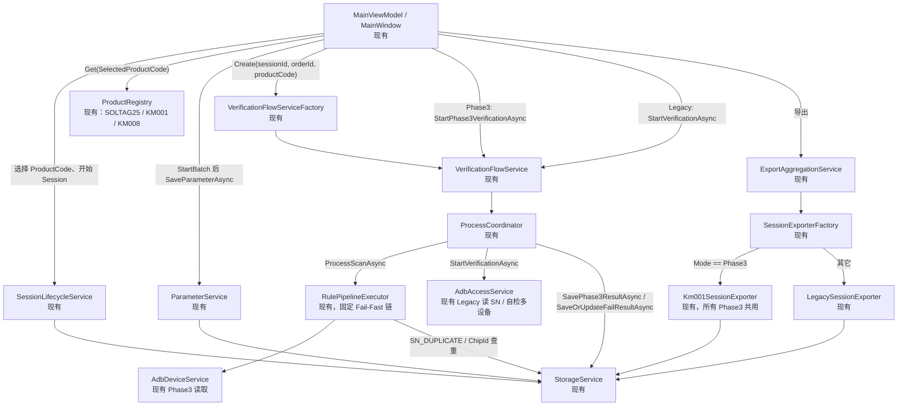

图中组件和调用关系均可在源码中找到。图中没有 YME009，因为它尚未注册。

---

## 1.3 Phase3 扩展机制

### 1.3.1 Phase3 从哪里进入

**源码事实：** 入口链见 1.2.3。产品是否走 Phase3，唯一依据是 `ProductRegistry` 中该 `ProductCode` 的 `Mode == VerificationMode.Phase3`。不存在单独的「Phase3 产品列表」或运行时插件注册。

**源码事实：** `VerificationMode` 枚举只有 `Legacy = 0` 和 `Phase3 = 1`（`Domain\Product\VerificationMode.cs` 第 11–21 行）。没有第三种模式。

### 1.3.2 产品如何注册或选择自己的 Phase3 流程

**源码事实：** KM001、KM008「注册规则链」的真实方式，不是实现 `IRule` 或向工厂登记规则列表，而是：

1. 在 `ProductRegistry` 静态构造函数中增加一条 `ProductProfile`；
2. 配置 `AdbConfig`（聚合命令或字段命令）和校验开关；
3. UI 因其 `Mode = Phase3` 自动走到 `ProcessScanAsync`；
4. `ProcessScanAsync` 用传入的 `ProductCode` 取 Profile，然后**始终**调用同一个 `RulePipelineExecutor.ExecuteAsync`（`ProcessCoordinator.cs` 第 406–437 行）。

全库不存在 `interface IRule`、规则工厂或按产品替换 Pipeline 的注册点。`IRulePipelineExecutor` 只有一个实现：`RulePipelineExecutor`。

**源码事实：** `RulePipelineExecutor.ExecuteAsync`（`D:\wpf_workspace\SnVerify\SnVerify\Services\Rules\RulePipelineExecutor.cs` 第 43–146 行）是一条对所有 Phase3 产品共用的固定顺序、失败立即终止的链：

1. `parameter == null` → `PARAMETER_NOT_CONFIGURED`（禁止访问 ADB）；
2. 调用 `IDeviceAccessService.ReadDeviceInfoAsync(profile)`（外部未预读时）；ADB 配置缺失、协议解析失败、DeviceSN 为空则失败返回；
3. 扫码 SN 与设备 SN 必须完全一致，否则 `SN_NOT_MATCH`；
4. 调用 `IsStickerSnPassedInBatchAsync(projectName, orderId, sticker)`，已 PASS 则 `SN_DUPLICATE`；
5. 若 `EnableChipIdCheck`：ChipId 必须以 `F50` 开头，且批次内 PASS 唯一，否则 `CHIPID_INVALID` / `CHIPID_DUPLICATE`；
6. 调用 `VersionVerificationService.VerifyAsync`，按 Profile 开关比较 Android / Board / Charge 版本。

产品差异只体现在 `AdbConfig` 和上述开关，不能跳过第 4 步的 `SN_DUPLICATE`，也不能改成「读完全部分项再统一判定」。

### 1.3.3 哪些步骤通用，哪些已允许产品覆盖或替换

**源码事实：**

| 步骤 | 是否通用 | 现有产品能否覆盖或替换 |
|---|---|---|
| Session 创建、扫码过程锁、Phase3 入口路由 | 通用 | 不能按产品替换入口，只能靠 `Mode` 在 Legacy / Phase3 之间选择 |
| Profile 查找、参数按 Session 读取、结果由协调器落库、更新 Snapshot | Phase3 通用 | 不能跳过 `SavePhase3ResultAsync`；该方法在规则结束后**总会 INSERT**（含 ADB 读取失败和异常，见 `ProcessCoordinator.cs` 第 444、464、723–752 行） |
| 设备信息读取命令与解析 | 可按产品配置 | 通过 `ProductProfile.AdbConfig` 和 `ParserFactory` 注册 Parser |
| ChipId / WifiMac / Board / Charge / Android 是否校验 | 可按产品开关 | Profile 布尔开关 |
| `SN_DUPLICATE`、SN 匹配、Fail-Fast 读设备 | 对所有 Phase3 强制 | **不能**按产品关闭 `SN_DUPLICATE`，也**不能**改为分项读全再判定 |
| 30 秒等待、CDC 门禁、AT 开/关 ADB、ADB Ready | 现有 Phase3 **没有**这些步骤 | 无扩展点可配置 |

**源码事实：** `VersionVerificationService`（`Services\Verification\VersionVerificationService.cs` 第 48–52 行）仅在 `ExpectedAndroidVersion` 非空时比较 Android 版本；为空则跳过该项。Phase3「开始测试」的必填规则是「Android / Board / Charge 至少填一项」（`MainViewModel.StartBatchAsync` 第 1271–1283 行），不是「目标软件版本必须填」。这与 YME009「目标软件版本必填、不使用 Board/Charge」并不等同。

### 1.3.4 KM001、KM008、SOLTAG25 如何使用 Phase3

**源码事实：**

- **KM001 / KM008：** `Mode = Phase3`，共用 `RulePipelineExecutor`。差异在 `AdbConfig`、Parser 和校验开关。都会执行 `SN_DUPLICATE`。KM001 额外执行 ChipId 规则。版本比较走 `VersionVerificationService`。读取已处于 ADB 可访问状态的设备，不经过 CDC/AT。
- **SOLTAG25：** `Mode = Legacy`，不进入 `ProcessScanAsync`。`StartVerificationAsync` 使用全库 PASS 历史（`IsBindingInPassHistoryAsync`、`IsStickerSnInPassHistoryAsync`、`IsDeviceSnInPassHistoryAsync`，`ProcessCoordinator.cs` 第 275–345 行），这就是 PRD 所说的 SOLTAG25 全库 PASS 查重。若 Profile 开启 Android 合一检验，则走 `AdbDeviceService` 读 SN 和版本，否则走 `AdbAccessService.ReadDeviceSnAsync`。

### 1.3.5 Phase3 当前执行关系

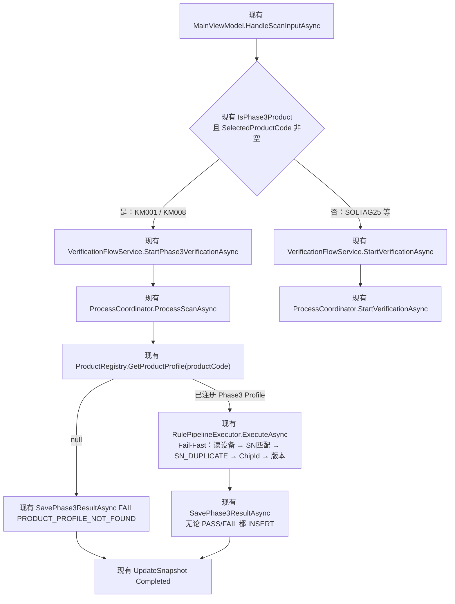

### 1.3.6 YME009 能否通过现有扩展机制接入，且不修改其他产品业务逻辑

**设计判断：** 可以沿用 Phase3 **入口**（把 `YME009` 注册为 `VerificationMode.Phase3`，让现有 `HandleScanInputAsync` 自动进入 `ProcessScanAsync`），但**不能**把 YME009 的检测直接交给现有 `RulePipelineExecutor`。原因：

1. 该执行器强制 `SN_DUPLICATE`，与 D08 冲突。
2. 该执行器 Fail-Fast，读失败或 SN 不匹配会立即返回，与 D07「分项读取、统一判定」冲突。
3. 该执行器假设设备已可 ADB 读取，没有 30 秒等待、CDC 唯一性门禁、AT 开启 ADB、ADB Ready；且 `ProcessScanAsync` 在读取失败时仍会 `SavePhase3ResultAsync`，与 D11、D13、D15「接入阶段失败不创建 TestRecord」冲突。
4. 现有链没有产测/两项老化判定，也没有 D16、D12 的分类规则。

**建议方案：** 继续使用现有 Phase3 入口和 `ProcessScanAsync` 作为编排挂载点。在 `ProcessScanAsync` 取出 Profile 之后，按 `ProductCode` 做一次产品分流：`YME009` 进入专属流程，KM001/KM008 仍走现有 `RulePipelineExecutor` 和现有 `SavePhase3ResultAsync`，一行行为都不改。本阶段不设计该专属流程的类结构，也不在本阶段修改源码。

**设计判断：** 因此「可以通过现有扩展机制接入」只对入口、Session、记录和导出注册框架成立；对检测规则和设备接入不成立。YME009 的设备接入与 30 秒等待必须放在现有规则链之前、之外，不能塞进当前这条固定规则链。

---

## 1.4 数据与记录机制

### 1.4.1 TestSession 创建与结束

**源码事实：** TestSession 在操作员「开始测试」时创建，不在扫码时创建。`CreateAndStartSession` 生成 `SessionName`，解析或创建 `Product` 与 `Order`，再 `StorageService.CreateSessionAsync` 插入 `TestSession`（含 `StartTime`，`EndTime` 此时为 null）。同一项目名、同一订单号下每次开始都是新行，与 D04 一致。

**源码事实：** `SessionLifecycleService.EndSession`（第 194–211 行）只把内存中的 `SessionSnapshot` 改为 Ended，并写日志，**没有**调用任何 Storage 更新。`StorageService` 有 `EndTime` 列，也有按该列读取的查询，但没有 `UPDATE TestSession SET EndTime = ...` 的方法被 `EndSession` 使用。这与 PRD 第 13.6 节及既有调研一致。

**设计判断：** 这是 SnVerify 现有实现缺陷，不属于 YME009 本期范围，本阶段不修复。YME009 不得把数据库中 `EndTime` 是否为空当作批次是否正常结束的判据。

### 1.4.2 VerificationParameter 保存内容与时机

**源码事实：** 表与模型字段为：`SessionId`（UNIQUE）、`ExpectedAndroidVersion`、`ExpectedBoardVersion`、`ExpectedChargeBoardVersion`、`CreatedAt`（`StorageService.cs` 第 192–200 行；`Domain\Models\VerificationParameter.cs`）。没有目标老化次数字段。开始测试并创建 Session 之后，`MainViewModel.StartBatchAsync` 在 Phase3 或 Legacy Android 合一模式下调用 `ParameterService.SaveParameterAsync`（第 1315–1344 行）。`ProcessScanAsync` 按当前 Session 内部 Id 读取该快照（第 397–403 行）。`SavePhase3ResultAsync` 把 `ExpectedAndroidVersion` 写入 `TestRecord.ExpectedVersion`，把实际 Android 版本写入 `ActualVersion`。

**设计判断：** 用现有 `ExpectedAndroidVersion` 承载 YME009 的目标软件版本，不需要为该参数新增表字段；也不需要、也不应写入目标老化次数。这与 PRD 第 13.3 节的技术映射建议一致，且满足「本次不改数据库」。

**源码事实：** 全库没有「同一项目名 + 同一订单号下，各 Session 的 `ExpectedAndroidVersion` 必须一致」的校验。`ParameterService` 只按 Session 读写。`IStorageService` 提供 `GetSessionsByOrderIdAsync` / `GetSessionsByProjectIdAsync` 和 `GetVerificationParameterAsync(sessionId)`，但没有现成的订单级参数一致性 API。

**设计判断：** D05/D06 现行规则（只保留目标软件版本一致；要改必须换订单号）可以在不改表结构的前提下，用现有查询做 YME009 专属开始校验。该校验不能做成全局规则，以免改变 KM001/KM008 允许同一订单下各填不同版本组合的现有行为。

**源码事实：** 现有 Phase3 开始校验是「三个目标版本至少填一个」，不是「Android 版本必填」。`VersionVerificationService` 在 Android 期望为空时跳过比较。

**建议方案：** YME009 在开始测试时做产品专属校验：目标软件版本必填；若该项目名+订单号下已有 Session 快照，则新值必须与已有 `ExpectedAndroidVersion` 一致，否则拒绝开始并提示换订单号。不修改 `VersionVerificationService` 的全局语义。

### 1.4.3 TestRecord 创建时机，以及是否允许 ADB Ready 后再创建

**源码事实：** Phase3 没有「先 INSERT 一条空记录、再 UPDATE」的流程。`SavePhase3ResultAsync` 在规则链结束（或 Profile 缺失、异常）时构造完整 `TestRecord` 并 `SaveTestRecordAsync`（`INSERT`，`StorageService.cs` 第 1199、1213–1214 行）。`TestRecord` 表对 `StickerSN` / `DeviceSN` 没有 UNIQUE 约束，只有普通索引（第 145–163、181–186 行）。因此同一 SN 可以有多条记录，与 D08 的数据库前提相符。

**源码事实：** 现有 Phase3 **只要进入 `ProcessScanAsync` 并走完 try/catch，就会尝试落库**，包括：`PRODUCT_PROFILE_NOT_FOUND`、规则链返回的 `ADB_READ_FAIL` / `ADB_PROTOCOL_INVALID`、以及 `EXCEPTION: ...`。这与 YME009 的 D13 不同：接入阶段（等待超时、多台 CDC、AT 失败或不确定、ADB Ready 超时）不得创建记录。

**设计判断：** 当前保存流程**允许**把 INSERT 推迟到 ADB Ready 成功（甚至推迟到综合判定完成）之后，因为本来就没有更早的 INSERT。实现 D13 的关键不是改表，而是 YME009 专属流程在接入失败时不要调用现有 `SavePhase3ResultAsync`。若 PRD「ADB Ready 后创建、判定后再保存」被理解为先有内存对象、判定后一次 INSERT，也与现有 `SaveTestRecordAsync` 兼容。不必为了 D13 先写再改一条数据库记录。

**设计判断：** D11/D15 的「30 秒超时不写记录」同样只需专属流程不调用保存方法，与现有保存点兼容。不能把 YME009 直接接入现有 `ProcessScanAsync` 的无条件保存路径。

**源码事实：** `SavePhase3ResultAsync` 和 Legacy 的 `SaveOrUpdateFailResultAsync` 在保存异常时都吞掉异常（第 545–548、754–757 行），随后仍可能把 Snapshot 更新为已完成。PRD 第 12 节「数据保存失败不得显示为已成功保存」仍为待确认。这是现有保存路径的行为限制，本阶段不修。

### 1.4.4 Result、FailReason，以及 D09、D13 是否可不改表结构实现

**源码事实：** `TestRecord.Result` 与 `FailReason` 均为现有列（模型注释中 Result 可为 `PASS` / `FAIL` / `TIMEOUT`）。Phase3 规则失败码定义在 `RuleFailReasonCodes`（`Services\Rules\RuleFailReasonCodes.cs`），经 `FailReasonTextResolver` 转成展示文案；未知代码回退为原始字符串（`FailReasonTextResolver.cs` 第 41–42 行）。

**设计判断：** D09、D12、D13 要求的分类可以在不修改数据库结构、不新增异常表或分类字段的前提下实现：综合结果仍写 `Result=PASS|FAIL`；业务 FAIL 与读取异常使用不同的稳定 `FailReason` 代码；接入阶段失败不 INSERT。具体代码名仍留待后续技术设计，本阶段不命名。D09 只适用于 YME009，不得改 KM001/KM008/SOLTAG25 的口径。

### 1.4.5 现有字段能否承载 YME009 需要持久化的业务值

**源码事实：** 现有 `TestRecord` 列为：`StickerSN`、`DeviceSN`、`WifiMac`、`ChipId`、`BoardVersion`、`ChargeBoardVersion`、`ExpectedBoardVersion`、`ExpectedChargeBoardVersion`、`Result`、`FailReason`、`VerifyTime`、`ExpectedVersion`、`ActualVersion`。没有 IMEI1、IMEI2、产测结果、重启老化、恢复出厂老化，也没有分项判定状态列。`DeviceInfo` 同样没有 IMEI / 产测 / 老化属性。PRD 第 9.1、9.3 节要求这些业务值可追溯、可导出；并写明字段映射问题与 D09 分类方案是两件事，本次不改数据库。

**设计判断：** D09/D13 的**分类和创建时机**可以不改表。YME009 所需的 IMEI、产测、两项老化以及分项状态，在现有列中没有对应位置。若借用 `ChipId` / `BoardVersion` 等列，会与现有 Phase3 字段语义和 KM001 导出列冲突，本阶段不建议把这当成方案。完整的业务值落库与导出列，属于「不改库则无法干净持久化」的限制，见 1.8、1.9。不得为了分类方便新增字段；也不得在本阶段修改 PRD 或实施改表。

### 1.4.6 导出和统计如何区分业务 FAIL 与设备读取异常

**源码事实：** Phase3 导出并不是每个产品一个导出器类。`SessionExporterFactory.GetExporter`（`Services\Storage\SessionExporterFactory.cs` 第 33–41 行）的规则是：`ProductProfile.Mode == Phase3` 则返回**同一个** `Km001SessionExporter`，否则返回 `LegacySessionExporter`。列差异靠 `ProductExportRegistry.GetProfile(productCode)`。当前注册了 KM001（14 列）和 KM008（较少列），没有 YME009（`Infrastructure\Export\ProductExportRegistry.cs`）。若某 Phase3 产品没有导出 Profile，`Km001SessionExporter.ExportAsync` 会抛「No export profile columns」（第 55–57 行）。

**源码事实：** `Km001SessionExporter` 将记录按 `Result == "PASS"` 与 `Result == "FAIL" || Result == "TIMEOUT"` 分到两个 Sheet；FAIL 侧按 `(StickerSN, DeviceSN)` 去重，只保留先遇到的一条；`failCount` 用去重后的 FAIL+TIMEOUT 计数，通过率分母是全部记录数，不排除读取异常（第 63–77、135–136 行）。现有 UI `StatusText` 只显示 PASS/FAIL，不按 FailReason 分桶。因此，现有导出和界面统计**不会**区分业务 FAIL 与读取异常，而是把所有非 PASS 当作 FAIL。

**设计判断：** `ISessionExporterFactory` / `ProductExportRegistry` / `IExportValueResolver` 足以让 YME009 **单独注册**导出列和导出器，而不改 KM001、KM008、SOLTAG25 的导出格式、分桶和去重。前提是工厂按 `ProductCode` 增加分支，把 YME009 交给自己的导出实现，而不是因为 `Mode == Phase3` 就落入 `Km001SessionExporter`。Q20（同一 SN 是否全量导出）仍开放，YME009 导出器不得把现有 FAIL 去重写成已确认规则。被导出的 YME009 记录必须能区分两类 FAIL，读取异常不得计入业务 FAIL 或 `PASS / (PASS + 业务 FAIL)` 分母。

**源码事实：** `ExportAggregationService` 按 Session 解析 `ProductCode` 再 `GetExporter`（第 88–98 行），这个调度框架可复用。`ServiceFactory` 当前调用 `new ExportAggregationService(storageService, loggingService, loggingService)`，工厂参数为 null，内部会 new 默认 `SessionExporterFactory`（第 43、121–122 行）。新增导出器时需要把默认工厂一并纳入，否则聚合导出会找不到 YME009 配置。

---

## 1.5 设备接入机制现状

### 1.5.1 SnVerify 当前设备接入在哪里

**源码事实：** SnVerify 内**没有** CDC 枚举、SetupAPI、AT 命令或串口客户端实现。全工程（排除 bin/obj）搜索不到用于设备发现的 CDC/SerialPort/AT 协议代码。现有设备能力都建立在「ADB 已可用」之上：

| 组件 | 路径 | 职责 |
|---|---|---|
| `AdbAccessService` | `Services\Adb\AdbAccessService.cs` | Legacy 读设备 SN；`adb devices` 列表；`CheckMultipleDevices` |
| `AdbDeviceService` | `Infrastructure\DeviceAccess\Service\AdbDeviceService.cs` | Phase3 按 `ProductProfile.AdbConfig` 读 `DeviceInfo` |
| `DeviceSessionManager` | `Infrastructure\DeviceAccess\Session\DeviceSessionManager.cs` | Shell warmup、Bootstrap 命令、另有一个未被 Phase3 读取路径调用的 `CheckMultipleDevices` |
| `DeviceCommandExecutor` | `Infrastructure\DeviceAccess\Command\DeviceCommandExecutor.cs` | 执行 `adb <arguments>`，**不带** `-s` / `-t` 定向参数 |

**源码事实：** `AdbDeviceService.ReadDeviceInfoAsync` 先 `EnsureSessionReadyAsync`（warmup + 可选 Bootstrap），再执行聚合命令或逐字段命令。总超时 10 秒，单命令 5 秒（第 25–26、58–65 行）。`DeviceSessionManager.EnsureSessionReadyAsync` **不**调用自己的 `CheckMultipleDevices`（第 42–73 行）。字段读取是顺序执行，一个字段失败时 `ExecuteAsync` 返回 null，解析后写入空值并继续下一字段（`AdbDeviceService.cs` 第 78–109 行；`DeviceCommandExecutor.cs` 第 29–32 行）。这与参考工程的 CDC → AT → ADB Ready 不是同一条链路。

### 1.5.2 CheckMultipleDevices 是否会拦截 YME009

**源码事实：** `AdbAccessService.CheckMultipleDevices`（第 543 行附近）在检测到多台时设置 `AdbSnapshot.MultipleDevicesWarning`，并返回 true。`ReadDeviceSnAsync` 在多台时也写 Warning 快照，但仍取 `devices[0]`（第 412–417 行）。这是「警告、不拦截、必要时仍选第一台」的策略，正是 D10 要求 YME009 不要沿用的策略。

**源码事实：** 生产码中，`AdbAccessService.CheckMultipleDevices` 的调用点只有 `MainViewModel.SelfCheckAsync`（第 1603 行）。`ProcessScanAsync` 和 `HandleScanInputAsync` 的 Phase3 路径都**不**调用它。`DeviceSessionManager.CheckMultipleDevices` 在生产路径中没有调用者（仅自身定义）。因此，该机制对正式扫码检测不是全局拦截器，也不是 Phase3 的前置门禁；它主要用于自检，以及 Legacy `ReadDeviceSnAsync` 内部的警告+选第一台。

**设计判断：** YME009 可以独立实现 CDC 唯一性门禁，而不必修改 `CheckMultipleDevices` 本身，也不应把 YME009 正式检测接到 Legacy `ReadDeviceSnAsync` 或现有自检的多设备警告上。D10 要求不修改 SnVerify 全局多设备处理，这一点与源码现状相容。若操作员在 YME009 下点击现有「自检」，仍会走 ADB `CheckMultipleDevices` + `ReadDeviceInfoAsync`，不会做 CDC/AT，可能造成误导。是否调整自检属于后续 UI/流程问题，本阶段不改自检全局行为。

### 1.5.3 与参考工程的架构边界

**源码事实（设备审查报告，已标注需区分事实与待验证）：** YunkeProductionTester 中存在 CDC 发现、连续两次唯一目标 CDC、AT 开 ADB、Transport ID 上确认 ADB Ready、按轮清零状态、以及关闭 ADB 等实现。识别条件、AT 原文、两次扫描间隔、15 秒 Ready 窗口和八个属性的真实返回，报告明确仍需真机验证。`persist.sys.yl.cit` 的参考读取路径还包含启动 `FactoryAutoService` 和空值等待，这些不得带入包装工位。

**设计判断：** SnVerify 当前没有可复用的 CDC/AT 子系统。YME009 的设备接入应作为产品专属能力，挂在 Phase3 入口之后、现有规则链和 `AdbDeviceService.ReadDeviceInfoAsync` 之前。不要把该逻辑写进 `AdbAccessService` 或 `CheckMultipleDevices`，以免改变其他产品。本阶段不设计接入类结构，也不展开 AT/ADB 详细步骤。

### 1.5.4 适合放置产品专属设备接入逻辑的扩展点

**设计判断：** 最合适的现有挂载点是 `ProcessCoordinator.ProcessScanAsync` 在取得 `ProductProfile` 之后、调用 `RulePipelineExecutor` 之前。此处已经位于服务层，已持有 Session、订单、扫码 SN 和 Snapshot 更新手段，并且只影响被分流到的产品。不适合的位置包括：

- `MainViewModel.HandleScanInputAsync`：应保持路由，不应承担设备接入；
- `RulePipelineExecutor`：改它会直接改变 KM001/KM008；
- `AdbDeviceService.ReadDeviceInfoAsync`：它假定 ADB 已就绪，且被 KM001/KM008/自检/Legacy Android 合一共用。

---

## 1.6 YME009 接入建议

本节为建议方案，尚未实施。

### 1.6.1 建议的接入位置

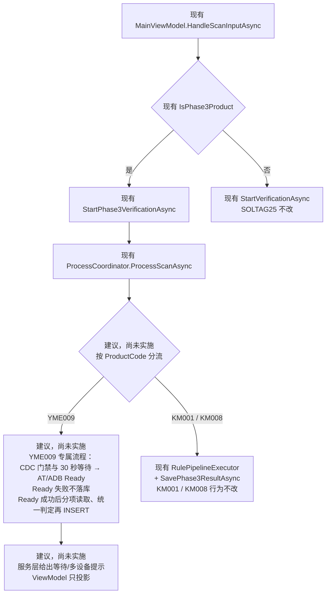

图中标注「现有」的节点和边均来自当前源码；标注「建议，尚未实施」的节点不是现有类或现有调用。

### 1.6.2 建议复用的扩展点

1. **产品注册：** 在 `ProductRegistry` 增加 `ProductCode = YME009`、`Mode = VerificationMode.Phase3`，并关闭 ChipId / Board / Charge 校验开关（避免自动显示 KM001 的主板/充电板输入）。Android 版本区可复用现有 `EnableAndroidVersionCheck` 与 `ExpectedAndroidVersion` 输入。
2. **Phase3 入口：** 复用 `HandleScanInputAsync` → `StartPhase3VerificationAsync` → `ProcessScanAsync`，不再走 Legacy。
3. **批次与 Session：** 复用项目名、订单号、`CreateAndStartSession`、`SessionName` 规则、`VerificationParameter.ExpectedAndroidVersion`。
4. **记录框架：** 复用 `TestRecord`、`SaveTestRecordAsync`（INSERT）、`Result` + `FailReason`。由专属流程决定何时调用、何时不调用。
5. **导出框架：** 复用 `ISessionExporter`、`SessionExporterFactory`、`ProductExportRegistry`、`ExportAggregationService` 的调度，为 YME009 单独注册。
6. **过程锁与扫码：** 复用现有 `IsProcessing` 忽略重复扫码，不引入并行检测。

### 1.6.3 必须隔离实现的部分

- CDC 发现、目标 CDC 唯一性门禁、连续两次确认、0 台/多台共用的 30 秒等待、AT 开启 ADB、ADB Ready、保存后尝试关闭 ADB。
- 分项读取八个属性后的统一判定；D16 对产测/老化空值非法值的处理；D12 主分类；不把 IMEI/MAC 缺失判为综合 FAIL。
- 不执行 `SN_DUPLICATE`，不走 SOLTAG25 全库 PASS 查重。
- 同一项目名+订单号的目标软件版本一致性校验。
- YME009 的 FailReason 稳定代码、统计分桶、导出列与导出分桶。
- 包装工位所需的等待提示、IMEI/产测/老化展示，以及业务 FAIL 与读取异常的区分展示。
- 不得引入 SMT/CIT 测试业务，不得在空产测结果上继续等待或启动 `FactoryAutoService`。

### 1.6.4 共享组件上允许的改动原则

只允许**按 ProductCode 分流的附加改动**，不得改变 KM001、KM008、SOLTAG25 在相同输入下的业务规则、结果分类、统计口径和导出行为。具体影响清单见 1.7。本阶段只记录方向，不改代码。

---

## 1.7 共享组件影响分析

### 1.7.1 可以完全复用、本阶段不必为了 YME009 修改其业务规则的组件

| 组件 | 路径 | 说明 |
|---|---|---|
| `SessionLifecycleService.CreateAndStartSession` / `SessionIdGenerator` | `Services\Session\`、`Domain\Validation\SessionIdGenerator.cs` | 每次开始新建 Session，命名格式符合 PRD 第 4.6 节 |
| `StorageService` 的 Product/Order/Session/Record 创建与查询，`SaveTestRecordAsync` | `Services\Storage\StorageService.cs` | 无 SN 唯一约束；不改表也可做 D09/D13 的分类和延迟 INSERT |
| `ParameterService` | `Services\Parameter\ParameterService.cs` | 按 Session 保存 `ExpectedAndroidVersion` |
| `VerificationFlowService` / `IVerificationFlowService` | `Services\Coordination\VerificationFlowService.cs` | Phase3 门面可直接走 |
| `ScanInputService` 及 `HandleScanInputAsync` 过程锁 | `Services\Input\`、`MainViewModel.cs` | 与 D08 过程锁边界一致 |
| `OrderNameValidator` | `Domain\Validation\OrderNameValidator.cs` | 订单号长度、非中文、非法文件名字符校验；YME009 未另行规定时可沿用 |
| `LoggingService` | `Services\Logging\LoggingService.cs` | Session 日志 |
| `ExportAggregationService` 的按产品选导出器调度 | `Services\Storage\ExportAggregationService.cs` | 需同时注册工厂，但不改其聚合方式 |
| `RulePipelineExecutor`、`VersionVerificationService`、`Km001SessionExporter`、`LegacySessionExporter`、`StartVerificationAsync` | 相应现有路径 | **不要改这些实现来迁就 YME009** |
| `AdbAccessService.CheckMultipleDevices` | `Services\Adb\AdbAccessService.cs` | 不修改全局多设备策略 |

### 1.7.2 可能需要修改的共享组件（仅附加、按产品隔离）

| 组件 | 原因 | 对现有产品的约束 |
|---|---|---|
| `ProductRegistry` | 必须注册 `YME009`，否则 UI 无法选择，Phase3 入口不会启用 | 只增加条目，不改已有三条 Profile |
| `ProcessCoordinator.ProcessScanAsync` | 需要在现有规则链之前按 `ProductCode` 分流到 YME009 专属流程 | `YME009` 以外的路径必须保持现有调用和保存行为 |
| `MainViewModel.StartBatchAsync` | 需要 YME009 专属：目标软件版本必填；订单内目标版本一致性；避免误用「三项至少填一」的 KM001 文案 | 仅在当前产品为 YME009 时生效 |
| `MainViewModel` / `MainWindow.xaml` / 可能的 `VerificationSnapshot` | 需要等待态、IMEI/产测/老化展示、两类 FAIL 的区分提示；现有 `StatusText` 不够 | 不得改变 KM001/KM008/SOLTAG25 的现有显示口径 |
| `SessionExporterFactory`、`ProductExportRegistry` | 按 `ProductCode` 注册 YME009 导出器与列，避免落入 `Km001SessionExporter` 的 FAIL 去重和统计 | 不改 KM001/KM008 的 Profile 和导出器逻辑 |
| `FailReasonTextResolver`（及可选的代码常量类） | 为 YME009 稳定失败码提供展示文案；未知码虽可回退原文，但验收需要可区分文案 | 只追加 case，不改现有码的文案 |
| `ServiceFactory` / `VerificationFlowServiceFactory` | 装配 YME009 专属服务并注入导出工厂 | 现有产品的构造参数与 MES Disabled 装配保持不变 |
| `DeviceInfo` 或等价的展示模型（若后续要绑定 IMEI/产测/老化） | 现有模型没有这些属性 | 只能追加属性；其他产品保持空值，不改读取逻辑 |

上述修改都不是本阶段任务，只说明影响面。

### 1.7.3 必须隔离的 YME009 专属逻辑

见 1.6.3。这些逻辑不应写入 `RulePipelineExecutor`、`AdbAccessService`、`Km001SessionExporter` 或 Legacy 决策树。

### 1.7.4 可能影响 KM001、KM008、SOLTAG25 的位置（必须避免行为变化）

- `RulePipelineExecutor` 的固定链和 `SN_DUPLICATE`；
- `ProcessCoordinator.StartVerificationAsync` 的全库 PASS 查重与 `SaveOrUpdateFailResultAsync`；
- `ProcessCoordinator.SavePhase3ResultAsync` 对 KM001/KM008 的无条件保存；
- `VersionVerificationService` 的全局比较语义；
- `Km001SessionExporter` 的分桶、去重、通过率；
- `CheckMultipleDevices` 及 `ReadDeviceSnAsync` 的多设备警告/选第一台；
- `Product.ProductName` 全局唯一及 `EnsureProductCodeAsync` 不覆盖已有代码：若开始测试校验不隔离，可能把 YME009 会话挂到旧产品行上，进而污染导出时的 `ProductCode` 解析。

---

## 1.8 当前架构限制

下列限制均基于源码事实或由源码事实得出的设计判断。不在本阶段修复，也不因此修改 PRD。

1. **没有按产品替换的规则链。** 不存在 `IRule` 或规则工厂。现有 Phase3 扩展只能配置读取命令和部分开关，不能关闭 `SN_DUPLICATE`，也不能改成读全再判定。YME009 必须在规则链外走专属流程。
2. **现有 Phase3 保存点与 D13/D11 不兼容（若直接复用）。** `ProcessScanAsync` 在 ADB 读取失败和异常时也会 INSERT。YME009 不能原样调用该保存路径。
3. **现有导出和 UI 统计不区分两类 FAIL。** `Km001SessionExporter` 把所有 FAIL/TIMEOUT 放在一起，并按 `(StickerSN, DeviceSN)` 去重。若 YME009 因 `Mode == Phase3` 落入该导出器，将违反 D09，并可能在 Q20 关闭前错误继承去重。
4. **TestRecord / DeviceInfo 缺少 YME009 业务字段。** D09/D13 的分类和创建时机可不改表实现；IMEI1/2、产测、两项老化及分项状态无法作为独立列持久化和导出。PRD 第 9.3 节把字段映射留到技术设计，且要求本次不改数据库。这是完整追溯和导出列的真实缺口，不能靠改 D09 绕过。
5. **没有订单级目标软件版本一致性校验。** 字段可复用，规则要由 YME009 专属开始校验补上。
6. **Phase3 开始测试的必填规则与 YME009 不完全相同。** 现有为「三项至少一项」；YME009 为目标软件版本必填、不使用老化次数和 Board/Charge。
7. **`ProductName` 全局唯一，且 `ProductCode` 已有值时不覆盖。** 跨产品重用同一项目名会导致产品类型和导出器解析错误。现有友情提示不够。
8. **Session `EndTime` 未持久化。** `EndSession` 只更新内存。按 PRD 13.6，本期默认不修复，YME009 不得依赖库中的 `EndTime`。
9. **MES 生产路径为 Disabled，且 Phase3 没有 Pre-Gate。** `VerificationFlowServiceFactory.Create` 硬编码 `mesPreCheck: null`、`mesReporter: null`、`mesMode: MesMode.Disabled`（`Infrastructure\VerificationFlowServiceFactory.cs` 第 54–61 行）。`ProcessScanAsync` 不含 MES Pre-Gate 调用；Post-Report 虽写在 `SavePhase3ResultAsync` 之后，但 Disabled 下直接返回（`ProcessCoordinator.cs` 第 765 行）。README 中「将结果上传至杰科 MES」与当前生产装配不一致，不得当作事实，也不得假设沿用 Phase3 就会自动获得 MES。包装工位是否需要 MES，PRD 仍待业务确认。
10. **现有 Snapshot / StatusText 没有等待态。** 30 秒等待若只置 `IsProcessing`，界面只会显示「正在检验...」，无法满足「明确提示等待」和多设备等待提示。
11. **现有保存失败被吞掉后仍可能显示完成。** 与 PRD「保存失败不得显示为已成功保存」（待确认）存在差距，不在本期修复范围里扩大重构。
12. **SnVerify 没有 CDC/AT 能力；Phase3 读取也不做 Transport ID 定向。** 设备接入必须专属实现。识别条件、AT 原文、Ready 细节仍以设备审查报告中的待真机验证项为准，本阶段不写死。

---

## 1.9 尚待技术设计阶段解决的问题

下列问题不属于本阶段的详细设计范围，只列出后续必须解决的题目。不在此给出类结构或 CDC/AT/ADB 步骤。

1. YME009 专属检测流程如何挂到 `ProcessScanAsync` 的分流点，以及等待、接入、读取、判定、保存、关闭 ADB 的职责切分（只定挂载点，下阶段再设计实现）。
2. YME009 稳定 FailReason 代码清单及其与业务 FAIL / 读取异常 / D12 主分类的对应关系。
3. 在「本次不改数据库」的约束下，IMEI、产测、两项老化和分项状态如何展示、如何导出、是否推迟到后续才增加列；不得把借用 KM001 列当成已定方案。
4. YME009 导出器的列定义、统计分桶，以及 Q20（同一 SN 多次检测是否全量导出）关闭前的过渡策略。
5. 订单内目标软件版本一致性校验的查询与提示文案；跨产品重用同一项目名时如何拒绝或隔离。
6. 等待态、多设备提示、两类 FAIL 在 Snapshot 与 UI 上的表达方式；等待期间取消、等待期间再次扫码（PRD 仍待确认）对过程锁的影响。
7. 自检在 YME009 下是否仍走现有 ADB 自检，避免与专属接入混淆。
8. 设备侧仍待真机验证的内容（CDC 识别条件、AT 原文与结束符、Ready 判定、属性返回与空值形态），以设备审查报告为准，不在架构阶段预先写死协议。
9. 包装工位是否需要 MES，需要哪些交互；在确认前保持 Disabled，不把 README 当生产行为。

完成本章后停止。不继续设计设备接入细节，不开始编码。

---

# 2. YME009 设备接入架构设计

本章在第一章结论之上，只设计 YME009 的设备接入架构，不展开完整业务检测实现，也不开始编码。业务依据仍是 PRD V0.6；设备侧源码依据仍是 `docs/YME009-Device-Integration-Technical-Audit.md`。参考工程路径按用户机书写：`D:\wpf_workspace\Mifi-YF_YunkeProductionTester`。

本章继续使用第一章的结论标记：源码事实、设计判断、建议方案、待确认问题。凡标为「建议方案」的组件名、类型名和交互关系均尚未实施，只是设计候选，不构成接口或实现代码。

本章已按定向修订补齐：连续两次唯一确认必须是同一台 CDC 设备；ADB Ready 与 ADB 身份关联必须分开；临时设备身份上下文与正式设备连接上下文必须按生命周期区分；AT 三种结果对应不同的清理动作。具体关联算法和 CDC 身份字段仍不在本章定案。

---

## 2.1 设计目标与边界

### 2.1.1 本章要回答的问题

1. 设备接入生命周期如何组织？
2. 各阶段分别由什么职责承担？
3. CDC 唯一性门禁与 ADB Ready 门禁如何衔接？
4. 如何保证本轮 CDC 目标、AT 通信目标、ADB 设备与 Transport ID 指向同一台设备，并在接入成功后把可靠的正式连接上下文交给后续业务检测？
5. 设备接入失败时，如何结束本轮流程？
6. 设备接入生命周期与 YME009 业务检测生命周期如何划分、由谁衔接？
7. 如何复用 SnVerify 现有架构，同时避免把 CDC、AT、ADB 细节堆进 `ProcessCoordinator`？

### 2.1.2 必须遵守的业务边界

下列规则均已在 PRD V0.6 的 D09–D16 中确认，本章不重新讨论，也不改写。2026-11-23 的 D17 规定五项分项业务判定，D18 规定综合主失败原因优先级；接入门禁和记录边界仍以本节为准，分项与主代码见第三章。

- **CDC 门禁（D10、D11、D15）：** 0 台目标 CDC 则等待；1 台必须再次扫描确认；连续两次确认唯一后才允许发送 AT；多台不自动选择、不发送 AT，等待条件恢复；AT 发送前再次检查唯一性。0 台、1 台、多台共用同一个 30 秒等待窗口。30 秒超时不创建 TestRecord，也不计入业务 FAIL。该 30 秒不用于 AT、ADB Ready 或属性读取。
- **两个独立门禁（D10、D13）：** AT 命令发送成功不等于 ADB Ready。只有 ADB Ready 成功后，才允许进入正式业务检测，并锁定 Transport ID。此后的 ADB 属性读取必须针对该 Transport ID 定向执行，不能依赖默认 ADB 设备选择。
- **记录边界（D09、D13、D14）：** CDC 等待超时、多台未通过门禁、AT 结果不确定或失败、ADB Ready 超时，均不创建 TestRecord。正式检测中的字段读取异常和业务 FAIL，仍按既有规则保存 TestRecord。实际数据库 INSERT 可以在读取与判定完成后一次完成，不要求提前插入空记录。记录保存后尝试关闭 ADB；关闭失败只报告异常，不改变已保存结果，不回滚，也不是 PASS 条件。

**设计判断：** 「ADB Ready 后创建 TestRecord」与「判定完成后一次 INSERT」的关系，第一章 1.4.3 已经说明：二者相容。本章沿用该解释：Ready 成功是进入正式检测的门禁；内存中可以开始构造记录对象，但数据库 INSERT 发生在统一判定之后。接入失败路径既不构造也不 INSERT。

**设计判断：** D13 的「ADB Ready 成功后进入正式检测」，在本章落实为两步独立检查都通过之后，才锁定 Transport ID 并进入正式检测：先确认 ADB 设备已经进入可通信状态，再确认该 ADB 设备就是本轮 CDC 目标设备。任一步未通过，都不得进入正式检测，也不得把未经关联的 Transport ID 交给业务检测。这不改写 D13，只是补齐「这个 Transport ID 必须属于本轮目标设备」这一实现约束。

### 2.1.3 本章明确不做的事

- 不重开 D01–D16，不设计 FailReason 代码清单、导出列、统计分桶或记录模型扩展。
- 不把 YunkeProductionTester 的 SMT/CIT 业务流程、拔板间隔、`FactoryAutoService` 启动或「空产测结果继续等待」搬入 YME009。
- 不设计面向未来多产品的通用设备接入框架。
- 不为 KM001、KM008、SOLTAG25 改造现有路径。
- 不把参考工程中已标明待验证的串口参数、结束符、Ready 窗口数值写成 YME009 已确认事实。
- 不擅自确定 CDC 设备身份字段，也不在证据不足时自行设计 CDC 与 ADB 的匹配算法。

---

## 2.2 两个生命周期及衔接

**建议方案：** 把一次扫码后的工作分成两个生命周期，由 YME009 轮次协调串联，而不是由 `ProcessCoordinator` 直接逐步调用底层设备能力。

### 2.2.1 设备接入生命周期

顺序固定为：

CDC 发现 → 目标 CDC 唯一性门禁（含 30 秒窗口内的 0 台 / 1 台 / 多台等待，以及连续两次同一台设备的唯一确认、发送前的身份复核）→ 产生临时设备身份上下文 → AT 开启 ADB → ADB Ready 确认 → ADB 身份关联 → 锁定 Transport ID 并形成正式设备连接上下文 → 接入成功。

该生命周期的唯一成功出口是「接入成功」，并交付正式设备连接上下文。任何接入失败出口都结束本轮检测，不进入业务检测，不创建 TestRecord。临时设备身份上下文只服务于本轮接入过程中的 AT 发送和必要清理，不得代替正式连接上下文交给业务检测。

### 2.2.2 业务检测生命周期

只有接入成功之后才开始：

接入成功 → 按已锁定且已完成身份关联的 Transport ID 定向读取属性 → 统一判定 → 一次 INSERT 保存 TestRecord → 尝试关闭 ADB → 资源清理 → 本轮结束。

关闭 ADB 发生在本轮全部 ADB 业务操作完成之后，包括属性读取和身份关联。它不是业务检测步骤。正常路径中，保存成功后才进入关闭阶段。保存未完成但仍有可用 AT 控制上下文时如何尽力关闭，见 2.6.2。本章不重新设计分项判定规则。

### 2.2.3 谁调用谁，谁结束本轮

**建议方案：**

1. 现有 `ProcessCoordinator.ProcessScanAsync` 在取得 `ProductProfile` 之后按 `ProductCode` 分流。若为 `YME009`，把本轮扫码 SN、当前 Session 和参数交给 YME009 轮次协调，然后等待其结束；不调用现有 `RulePipelineExecutor`，也不调用现有 `SavePhase3ResultAsync`。KM001、KM008 仍走原路径，一行行为都不改。这与第一章 1.3.3、1.5.4、1.6.1 的挂载点结论一致，只是把「专属流程」内部再分成接入与业务检测。
2. **YME009 轮次协调**负责一次扫码的完整检测过程：先启动设备接入生命周期；失败则整理提示并结束本轮；成功则把正式设备连接上下文交给业务检测；业务检测完成后发起记录保存。正常路径在保存成功后请求关闭 ADB。其他已经具备可用 AT 控制上下文的结束出口，按 2.6.2 尽力关闭。关闭尝试结束或被跳过后做资源清理，最后向 `ProcessCoordinator` 返回本轮结果。因此，**结束整个检测过程的是轮次协调，不是设备接入协调，也不是 `ProcessCoordinator`。**
3. **设备接入生命周期协调**只负责接入本身，不保存记录，不执行八项属性的业务判定。它在 CDC 门禁通过后持有临时设备身份上下文，在身份关联成功后才形成正式连接上下文。
4. 业务检测只使用正式连接上下文做定向读取和判定，不再重新做 CDC 发现或默认设备选择。

下图是**图 2：设备接入与业务检测生命周期关系图**。阅读目的是快速看出两个生命周期的前后关系、TestRecord 的保存时机、ADB Ready 与身份关联必须分开，以及关闭 ADB 与已保存结果互不影响。重点是 D13、D14。

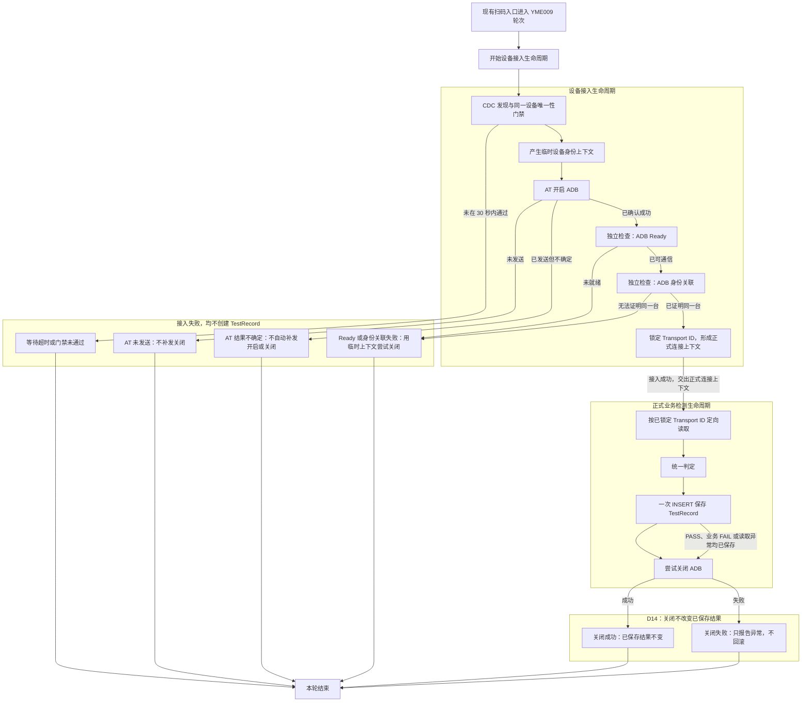

**图后约束：**

- 30 秒窗口只覆盖 CDC 门禁，不延伸到 AT、ADB Ready 或身份关联。
- 接入失败的各条出口都不进入正式检测，也不计入业务 FAIL。
- AT 未发送，或已发送但结果不确定时，不自动补发关闭命令。
- 只有 AT 已确认成功之后，Ready 失败或身份关联失败才使用临时设备身份上下文尝试关闭。
- 数据库 INSERT 发生在统一判定之后；图中「进入正式检测」不等于已经落库。
- 正常路径上，关闭 ADB 发生在全部 ADB 业务操作完成并且 TestRecord 保存成功之后。关闭是收尾动作，不是检测结果成立的前置条件，也不是业务检测步骤。关闭失败不改变已保存结果。本次不定义关闭失败后的自动恢复或重试。
- 保存未完成、SessionId 映射失败、未预期软件异常，以及正式上下文已形成但业务检测尚未开始的结束，若 AT 控制上下文仍可用，按 2.6.2 尽力关闭。本图不展开这些出口，也不为关闭构造 TestRecord。
- 等待期间取消、等待期间再次扫码仍为 PRD 待确认项，本图不画，不因此补充新的业务规则。

---

## 2.3 职责分层与组件关系

### 2.3.1 分层与建议候选

**建议方案：** 按下表划分职责。候选名称只用于后续编码时识别边界，不是已经存在的类型，也不在本阶段展开方法签名。

| 职责 | 建议候选 | 职责说明 | 明确不承担的事 |
|---|---|---|---|
| 入口与产品分流 | 现有 `ProcessCoordinator` | 复用 Phase3 扫码入口；按 `ProductCode` 把 YME009 交给轮次协调；把轮次结果投影回现有 Snapshot 机制 | 不实现 CDC 发现、唯一性判断、AT 收发、Ready 检查、身份关联或 ADB 关闭；不把 YME009 送入 `RulePipelineExecutor` |
| 一轮检测过程协调 | `Yme009RoundCoordinator` | 串联两个生命周期；决定本轮结束；在接入失败时不保存记录；在正式检测完成后发起保存；保存后再发起关闭 | 不直接做 SetupAPI 枚举或串口读写 |
| 设备接入完整生命周期 | `Yme009DeviceAccessCoordinator` | 组织发现、同一设备门禁、开启 AT、Ready、身份关联与 Transport ID 锁定；持有临时设备身份上下文；关联成功后返回正式连接上下文，或返回失败原因；在需要时通过 AT 能力执行关闭 | 不创建 TestRecord；不做八项属性的业务判定 |
| CDC 发现与状态观察 | `Yme009CdcDiscovery` | 枚举当前在线端口，按 YME009 识别条件给出 0 台、1 台或多台候选及其可比较的设备身份，以及发现失败 | 不做等待策略，不发送 AT。识别条件和身份字段本身仍待真机验证，不得写入 `VID_0E8D` 或 `M6x-66B`，也不得预先指定身份字段 |
| CDC 唯一性门禁 | `Yme009CdcUniquenessGate` | 管理 30 秒窗口、连续两次同一台设备的唯一确认、发送前的身份复核；决定继续等待、允许进入 AT，或超时结束 | 窗口到期后不得再发 AT；不得只比较数量是否都为 1 |
| AT 通信与 ADB 开关 | `Yme009AtAdbSwitch` | 每次交换按当次发现得到的当前 COM 打开串口，发送开启或关闭 AT，交换结束释放串口。关闭前用上下文中的设备身份重新匹配当前 CDC | 不得把 AT 成功直接申报为 ADB Ready，也不得在结果不确定时自动重发开启或关闭命令。不得复用开启时的 COM 号或串口句柄 |
| ADB Ready 检查、身份关联与 Transport ID 锁定 | `Yme009AdbReadyGuard` | 在 AT 成功之后依次完成三件独立的事：确认 ADB 已可通信；确认该 ADB 设备就是本轮 CDC 目标；只有关联成功才锁定 Transport ID | 不得把「当前只有一台 ADB 设备」作为唯一关联依据；关联未通过时不得交出 Transport ID；不在锁定前允许业务读取 |
| YME009 业务检测 | `Yme009BusinessInspection` | 使用正式连接上下文完成分项读取和统一判定，交出待保存结果 | 不重新选择 ADB 设备；不在判定前单独落库。详细判定规则不在本章展开 |
| 记录保存 | 现有 `StorageService.SaveTestRecordAsync` | 由轮次协调在判定完成后调用一次 INSERT | 接入失败路径不得调用；也不得复用现有 `SavePhase3ResultAsync` |
| ADB 关闭与资源清理 | 由轮次协调发起，由设备接入协调通过 AT 开关执行 | 正常路径在 ADB 业务操作完成且保存成功后，使用正式上下文中的设备身份尝试关闭。保存未完成、映射失败、未预期软件异常，以及正式上下文已形成但业务检测尚未开始的结束，只要设备身份上下文仍在，也尽力关闭。Ready 超时或身份关联失败使用临时上下文尝试关闭 | 关闭失败不修改已保存结果，也不把未保存解释为已保存。关闭前按 2.6.2 重新发现当前 CDC 并打开当前 COM，这不属于异常重连。不得复用开启时的 COM 或串口句柄，不得重做 Ready 或身份关联。AT 未发送或开启结果不确定时，不补发关闭命令 |

**源码事实（第一章已确认，本章沿用）：** SnVerify 当前没有 CDC 枚举、SetupAPI 或 AT 客户端；现有 `DeviceCommandExecutor` 执行 `adb` 时不带 `-s` / `-t` 定向参数。因此，上表中的发现、门禁、AT、Ready 和身份关联都必须是 YME009 专属能力，不能改写 `AdbAccessService`、`AdbDeviceService` 或 `CheckMultipleDevices` 来兼做。

**源码事实（设备审查报告）：** 参考工程生产装配使用 `SetupApiSerialPortDiscovery`、`WindowsOverlappedAtCommandClient`、`SmtAtSession`、`SmtDeviceMonitor` 和按 `-t {TransportId}` 定向的 `AdbClient`。这些实现可参考，但它们嵌在 SMT 工位协调器中，不能原样迁入 `ProcessCoordinator`，也不能把 SMT 工位状态机当作 YME009 的业务检测。参考工程也没有把 CDC 目标映射到 ADB Transport ID 的实现，见 2.4.3 和 2.7。

### 2.3.2 五个关键问题的直接回答

1. **哪一层负责设备接入完整生命周期？** 设备接入生命周期协调。轮次协调只启动和消费它的结果。
2. **`ProcessCoordinator` 应承担什么职责？** 只负责现有入口、Session / 扫码 SN 的既有上下文，以及按 `ProductCode` 分流。它是挂载点，不是设备接入实现者。
3. **设备接入成功后，向业务检测交付什么信息？** 见 2.5.1 的正式设备连接上下文：必须包含已验证的 CDC 设备身份，以及已经完成身份关联后锁定的 Transport ID。临时设备身份上下文不得交给业务检测。扫码 SN、Session、目标软件版本仍由轮次协调持有，不塞进设备发现结果里重复定义。
4. **业务检测结束后，由谁负责关闭 ADB？** 轮次协调在全部 ADB 业务操作结束之后发起关闭。正常路径是保存成功之后。设备接入协调通过既有 AT 能力执行关闭。`ProcessCoordinator` 不直接发 AT。异常出口是否尝试，见 2.6.1 和 2.6.2。
5. **取消、超时、异常时，资源清理如何组织？** 见 2.6。原则是：接入失败不写记录；已确认开启成功且 AT 控制上下文仍可用时，使用临时或正式上下文尽力关闭，但 AT 未发送、AT 结果不确定等 2.6.1 明确禁止补发关闭命令的出口除外；关闭失败只报告，不倒推检测结果或保存结果。

下图是**图 3：组件职责与调用关系图**。阅读目的是看清调用方向：现有入口只分流，轮次协调串联完整流程，底层设备细节停在专属接入协调之内，关闭 ADB 也走同一条 AT 能力。图中标注「建议」的节点均尚未实施。为避免返回边交叉成网，图中用正向箭头上的说明表示调用目的；轮次协调按「接入 → 业务检测 → 保存 → 关闭」的顺序消费这些结果。

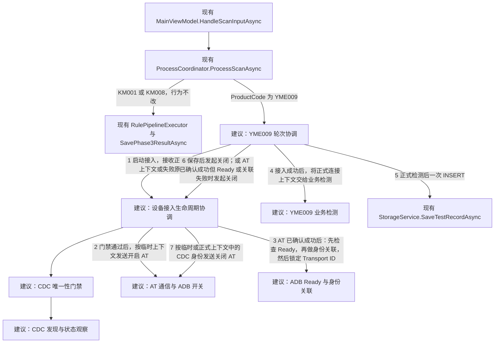

**图后约束：**

- `ProcessCoordinator` 到轮次协调只有一条分流边；它不直接连接 CDC、AT、Ready 或关闭命令。
- KM001 / KM008 路径与 YME009 路径在分流点之后完全分开。
- YME009 轮次协调负责串联完整流程；设备接入协调负责设备接入，并通过 AT 能力执行开启和关闭。
- 业务检测只从轮次协调接收正式连接上下文，不反向去枚举设备，也不使用临时设备身份上下文做属性读取。
- 关闭 ADB 的触发时机是：正常路径在全部 ADB 业务操作完成并且 TestRecord 保存成功之后，使用正式上下文尝试关闭；保存未完成等仍有可用 AT 控制上下文的出口按 2.6.2 尽力关闭；AT 已确认成功但 ADB Ready 失败或身份关联失败时，使用临时设备身份上下文尝试关闭；AT 结果不确定时不自动补发开启或关闭命令，只报告异常。关闭失败不改变已经保存的检测结果，也不把未保存解释为已保存。
- 关闭 ADB 仍走同一 AT 开关，不引入第二种关闭通道。
- 该图不表示这些建议组件已经存在于 SnVerify 源码中。

### 2.3.3 对现有架构的复用方式

**设计判断：** 复用止于第一章已经确认的挂载点和数据框架：Phase3 扫码入口、`ProductRegistry` 注册、`TestSession` / `VerificationParameter`、`SaveTestRecordAsync`、过程锁和 Snapshot 投影。设备接入内部的发现、门禁、AT、Ready 和身份关联全部隔离在 YME009 专属职责中。不要把这些步骤写进 `MainViewModel`、`RulePipelineExecutor`、`AdbDeviceService` 或 `AdbAccessService`。

---

## 2.4 设备接入流程与门禁

### 2.4.1 30 秒窗口与 CDC 门禁

**设计判断：** 30 秒窗口从本轮扫码进入设备接入时启动，覆盖 0 台、1 台、多台三种观察，直到下列已确认条件之一发生：

- 连续两次确认是同一台唯一目标 CDC，并且发送前的身份复核仍确认是这一台，于是离开窗口、发送 AT；
- 窗口到期，仍未满足上述条件，于是结束接入。

若后续需求确认允许等待期间取消，则取消也可以结束该等待窗口；当前不将其作为已确认的业务规则，见 2.6.3。

扫码时若已经存在唯一目标 CDC，仍必须完成连续两次同一台设备的确认和发送前身份复核，但不必人为等待窗口走完；两次确认通过后立即进入 AT。这与 D11「已接入则直接进入」相容。

必须先把下列概念区分清楚。它们不能互相替代。

| 概念 | 含义 | 单独成立时仍不能通过门禁的情况 |
|---|---|---|
| CDC 设备数量 | 按本轮识别条件，当前发现到的目标 CDC 台数 | 两次发现都是 1 台，但不是同一台设备 |
| CDC 设备身份 | 用于判断两次发现是否指向同一台目标设备的标识 | 只知道当前是 1 台，却无法判断与上次是否相同。具体识别字段暂不定案，不得预先指定为 COM 端口名、VID/PID 或某个父设备名 |
| 连续两次唯一确认 | 两次发现结果都恰好只有一台目标 CDC，并且对应同一个 CDC 设备身份 | 只比较两次数量是否都是 1；或第一次是设备 A、第二次变成设备 B |
| AT 发送前的身份复核 | 离开等待窗口、实际发送 AT 之前，再次发现并确认仍然恰好一台，且仍然是刚才通过连续确认的那一台 | 只确认当前仍是 1 台，却不再核对其是否仍是同一台 |

**建议方案：** 门禁对每次发现结果的处理如下。

| 发现结果 | 窗口未到期时 | 是否允许发送 AT | 窗口到期时 |
|---|---|---|---|
| 0 台 | 继续观察，并清除尚未完成的连续确认 | 否 | 结束接入，不创建记录 |
| 1 台，尚未获得连续两次同一设备确认 | 记录该设备身份，立即再扫描一次以确认 | 否 | 结束接入，不创建记录 |
| 连续两次都恰好 1 台，且是同一台设备 | 进入发送前的身份复核 | 仅当复核仍是同一台 | 若复核已不再是同一台或已不再唯一，按到期未通过处理 |
| 两次都恰好 1 台，但设备身份已变化 | 不能通过门禁。把后一次发现记为新的第一次唯一，重新开始连续确认 | 否 | 结束接入，不创建记录 |
| 多台 | 不选择其中一台，继续观察，并清除尚未完成的连续确认 | 否 | 结束接入，不创建记录 |
| 发现失败 | 窗口内允许重试发现，不把失败结果计入连续确认 | 否 | 与门禁未通过同一出口，不创建记录 |

**设计判断：** 发送前的身份复核仍属于 CDC 门禁，不属于 AT 结果。若此时已变为 0 台、多台、发现失败，或仍是 1 台但已换成另一台设备，不得发送 AT。若 30 秒尚未到期，应回到窗口内继续观察，并按上表重新开始或更新连续确认，而不是把「未发送」直接当作本轮 AT 失败并结束。这一点需要与参考工程区分：参考工程在第三次检查失败时把 `NotSent` 与开启失败一并处理，且其等待没有 30 秒上限，不宜原样搬入包装工位。

**源码事实（设备审查报告与参考工程）：** 参考工程在普通等待阶段对唯一候选会立即再做一次 `ScanAsync`，两次扫描之间没有固定 `Task.Delay`；只有结果不是可接受的唯一时，才在下一轮询前延迟。发送前还会再扫描一次。多台时不选择、不发 AT。等待本身是无限等待。`ClassifyBoard`（`D:\wpf_workspace\Mifi-YF_YunkeProductionTester\Mifi-YF_YunkeProductionTester\Application\Station\SmtStationCoordinator.At.cs`）只按 `Candidates.Count` 分成 0、1、多台或发现失败；第二次扫描和发送前扫描都只要求数量再次为 1，没有比较两次候选是否为同一台 CDC 设备。`SmtAtSession.EnableCoreAsync` 发送前也只检查 `Candidates.Count != 1`。YME009 可以采用「连续两次确认 + 发送前再检查」这一结构，但必须在此之上增加同一设备约束，不能只搬数量判断。连续两次扫描不加间隔是否足以抑制枚举抖动，报告已标明需要真机验证。本章不把「无间隔」或「轮询 1 秒」写成已确认参数，也不把参考工程里用于筛选的某个字段写成已确认的身份字段。

### 2.4.2 AT 开启 ADB 与结果分类

**源码事实（设备审查报告，参考工程原文）：**

- 开启命令：`at^optprop setprop persist.sys.skyroam.adb.enable 1`
- 关闭命令：`at^optprop setprop persist.sys.skyroam.adb.enable 0`
- 成功响应特征：先出现行 `SIMO AT COMMAND RESULT:`，随后出现行 `OK`。二者是分行匹配，不能把「`SIMO AT COMMAND RESULT: OK`」直接理解成必须出现在同一行，除非真机证实 YME009 确为单行。

**待确认问题：** 上述命令原文、结束符、串口参数和响应时序是参考工程针对其主板的实现，PRD 并未把它们写成 YME009 已确认协议。本章把它们作为设计基线引用，是否适用于 YME009 仍需真机验证，见 2.7。本章不补充未经证实的波特率、数据位、超时秒数或结束符确定值。

**建议方案：** 只有 CDC 门禁全部通过、并已形成临时设备身份上下文后，才开始一次开启 ADB 的 AT 交换。顺序是：使用当次发现得到的当前 COM 号打开串口，发送开启命令，按下面三种结果分类，然后释放这次串口。COM 号不是设备身份，也不留给后续关闭复用。AT 开启命令的结果仍只按下面三种处理，不再另建复杂的异常分类体系。

| AT 结果 | 含义 | 后续处理 |
|---|---|---|
| 未发送 | 命令没有实际发送 | 结束接入，不补发关闭命令，不创建 TestRecord，不自动改发开启命令 |
| 已确认成功 | 收到能够确认成功的响应 | 进入独立的 ADB Ready 检查 |
| 已发送但结果不确定 | 命令可能已经执行，但无法确认 | 结束接入，不自动重发开启或关闭命令，报告异常，不创建 TestRecord |

如果设备返回看起来像明确失败的响应，只有在能够确认设备未执行开启命令时，才可以按明确失败处理，其清理动作与「未发送」相同：结束接入，不补发关闭。如果无法确认设备实际状态，则按「已发送但结果不确定」处理。

其他约束：

- **开启失败或不确定后，不自动重发 AT。** 本轮接入结束，提示操作员。操作员如需重试，应开始新的一轮检测。该策略与参考工程「不确定则不自动重发」一致，也避免在状态不明时重复写开启命令。
- AT 已确认成功只表示命令交换成功，必须再进入独立的 ADB Ready 检查，而不能把 AT 成功等同于 ADB Ready，更不能直接锁定 Transport ID。
- 参考工程把已发送但无法确认成功统一记为 `Uncertain`，且没有单独的明确失败枚举。YME009 在业务出口上按 PRD 把「失败或不确定」视为同一类接入失败，均不创建 TestRecord。是否在提示文案上区分「未发送」与「已发送但不确定」，可在后续界面设计中决定，不在本章规定。

### 2.4.3 ADB Ready、身份关联与 Transport ID 锁定

这是三个必须分开的检查，不能合并成「列表里出现了一个稳定的 Transport ID」。

| 检查 | 要确认的事实 | 通过之后才允许做的事 | 不能单独作为通过依据的现象 |
|---|---|---|---|
| ADB Ready | ADB 设备已经进入可通信状态 | 开始做身份关联 | 某个 Transport ID 连续处于 `device`，但尚未证明它属于本轮 CDC 目标 |
| ADB 身份关联 | 该可通信的 ADB 设备就是本轮通过 CDC 门禁的那台 YME009 设备 | 锁定这个 Transport ID，并形成正式连接上下文 | 「当前 ADB 列表里只有一台设备」；电脑上可能同时存在其他 ADB 设备，列表状态也可能变化 |
| Transport ID 锁定 | 在身份关联成功后，固定本轮后续命令使用的设备标识 | 把正式连接上下文交给业务检测，后续读取必须按 `adb -t {TransportId}` 定向执行 | 关联尚未通过就预先锁定；或改用默认设备选择 |

**建议方案：**

- Ready 的具体等待窗口、列表轮询间隔、以及需要连续几次观察到同一 Transport ID 为 `device`，一律视为待验证。参考工程是 15 秒窗口、默认 1 秒轮询、同一 Transport ID 连续两次 `device`，且 15 秒从 AT 写入时刻起算；这些数值不得写成 YME009 已确认参数。架构上只要求：Ready 必须在 AT 已确认成功之后独立判定。
- Ready 未成功，不得进入身份关联的通过结论，不得锁定 Transport ID，不得进入业务检测。此时开启已经确认成功，应使用临时设备身份上下文尝试关闭 ADB，然后结束接入并提示，不创建 TestRecord，不自动重发 AT。
- 即使 Ready 表明某台 ADB 设备已经可通信，如果无法证明它与本轮 CDC 目标是同一台设备，也不得将该 Transport ID 交给业务检测。关联失败与 Ready 失败一样，属于接入失败：不创建 TestRecord；若开启已确认成功，使用临时设备身份上下文尝试关闭。
- 不允许把「当前只有一台 ADB 设备」作为唯一的身份关联依据。身份关联必须考虑其他 ADB 设备同时在线、以及关联过程中 ADB 列表发生变化的情况。

**源码事实（参考工程，关键缺口）：** 当前参考工程没有可靠的 CDC 与 ADB 身份关联证据，因此不能假设这个问题已经解决。

- Ready 确认在 `TryConsumeReady`（`D:\wpf_workspace\Mifi-YF_YunkeProductionTester\Mifi-YF_YunkeProductionTester\Application\Station\SmtStationCoordinator.At.cs`）：只统计状态为 `device` 的 Transport ID；若已有 streak 的 Transport ID 仍在本帧列表中就累加；否则仅当本帧恰好一台 `device` 时开始新的 streak；连续两次后用该 Transport ID 与 Serial 构造 `AdbTarget`。它不读取、不比对任何 CDC 端口、实例或父设备标识。
- 一旦 streak 已锁定，第二帧即使同时出现其他 `device`，只要原 Transport ID 仍在，计数仍会增加。这不能证明该设备就是刚刚通过 CDC 门禁的那一台。
- `AdbDeviceEntry`（`D:\wpf_workspace\Mifi-YF_YunkeProductionTester\Mifi-YF_YunkeProductionTester\Application\Adb\AdbDeviceEntry.cs`）注释写明：Serial 只用于显示和日志，TransportId 是 ADB 连接会话标识，二者都不是物理板身份。
- 定向执行只使用 `-t {TransportId}`；Serial 不得作为定向依据。这解决的是「命令发给哪一个已选定的 Transport」，而不是「这个 Transport 是不是刚才那台 CDC 设备」。

**待确认问题：** CDC 目标与 ADB 设备之间如何建立可靠关联，必须结合参考工程现有能力和 YME009 真机验证后才能决定。在获得可证明的方法之前，本章只保留「必须关联、不能证明则不得交付」这一约束，不自行设计匹配算法，也不预留面向多产品的绑定框架。这是当前技术设计的关键待验证项，见 2.7.2。

### 2.4.4 设备接入完整流程

下图是**图 1：设备接入完整流程图**。阅读目的是一次看清：哪些情况继续留在 30 秒窗口内等待，哪些情况可以发送 AT，哪些情况直接结束本轮接入；以及 Ready 与身份关联是两次不同的检查。它只覆盖设备接入生命周期，不含属性读取和判定细节。

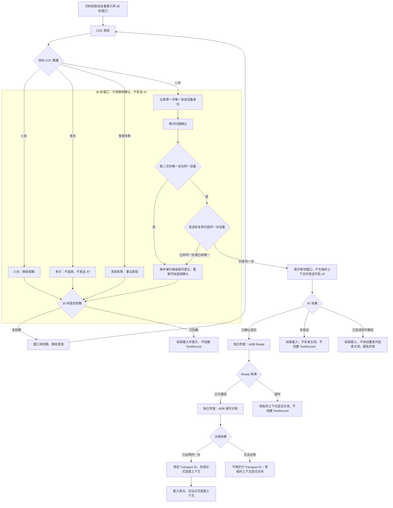

**图后约束：**

- 只有「连续两次都是同一台唯一目标 CDC，且发送前复核仍是这一台」可以发送 AT。0 台、多台、发现失败、只确认到一次唯一，或两次虽都是 1 台但不是同一台，都只能在窗口内等待或在到期后结束。
- 发送 AT 之后不再使用 30 秒窗口。AT、Ready 与身份关联使用各自的超时或判定策略，数值待验证。
- 图中的「再次扫描确认」不表示已经规定了固定间隔；间隔是否需要、需要多久，仍待真机验证。
- Ready 节点不写 15 秒或连续两次，以免把参考工程参数伪装成 YME009 已确认事实。
- ADB Ready 只表示设备已可通信；必须再通过身份关联，才能锁定 Transport ID 并交给业务检测。关联方法本身待验证，本图只画检查位置，不画具体匹配步骤。
- AT 未发送或结果不确定时，不自动补发关闭命令。只有 AT 已确认成功后的 Ready 失败或关联失败，才使用临时设备身份上下文尝试关闭。
- 本图不画等待期间取消和等待期间再次扫码。
- 正式检测的读取、判定、保存，以及保存之后再尝试关闭 ADB，见 2.2 的生命周期关系图，避免在本图重复展开业务检测。

---

## 2.5 交接上下文与状态模型

### 2.5.1 临时设备身份上下文与正式设备连接上下文

**建议方案：** 接入过程中需要两种不同职责的上下文。这是生命周期和数据职责上的区分，不要求设计成两个独立类，也不为此扩展上下文管理框架。实施时可以把它们做成同一对象的两个阶段，但正式阶段必须在身份关联通过之后才能成立。设备身份的具体字段仍待验证。

**A. 临时设备身份上下文**

- **产生时机：** CDC 门禁通过之后，也就是连续两次确认同一台唯一目标 CDC，并且发送前身份复核仍然通过之时。
- **用途：** 记录本轮通过门禁的 CDC 设备身份，不记录可跨 USB 重新枚举复用的 COM 号或串口句柄。按该身份在当次发现的当前 COM 上发送开启 AT。在正式连接上下文尚未形成，但本轮 AT 开启已确认成功，且该设备身份仍在时，按 2.6.2 重新发现当前 CDC 并尽力关闭 ADB。AT 未发送、AT 结果不确定等 2.6.1 明确禁止补发关闭命令的出口除外。它还参与本轮资源清理的交接。关闭 ADB 与资源清理不是同一动作。
- **明确不包含：** 尚未确认、尚未完成身份关联的 Transport ID。
- **不得交付给业务检测。**

**B. 正式设备连接上下文**

- **产生时机：** ADB Ready 成功，并且 ADB 身份关联成功之后。建议候选名仍可用 `Yme009DeviceConnectionContext`。
- **用途：** 向业务检测交付；支持后续按已锁定 Transport ID 做定向属性读取。本轮 ADB 业务操作已经结束，且其中的 CDC 设备身份仍然可用于匹配时，优先用这份身份做关闭前的重新发现。正常路径还要等 TestRecord 保存成功。不得在属性读取、身份关联或其他 ADB 业务操作尚未完成时用它关闭。正式上下文不保存可跨 USB 重新枚举复用的 COM 号或串口句柄。
- **必须包含：** 已验证的 CDC 设备身份；已确认与该 CDC 设备关联的 Transport ID；本轮接入世代或就绪令牌，防止上一轮的 Ready 状态或上下文被下一轮误用。
- **可选包含：** ADB Serial，仅用于日志，不得作为定向执行依据。参考工程的 `AdbTarget` 也只把 Serial 用于日志。

| 内容 | 所属上下文 | 作用 | 约束 |
|---|---|---|---|
| 本轮通过门禁的 CDC 设备身份 | 临时上下文必须有；正式上下文必须继承并保持一致 | 用于确认后来发现的 CDC 是否仍属于本轮目标，并据此取得当次 COM 后发送开启或关闭 AT。正式上下文尚未形成，但 AT 开启已确认成功且临时上下文仍在时，用临时上下文中的身份尽力关闭；2.6.1 明确禁止补发的出口除外。正式上下文已形成时，优先用正式上下文中的身份做关闭前匹配 | 具体字段待验证，见 2.7.2。不得把 COM 号当作该身份。目标不能按该身份唯一匹配、发现失败或当前 COM 打不开时，跳过发送关闭 AT，不重做 Ready 或身份关联。关闭结果不影响已保存的检测结果 |
| 当次 COM 号与串口句柄 | 不属于两类上下文的长期内容 | 只服务于当前这一次 AT 交换 | USB 重新枚举后不得复用。交换结束即释放。开启时的 COM 不能作为关闭时的 COM |
| 已锁定且已完成身份关联的 Transport ID | 只属于正式上下文 | 本轮所有后续 ADB 属性读取的唯一设备定向依据 | 必须使用定向参数，例如参考工程中的 `adb -t {TransportId}`；不得改用默认设备，也不得直接复用现有不带定向参数的 `DeviceCommandExecutor`；关联未通过时不得写入 |
| 本轮接入世代或就绪令牌 | 两种上下文都可以携带 | 防止上一轮状态被下一轮误用 | 每一轮接入开始时清零 Ready 观察、关联结果和锁定结果。参考工程每次开启都会清零 streak 与观察缓存，这一原则可参考 |
| 可选的 Serial | 正式上下文可有 | 仅用于日志 | 不得作为定向执行依据，也不得单独作为与 CDC 关联的充分证据 |

扫码 SN、当前 TestSession、目标软件版本不属于设备发现结果，由轮次协调在调用业务检测时一并提供。

**设计判断：** 设备身份、COM 号和串口连接句柄必须分开。设备身份用来确认当前 CDC 是否属于本轮目标，字段仍待 2.7.2 核实。COM 号只是当前 USB 枚举下的通信地址。串口句柄只覆盖一次 AT 交换。三者都不能互相替代。

**设计判断：** 业务检测一旦开始，即视为已经越过接入门禁，并且已经持有正式连接上下文。读取过程中 Transport ID 消失、定向命令失败或超时，属于正式检测中的设备读取异常，应按 D09 保存 TestRecord，而不是退回「接入失败、不创建记录」。Transport ID 在断开或重连后是否仍指向同一台设备，需要真机验证，见 2.7；在验证完成前，架构上不沿用上一轮锁定的 Transport ID。

### 2.5.2 状态模型

流程图已经给出步骤和分支。状态图的独立价值在于：30 秒窗口内，0 台、一次唯一、多台之间可以来回回退，设备身份变化时必须重新开始连续确认；而一旦发送 AT，就进入不可回到等待窗口的终态通道。这与「三条并列等待路径」并不相同，故另附**图 4：设备接入状态图**。

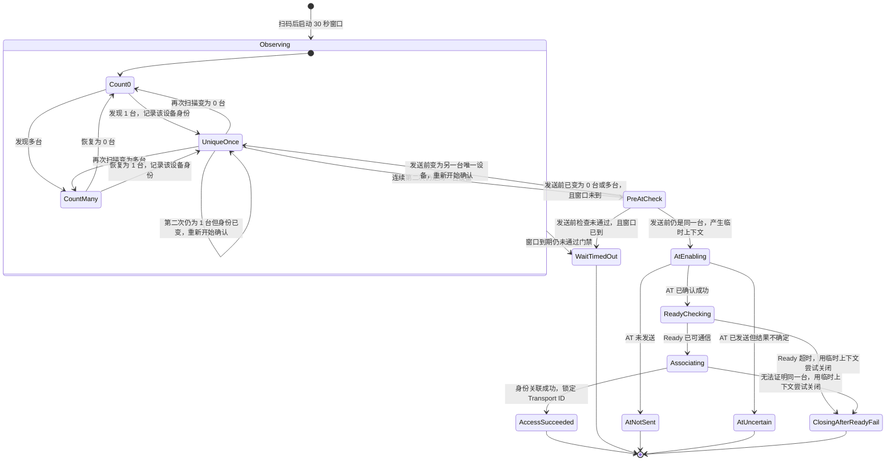

**图后约束：**

- `Observing` 内部的转移都不离开 30 秒窗口，也都不允许发送 AT。两次都是 1 台但不是同一台时，必须留在观察中重新开始连续确认，不能进入 `PreAtCheck`。
- `AtEnabling` 之后不再回到 `Observing`。AT 未发送、AT 结果不确定、Ready 超时、身份关联失败都是本轮终态。
- `AtNotSent` 和 `AtUncertain` 都不自动补发关闭命令。`AtUncertain` 需要向操作员报告异常。
- `ClosingAfterReadyFail` 覆盖 Ready 超时和身份关联失败：二者都使用临时设备身份上下文尝试关闭，且都不创建 TestRecord。
- `AccessSucceeded` 是设备接入生命周期的成功终态，此时才形成正式连接上下文，随后进入业务检测，不再修改已锁定的 Transport ID。正式检测保存 TestRecord 之后再尝试关闭 ADB，属于下一生命周期，本图不重复展开。
- 发现失败不单独设终态，表现为停留在当前观察并重试，直到窗口到期。
- 取消若在后续需求中被确认允许，只应在 `Observing` 或尚未发送 AT 的检查点进入「已取消」终态；不在本图先行画成已确认规则。

---

## 2.6 异常出口与资源清理

### 2.6.1 接入失败出口

| 出口 | 典型原因 | TestRecord | 是否尝试关闭 ADB | 本轮如何结束 |
|---|---|---|---|---|
| 等待超时 / 门禁未通过 | 30 秒内持续 0 台、多台，或未能连续两次确认同一台唯一目标 CDC；发现一直失败 | 不创建 | 否。此时尚未确认已发送开启命令 | 停止观察，提示操作员，由轮次协调结束本轮。不计入业务 FAIL |
| AT 未发送 | 命令没有实际发送，或能够确认设备未执行开启命令的明确失败 | 不创建 | 否。不补发关闭命令 | 不自动改发开启命令，提示后结束本轮 |
| AT 已发送但结果不确定 | 开启命令可能已经执行，但无法确认 | 不创建 | 否。不自动补发开启或关闭命令，报告异常 | 不自动重发 AT，提示后结束本轮 |
| ADB Ready 超时 | AT 已确认成功，但 Ready 检查未通过 | 不创建 | 是。使用临时设备身份上下文尝试关闭 | 关闭成功或失败都不写记录，提示后结束本轮 |
| ADB 身份关联失败 | ADB 已可通信，但无法证明该设备就是本轮 CDC 目标 | 不创建 | 是。使用临时设备身份上下文尝试关闭，且不得交付 Transport ID | 关闭成功或失败都不写记录，提示后结束本轮 |
| 正式检测中的读取异常或业务 FAIL | 已进入业务检测 | 按 D09 保存 | 保存成功后使用正式上下文中的设备身份，按 2.6.2 重新发现当前 CDC 并尝试关闭。保存未完成时不另造记录；设备身份仍在时同样尽力关闭 | 关闭失败不改变已保存结果。关闭成功也不把未保存解释为已保存。不得复用开启时的 COM |

**设计判断：** D14 的原文覆盖的是「记录保存后的关闭」。Ready 超时或身份关联失败虽然不创建记录，但 AT 开启已经成功，设备上的 ADB 可能已经打开。若完全不清理，会把参考工程「异常路径经常不关 ADB」的行为带进包装工位。因此，**建议**在「AT 已确认成功但未进入正式检测」时，使用临时设备身份上下文尝试关闭，并把关闭结果只作为异常报告。这不改变 D13「不创建 TestRecord」，也不把关闭成功当成补救后的检测通过。此时还没有正式连接上下文，不能依赖尚未锁定的 Transport ID 去关闭。

**建议方案：** 对「AT 已发送但结果不确定」，不要自动补发关闭命令。因为此时无法确认开启是否生效，补发关闭可能作用在错误状态上。该路径以提示结束本轮，并把设备实际状态列为待真机验证项。

### 2.6.2 正式检测路径上的清理

**建议方案：** 正常检测路径的顺序固定为：CDC 观察与确认 → AT 接入 → ADB Ready → 身份关联并锁定 Transport ID → ADB 业务检测 → TestRecord 保存成功 → 尝试关闭 ADB → 资源清理。

关闭 ADB 必须发生在本轮全部 ADB 业务操作完成之后。正常路径中，保存成功后才进入关闭阶段。不得在属性读取、身份关联或其他 ADB 业务操作尚未完成时关闭 ADB。关闭不属于业务检测步骤，而是检测结束后的设备收尾动作。

关闭由轮次协调发起，由设备接入协调通过既有 AT 开关执行，不新增 AT 命令，也不改变开启 ADB 的发送规则。

**建议方案：** 每一轮结束时，只要本轮 AT 开启已经确认成功，并且临时上下文或正式上下文中的设备身份仍然存在，就尽力尝试关闭 ADB。开启时的 COM 号和串口句柄不属于这份上下文，也不要求它们仍然有效。正式连接上下文已经形成时，优先使用正式上下文中的设备身份做关闭前匹配。正式连接上下文尚未形成，但本轮 AT 开启已确认成功，且临时设备身份上下文仍然存在时，也使用临时上下文中的身份尽力关闭。该范围覆盖 Ready 检查、身份关联过程中发生的其他异常结束，不限于 2.6.1 明列的 Ready 超时和身份关联失败。AT 未发送、AT 已发送但开启结果不确定等 2.6.1 明确禁止补发关闭命令的出口，仍然不补发。无论是否发送关闭命令，都继续进入统一资源清理。

USB 重新枚举之后重新发现 CDC、取得当前 COM 并重新打开串口，是关闭流程本身的必要步骤，不属于被禁止的异常重连。不得为了关闭重新执行 ADB Ready、身份关联或 Transport ID 锁定，不得切换到其他设备，也不得在关闭命令已经发出但结果不确定时自动重发。

**开启 ADB 的一次 AT 交换**按以下顺序执行，不改变上面三种 AT 结果分类：

1. 发现当前 CDC 候选。
2. 按已经用于本轮门禁的目标识别条件筛选。识别字段仍待 2.7.2 核实，不得临时指定。
3. 做唯一性检查。多台候选不自动选择。
4. 取得这次发现的当前 COM 号。
5. 打开该 COM。
6. 发送开启 ADB 的 AT 指令。
7. 按 2.4.2 的三种结果分类。
8. 结束这次交换并释放串口。

**ADB 开启后的 USB 重新枚举：** 开启 ADB 可能使 USB 重新枚举。原 COM 号可能消失或改变。开启时取得的 COM 号不能作为关闭时的有效 COM 号。开启阶段的串口句柄不能跨过这次重新枚举继续使用。ADB Ready、身份关联和 Transport ID 锁定仍按 2.4.3 执行，不在关闭流程里重做。

**关闭 ADB 的一次 AT 交换**在允许尝试关闭时按以下顺序执行：

1. 重新发现当前 CDC 候选。
2. 用本轮上下文中的设备身份确认候选属于本轮目标。正式上下文优先。
3. 做唯一性检查。不得从多台候选里自动选一台。
4. 取得重新发现后的当前 COM 号。
5. 用该 COM 重新打开串口。
6. 发送关闭 ADB 的 AT 指令。
7. 按现有 AT 结果规则处理响应。关闭命令已发送但结果不确定时，不自动重发。
8. 结束这次交换并释放串口。

不得复用开启前的 COM 号或开启阶段的串口句柄。仅凭当前只有一个 CDC 候选，而上下文中的身份对不上或身份字段仍无法比较时，不得断言它就是本轮目标设备。

下列情况不发送关闭 AT，记为关闭未完成或跳过，然后继续统一资源清理：CDC 重新发现失败；没有发现目标 CDC；多个目标 CDC 无法按已确认规则唯一确定；无法确认重新发现的 CDC 属于本轮目标；当前 COM 打开失败。这些情况不改变已保存的 TestRecord、业务 PASS / FAIL、保存状态、统计和导出结果。

这条尽力关闭适用于：

- 业务 PASS、业务 FAIL，或必要属性读取异常已经形成完整检测结果，并且保存成功；
- 保存失败或保存结果不能确认，即第四章状态 5；
- SessionId 映射失败，即状态 1，尚未进入保存过程；
- 未预期软件异常，即状态 6，未形成完整检测结果；
- 正式连接上下文已经形成，但业务检测尚未开始便结束本轮；
- 其他已经具备可用 AT 控制上下文的异常结束出口。

状态 5 与 SessionId 映射失败仍然是两种情况。状态 6 不得伪装成业务 FAIL 或设备读取异常。不得为了关闭 ADB 而构造 TestRecord。不得因为关闭成功，就把保存失败解释为保存成功。不得因为关闭失败，就改变已经保存的 PASS 或 FAIL。

执行边界：

1. 关闭匹配只使用本轮上下文里已经记录的设备身份。不使用开启时的 COM 号或串口句柄。
2. USB 重新枚举后的重新发现、取得当前 COM 和重新打开串口，属于关闭流程。身份不能确认、发现失败、不唯一或当前串口打不开时，跳过发送，不因此切换设备、重做 Ready 或反复重试。
3. 不为了关闭重新执行 ADB Ready 或身份关联。
4. 重新发现失败、没有目标 CDC、多个目标无法唯一确定、无法确认属于本轮目标，或当前 COM 打开失败时，不发送关闭 AT。开启阶段的 COM 消失本身不是跳过理由。
5. 关闭命令失败或结果不确定时，记录异常或结果，不改变业务结果和保存结果，也不自动重发。
6. 不进行无限等待，不增加重试框架。
7. 关闭尝试结束或被判定无法执行后，继续完成资源清理。
8. 这次关闭交换自己的串口在交换结束时释放。关闭不得阻塞上下文作废、Transport ID 解锁和过程锁释放。

关闭尝试必须使用清理令牌或等价机制，不能因为本轮工作 Token 已取消而被直接跳过。操作员开始下一轮时，必须重新走完整的接入门禁，不得沿用上一轮临时上下文或正式上下文。保存失败的界面文案仍待确认；关闭异常的提示不得盖住「未保存」。

等待超时、AT 未发送、AT 已发送但结果不确定，仍按 2.6.1 不补发关闭命令。这三条没有已确认可以安全发送关闭命令的 AT 控制上下文。本章不推断这三条可以补发关闭。

### 2.6.3 取消与等待期间再次扫码

**待确认问题：** PRD 已写明，等待期间是否允许取消、等待期间再次扫码如何处理，仍待确认。本章不把其中任何一种写成已确认规则。

**建议方案：** 接入协调和 30 秒等待循环必须能够响应取消令牌或停止请求，以便一旦业务确认允许取消，不必再改门禁结构。若将来允许取消，建议的清理原则是：仍处于 CDC 观察、尚未确认发送开启命令时，只停止观察，不创建记录，不发送关闭 AT；若已经 AT 成功，则按 2.6.1 使用临时设备身份上下文尝试关闭。等待期间的过程锁继续沿用第一章和 D08 的既有边界：在未另作需求确认前，检测处理中的新扫码仍被忽略，不引入并行检测。

### 2.6.4 资源释放的基本要求

**建议方案：** 每次 AT 交换的串口资源都是：发现 CDC → 取得当前 COM → 打开串口 → 完成 AT 交换 → 释放串口。开启 ADB 和关闭 ADB 是两次独立交换。不得把一次打开的串口当作贯穿整轮的长期资源，也不得把开启时的句柄留到 USB 重新枚举之后。

每一轮结束时，无论成功或失败，也无论是否实际发送了关闭命令，都应停止本轮 CDC 观察、Ready 观察和身份关联观察，并作废本轮临时上下文和正式连接上下文。若某次交换的串口句柄尚未释放，统一清理负责释放这个残留句柄；这不是关闭 ADB 命令，也不复用开启时的 COM。AT 交换应保证同一时刻只进行一次。关闭 ADB 的尝试若要执行，发生在上述统一清理之前，并使用清理令牌或等价机制。关闭失败、结果不确定或被跳过，都不阻止这些释放，也不阻止过程锁在清理完成后释放。这些原则可参考 `SmtAtSession` 的单次交换互斥，以及每次开启前清零 Ready 状态，但不把 SMT 的拔板状态机一并迁入。参考工程关闭前会重新发现并打开当次 COM，见 2.7.1；它没有把重新枚举前后的实例标识做成同一台设备的证明。

---

## 2.7 待验证事项

本节只整理与设备接入架构有关的验证项，不把待验证内容写成已确认设计。

### 2.7.1 已有源码证据

下列内容已在参考工程源码中得到证明，可作为实现参考，但它们证明的是 YunkeProductionTester 的行为，不是 YME009 真机已经接受的协议。

- SetupAPI 枚举 Ports 类在线设备，再按候选条件筛选；不使用 WMI。
- 按目标 CDC 数量分类为 0、1、多台或发现失败；多台不自动选择、不发送 AT。参考工程的连续两次唯一确认和发送前再检查，比较的是数量是否再次为 1，而不是两次是否为同一台 CDC 设备。
- 普通等待阶段采用连续两次数量唯一确认，发送前再检查一次；两次确认之间没有固定间隔。
- 生产路径的开启 / 关闭 AT 原文，以及分行匹配 `SIMO AT COMMAND RESULT:` 与 `OK`。
- AT 交换使用 `NotSent` / `Succeeded` / `Uncertain`，已发送但无法确认则不自动重发。
- ADB Ready 与 AT 成功分开；参考实现为 15 秒窗口内同一 Transport ID 连续两次 `device`。该 Ready 观察不把 CDC 或 USB 父设备映射到 Transport ID。
- 后续 ADB 命令使用 `-t {TransportId}` 定向，调用方不得自行携带设备选择参数。Serial 只用于日志，参考工程并明确它不是物理板身份。
- 保存成功后发送关闭 AT；关闭失败不自动重试。每次开启前清零上一轮 Ready 状态。
- `SmtAtSession.EnableCoreAsync` 与 `DisableCoreAsync` 各自调用 `DiscoverAsync`。筛选后的候选不是恰好一台时，不打开串口、不发送 AT。位置：`Application\Prepare\SmtAtSession.cs`。
- 开启和关闭都用当次候选的 `PortName` 调用 `OpenAndClearAsync`。会话以 `await using` 结束，`DisposeAsync` 在端口未隔离时调用 `TryClosePort`。关闭调用不接收开启时保存的 COM。调用入口分别是 `SmtStationCoordinator.At.cs` 的 `TryEnableAsync` 与 `TryDisableAsync`。
- 候选类型 `SerialPortCandidate` 带有 `InterfaceInstanceId`、`ParentInstanceId`、`PortName` 和 `ParentProduct`。关闭路径没有把这些字段与开启时的候选比较。唯一性只是 `Candidates.Count == 1`。这不能写成已经证明 USB 重新枚举前后是同一台物理设备。
- SnVerify 现有正式扫码路径不调用 `CheckMultipleDevices`，因此 YME009 专属门禁不会被该通用警告拦截。依据见第一章 1.5.2。
- **当前没有可靠的 CDC 与 ADB 身份关联实现。** 参考工程不能作为「关联问题已经解决」的证据。

### 2.7.2 尚需真机验证

- YME009 目标 CDC 的准确识别条件，包括 VID/PID、兼容 ID、父设备名、接口和驱动服务名等。不得把 `VID_0E8D`、`M6x-66B` 当作已确认条件。
- **用于判断「同一台 CDC 设备」的身份字段。** 不能在验证前认定 COM 端口名、VID/PID 或某个父设备名就足以代表设备身份。参考工程虽然读出接口实例和父实例，但关闭时没有用它们与开启时的候选比对。
- ADB 开启后 USB 是否重新枚举、原 COM 是否失效，需在 YME009 真机确认。设计上不把开启时的 COM 或串口句柄留给关闭使用。哪一组 USB 字段能在重新枚举后仍指向同一台设备，仍待核实；核实前不得把「当前只有一个 CDC 候选」写成同一台设备的证明。
- YME009 是否接受与参考工程相同的 AT 原文、响应格式和分行成功判断。
- AT 串口参数、结束符和响应时序。参考工程把 115200 之外的默认值、结束符 `\r\n`、重叠 I/O 时限都标明为待设备验证，YME009 同样不能直接采用为已确认值。
- AT 发送后的异常响应、写失败、读超时，以及「不确定」在真机上的具体表现。
- 连续两次 CDC 扫描不加固定间隔，在 YME009 上是否足够稳定。
- ADB Ready 的等待策略：窗口从何时起算、长度多少、轮询间隔、需要连续几次同一 Transport ID、Ready 阶段若同时出现其他 `device` 如何处理。参考工程的 15 秒和连续两次只是参考，不是 YME009 已确认参数。
- **CDC 目标与 ADB 设备之间如何建立可靠身份关联。这是当前关键待验证项。** 该方法必须在其他 ADB 设备同时在线时仍然有效，不能以「当前只有一台 ADB 设备」或「某个 Transport ID 连续两次处于 `device`」作为唯一依据。在获得可证明的方法之前，不得将该 Transport ID 交给业务检测。
- Transport ID 在设备断开、重连后是否仍然有效，是否可能被分配给另一台设备。
- ADB 关闭失败，或 AT 不确定因而未关闭时，设备上的 ADB 实际状态，以及对下一轮重新插入或再次开启的影响。
- 多台目标 CDC 热插拔、枚举抖动和发现失败在实机上的时序。

### 2.7.3 当前技术设计暂不决定

- CDC 设备身份的具体字段组合，以及 CDC 与 ADB 的具体匹配算法。
- AT 客户端的具体 I/O 实现选型。参考工程生产路径使用重叠 I/O 客户端，另有一套未被生产装配使用的 `SerialPortAtCommandClient`。本章只要求独立的 AT 通信职责，不预选实现类。
- Ready 检查的最终数值和轮询算法。
- 等待提示、关闭失败提示、身份关联失败提示的界面文案和 Snapshot 字段设计。
- 等待期间取消、等待期间再次扫码的业务规则。
- 保存失败、未预期软件异常和映射失败的界面文案。这些出口是否尝试关闭 ADB，已由 2.6.2 确定：仍有可用 AT 控制上下文则尽力关闭。AT 未发送和 AT 结果不确定仍不补发关闭。
- 业务检测内部的属性读取顺序、单字段超时、空值解析和 FailReason 代码。这些属于后续业务检测设计，且部分仍待真机或需求确认。

---

## 2.8 跨章节待决问题

本章解决的是第一章 1.9 第 1 项中与设备接入相关的职责切分，以及第 8 项中「不要在架构阶段把协议参数写死」的约束。本章还补齐了同一台 CDC 确认、临时与正式上下文，以及「必须先完成 CDC 与 ADB 身份关联才能锁定 Transport ID」的架构约束；但具体关联方法仍留在 2.7.2，不在此定案。下列问题继续保留，本章不展开设计，也不擅自定案。

1. **YME009 业务检测的详细实现。** 分项读取、统一判定、D12/D16 分类和 FailReason 稳定代码清单，仍待后续技术设计。本章只保证：这些工作发生在接入成功之后，并且使用已锁定、且已通过身份关联的 Transport ID。
2. **TestRecord 持久化缺口。** IMEI、产测、两项老化和分项状态在现有列中没有对应位置。D09/D13 的分类和创建时机可不改表；完整业务值落库与导出列仍按第一章 1.8 第 4 项和 1.9 第 3 项保留。不得为了设备接入设计方便而改表或改 PRD。
3. **YME009 导出与统计。** 导出器注册、两类 FAIL 分桶、Q20 关闭前的过渡策略，仍按 1.9 第 4 项保留。
4. **订单内目标软件版本一致性，以及 `ProductName` 跨产品复用。** 仍按 1.8 第 5、7 项和 1.9 第 5 项保留。
5. **等待态、两类 FAIL 的界面表达。** 以及等待期间取消、等待期间再次扫码被确认之后，对过程锁和 Snapshot 的影响。见 1.9 第 6 项和本章 2.6.3。
6. **YME009 下的自检是否仍走现有 ADB 自检。** 见 1.9 第 7 项。本章只重申：正式扫码检测不得接入现有 `CheckMultipleDevices` 或 `ReadDeviceSnAsync`。
7. **包装工位是否需要 MES。** 见 1.9 第 9 项。确认前保持 Disabled。
8. **Session `EndTime` 未落库、现有保存失败被吞掉后仍可能显示完成。** 见 1.8 第 8、11 项。本期默认不修复，也不在设备接入设计里顺手处理。

完成本章后停止。不继续设计完整业务检测实现，不开始编码。

---

# 3. YME009 业务检测架构设计

本章从第二章交付的正式设备连接上下文开始，设计接入成功之后的业务检测，直到 TestRecord 保存完成。业务依据是 `docs/YME009-Packaging-Station-PRD.md` V0.6。设备读取依据是 `docs/YME009-Device-Integration-Technical-Audit.md` 第 5、6 节中已经标明证据等级的结论。数据与导出依据是第一章 1.4、1.6、1.8。

本章继续使用结论标记：源码事实、设计判断、建议方案、待确认问题。建议组件名尚未实施，不构成接口或实现代码。

本章回答第一章 1.9 的第 2、3、4 项，以及第二章 2.8 的第 1、2、3 项。Q20 仍不关闭。

---

## 3.1 设计目标与边界

### 3.1.1 本章要回答的问题

1. 正式连接上下文交付之后，八个 Android 属性如何读取？
2. 每个字段的读取状态如何保留，某一字段失败后其余字段如何继续？
3. 五项必要检测如何统一为 PASS / FAIL，同时保留哪些技术状态和原始值？
4. 五项条件如何收成一条综合结果？
5. `FailReason` 使用哪些稳定代码，业务 FAIL 与读取异常如何分开？
6. 检测结果如何写入现有 `TestRecord`，且不把分类做成新的数据库字段？
7. 已保存结果如何进入 YME009 自己的导出和统计，同时不改变 KM001、KM008、SOLTAG25？

### 3.1.2 起点与身份关联前提

**设计判断：** 业务检测的输入是第二章 2.5.1 的正式设备连接上下文，加上轮次协调已经持有的扫码 SN、当前 `TestSession` 和本会话目标软件版本。业务检测使用其中已锁定的 Transport ID 做定向读取。上下文中的 CDC 身份只留给保存之后关闭 ADB，本章不拿它做属性读取。

调用契约：

- 上下文带有已锁定的 Transport ID 和本轮世代时，才允许开始读取。
- 没有该上下文时，不得开始读取，不得构造 TestRecord。这一出口属于接入失败，记录规则仍按 D13。
- 读取开始之后，Transport ID 丢失、命令失败或超时，属于正式检测中的读取异常，按 D09 保存，不退回「接入失败、不建记录」。这一点第二章 2.5.1 已经写明，本章沿用。

**设计判断：** 本章不实现 CDC 与 ADB 身份匹配，也不把匹配算法当成读取流程的一步。工位操作规范是同时只放置一台待测设备。CDC 唯一性检查、连续两次确认、AT 发送前复核、ADB Ready 和 Transport ID 锁定，仍由第二章的接入生命周期完成。若接入阶段已经具备身份关联，业务检测只消费它产出的正式上下文。关联算法未验证之前，也不在业务检测中补一套匹配框架。第二章 2.7.2 的关联待验证项保持原样。

目标软件版本取当前会话已保存的 `VerificationParameter.ExpectedAndroidVersion`。判定函数不重新读取界面，也不在订单内再做一次版本一致性查询。订单内一致性属于开始测试时的专属校验，见 1.4.2。该值为空时不进入正式设备检测，见 3.6.1。

### 3.1.3 必须遵守的业务边界

下列规则已在 PRD 中确认，本章只落实，不改写。

- **分项读取、统一判定（D07）。** 八个字段都要尝试读取。一个字段失败，不放弃其他仍能独立读取的字段。每个字段保留自己的值和状态。全部读取结束后，再计算综合结果。必要判定项是设备 SN、软件版本、产测结果、重启老化、恢复出厂老化。其中任一项失败或缺失，综合结果不得为 PASS。IMEI1、IMEI2、WiFi MAC 只展示和追溯。
- **两类 FAIL（D09、D12）。** 综合结果只有 `PASS` 和 `FAIL`。业务判定失败、读取异常和协议异常都保存为 `Result=FAIL`，用 `FailReason` 的稳定代码区分。同一次里既有必要字段的读取异常或协议异常，又已经可以看出其他业务条件不满足时，综合主分类仍是读取异常或协议异常。已发现的其他 FAIL 留在分项结果里，不改变主代码。分项本身不再使用第三种业务判定。
- **二值属性（D17，替代 D16 的分项业务判定）。** `persist.sys.yl.cit`、`persist.sys.yl.aging.reboot`、`persist.sys.yl.aging.reset` 的业务判定只有 PASS / FAIL。精确为 `1`：技术状态 `Ok`，业务 PASS。精确为 `0`：技术状态 `Ok`，业务 FAIL，原因是测试失败。空值：技术状态 `Missing`，业务 FAIL，原因是未测试。其他非空值：技术状态 `ProtocolInvalid`，业务 FAIL，原因是数据异常，无法识别。读取失败、超时、断开：保留 `CommandFailed`、`TimedOut` 或 `Disconnected`，业务 FAIL，原因是读取异常。空值不得按 `0`，非空非法值不得按测试失败。该规则不用于 SN、软件版本、IMEI、MAC。综合主失败原因的优先级以 D18 为准。
- **创建时机（D13）。** 只有正式检测开始后才保存 TestRecord。内存对象可以在判定完成后一次构造，数据库仍是一次 INSERT。
- **关闭时机（D14）。** 保存成功之后才尝试关闭 ADB。关闭失败不修改已保存结果。关闭动作本身仍按第二章 2.6.2，本章不重新设计。
- **综合主失败原因（D18）。** 不新增、不删除、不重命名 FailReason 代码。`YME009_REQUIRED_VALUE_MISSING` 表示必要字段未提供有效值，适用于设备 SN、软件版本、产测、重启老化和恢复出厂老化为空。多个条件同时存在时按 3.8.2 只选一个主代码，分项原因全部保留。
- **重复 SN（D08）。** 本次判定不查询历史 PASS，不返回 `SN_DUPLICATE`，不覆盖旧记录。

**设计判断：** 设备审查报告 5.1 节有一句把「产测尚未完成」写成业务 FAIL。D17 确认空值的分项业务判定是 FAIL，原因是未测试，技术状态是 `Missing`；它不是值为 `0` 的测试失败。非空不可识别值的原因是数据异常，不是测试失败。报告中「这两项已有读取实现、其余六项没有、不得启动 `FactoryAutoService`、不得空等产测」的结论继续有效。

### 3.1.4 本章明确不做的事

- 不重新设计 CDC 发现、唯一性门禁、AT 开启 ADB、ADB Ready 或关闭 ADB。
- 不把 YME009 送入 `RulePipelineExecutor`，不修改 KM001、KM008、SOLTAG25 的规则、统计和导出。
- 不启动 `FactoryAutoService`，不轮询等待产测或老化变成 `1`，不读取老化次数。
- 不读取 CIT 分项属性（`persist.sys.yl.cit.wifi` 等）。
- 不修复 `EndSession` 未写 `EndTime`、Phase3 保存异常被吞掉、MES Disabled。YME009 专属保存路径单独避开「保存失败仍显示完成」，见 3.9.4。
- 不关闭 Q17、Q20、Q12，也不规定检测过程中的操作员取消。
- 不设计界面布局和 Excel 列顺序。本章只规定展示和导出必须能拿到的数据。

---

## 3.2 职责与组件

### 3.2.1 需要专属组件的原因

**源码事实：** 现有 `DeviceCommandExecutor` 执行 `adb` 时不带 `-t`。现有 `AdbDeviceService.ReadDeviceInfoAsync` 按 KM001/KM008 的字段表读取，失败字段写成空值后继续，但没有 YME009 的八个键，也没有「协议非法」和「业务 0」的区分。`RulePipelineExecutor` 在读取后按固定链逐条失败返回，不能表达 D07 的「读完再统一判定」，也不能关闭 `SN_DUPLICATE`。

因此需要下面四个专属边界。它们都挂在第二章已经确定的 `Yme009RoundCoordinator` 之后，不进入现有规则链。

| 建议候选 | 必要性 | 职责 | 明确不承担 |
|---|---|---|---|
| `Yme009BusinessInspection` | 第二章已把「正式检测」留在这个边界。需要一个对象把读取和判定串起来，避免轮次协调直接拼 ADB 命令 | 接收正式连接上下文、扫码 SN 和目标版本；调用读取；调用纯判定；返回待保存的检测结果 | 不发现 CDC，不发送 AT，不保存数据库，不关闭 ADB，不做身份匹配 |
| `Yme009PropertyReader` | 现有执行器不能按 Transport ID 定向，也不能产出分项状态 | 对八个属性各执行一次定向 `getprop`，为每个字段填写读取状态和原始值 | 不判断五项是否 PASS，不把失败改写成 `0`，不重试，不启动产测 |
| `Yme009InspectionJudge` | D07、D12、D16 必须能在不连接设备的情况下验证 | 纯函数。输入八个字段结果、扫码 SN 和已经存在的目标版本；输出综合结果、主 `FailReason`、五项分项判定 | 无 I/O，不读历史记录，不写 `TestRecord`。目标版本为空时不把它写成读取异常 |
| `Yme009FailReasonCodes` | 失败码必须集中，且不能改写 `RuleFailReasonCodes` 里已有常量的含义 | 只存放本章 3.8 的 YME009 代码 | 不包含 `SN_DUPLICATE`，不替换 KM001 已有代码 |

**设计判断：** 不再增加字段策略类、规则管道或身份匹配服务。八个属性用读取器内部的一张字段表描述，表中区分「必要文本」「必要二值」「信息字段」。定向进程调用作为读取器的内部细节，不单独再做一层设备框架，也不修改 `DeviceCommandExecutor`。

**设计判断：** `TestRecord` 的列映射做成判定结果旁边的纯映射，由轮次协调在调用 `SaveTestRecordAsync` 之前使用。不为此新增仓储，也不往 `StorageService` 里写 YME009 判定分支。

**设计判断：** 导出需要独立的 `Yme009SessionExporter`。必要性见 3.10：现有工厂在 `Mode == Phase3` 时一律返回 `Km001SessionExporter`。

### 3.2.2 调用关系

下图是**图 5：业务检测调用关系**。阅读目的是看清读取、判定、保存三者分开，以及轮次协调仍是唯一调用保存和关闭的位置。

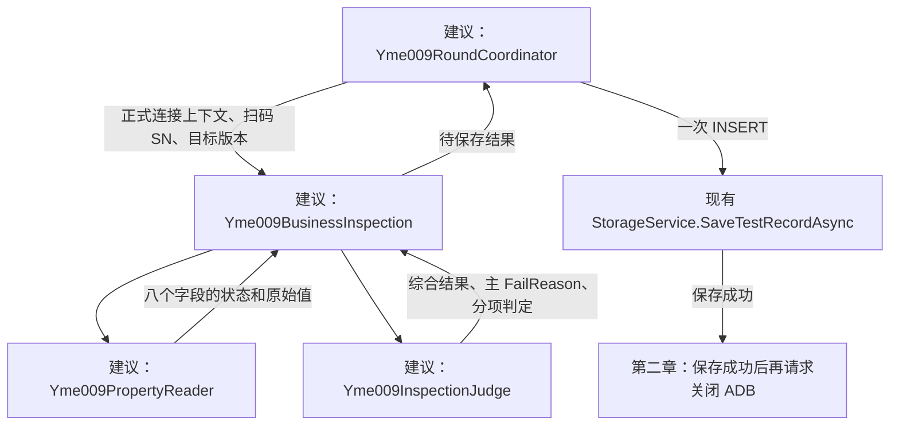

**图后约束：**

- `ProcessCoordinator` 仍只做产品分流，不调用读取器或判定函数。
- 判定函数看不到 ADB，读取器看不到 PASS 条件。
- 读取器只使用本次传入的 Transport ID。
- 保存失败时不进入「保存成功后再关闭」这条边。若仍有可用 AT 控制上下文，按 2.6.2 尽力关闭；否则跳过。本章不另定关闭规则。关闭失败不把未保存显示为已保存。
- 目标软件版本为空时，轮次协调不调用业务检测。该情况不是读取失败，见 3.6.1。

---

## 3.3 业务检测整体流程

**建议方案：** 一轮正式检测按下列顺序执行。顺序固定，便于和 D07、D13、D14 对照。

1. 轮次协调确认本次持有正式连接上下文，取出 Transport ID、扫码 SN、`SessionId` 和目标软件版本。目标软件版本为空时停在这一步：不读取、不判定、不创建 TestRecord。处理方式见 3.6.1。
2. 业务检测按该 Transport ID 定向读取八个属性。每个字段独立记状态。
3. 已经确认该 Transport ID 丢失时，尚未读取的字段记为断开，不再改选其他 ADB 设备。
4. 八个字段的状态收齐后，判定函数一次性计算分项结果和综合结果。
5. 用判定结果构造一条完整 `TestRecord`。此时仍只在内存中。
6. 轮次协调调用一次 `SaveTestRecordAsync`。
7. 保存成功后，轮次协调按第二章请求关闭 ADB。
8. 把综合结果、主失败原因和分项状态交回现有 Snapshot 投影。界面文案由后续 UI 任务使用这些数据，本章不规定布局。

下图是**图 6：从正式连接上下文到保存**。它复述目标版本已经存在之后的读取、判定和一次 INSERT，不增加新的通过条件。目标版本为空的出口在步骤 1，不画进图中。

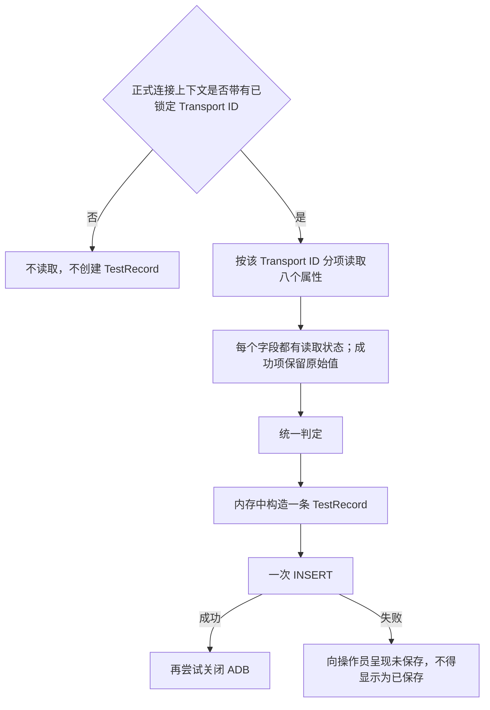

**图后约束：**

- 30 秒等待窗口不参与属性读取。每个字段使用自己的命令超时。
- 本图从目标软件版本已经存在开始。版本为空时不进入读取，图中不单画这一支，避免把它画成设备读取结果。
- 信息字段失败不会在本图中把综合结果改成 FAIL。是否 FAIL 只由判定函数根据五项必要项决定。
- 接入阶段的等待超时、AT 失败、Ready 超时不进入本图。
- 检测过程中的操作员取消，PRD 仍未确认。本章不增加取消入口。若读取因本轮上下文被作废而中断，已开始的正式检测按读取异常保存，综合结果不得为 PASS。

---

## 3.4 Android 属性读取

### 3.4.1 读取命令

**源码事实（审查报告）：** 参考工程里，`ro.build.display.id` 的生产读取是定向命令 `adb -t {TransportId} shell getprop ro.build.display.id`。成功时只去掉末尾连续的 `\r` 和 `\n`。`persist.sys.yl.cit` 的生产读取是 `adb -t {TransportId} shell "getprop | grep -F persist.sys.yl.cit"`，空匹配会进入 CIT 等待，不属于包装工位。其余六个属性在参考工程中没有读取实现。

**建议方案：** 八个属性都使用同一种定向读取，每个属性一条命令：

`adb -t {TransportId} shell getprop {属性键}`

字段表如下。顺序只用于日志和状态记录，不表示后一个属性依赖前一个属性。审查报告没有发现这八项之间必须先执行的通信步骤；在真机证明存在这种依赖之前，读取器不插入前置命令。

| 顺序 | 字段 | 属性键 | 角色 |
|---|---|---|---|
| 1 | 设备 SN | `sys.skyroam.osi.sn` | 必要文本 |
| 2 | 软件版本 | `ro.build.display.id` | 必要文本 |
| 3 | IMEI1 | `sys.skyroam.imei1` | 信息字段 |
| 4 | IMEI2 | `sys.skyroam.imei2` | 信息字段 |
| 5 | WiFi MAC | `persist.sys.wifi.mac` | 信息字段 |
| 6 | 产测结果 | `persist.sys.yl.cit` | 必要二值 |
| 7 | 重启老化 | `persist.sys.yl.aging.reboot` | 必要二值 |
| 8 | 恢复出厂老化 | `persist.sys.yl.aging.reset` | 必要二值 |

**建议方案：** 命令完成且退出码为 0 时，视为该字段读取成功。原始值只去掉末尾连续 `\r` / `\n`，中间空格和大小写保留。退出码非 0、进程失败、ADB 不可用，记为命令失败，丢弃该次输出，不从输出里解释出 `0` 或 `1`。单字段超时记为超时。已锁定的 Transport ID 不在成功的设备列表中，或命令明确报告该 Transport 不存在，记为断开。

**待确认问题：** 六项尚未实现的属性，以及产测属性改用直接 `getprop` 之后，真机上的退出码、空值和多行输出仍以审查报告 9.5 节为准。上面的退出码规则是建议方案，用来保证失败不会被写成 `0`；它不是已经确认的设备协议。

每个字段只读一次。不因为得到空值、`0`、非法值或命令失败而重试，也不为了等产测完成而轮询。单字段超时的毫秒数待真机验证，不把参考工程的 5 秒写成已确认值，也不把接入阶段的 30 秒用于属性读取。

### 3.4.2 成功值如何分类

读取成功之后，再对原始值分类。这一步仍然属于读取结果，不属于综合 PASS。

| 角色 | 原始值 | 字段分类 |
|---|---|---|
| 必要二值 | 恰好 `1` | `Ok`。业务 PASS |
| 必要二值 | 恰好 `0` | `Ok`。业务 FAIL，原因是测试失败 |
| 必要二值 | 空串 | `Missing`。业务 FAIL，原因是未测试。不得按 `0` |
| 必要二值 | 除 `0` / `1` 以外的非空内容 | `ProtocolInvalid`。业务 FAIL，原因是数据异常，无法识别。不得按测试失败 |
| 必要文本 | 去掉末尾换行后仍有内容 | 可进入 SN 或版本比较 |
| 必要文本 | 空串 | `Missing`。业务 FAIL，原因是未测试。这不是 SN 不匹配或版本不匹配 |
| 信息字段 | 去掉末尾换行后仍有内容 | 已采集 |
| 信息字段 | 空串 | 该字段缺失。不影响综合结果 |

**设计判断：** 必要文本的空值按 D17 记为该项 FAIL，原因是未测试，不是 SN 不匹配或版本不匹配。审查报告里，参考工程把空的软件版本当成比较失败；包装工位不沿用该比较。空的 IMEI 或 MAC 只保留字段状态。

协议数据异常只可能出现在三个二值属性的非空非法值上。空值使用 `Missing`，不使用 `ProtocolInvalid`。SN、版本、IMEI、MAC 不产生协议数据异常分类。

### 3.4.3 某一字段失败之后

**建议方案：**

- 命令失败或超时，且 Transport ID 仍在：继续读取后面的字段。
- 某一字段已经确认 Transport ID 丢失：后面尚未读取的字段记为断开，不再发起命令，也不换一台 ADB 设备。已经成功的字段保留原始值。
- 信息字段失败：继续读取必要字段。
- 必要字段失败：继续读取其余字段，包括 IMEI 和 MAC。

这样满足 D07 的「独立字段继续读取」。Transport 丢失后不再发命令，是因为继续发只会得到同一次断开；这些字段的状态仍然逐项保留，不是把整次读取收成一个空结果。

读取过程中不重新连接、不重新锁定 Transport ID。恢复方式属于 Q12，本章不设计。

---

## 3.5 分项读取状态

**建议方案：** 每个字段在进入判定前都有且仅有一个读取状态。

| 状态 | 含义 | 是否把原始值交给判定 |
|---|---|---|
| `Ok` | 命令成功，且值属于该角色的可判定内容或可展示内容。二值属性仅 `0` 和 `1` 为 `Ok` | 是。原始值保留 |
| `Missing` | 命令成功，原始值为空。包括必要文本、三个二值属性和信息字段 | 原始值保留。必要字段的业务判定为 FAIL，原因是未测试。信息字段只作展示 |
| `ProtocolInvalid` | 命令成功，二值属性是除 `0` / `1` 以外的非空内容 | 保留原始文本。业务判定为 FAIL，原因是数据异常，无法识别。不参与「是否为 0」的测试失败判定 |
| `CommandFailed` | 命令或 ADB 失败 | 业务判定为 FAIL，原因是读取异常。不保留失败输出 |
| `TimedOut` | 该字段超时 | 业务判定为 FAIL，原因是读取异常 |
| `Disconnected` | 锁定的 Transport ID 已丢失，或因此未再发送 | 业务判定为 FAIL，原因是读取异常 |

五项必要项的业务判定只有 PASS / FAIL，工位不展示第三种业务判定。信息字段没有 PASS / FAIL 结论。

分项业务判定：

- 必要二值处于 `Ok` 且原始值精确为 `1`：PASS。
- 必要二值处于 `Ok` 且原始值精确为 `0`：FAIL，原因是测试失败。
- 必要二值或必要文本处于 `Missing`：FAIL，原因是未测试。
- 必要二值处于 `ProtocolInvalid`：FAIL，原因是数据异常，无法识别。
- 必要项处于 `CommandFailed`、`TimedOut` 或 `Disconnected`：FAIL，原因是读取异常。
- 必要文本处于 `Ok`，并且比较结果一致：PASS。
- 必要文本处于 `Ok`，并且比较结果不一致：FAIL。SN 的原因是 SN 不匹配，软件版本的原因是软件版本不匹配。

原先用 `NotJudged` 表示「该项不做业务结论」的工位展示，由 D17 替代。技术状态枚举不删除、不合并。同一条记录仍可同时保留一项的读取异常状态和另一项的业务 FAIL；综合主原因仍看 3.7，不因为分项都显示 FAIL 而改变。

---

## 3.6 分项业务判定

### 3.6.1 比较规则的唯一位置

**待确认问题（Q17）：** SN 比较是否忽略大小写和空格，PRD 尚未确认。软件版本是否使用同一比较语义，PRD 也没有单独的已确认规则。

**建议方案：** SN 与扫码 SN、实际版本与目标版本，共用同一个比较函数，并且只有这一处。当前实现暂定为：使用 3.4.1 已经去掉末尾换行的原始值，与对照值做区分大小写的完全比较；不删除首尾空格，不折叠大小写。因此目前大小写不同或空格不同会得到「不一致」。Q17 关闭后只替换这个函数，不改综合判定的分支。

**源码事实：** `MainViewModel.StartVerifyAsync` 在扫码内容为空白时写警告并返回；`HandleScanInputAsync` 对空白 SN 直接返回。两条路径都不会进入检测。

**待确认问题：** PRD 第 12 节仍把「扫码 SN 为空」标为待确认。本章不给它分配 `FailReason`，也不在判定函数里再判一次。已有入口继续挡住空扫码即可。

**设计判断：** 目标软件版本属于当前 TestSession 的业务配置，取自 `VerificationParameter.ExpectedAndroidVersion`，不是某一次设备属性读取。第一章 1.4.2 已经要求 YME009 在开始测试时确认它必填。正式设备检测开始前，轮次协调再次确认本会话快照里已经有这个值。

值为空时，不调用读取器，不调用判定函数，不创建 TestRecord，也不计入 PASS、业务 FAIL 或读取异常。本轮不得显示为 PASS，也不得显示为已保存。具体提示留给后续界面设计。这不替代开始测试时的专属校验，也不改写五项业务条件：版本项仍然是「实际软件版本与批次目标软件版本一致」。

判定函数只在目标版本已经存在时比较实际版本。它不把配置缺失写成 `NotJudged`，也不返回 `YME009_REQUIRED_VALUE_MISSING` 或其他读取代码。若调用时仍然发现目标版本为空，判定函数返回「会话参数异常」。调用方按同一边界结束本轮：记录日志，不保存检测记录，不把它统计成设备读取异常。不为此新增失败码或异常处理框架。

### 3.6.2 五项判定

| 项目 | PASS | FAIL |
|---|---|---|
| SN 匹配 | 设备 SN 为 `Ok`，且比较函数结果相等 | 比较不一致时原因是 SN 不匹配。空值原因是未测试。读取失败、超时、断开原因是读取异常 |
| 软件版本 | 实际版本为 `Ok`，目标版本已在进入本表之前确认存在，且比较函数结果相等 | 比较不一致时原因是软件版本不匹配。实际版本空值原因是未测试。读取失败、超时、断开原因是读取异常 |
| 产测 | 状态为 `Ok`，且原始值精确为 `1` | `0` 是测试失败；空值是未测试；其他非空值是数据异常，无法识别；读取失败、超时、断开是读取异常 |
| 重启老化 | 状态为 `Ok`，且原始值精确为 `1` | 同产测 |
| 恢复出厂老化 | 状态为 `Ok`，且原始值精确为 `1` | 同产测 |

两项老化分别判定、分别保存。没有「老化总项」代替这两项。不比较老化次数。

### 3.6.3 信息字段

IMEI1、IMEI2、WiFi MAC 只保留读取状态和原始值。它们没有 PASS / FAIL 分项结论，不进入 3.7 的任一分支。三项都失败时，只要五项必要项全部 PASS，综合结果仍为 PASS。

---

## 3.7 综合判定

**已确认（D18）：** 判定函数只在目标版本已经存在时做一次综合计算。目标版本为空的会话参数异常不进入下面的优先级，见 3.6.1。多个条件同时存在时，按下面的顺序取第一个成立的主代码。分项 PASS / FAIL 和分项原因全部保留。

1. 任一必要项为 `CommandFailed`、`TimedOut` 或 `Disconnected`：`YME009_READ_FAIL`。
2. 否则，任一必要二值项为非空非法值：`YME009_PROTOCOL_INVALID`。
3. 否则，设备 SN、软件版本、产测、重启老化或恢复出厂老化为空：`YME009_REQUIRED_VALUE_MISSING`。目标版本缺失不使用这条代码。空值不得改用协议异常代码或值为 `0` 的业务代码。
4. 否则，SN 比较不一致：`YME009_SN_MISMATCH`。
5. 否则，软件版本比较不一致：`YME009_VERSION_MISMATCH`。
6. 否则，产测、重启老化或恢复出厂老化精确为 `0`：分别使用 `YME009_CIT_FAIL`、`YME009_AGING_REBOOT_FAIL`、`YME009_AGING_RESET_FAIL`。多项为 `0` 时按产测、重启老化、恢复出厂老化的顺序取第一项。
7. 五项全部 PASS 时，综合结果为 `PASS`。`FailReason` 为空。

信息字段不参与这七步。第 1 至第 3 步选出的主代码仍归入读取异常统计桶。第 4 至第 6 步归入业务 FAIL。

例如 SN 不匹配、产测为空、重启老化为 `0`、恢复出厂老化为 `1`：综合结果为 `FAIL`，主代码为 `YME009_REQUIRED_VALUE_MISSING`。SN 分项原因是 SN 不匹配，产测分项原因是未测试，重启老化分项原因是测试失败，恢复出厂老化为 PASS。

下图是**图 7：主分类与主失败码**。顺序与 D18 相同，不是新的通过条件。

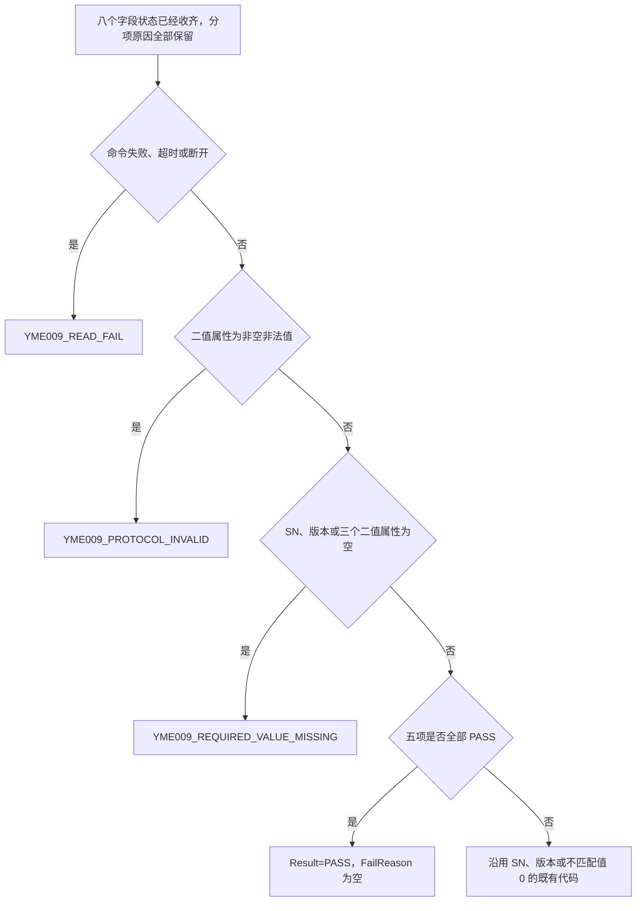

**图后约束：**

- 第 1 至第 3 步优先于 SN 不匹配、版本不匹配和值为 `0`。空值只有在没有命令失败和协议异常时才成为主代码。
- 产测或老化的 `0` 只有在该项状态为 `Ok` 时才使用测试失败代码。空值和非空非法值都不得使用这个代码。
- 同一次同时存在多项失败时，主代码只取 D18 的最高优先级。分项 FAIL 和原因都保留。
- IMEI 和 MAC 不出现在本图的判断里。

多项失败同时成立时，主代码按 D18 和 3.8.2 选取。分项状态和分项原因仍逐项保留。这个顺序只用于填唯一的 `FailReason`，不表示前一项失败就可以不记录后一项。

---

## 3.8 FailReason 分类

### 3.8.1 代码清单

**建议方案：** YME009 使用单独的代码集，不复用 `SN_NOT_MATCH`、`ANDROID_VERSION_MISMATCH`、`ADB_READ_FAIL`、`ADB_PROTOCOL_INVALID`。那些常量继续只服务现有规则链。YME009 也不产生 `SN_DUPLICATE`、`TIMEOUT` 结果或 `EXCEPTION:` 前缀。

`Result` 与主代码的关系：

| 主分类 | `Result` | `FailReason` | 统计桶 |
|---|---|---|---|
| 通过 | `PASS` | 空 | PASS |
| 业务 FAIL | `FAIL` | 下表业务代码之一 | 业务 FAIL |
| 读取异常 | `FAIL` | 下表读取代码之一 | 读取异常 |

业务代码：

| 代码 | 何时作为主代码 | 建议展示文案 |
|---|---|---|
| `YME009_SN_MISMATCH` | 没有第 1 至第 3 级条件，且 SN 比较不一致 | 扫码 SN 与设备 SN 不一致 |
| `YME009_VERSION_MISMATCH` | 没有更高优先级条件，且软件版本比较不一致 | 软件版本与目标版本不一致 |
| `YME009_CIT_FAIL` | 没有更高优先级条件，且产测状态为 `Ok`、原始值精确为 `0` | 产测结果未通过 |
| `YME009_AGING_REBOOT_FAIL` | 没有更高优先级条件，产测不是主代码，且重启老化精确为 `0` | 重启老化结果未通过 |
| `YME009_AGING_RESET_FAIL` | 没有更高优先级条件，前面的值为 `0` 的项都不是主代码，且恢复出厂老化精确为 `0` | 恢复出厂老化结果未通过 |

读取代码：

| 代码 | 何时作为主代码 | 建议展示文案 |
|---|---|---|
| `YME009_READ_FAIL` | 存在必要项命令失败、超时或断开，且按 3.8.2 它优先于另外两个读取代码 | 设备读取失败 |
| `YME009_PROTOCOL_INVALID` | 没有更高优先级的读取失败，且产测或任一项老化为非空非法值 | 产测或老化数据无法识别 |
| `YME009_REQUIRED_VALUE_MISSING` | 没有更高优先级的读取失败或协议异常，且设备 SN、软件版本、产测、重启老化或恢复出厂老化在命令成功后为空 | 必要判定数据缺失 |

展示文案可以在不改变代码的前提下调整。`FailReasonTextResolver` 只追加这些代码的分支，不修改已有代码的文案。未知代码仍回退为原始字符串。

读取异常的主文案不得写成「SN 不一致」「版本不一致」「产测未通过」或「老化结果为 0」。分项结论里已经存在的业务 `Fail` 可以作为诊断同时展示，标题仍使用读取异常文案。这是 PRD 8.2 的展示要求。

### 3.8.2 综合主失败代码的优先级

当存在必要项失败时，按 D18 取第一个成立的代码。不新增代码：

1. 任一必要项为 `CommandFailed`、`TimedOut` 或 `Disconnected`：`YME009_READ_FAIL`。
2. 否则，任一必要二值项为非空非法值，即 `ProtocolInvalid`：`YME009_PROTOCOL_INVALID`。
3. 否则，设备 SN、软件版本、产测、重启老化或恢复出厂老化为 `Missing`：`YME009_REQUIRED_VALUE_MISSING`。目标版本缺失不使用这条代码。空值不得按 `0`，也不得改记为 `YME009_PROTOCOL_INVALID`。
4. 否则，SN 比较不一致：`YME009_SN_MISMATCH`。
5. 否则，软件版本比较不一致：`YME009_VERSION_MISMATCH`。
6. 否则，产测、重启老化或恢复出厂老化精确为 `0`：使用对应的现有测试失败代码，多项同时为 `0` 时按产测、重启老化、恢复出厂老化的顺序取第一项。

分项原因不写入主代码。哪一个字段失败，以分项状态和分项原因为准。

第 1 至第 3 步选出的主代码仍归入读取异常统计桶。信息字段的失败不参与这个选择。五项必要项都是明确 PASS 时，即使 IMEI 或 MAC 失败，也不写失败代码。

### 3.8.3 统计时如何识别

**建议方案：** 用一个纯函数从 `Result` 和 `FailReason` 得到统计分类，导出和后续界面计数都调用它。

- `Result=PASS` 且 `FailReason` 为空：PASS。
- `FailReason` 属于 3.8.1 的五个业务代码：业务 FAIL。
- `FailReason` 属于三个读取代码：读取异常。
- 其他组合：未登记。未登记不计入 PASS，不计入业务 FAIL，也不进入通过率分母；导出中保留原始 `FailReason`。正常写入路径不会产生未登记记录。

统计不得通过扫描分项结论里的 `Fail` 来计数。否则 D12 的诊断分项会被算进业务 FAIL。

设备业务通过率是 `PASS / (PASS + 业务 FAIL)`。分母为 0 时，通过率留空，表示本批没有可计入的业务判定。读取异常保留在记录和导出明细中。

### 3.8.4 与现有失败码解析的关系

**源码事实：** `FailReasonTextResolver` 对未知代码返回原字符串。Phase3 现有代码定义在 `RuleFailReasonCodes`。

**建议方案：** 新代码放在 `Yme009FailReasonCodes`。解析器追加分支。不把 YME009 代码交给 `RulePipelineExecutor` 返回，避免 KM001 记录出现这些代码，也避免 YME009 记录出现 `SN_DUPLICATE`。

---

## 3.9 TestRecord 持久化

### 3.9.1 保存方式

**源码事实：** `SaveTestRecordAsync` 是 INSERT。`TestRecord` 对 SN 没有唯一约束。Phase3 现有保存发生在 `SavePhase3ResultAsync`，失败时会被抓住并不再向外表示保存失败。`VerifyTime` 在该路径使用 `DateTime.Now`。

**建议方案：** YME009 由轮次协调在判定完成后调用一次 `SaveTestRecordAsync`。不调用 `SavePhase3ResultAsync`。不先插入空行再更新。`VerifyTime` 同样取构造记录时的 `DateTime.Now`。一次完成的检测对应一条新记录，历史记录不更新、不删除。

`SessionId` 使用当前 TestSession 的内部 Id。订单和产品通过会话关联，不在记录里复制一套订单号字段。目标软件版本写入 `ExpectedVersion`，来源是本会话的 `ExpectedAndroidVersion`。不写目标老化次数。

### 3.9.2 现有列的映射

**源码事实：** 现有列包括 `StickerSN`、`DeviceSN`、`WifiMac`、`ChipId`、`BoardVersion`、`ChargeBoardVersion`、`ExpectedBoardVersion`、`ExpectedChargeBoardVersion`、`Result`、`FailReason`、`VerifyTime`、`ExpectedVersion`、`ActualVersion`。没有 IMEI、产测、两项老化和分项状态列。

**建议方案：** 语义已经一致的列直接使用。

| 现有列 | YME009 写入内容 | 空值约定 |
|---|---|---|
| `StickerSN` | 本轮扫码 SN | 正式检测记录中填写扫码值 |
| `DeviceSN` | 设备 SN 原始值 | 仅 `Ok` 或 `Missing` 时写入。`Missing` 写空串。命令失败、超时、断开写 NULL |
| `ActualVersion` | 实际软件版本原始值 | 同 `DeviceSN` |
| `ExpectedVersion` | 本会话目标软件版本 | 能保存的正式检测记录中该列有值。目标版本为空时不写 TestRecord |
| `WifiMac` | WiFi MAC 原始值 | 同 `DeviceSN`。这是现有 MAC 列，不另建 MAC 列 |
| `Result` | `PASS` 或 `FAIL` | 不写 `TIMEOUT` |
| `FailReason` | 3.8 的主代码 | PASS 时 NULL |
| `VerifyTime` | 构造记录的本地时间 | 必填 |
| `ChipId`、`BoardVersion`、`ChargeBoardVersion`、`ExpectedBoardVersion`、`ExpectedChargeBoardVersion` | 不使用 | 保持 NULL |

**设计判断：** 不把 IMEI、产测或老化写入 `ChipId` 和主板版本列。那些列已经被 KM001 的字段语义和导出使用。混用会使旧产品的导出含义变得不稳定。

`DeviceSN` 为 NULL 表示这次没有采到设备 SN，不得用扫码 SN 填补。`Missing` 用空串，是为了和「命令没有成功」区分；分项状态列仍然是读取是否成功的依据。两者由同一次映射写入。

### 3.9.3 业务值如何落库

**设计判断：** D09 禁止的是异常表、异常记录类型，以及专门用来区分业务 FAIL 与读取异常的分类字段。这个区分继续只放在 `Result` 和 `FailReason`。PRD 9.1 同时要求保存 IMEI、产测、两项老化、分项判定和信息字段状态。这些值在现有列中没有位置。PRD 9.3 把落库方式交给技术设计，并把它和 D09 的分类方案分开。

**源码事实：** 当前库表只有 `Product`、`Order`、`TestSession`、`TestRecord`、`VerificationParameter`。没有按记录扩展的子表，也没有通用的键值扩展表。`VerificationParameter` 按会话保存目标版本，不能存放每一台设备的 IMEI 或产测结果。`ProductExportRegistry` 只决定导出列，不保存检测值。`SaveTestRecordAsync` 在同一次锁内完成 INSERT，并用 `last_insert_rowid()` 回填 `TestRecord.Id`；它现在不负责写入第二张表。`StorageService` 已经用 `ALTER TABLE` 为 `TestRecord` 补过 `WifiMac`、`ChipId` 等可空列。现有查询按列序号读取。可借用而又尚未被 YME009 使用的列，只有 `ChipId`、`BoardVersion`、`ChargeBoardVersion`、`ExpectedBoardVersion`、`ExpectedChargeBoardVersion` 这五列。

下面三种方案都只讨论 IMEI、产测、两项老化、八个读取状态和五项分项结论如何保存。无论选哪一种，业务 FAIL 与读取异常仍然只由 `Result` 和 `FailReason` 区分。

| 比较项 | A：扩展现有 TestRecord，追加 YME009 专属可空列 | B：新增 YME009 专属扩展存储，用 TestRecordId 关联 | C：复用现有字段或已有扩展机制 |
|---|---|---|---|
| 数据结构变化 | 在现有表上追加 18 个可空列。不新增表 | 新增一张只属于 YME009 的表或等价存储，一行对应一条 `TestRecord.Id` | 不新增列、不新增表。五列共享字段无法容纳 18 项；若改成把多项塞进其中一个文本列，列的原有含义也不再成立 |
| 保存与查询方式 | 仍调用一次 `SaveTestRecordAsync`。按会话查询 TestRecord 时可以同时得到业务值 | 主记录和扩展数据可以放在同一数据库事务里一次提交。当前 `SaveTestRecordAsync` 只插入 TestRecord，没有这个事务入口。查询要按 `TestRecordId` 关联 | 可以沿用现有 INSERT。读取方必须知道哪一列被改作 IMEI、产测或状态，现有按列名理解的查询做不到这一点 |
| 数据一致性 | 综合结果和业务值在同一行、同一次写入中成功或失败 | 扩展表并不要求两次独立提交。同一事务可以让主记录和扩展数据一起提交或一起回滚。只有沿用现有方法先提交主记录、再另写扩展数据时，才会留下有结论但缺少追溯值的记录 | 主记录本身不会分裂。写进去的内容与列名不一致，后续导出和旧记录无法分辨这列原来的含义 |
| 对 KM001、KM008、SOLTAG25 的影响 | 这些产品的 INSERT 把新列写为 NULL，导出列清单不增加新列。行为保持不变。共享风险是按序号读取的查询必须和 INSERT 一起修改，否则会错位 | 旧产品不写扩展存储，表结构对它们不可见。影响面比改 TestRecord 更窄，但 `StorageService` 会增加一条只有 YME009 使用的保存路径 | 直接占用 KM001 已经使用的 ChipId 或主板版本列。旧产品的导出和字段说明会读到不属于该列的值 |
| 导出实现复杂度 | YME009 导出器读取同一行即可。旧导出器不引用新列 | 导出要按 `TestRecordId` 关联扩展表。同一事务提交后不会只剩主记录；额外复杂度在关联查询 | 要么把打包文本拆开，要么让 YME009 的值出现在旧产品的列位置上 |
| 后续维护成本 | 列较多，但补列方式和现有 `WifiMac`、`ChipId` 相同。再增加一项仍是可空列 | 主表和扩展表都要维护。同一事务可以收住提交，保存入口、查询和导出仍要认识第二份结构 | 不改表的代价会留在每个读取点。借用约定一旦遗漏，就会污染旧产品数据或导出 |

**建议方案：** 采用方案 A。

比较之后不采用 B。扩展表并不等于必须分两次独立提交：同一数据库事务可以让主记录和扩展数据一起成功或一起回滚。本期仍选择 A，是因为当前保存流程就是 `SaveTestRecordAsync` 的单表 INSERT，查询和导出也都按 TestRecord 的一行读取。B 即使做成一个事务，也要新增扩展存储、事务保存入口，以及按 `TestRecordId` 的查询和导出关联。这些超出本期复用现有保存流程的范围。D09 也没有要求另建业务值存储。

比较之后不采用 C。现有五列装不下 18 项业务值、读取状态和分项结论，而且这些列已经有 KM001 的含义。工程里也没有可以挂接 `TestRecordId` 的现成扩展表。把多项结果打包进一个旧列，会让导出和查询都依赖私有格式，并与 3.9.2 已经排除的列借用相冲突。

方案 A 的代价是共享表变宽，以及所有按序号读取 `TestRecord` 的位置要和 INSERT 同时修改。这个代价可以限制在仓储读写：新列默认 NULL，KM001、KM008、SOLTAG25 的判定、统计和导出列保持不变。业务值与 `Result`、`FailReason` 同一次写入，不会出现只有结论、没有产测或老化原始值的记录。

方案 A 的 18 个可空列如下。它们保存 YME009 的业务数据、读取状态和分项结论，不是新增的异常分类字段。

| 新列 | 内容 |
|---|---|
| `Imei1` | IMEI1 原始值。写入约定同 `WifiMac` |
| `Imei2` | IMEI2 原始值。写入约定同 `WifiMac` |
| `CitValue` | 产测原始值。命令成功时写入，包括 `0`、`1`、空串和非法文本。命令未成功则 NULL |
| `AgingRebootValue` | 重启老化原始值。约定同 `CitValue` |
| `AgingResetValue` | 恢复出厂老化原始值。约定同 `CitValue` |
| `SnReadStatus` | 设备 SN 的读取状态 |
| `VersionReadStatus` | 软件版本的读取状态 |
| `Imei1ReadStatus` | IMEI1 的读取状态 |
| `Imei2ReadStatus` | IMEI2 的读取状态 |
| `WifiMacReadStatus` | WiFi MAC 的读取状态 |
| `CitReadStatus` | 产测的读取状态 |
| `AgingRebootReadStatus` | 重启老化的读取状态 |
| `AgingResetReadStatus` | 恢复出厂老化的读取状态 |
| `SnJudgment` | 现行业务判定只保存 `Pass` 或 `Fail`。列本身不增删 |
| `VersionJudgment` | 同上 |
| `CitJudgment` | 同上 |
| `AgingRebootJudgment` | 同上 |
| `AgingResetJudgment` | 同上 |

读取状态和分项结论使用 3.5 的记号，作为稳定记号保存，不把中文文案写入这些列。中文只在展示时由失败码和状态记号转换。

这些判定列不是 D09 所说的分类字段。主分类只看 `FailReason`。一条读取异常记录上可以同时有 `CitJudgment=Fail`，统计仍按读取异常计数。

**建议方案：** 新列沿用现有 `ALTER TABLE` 补列方式，默认 NULL。`SaveTestRecordAsync` 的 INSERT，以及所有按序号读取 `TestRecord` 的查询，必须同一次改完。KM001、KM008、SOLTAG25 的导出列清单不加入这些列。实施时先补测试中的读写往返，确认旧产品记录的原有列值不变。

本章不实施这次表结构变更。

### 3.9.4 保存失败与未预期软件异常

**建议方案：** YME009 路径不吞掉 `SaveTestRecordAsync` 的异常。保存失败时，本轮结果是「未保存」。内存中的 PASS 或 FAIL 可以记入日志，但不得通过 Snapshot 显示为已经保存的检测结果。这只约束新的调用路径，不修改 `SavePhase3ResultAsync` 的现有行为。

保存失败后的提示文案仍未确认：PRD 只要求不得显示为已成功保存。是否尝试关闭 ADB 已由第二章 2.6.2 确定：仍有可用 AT 控制上下文则尽力关闭，否则跳过。关闭失败或结果不确定不把「未保存」改成已保存。实施时不得让关闭失败的提示盖住「未保存」。保存失败本身也不改写成 `YME009_READ_FAIL`。

已经识别的设备读取结果仍按 3.4 和 3.8 处理，不经过本节的软件异常路径：

- 必要项命令失败、超时或 Transport 断开，按读取状态进入 `YME009_READ_FAIL`。分项业务判定为 FAIL，原因是读取异常。
- 二值属性成功返回非空非法值，使用 `YME009_PROTOCOL_INVALID`。分项业务判定为 FAIL，原因是数据异常，无法识别。
- 二值属性成功返回空值：技术状态 `Missing`，分项 FAIL，原因是未测试。没有更高优先级时，综合主代码使用 `YME009_REQUIRED_VALUE_MISSING`。不得写入值为 `0` 的业务代码，也不得改记为 `YME009_PROTOCOL_INVALID`。
- 设备 SN 或实际软件版本在命令成功后为空，同样使用 `YME009_REQUIRED_VALUE_MISSING`。分项 FAIL，原因是未测试，不是 SN 不匹配或版本不匹配。

**设计判断：** 未预期的软件异常是程序错误，不是设备读取异常。轮次协调只在调用 YME009 业务检测和保存的这一层接收异常，并写入完整异常日志，包括异常类型、消息和堆栈。不增加全局异常处理框架，不把异常文本写入 `FailReason`，也不把这类异常转换成 `YME009_READ_FAIL`、`YME009_PROTOCOL_INVALID` 或任一业务失败码。

处理边界：

- 读取器对命令失败、超时、断开和退出码给出明确的字段状态。这些状态属于已识别结果。
- 判定函数在输入完整时给出 3.7 的综合结果。目标版本为空时返回 3.6.1 的会话参数异常，不生成检测记录。
- 尚未得到完整检测结果时发生软件异常：不构造 `Result=PASS` 或 `Result=FAIL` 的 TestRecord，不显示为 PASS，不显示为已保存。已读到的片段只留在日志中。
- 完整检测结果已经得到，异常发生在保存过程：按前面的「未保存」处理，保留原来的判定日志，不把保存失败改记成设备读取异常。
- 界面如何向操作员描述程序异常，留给后续 UI 设计。

设备清理交回第二章，不在判定函数里处理，也不新增关闭通道或全局异常处理框架。正式检测中的软件异常发生时，本轮已经持有正式连接上下文，对应的 AT 开启已经确认成功。只要该正式上下文中的设备身份仍在，轮次协调按 2.6.2 重新发现当前 CDC 并尽力关闭 ADB。发现失败、身份不能确认或当前串口打不开则跳过发送。关闭前重新打开当前 COM 不属于被禁止的异常重连，也不重新执行 Ready 或身份关联。不把程序异常改写成检测记录，再去走保存成功后的关闭。关闭失败不改变「未形成完整结果、未保存」这一事实。关闭尝试结束或跳过后，按 2.6.4 做统一资源清理：停止本轮观察、释放残留串口句柄，并作废这次正式连接上下文。关闭 ADB 与资源清理不是同一动作。下一轮重新接入，不沿用该上下文。

---

## 3.10 检测结果与导出、统计的衔接

### 3.10.1 为什么必须单独导出

**源码事实：** `SessionExporterFactory` 在产品模式为 Phase3 时返回同一个 `Km001SessionExporter`。该导出器把 `FAIL` 和 `TIMEOUT` 放在一起，并按 `(StickerSN, DeviceSN)` 只保留先遇到的一条 FAIL。通过率分母包含这些非 PASS 记录。`ProductExportRegistry` 当前没有 YME009。没有导出配置时，KM001 导出器会直接失败。

**设计判断：** YME009 若落入该导出器，读取异常会被算进 FAIL，并可能在 Q20 关闭前套用去重。这与 D09 冲突。

**建议方案：** 工厂先按 `ProductCode == YME009` 返回 `Yme009SessionExporter`，其余产品保持今天的分支。YME009 不注册进 KM001 的列配置，KM001 导出器也不读取 YME009 的新列。`ExportAggregationService` 已经按产品选择导出器；默认工厂创建处必须能看到这个新分支，单次导出和聚合导出才一致。不修改聚合服务选择会话的方式。

### 3.10.2 导出内容与统计

**建议方案：** 导出明细包含 PRD 10.1 要求的内容。列顺序和单元格格式留给后续导出设计。至少要能导出：

- 订单号、检测会话、检测时间。
- 扫码 SN、设备 SN、目标软件版本、实际软件版本。
- IMEI1、IMEI2、WiFi MAC，以及这三项的读取状态。
- 产测、重启老化、恢复出厂老化的原始值和分项结论。
- SN 匹配结论、软件版本匹配结论。
- `Result`、`FailReason`、由 3.8.3 算出的统计分类、失败码展示文案。

不导出目标老化次数或实际老化次数。信息字段不导出成「检测项目 PASS/FAIL」。读取失败导出为该项的读取状态。

明细中的每一行都来自一条 TestRecord，分类列由 3.8.3 的函数写出，不由表格公式重新解释中文文案。

汇总只计算四个数：PASS 数量、业务 FAIL 数量、读取异常数量、设备业务通过率。读取异常不进入业务 FAIL，也不进入分母。未登记代码单独保留，不并入业务 FAIL。

### 3.10.3 Q20 关闭前的过渡

**待确认问题：** Q20 仍未决定同一 SN 的多次检测是全部导出，还是沿用某种去重。本章不选定最终策略，也不把下面的过渡写成验收条件。

**建议方案：** 在 Q20 关闭前，YME009 导出当前导出范围内的每一条 TestRecord，按 `VerifyTime` 排列，不去重。导出范围仍是现有导出入口已经选定的会话范围。这样做只保证「这次选定的记录原样出现」，既不宣布跨会话全历史必须导出，也不继承 KM001 的 FAIL 去重。Q20 若以后要求去重，只改 `Yme009SessionExporter`。

被导出的行仍必须带统计分类。即使将来去重，读取异常也不得在汇总里计入业务 FAIL 或通过率分母。

界面会话计数使用同一个分类函数，按当前会话已保存的记录计算。现有只显示 PASS/FAIL 的 `StatusText` 不能作为 YME009 的统计口径。具体布局不在本章设计。

---

## 3.11 与前两章的对应及仍开放的问题

本章落实了下列此前挂起的设计：

- 正式检测使用已锁定 Transport ID 做分项读取和统一判定，主失败码使用 3.8 的清单。
- IMEI、产测、两项老化、读取状态和分项结论经过 3.9.3 的比较后，推荐追加为 TestRecord 的可空列。这些列不是异常分类字段。
- 导出使用 YME009 自己的导出器。Q20 关闭前的过渡是范围内记录全部导出、不去重。

下列事项本章不决定：

| 事项 | 处理 |
|---|---|
| Q17 大小写和空格 | 比较集中在一个函数。当前建议是区分大小写的完全比较。确认后只换该函数 |
| Q20 历史导出 | 过渡策略见 3.10.3，最终方案未定 |
| Q12 断开后的重连 | 不重连。已开始的检测按读取异常保存 |
| 六项属性的真机返回、直接 `getprop` 读取产测的实际输出、单字段超时毫秒数 | 保持审查报告中的待验证状态。验证结果只调整 3.4 的解析，不改变 D16 的 0/1/非法值分类 |
| 保存失败的界面文案 | 继续开放。已确认的只有不得显示为已保存。关闭 ADB 已由 2.6.2 确定：仍有可用 AT 控制上下文则尽力关闭，不再作为待决策 |
| 未预期软件异常的界面文案 | 处理边界见 3.9.4：记完整日志，不创建读取异常记录，不显示为 PASS 或已保存。若仍有可用 AT 控制上下文，按 2.6.2 尽力关闭，再做 2.6.4 的资源清理。提示文案未定 |
| 检测中途的操作员取消 | 不新增入口 |
| 等待态、自检、订单内目标版本校验、`ProductName` 跨产品复用、MES、`EndTime` | 仍分别留在第一章 1.9 和第二章 2.8，本章不提前实现 |

PRD 15.4 的判定场景是以后实现 `Yme009InspectionJudge` 时的直接用例来源。实现阶段应先用这些场景和 D12、D16 的组合锁定判定函数，再连接真实 ADB。那一步不属于本章。

完成本章后停止。不开始编码，不修改 PRD，不修改设备审查报告。

# 4. YME009 记录与异常处理设计

本章说明 YME009 如何把第三章已经构造好的检测结果可靠地写入数据库，以及保存结果、异常出口和日志如何反馈给上层，而不把未保存或程序异常显示成已完成的检测。

本章继续使用结论标记：源码事实、设计判断、建议方案、待确认问题。建议组件名、状态名和交互关系均尚未实施，不构成接口或实现代码。

---

## 4.1 设计目标与边界

### 4.1.1 本章要解决的问题

第三章已经确定：正式检测在统一判定后于内存中构造 `TestRecord`，并由建议的 `Yme009RoundCoordinator` 一次调用 `StorageService.SaveTestRecordAsync`。只读源码审查进一步证明，现有底层 INSERT 可以承载这一调用，但现有 Phase3 / Legacy 包装方法会吞掉保存异常，随后仍把 `VerificationSnapshot` 更新为 `Completed`；`StatusText` 再把非空且非 `PASS` 的 `LastResult` 显示为 `FAIL`。未预期软件异常在现有 `ProcessScanAsync` 总 `catch` 中还会被写成 `EXCEPTION: ...` 的 FAIL 记录。

本章只解决这些问题在 YME009 新路径上的衔接：

- 如何独立调用底层保存，而不经过会吞异常的旧包装方法。
- 如何缩小「INSERT 已提交、调用方却收到异常」的窗口，又不宣称能够绝对保证。
- 如何把业务判定结果、数据库保存结果和 ADB 关闭结果分开表达，避免保存失败或程序异常被显示为已完成的 PASS / FAIL。
- 异常由谁捕获、如何记日志、如何结束本轮。
- 保存与统计、导出的边界。

### 4.1.2 已确认且本章不再讨论的规则

- ADB Ready 成功后才进入正式业务检测。
- 完成八项属性读取和统一判定后，在内存中构造 `TestRecord`，一次调用 `SaveTestRecordAsync`，不提前插入空记录。
- 设备接入失败、ADB Ready 失败、CDC 等待超时等不创建 `TestRecord`。
- 正式检测阶段的业务 FAIL 和设备读取异常均保存记录。
- `TestRecord` 使用第三章已经确定的方案 A：追加 18 个可空列。
- 允许同一 SN 多次检测，每次新增独立记录，不覆盖历史。
- 综合结果仍然只有 PASS / FAIL；业务 FAIL 与设备读取异常通过 `Result` + `FailReason` 区分。
- 不新增异常表、独立异常记录类型或专门的异常分类字段。
- 未预期软件异常不能伪装成设备读取异常或业务 FAIL。
- 数据库保存失败不能显示为已保存或已完成。
- ADB 关闭失败不改变已经成功保存的检测结果。
- 记录保存成功后再尝试关闭 ADB；关闭规则本身仍遵循第二章，本章不另定一套设备关闭流程。

### 4.1.3 本章不重新设计的内容

- 不修改 CDC、AT、ADB Ready、身份关联、临时上下文和正式连接上下文。
- 不修改八项属性读取、统一判定和 FailReason 清单。
- 不重新设计 `Yme009SessionExporter` 的列和汇总口径，只明确保存与统计的数据源边界。
- 不修复旧产品路径上「保存失败仍显示完成」、`EndSession` 未写 `EndTime`，以及 Phase3 总 `catch` 把程序异常写成 FAIL 的现有行为。
- 不增加全局异常框架，不新增日志系统、操作审计表或设备通信日志系统。

---

## 4.2 YME009 独立记录保存路径

### 4.2.1 复用切点

**源码事实：** 现有正式保存入口把构造、INSERT、吞异常，以及 Phase3 的 MES 上报放在 `ProcessCoordinator.SavePhase3ResultAsync`、`SaveResultAsync` 和 `SaveOrUpdateFailResultAsync` 中。这三个方法在保存异常时空 `catch`，注释为保存失败不应中断上层流程；找不到内部 `SessionId` 时直接 `return`，不抛异常。底层 `StorageService.SaveTestRecordAsync` 则是单条 `INSERT`，成功后用 `last_insert_rowid()` 回填 `record.Id`，失败抛出，方法内没有 `try/catch`，也没有重试。依据：`D:\wpf_workspace\SnVerify\SnVerify\Services\Coordination\ProcessCoordinator.cs` 中上述三个包装方法；`D:\wpf_workspace\SnVerify\SnVerify\Services\Storage\StorageService.cs`，`SaveTestRecordAsync`，第 1199–1246 行。

**建议方案：** YME009 只复用底层 `SaveTestRecordAsync`，由建议的 `Yme009RoundCoordinator` 在判定完成后调用一次。明确不调用、也不修改：

- `SavePhase3ResultAsync`
- `SaveResultAsync`
- `SaveOrUpdateFailResultAsync`

旧产品继续走原包装方法，行为保持不变。YME009 路径不得把保存异常吞掉后继续显示完成，也不得把保存失败改写成 `YME009_READ_FAIL` 或其他 FailReason。

方案 A 已要求扩展 `SaveTestRecordAsync` 的 INSERT 列集合，并同步修改按序号读取 `TestRecord` 的查询。本章的保存路径建立在这一已经确定的共享方法改造之上，不另开保存入口。

### 4.2.2 保存前必须取得有效的内部 SessionId

**源码事实：** `TestRecord.SessionId` 必须是 `TestSession` 的内部整型主键，不是业务 `SessionName`。`SaveTestRecordAsync` 在 `SessionId <= 0` 时抛出 `ArgumentException`。现有包装方法先调用 `GetInternalSessionIdBySessionNameAsync`，得到空值就静默返回。依据：`StorageService.SaveTestRecordAsync` 第 1203–1204 行；`GetInternalSessionIdBySessionNameAsync`，第 1303–1314 行。

**建议方案：** 轮次协调在调用 `SaveTestRecordAsync` 之前，必须已经持有有效的内部 `TestSession.Id`（大于 0）。该值应在正式检测开始时确认，与第三章 3.3 步骤 1 一致；若到达保存前仍未确认，必须立即再查一次，不得带着无效 `SessionId` 调用保存。

映射失败时：

- 不调用 `SaveTestRecordAsync`。
- 不构造或丢弃尚未写入的检测结果，均不得把它显示为已保存或已完成。
- 不得静默跳过。
- 使用现有 `ILoggingService.LogError` 记录 `SessionName`、扫码 SN 和失败原因。
- 不把该情况写成设备读取异常或业务 FAIL 记录。
- 本轮按「保存没有完成」结束。若仍有可用的临时或正式 AT 控制上下文，按 2.6.2 和 4.6.2 尽力关闭 ADB；没有则跳过。关闭不表示已经保存。关闭结束或跳过后继续统一资源清理。

### 4.2.3 保存成功后必须留下 TestRecord.Id

**源码事实：** `TestRecord.Id` 是 `int`。成功路径在 `SELECT last_insert_rowid()` 之后把主键写回 `record.Id`。现有 Phase3 包装不检查该值，也不把它写入日志或 Snapshot。现有会话日志按 `SessionName` 分文件，并不自动包含 `TestRecord.Id`。

**建议方案：** 只有保存方法正常返回、Commit 成功且 `record.Id > 0`，才允许进入保存成功状态。按 4.3.4，`SaveTestRecordAsync` 只有在 Commit 成功、并把已校验的主键赋给 `record.Id` 之后，才会正常返回。因此，调用方一旦看到方法正常返回且 `record.Id > 0`，即可把本轮保存结果视为成功。轮次协调必须把该 `Id` 写入本轮结果，并记入会话日志，供日后按 Session、SN 和记录主键对照。不得假设现有日志已经包含这一字段。

INSERT 成功不等于保存成功。在事务内取得 `LastInsertRowId` 也不等于保存成功。任何异常都不能仅凭内存中的 `Id` 判断数据库保存成功。

若方法正常返回但 `Id` 仍为 0，按保存失败处理：不得显示已保存，并记错误日志。这一分支应视为实现缺陷，而不是业务 FAIL。若方法抛出异常，即使内存中的 `record.Id` 看起来大于 0，也不得据此判断已经保存成功。

### 4.2.4 保存调用流程

下图是**图 8：YME009 记录保存流程图**。阅读目的是看清独立保存路径如何从判定结果走到一次底层保存，以及 SessionId 映射失败、保存成功和保存失败分别通向哪里。图中把事务内的 INSERT、读取 `LastInsertRowId`、检查 Id、Commit、回填 `record.Id` 和方法返回按顺序画出；保存成功只出现在 Commit 成功、Id 已回填并且方法正常返回之后。事务开始之后的失败均进入统一的事务异常收尾：尝试 Rollback，再抛出原始异常，并释放事务对象/资源；Commit 失败或中断仍标为保存结果不能确认。图中的「保存成功后再关闭」只出现在保存成功之后。保存未完成不进入这条边；只要仍有可用 AT 控制上下文，就按 2.6.2 尽力关闭，否则跳过。关闭不表示保存成功。

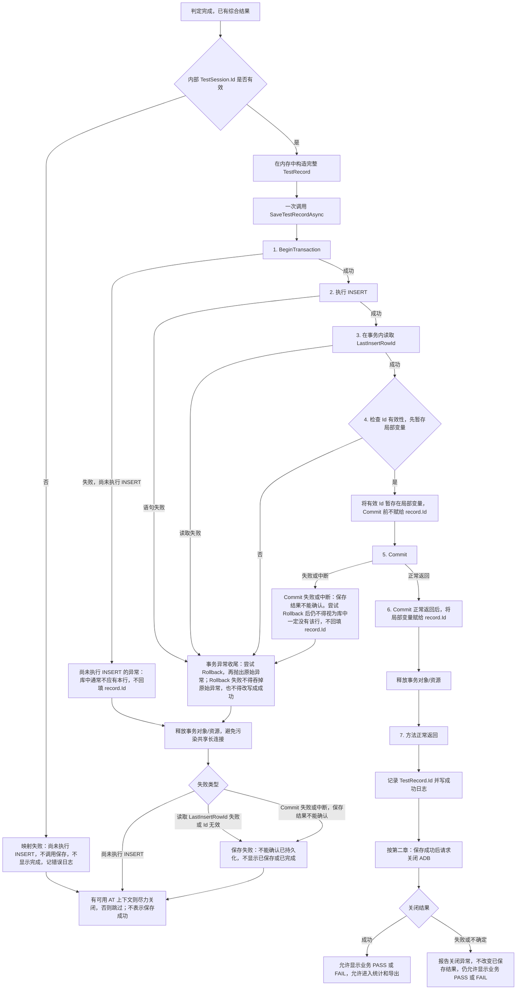

**图后约束：**

- 本图的调用方是建议的 `Yme009RoundCoordinator`，不是 `ProcessCoordinator`，也不是三个旧包装方法。
- 业务 PASS / FAIL 在构造记录时已经确定；图中「允许显示」取决于保存成功，不把保存结果改写成新的业务结果。
- INSERT 成功不等于保存成功。取得 `LastInsertRowId` 不等于保存成功。只有 Commit 成功、Id 已回填且方法正常返回，才进入保存成功，并允许走上「保存成功后再关闭」这条边。
- 不要在 Commit 之前把尚未确认提交的 Id 暴露给调用方。保存成功节点不得出现在 Commit 之前。
- 任何异常都不能仅凭内存中的 Id 判断数据库保存成功。
- 事务开始之后的失败均经过统一的事务异常收尾：尝试 Rollback，再向调用方抛出原始异常。Rollback 本身失败，不得吞掉原始异常，也不得改写成成功。
- Commit 失败或中断仍然属于「保存结果不能确认」，不因已经尝试 Rollback 而画成数据库一定没有该行。
- 成功路径与失败路径均释放事务对象/资源，避免事务异常后污染共享长连接。这只是保存方法内的必要约束，不引入连接恢复框架或新的架构组件。
- 保存失败、尚未执行 INSERT 的异常，以及映射失败，都不得进入「保存成功后再关闭」这条边。该边上的关闭失败也不回写 `TestRecord`。它们汇入同一条尽力关闭边：仍有可用 AT 控制上下文则按 2.6.2 关闭，否则跳过。关闭结束或跳过后继续统一资源清理。不按三类技术场景画成不同的关闭路径。SessionId 映射失败仍是状态 1，不是状态 5。
- 未预期软件异常若发生在得到完整检测结果之前，不进入本图的构造和保存步骤，见 4.4 和 4.5。
- 目标软件版本为空时，轮次协调按第三章 3.6.1 不创建记录，不走本图。

---

## 4.3 INSERT 与主键获取的原子性

### 4.3.1 当前实现

**源码事实：** `SaveTestRecordAsync` 在 `lock (_lockObject)` 内依次执行：

1. `cmd.ExecuteNonQuery()` 执行 `INSERT INTO TestRecord ...`。
2. 另建一条 `SELECT last_insert_rowid()` 命令，用 `ExecuteScalar()` 取回主键。
3. `Convert.ToInt32(...)` 写回 `record.Id`。
4. 方法正常返回。

依据：`D:\wpf_workspace\SnVerify\SnVerify\Services\Storage\StorageService.cs`，第 1216–1245 行。`ExecuteNonQuery()` 的返回值未被使用。方法内没有 `BeginTransaction`、`Commit` 或 `Rollback`。全工程生产代码中也没有这些事务 API 的调用。连接在 `InitializeAsync` 中以 `Data Source={_dbPath};Version=3;` 打开，并作为字段长期持有；所有写入都进入同一把 `_lockObject`。`INSERT` 因此依赖 SQLite 自动提交：第一条语句一旦成功返回，该行已经持久化。若随后的 `last_insert_rowid()` 或类型转换失败，调用方收到异常，数据库中却可能已经有记录。

`TestRecord` 对 `StickerSN` / `DeviceSN` 没有 UNIQUE 约束。该边界不会因为主键回填失败而自动阻止再次 INSERT。本章不为此新增补偿删除或补偿记录。

### 4.3.2 当前驱动能提供的方式

**源码事实：** 工程实际使用的是 `System.Data.SQLite.Core` 1.0.119.0，目标框架 .NET Framework 4.7.2。依据：`D:\wpf_workspace\SnVerify\SnVerify\packages.config` 第 7–8 行；`D:\wpf_workspace\SnVerify\SnVerify\SnVerify.csproj` 第 43–44 行。该版本发布说明写明内嵌 SQLite 核心为 3.46.1。

在这一驱动上，与「INSERT 后取得主键」相关的能力如下。它们属于方案 C 的评估对象，不预先当作推荐结论。

| 方式 | 源码与驱动依据 | 适用性判断 |
|---|---|---|
| 当前的第二条 SQL：`SELECT last_insert_rowid()` | `SaveTestRecordAsync` 第 1239–1242 行；同一文件中创建 Product、Order、Session 和检验参数时也使用这一写法 | 与现有仓储一致，但和第二步 INSERT 不是同一条语句，也不是同一显式事务 |
| `SQLiteCommand.ExecuteNonQuery()` 的返回值 | 第 1238 行已经调用，返回值未使用 | **不能用于取主键。** ADO.NET 中该方法返回受影响行数，成功 INSERT 通常为 1，不是自增 Id |
| `SQLiteConnection.LastInsertRowId` | 该类型的公开属性，返回本连接上最近一次成功 INSERT 的 rowid，内部调用 `sqlite3_last_insert_rowid`。连接未处于有效状态时会抛出 `InvalidOperationException` | 可在同一把锁、同一连接上于 INSERT 成功后立即读取，避免第二条 SQL。属性读取几乎不会失败，但若仍使用自动提交，INSERT 在读取属性之前已经提交 |
| `INSERT ... RETURNING Id` 后用 `ExecuteScalar()` 一次取回 | 内嵌 SQLite 3.46.1 支持 `RETURNING`（该语法自 3.35 起可用）。当前工程没有任何语句使用它 | 单条语句在自动提交下同进同退，能够消除「先提交、再另查主键」的窗口。这是本工程尚未使用的 SQL 形式，现有测试也没有覆盖 |

**设计判断：** 方案 C 并不是单一做法。其中，`ExecuteNonQuery` 返回值应直接排除；`LastInsertRowId` 和 `RETURNING` 都与当前驱动兼容，但前者仍可能落在自动提交之后，后者则改写了本工程尚未使用的 SQL 形状。

### 4.3.3 方案比较

比较对象按任务给定的三种方案展开。方案 C 按 4.3.2 的实际能力拆开说明，避免把「驱动是否另有更好方法」写成一句空话。

| 比较维度 | 方案 A：保持两条语句自动提交 | 方案 B：同一数据库事务完成 INSERT 和主键获取 | 方案 C：改用驱动提供的主键返回方式 |
|---|---|---|---|
| INSERT 与主键获取的一致性 | 低。两条自动提交语句，主键查询失败时行可能已经存在 | 高。在 `Commit` 之前失败可以 `Rollback`，调用方看到异常时通常不会留下已提交行 | 视具体做法而定。仅改用 `LastInsertRowId`、仍自动提交时，只缩小窗口，并不把 INSERT 推迟到取得 Id 之后。`RETURNING` 作为单条语句，一致性高 |
| 异常时是否可能留下「已提交但调用方认为失败」的记录 | 会。这正是当前实现已经存在的边界 | 可以把两条语句之间的窗口关掉。`Commit` 本身失败、进程在提交过程中被终止等少见情况仍可能使磁盘状态需要核对，不能写成绝对不会发生 | 仅用 `LastInsertRowId` 时，窗口变小但仍在自动提交之后。`RETURNING` 在语句失败时不会留下该行；语句成功之后、方法返回之前若再抛异常，仍可能出现「库中已有行、调用方看到失败」 |
| 驱动和仓储兼容性 | 完全是现状，无需新 API | `SQLiteConnection.BeginTransaction()` 是当前驱动已有的标准 ADO.NET API。生产代码尚未使用，需要在同一把 `_lockObject` 内完成 Begin / Commit / Rollback，并保证失败时不会把未结束事务留在这条长连接上 | `LastInsertRowId` 是当前连接类型的既有属性，与长连接加锁模型兼容。`RETURNING` 被 3.46.1 支持，但会引入本仓库没有覆盖过的 SQL |
| 并发和连接锁 | 现状：单连接、全程加锁，`last_insert_rowid()` 只反映本连接最近一次 INSERT | 事务必须完整包在现有锁内，锁内不得再 `await` 以致交错。这与当前 `Task.Run` + `lock` 的结构兼容。若事务泄漏，会阻塞这条共享连接上的后续所有访问 | 只要仍在同一把锁内读取 `LastInsertRowId` 或执行 `RETURNING`，并发模型与现状相同。不额外拉长锁外的事务寿命 |
| 对其他产品现有保存行为的影响 | 无。旧包装方法继续吞异常并显示完成 | 若只改 `SaveTestRecordAsync` 的内部实现、不改方法签名和「成功回填 Id 并正常返回、失败抛出」的约定，则 KM001、KM008 等调用方的成功路径不变；旧包装的空 `catch` 语义也不变。变化是收紧失败窗口，减少「上层以为失败、库中却已有行」 | 同样可以限制在这一共享方法内部。成功与失败的对外约定可以保持不变 |
| 改造范围和维护成本 | 无改造，但 YME009 仍必须把任何保存异常视为「不能确认已持久化」 | 改造范围小，仅限这一方法的锁内实现，并补回归测试。需要谨慎处理 Rollback 失败，避免掩盖原始异常 | 只换 `LastInsertRowId` 的改动最小，但不解决已提交窗口。改用 `RETURNING` 需要补充该语法在本驱动上的读写测试，并与方案 A 的 18 列 INSERT 同期修改 |

### 4.3.4 推荐方案

**建议方案：** 采用方案 B，并在同一事务内使用 `SQLiteConnection.LastInsertRowId` 取得主键，不再发送第二条 `SELECT last_insert_rowid()`。不推荐继续使用方案 A。不把 `ExecuteNonQuery` 的返回值当作主键。本期不采用 `INSERT ... RETURNING`，以免在共享保存路径上引入本工程尚未覆盖的 SQL 形式；它在当前驱动上是可行的替代，而不是已经采用的实现。

推荐理由：

1. 本章要缩小的，正是「第一条语句已经自动提交、第二条语句失败」这一已经被源码证实的窗口。方案 A 原样保留该窗口。
2. 方案 B 使用当前驱动已经提供、只是工程尚未调用的事务 API，不更换驱动，也不改变「一次检测新增一条 `TestRecord`」。
3. 在事务内读取 `LastInsertRowId`，可以去掉第二条 SQL，同时把「Id 转换失败」放在 `Commit` 之前：若 `rowid <= 0` 或超出 `int` 范围，则回滚并抛出异常，不留下调用方无法引用的已提交行。通过检查的主键先放在局部变量中，不要在 `Commit` 之前写回 `record.Id`。
4. 仅采用自动提交下的 `LastInsertRowId`，并不能把 INSERT 推迟到取得主键之后，对已陈述问题的帮助不完整。

实施时只改 `SaveTestRecordAsync` 的内部实现，方法签名不变。下列步骤仍在现有 `_lockObject` 内进行，并先检查连接已打开。建议顺序必须严格如下，不得合并步骤，也不得改序。这是设计步骤，不是实现代码：

1. `BeginTransaction`。
2. 执行 INSERT。
3. 在事务内读取 `LastInsertRowId`。
4. 检查 Id 有效性，将其暂存在局部变量。
5. `Commit` 成功。
6. `Commit` 正常返回后，再将局部变量赋给 `record.Id`。
7. 方法正常返回。

不要在 `Commit` 之前把尚未确认提交的 Id 暴露给调用方。只有保存方法正常返回、`Commit` 成功且 `record.Id > 0`，才允许进入保存成功状态。INSERT 成功不等于保存成功，取得 `LastInsertRowId` 也不等于保存成功。

补充约束：

- 步骤 4 中，若 `rowid <= 0` 或超出 `int` 范围，则 `Rollback` 并抛出异常，不得回填 `record.Id`，也不得进入步骤 5。
- 任何失败都尝试 `Rollback`，再把原始异常抛出。Rollback 本身失败时不得吞掉原始异常，也不得改写为成功。
- 不重试、不改成 UPDATE、不删除「可疑」历史行。

对旧产品的兼容约定：

- 方法签名保持 `Task SaveTestRecordAsync(TestRecord record)`。
- 成功时仍然回填 `record.Id` 并正常返回。按上述顺序，这一回填只发生在 `Commit` 正常返回之后。
- 失败时仍然抛出异常，不增加布尔返回值。此时调用方不应看到 `record.Id` 已被赋值。
- 不改变「每次调用新增一条记录、不覆盖历史」。
- 不修改 `SavePhase3ResultAsync`、`SaveResultAsync`、`SaveOrUpdateFailResultAsync` 的空 `catch`。旧产品在保存失败后仍可能显示完成，这是第一章已经记录、本期默认不修的行为。本次改动对它们而言只是收紧失败窗口：以前那种「库中已有行、包装方法却走进空 catch」会更少出现，成功路径的可见行为不变。
- 方案 A 追加的 18 个可空列在同一次共享方法修改中写入；旧产品记录这些列为 NULL，其判定、统计和导出口径不变。这是第三章已经确定的约束，不是本章新增的表策略。

### 4.3.5 仍不能绝对保证的边界

即使采用方案 B，也不能宣称「凡是调用方看到异常，数据库中就一定没有这一行」，或「凡是方法抛出异常，就一定没有提交」。至少还有：

- `Commit` 过程中的 I/O 失败、磁盘满或进程被终止，可能使事务最终状态需要对照数据库才能确定。
- 方法在 `Commit` 已经成功之后、把 Id 赋给 `record.Id` 或返回调用方之前被中断，调用方仍可能把它当成失败。
- 因此，YME009 把保存方法抛出的异常统一解释为「不能确认记录已成功持久化」，而不是「已经证明库中没有该行」。这对应 4.4 的状态 5。界面不得显示已保存或已完成；统计和导出仍然只读数据库中实际存在的行，不为这一不确定性补写或删除记录。
- 在这类异常下，调用方不应看到 `record.Id` 已被赋值。就算磁盘上可能已经有行，也不能仅凭内存中的 `Id` 判断数据库保存成功。任何异常都不能仅凭内存中的 `Id` 判断保存成功。

---

## 4.4 保存成功、保存失败与结果状态

### 4.4.1 必须分开的三种结果

**设计判断：** 业务判定结果、数据库保存结果和设备资源关闭结果是三个独立事实，不能合并成一个 PASS / FAIL。

| 结果种类 | 取值 | 谁决定 | 不得被什么改写 |
|---|---|---|---|
| 业务判定结果 | 仅 `PASS` 或 `FAIL`，FAIL 时带 3.8 的 `FailReason` | 第三章判定，在构造 `TestRecord` 时写入 | 不得因保存失败或关闭失败而改成另一种业务结果，也不得把程序异常写入 `FailReason` |
| 数据库保存结果 | 尚未保存、正在保存、保存成功（Commit 成功、Id 已回填且方法正常返回）、不能确认已持久化 | 本章的保存路径 | 不得把保存失败显示成已完成的 PASS / FAIL。INSERT 成功或取得 `LastInsertRowId` 都还不是保存成功。任何异常都不能仅凭内存中的 Id 判断保存成功 |
| 设备资源关闭结果 | 未尝试、成功、失败或不确定 | 第二章的关闭动作 | 关闭失败不修改已保存记录，也不改变业务判定 |

PRD 中的 PASS / FAIL 仍然只表示业务判定。保存失败和未预期软件异常都不是新的业务结果值。

### 4.4.2 六种状态

**建议方案：** YME009 本轮在记录与保存意义上区分以下状态。它们是轮次结果上的状态，不是新的数据库字段，也不是新的 `Result` 枚举。

| 状态 | 是否存在 TestRecord 对象 | 是否存在数据库记录 | 是否允许显示 PASS / FAIL | 是否允许显示已保存或已完成 | 是否允许进入统计和导出 |
|---|---|---|---|---|---|
| 1. 尚未构造 TestRecord | 否 | 否 | 否 | 否 | 否 |
| 2. 已构造检测结果，但尚未保存 | 是，内存中，`Id` 尚未回填 | 否 | 否 | 否 | 否。内存对象不得当作已落库结果 |
| 3. 正在保存 | 是 | 尚未确认 | 否。此时仍在处理中 | 否 | 否 |
| 4. 保存成功：Commit 成功、Id 已回填，且保存方法正常返回 | 是，且 `Id > 0` | 是 | 是。显示的是业务判定，不是保存动作本身 | 是 | 是。仅这一条已落库记录 |
| 5. 保存失败，不能确认记录已成功持久化 | 内存对象可保留供日志使用 | 不能确认。多数情况下没有新行，但不能把它写成「已证明无行」 | 否 | 否 | 内存结果不得加入统计或导出。若库中因 4.3.5 的少见边界实际有行，导出仍以数据库为准，但不在界面上把本轮宣布为已保存 |
| 6. 未预期软件异常，未形成完整检测结果 | 不构造完整的 `Result=PASS` 或 `Result=FAIL` 记录 | 否。不得为此补写伪装 FAIL | 否 | 否 | 否。已读到的片段只留在日志中 |

状态 4 不得仅因 INSERT 成功，或已经读到 `LastInsertRowId`，而成立。只有 Commit 成功、Id 已回填且方法正常返回，才进入状态 4。若保存过程抛出异常，即使内存中的 `Id` 看起来大于 0，也不得进入状态 4。

SessionId 映射失败发生在构造或保存之前，属于状态 1 的终止，而不是状态 4。它的界面和导出规则与状态 5 相同：不得显示完成，不得写入伪装检测记录。目标软件版本为空、设备接入失败等已经在前三章规定的「不创建记录」出口，也停留在状态 1，不进入本章的保存状态机。

判定已经完成、异常发生在保存过程中时，按状态 5 处理，并在日志中保留原来的业务判定；不把保存异常改记成设备读取异常。这与第三章 3.9.4 一致。

### 4.4.3 现有 Snapshot 的限制与推荐表达方式

**源码事实：** `VerificationSnapshot` 只有 Idle、Processing 和 Completed 三种工厂方法。`Completed` 接受 `result` 和 `failReason`，并把 `IsProcessing` 置为 false。`MainViewModel.StatusText` 在 `IsProcessing` 为真时显示「正在检验...」；一旦 `LastResult` 非空，则 `PASS` 显示为 PASS，其余一律显示为 FAIL。`VerificationUiState` 也只有 Idle、Processing、Pass、Fail。现有 Snapshot 没有「保存成功 / 保存失败 / 未预期程序异常」字段。依据：`D:\wpf_workspace\SnVerify\SnVerify\Domain\State\VerificationSnapshot.cs` 第 63–82 行；`D:\wpf_workspace\SnVerify\SnVerify\ViewModels\MainViewModel.cs` 第 38–44、692–703 行。

因此，只要 YME009 在保存失败或程序异常后调用现有 `Completed`，并传入内存中的 `PASS` / `FAIL`，界面就会把本轮显示成检测完成。这是必须避开的路径。

三种表达方式的比较：

| 方式 | 做法 | 对旧产品的影响 | 主要问题 |
|---|---|---|---|
| 扩展现有 Snapshot | 给共享 `VerificationSnapshot` 增加保存状态字段，或扩充 `Completed` 的含义 | 共享类型变化。若默认值处理不当，会改变 KM001、KM008、SOLTAG25 对 Completed 的理解；`StatusText` 是全局绑定，改错会直接影响旧产品 | 可以用兼容默认值降低风险，但仍然触碰所有产品共用的状态对象和状态文本 |
| 只增加独立的保存状态，仍对失败路径调用 `Completed` | 另外保存一个 Persistence 标志，但 Snapshot 继续带上业务 `LastResult` | 表面上少改 Snapshot，只要 `StatusText` 仍只看 `LastResult`，保存失败还是会显示 PASS / FAIL | 不能解决当前问题 |
| YME009 专属轮次结果，再向界面做受控投影 | 由轮次协调持有业务结果、保存状态、`TestRecord.Id` 和关闭结果；只有保存成功的状态 4（Commit 成功、Id 已回填且方法正常返回）才投影为现有 `Completed` | 不修改 `Completed` 的既有语义，也不要求旧产品改用新字段 | 界面需要一条 YME009 投影分支，使状态 5、状态 6 和映射失败不会走进现有 PASS / FAIL 文本。具体文案仍待确认 |

**建议方案：** 采用第三种，即 YME009 专属轮次结果，外加对现有 Snapshot 的受控投影。这是对旧产品影响最小的方式。

建议的轮次结果只作为设计候选，不展开为完整类型定义，至少区分：

- 业务判定：`PASS`、`FAIL` 或「无完整结果」。
- 保存状态：对应 4.4.2 的六种状态。
- 成功时的 `TestRecord.Id`。
- 关闭结果：未尝试、成功、失败或不确定。

投影规则：

- 状态 4：即 Commit 成功、Id 已回填且保存方法正常返回之后，可以把业务判定投影为现有 `VerificationSnapshot.Completed`，以便沿用 PASS / FAIL 的已有展示。关闭失败只作为附加异常报告，不得因此把 `LastResult` 改成 FAIL，也不得把已保存的 PASS 改掉。不得仅因已经读到 `LastInsertRowId` 或 INSERT 已执行就做这一投影。
- 状态 3：保持处理中，不调用 `Completed`。
- 状态 5、状态 6，以及 SessionId 映射失败：不得调用带有业务 `PASS` / `FAIL` 的 `Completed`，也不得把 `LastResult` 设为这两个值。界面必须能区别于「等待检验」和「检测已完成」。具体提示文案仍是待确认问题，见 4.10。
- 不修改旧产品使用的 `Completed` 语义，不把旧路径的空 `catch` 改掉。

### 4.4.4 状态流转

下图是**图 9：保存成功、保存失败和未预期异常的状态流转图**。阅读目的是看清六种保存相关状态如何转换，以及只有保存成功（Commit 成功、Id 已回填且方法正常返回）才允许把业务 PASS / FAIL 显示为已完成。保存成功不得出现在 Commit 之前。状态 4 的关闭结果单独分叉，不反向修改保存状态。状态 5 和状态 6 在上下文仍可用时也尽力关闭，关闭不把它们变成保存成功。

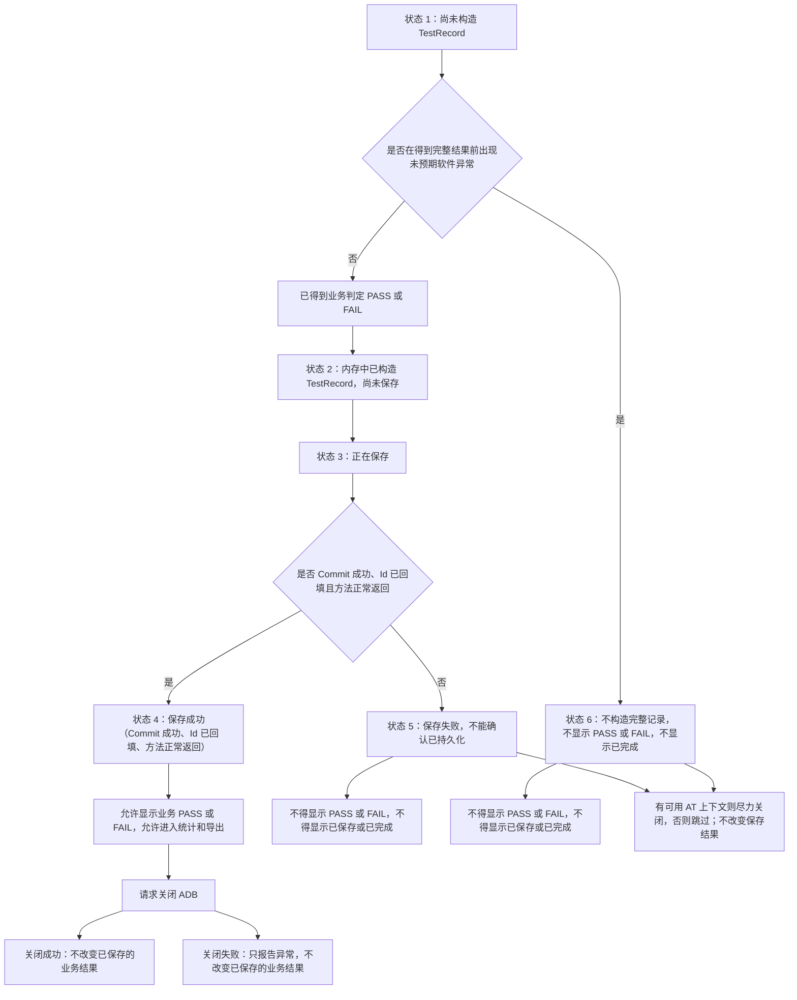

**图后约束：**

- 业务判定在进入状态 2 时已经确定；之后的保存失败、关闭失败都不得改写 `Result` 或 `FailReason`。
- 进入状态 4 的判定与 4.3.4 一致：须完成事务内 INSERT、读取 `LastInsertRowId`、检查 Id 并暂存局部变量，然后 Commit 成功，再回填 `record.Id`，最后方法正常返回。INSERT 成功或取得 `LastInsertRowId` 都还不能进入状态 4。保存成功节点不得出现在 Commit 之前。
- 状态 5 在技术上可能对应尚未执行 INSERT 的异常，或 INSERT 已执行但保存结果不能确认；二者都不得显示为已完成。只要仍有可用 AT 控制上下文，就按 2.6.2 尽力关闭，不画成不同的关闭路径。关闭失败不把状态 5 改成状态 4。
- 状态 6 与状态 5 的差别是：前者没有完整检测结果，后者可以在日志中保留原判定，但两者都不得显示为已完成。状态 6 同样在上下文仍可用时尽力关闭，不得伪装成业务 FAIL 或读取异常。
- SessionId 映射失败不进入状态 2 至状态 4，直接按不得显示完成处理，图中省略以避免与状态 5 的保存异常混在同一条边上。它属于状态 1，不是状态 5。若临时或正式上下文仍可用，按 2.6.2 尽力关闭，不为关闭构造 TestRecord。
- 「允许进入统计和导出」只适用于状态 4 中已经存在的数据库行。
- 任何异常都不能仅凭内存中的 Id 判断数据库保存成功，也就不能从状态 5 转入状态 4。

---

## 4.5 异常处理分类与出口

**建议方案：** 异常仍由 YME009 轮次协调在本轮边界上分类处理，不增加全局异常框架，不修改旧产品的 `catch` 路径，也不把所有异常吞掉后继续执行。`ProcessCoordinator` 继续只做入口分流，不得把 YME009 本轮异常接回现有 `ProcessScanAsync` 总 `catch`，以免再次写成 `EXCEPTION: ...` 的 FAIL 记录。

| 异常类别 | 已确认处理原则 | 由谁捕获 | 日志 | 向上层返回 | 本轮如何结束 |
|---|---|---|---|---|---|
| 设备读取异常 | 按第三章 FailReason 规则保存 FAIL 记录 | 读取器给出字段状态，判定函数给出 `YME009_READ_FAIL` 等代码；轮次协调把它当作完整检测结果 | 记录扫码 SN、主失败码和将要保存的综合结果。这不是未预期程序异常 | 构造 FAIL 记录并走 4.2 的保存路径 | 保存成功后按第二章关闭 ADB；保存失败则进入状态 5 |
| 业务判定失败 | 保存 FAIL 记录 | 判定函数给出业务失败码；轮次协调保存 | 同上，记录业务判定结果 | 构造 FAIL 记录并保存 | 与上一行相同 |
| 未预期软件异常 | 记录完整异常日志，不创建伪装 FAIL 记录 | 建议的 `Yme009RoundCoordinator` 在调用业务检测和保存的这一层捕获。判定函数保持纯函数，不把未知异常改写成 FailReason | `LogError`，必须带异常对象，从而写出类型、消息和堆栈。不得改用只记消息的 `LogInfo` | 不构造 `Result=FAIL` 且 `FailReason=EXCEPTION: ...` 的记录，不把异常文本写入 `FailReason`，不显示 PASS 或已保存 | 是否发送关闭 AT 见 4.6。其后按 2.6.4 停止本轮观察、释放残留串口句柄、作废上下文 |
| SessionId 映射失败 | 不允许静默跳过并显示完成 | 轮次协调在保存前检查 | `LogError`，包含 `SessionName` 和扫码 SN | 不调用保存，不显示完成 | 按保存未完成结束；是否关闭 ADB 见 4.6 |
| 数据库保存异常 | 不得显示已保存或已完成 | 轮次协调不吞掉 `SaveTestRecordAsync` 抛出的异常 | `LogError`，必须带完整异常对象，并记下当时的业务判定、`SessionName`、内部 SessionId 和扫码 SN | 进入状态 5。不把数据库异常改写成 `YME009_READ_FAIL` 或其他设备失败码 | 不显示完成。是否关闭 ADB 见 4.6 |
| ADB 关闭异常 | 不改变已经成功保存的检测结果 | 轮次协调请求设备接入协调关闭；关闭异常在关闭步骤捕获，不得反向进入保存步骤 | 记录关闭失败或不确定，建议使用 `LogError` 或至少带结果的警告日志 | 业务结果和保存结果保持状态 4；另外报告关闭异常 | 结束本轮，作废上下文。不回滚、不修改已保存记录 |

补充约束：

- 已经识别的命令失败、超时、Transport 断开、空值和非法值，仍按第三章 3.4、3.8 进入读取异常或协议非法，不走「未预期软件异常」出口。
- 未预期软件异常若发生在保存过程中，按状态 5 处理，保留原判定日志；若发生在得到完整结果之前，按状态 6 处理。
- 不得复制 `ProcessScanAsync` 总 `catch` 那种「写成 FAIL 记录、再用 `LogInfo` 记下消息、然后 `Completed`」的做法。
- 日志写入失败不得改变已经确定的业务结果或已经成功的保存结果，见 4.7。

---

## 4.6 ADB 关闭与异常收尾

### 4.6.1 与第二章已经对齐的部分

本章不重新定义 CDC、AT、ADB 关闭流程。下列内容继续沿用第二章 2.6.2、2.6.4 和第三章 3.9.4：

- 正式检测在记录保存成功之后，由轮次协调请求设备接入协调，使用正式连接上下文尝试关闭 ADB。
- 关闭失败、关闭未发送或结果不确定时，只报告异常，不修改、不删除、不回滚已经保存的 `TestRecord`，也不影响该条业务结果是否为 PASS。
- 未预期软件异常不创建 `TestRecord`，因此不把程序异常改写成检测记录，再去走「保存成功后再关闭」这条已确认边。
- 无论本轮成功或失败，结束时都要停止本轮观察，并作废临时上下文和正式连接上下文。开启阶段的串口不跨 USB 重新枚举复用；若交换结束时仍有残留句柄，按 2.6.4 释放。下一轮必须重新接入，不得沿用这些上下文。

### 4.6.2 保存没有完成时的关闭 ADB

**建议方案：** 保存没有完成时是否发送关闭 ADB，已由第二章 2.6.2 确定。只要本轮 AT 开启已确认成功，且临时或正式上下文中的设备身份仍在，就尽力关闭。正式上下文优先，用其中的设备身份做关闭前匹配。正式上下文尚未形成时，使用临时上下文中的身份。该范围不局限于 Ready 超时和身份关联失败。AT 未发送、AT 结果不确定等 2.6.1 明确禁止补发关闭命令的出口仍不补发。上下文中的设备身份不在，或关闭前重新发现失败、身份不能确认、CDC 不唯一、当前 COM 打不开时，跳过发送。不得复用开启时的 COM 或串口句柄，也不得重新执行 Ready 或身份关联。USB 重新枚举后的重新发现和重新打开当前 COM 属于 2.6.2 的关闭步骤，不是异常重连。关闭失败或结果不确定不改变业务结果或保存结果，也不把未保存解释为已保存。关闭尝试结束或跳过后，按 2.6.4 继续统一资源清理。关闭 ADB 与资源清理不是同一动作。本章不另定一套关闭流程。

「保存没有完成」仍区分以下三类技术场景。它们都不进入保存成功状态。关闭不按这三类分成不同路径，而按上面的上下文可用性决定。本节保留三类的技术状态，不改变六种保存状态的定义。

**1. 尚未执行 INSERT 的异常**

包括：SessionId 映射失败，尚未调用或不应调用保存；保存方法在执行 INSERT 之前抛出的异常；以及构造完成之后、INSERT 尚未执行即已失败的情况。若 INSERT 语句失败且事务尚未进入 Commit，通常也不应留下已提交的本轮新行，技术状态更接近这一类。

技术状态：

- 通常不应在数据库中留下本轮新行。
- 内存中的检测结果若已构造，仍不得显示为已保存或已完成。
- 不进入状态 4。映射失败仍按 4.4.2，属于状态 1 的终止；若已进入保存调用但尚未执行 INSERT，也不得视为保存成功。

影响：

- 界面和导出规则与「不得显示完成、不得写入伪装检测记录」一致。
- 设备侧此时通常仍保持检测前已开启的 ADB。若仍有可用 AT 控制上下文，按本节开头的规则尽力关闭；没有则跳过。SessionId 映射失败属于这一类，它是状态 1 的终止，不是状态 5。只要临时或正式上下文仍可用，同样尽力关闭。不得为了关闭构造 TestRecord。

**2. INSERT 已执行，但保存结果不能确认**

包括：事务内 INSERT 已经执行，但 Commit 失败或在提交过程中被中断；`LastInsertRowId` 已读到、甚至已经通过有效性检查，但方法在正常返回之前抛出异常；以及 4.3.5 所述、调用方看到异常而磁盘状态需要对照数据库才能确定的情况。方法若正常返回但未回填有效 `Id`，仍按状态 5 处理，并视为实现缺陷，见 4.2.3。

技术状态：

- 调用方看到的是异常或未正常返回，不得进入状态 4。
- 按 4.3.4，调用方不应看到 `record.Id` 已被赋值。即便内存中的 `Id` 看起来大于 0，也不得仅凭该值判断数据库保存成功。
- 磁盘上既可能没有新行，也可能已经有行。YME009 把这类情况一律解释为「不能确认已持久化」，对应状态 5。

影响：

- 界面不得显示已保存或已完成；统计和导出仍只以数据库中实际存在的行为准，不为这一不确定性补写或删除记录。
- 若把「未保存」理解成「库中一定没有行」，可能和实际情况不完全一致。这不改变关闭规则：仍有可用 AT 控制上下文就尽力关闭。关闭成功也不把状态 5 解释为保存成功。

**3. 未预期软件异常，未形成完整检测结果**

对应状态 6。尚未得到完整的业务 PASS / FAIL，不构造完整待保存记录，不得为此补写伪装 FAIL。

技术状态：

- 不存在完整的待持久化检测结果，通常也不会走到 4.3.4 的 INSERT。
- 已读到的片段只留在日志中，不显示 PASS / FAIL，不显示已保存或已完成。

影响：

- 处理边界与第三章 3.9.4、本章 4.5 一致。
- 不把该类异常改写成检测记录后再走「保存成功后再关闭」的已确认边。若仍有可用 AT 控制上下文，按本节开头的规则尽力关闭；没有则跳过。

关闭结果只作为收尾报告。不得把关闭成功理解成「本轮已完成或已保存」；关闭失败的提示不能盖住「未保存」。这与第二章以及第三章 3.9.4 一致。

补充边界：

- 当前 SnVerify 正式检验路径没有「保存后再关闭设备 ADB」的实现。关闭链路按第二章新建，不从旧产品路径推断。
- 上下文或 AT 通道不可用时跳过关闭。关闭失败或未关闭后的设备实际状态，仍是第二章的真机待验证项。
- 采用方案 B 后，Commit 与调用方所见结果之间的少见窗口会被收紧。若出现 4.3.5 所述的不确定提交，状态仍是「不能确认已持久化」。该边界不改变关闭规则，也不据此把状态 5 改成状态 4。
- PRD 目前只确认不得显示为已成功保存。保存失败和未预期软件异常的界面文案仍未确认。

图 8、图 9 和图 10 对这三类场景使用同一条尽力关闭规则，不按技术场景画成不同的关闭路径。三类的保存状态仍然不同。

---

## 4.7 日志与问题追溯

### 4.7.1 复用现有日志能力

**源码事实：** 现有 `ILoggingService` / `LoggingService` 按 `SessionName` 写入 `session_{SessionName}.log`，`LogError(message, exception)` 会把异常对象追加到同一条目中，因而可以包含类型、消息和堆栈。`WriteLog` 在写入失败时只更新日志 Snapshot，不向外抛出。现有正式扫码路径并不保证写入 `TestRecord.Id`，也不能按保存是否成功检索。依据：`D:\wpf_workspace\SnVerify\SnVerify\Services\Logging\LoggingService.cs`，`StartSession` 与 `LogError`、`WriteLog`。

**建议方案：** YME009 继续使用这一日志服务，不新增日志框架，不把日志文件写入数据库，不新增操作审计表，也不新增设备通信日志系统。需要补的是新路径上的调用内容和关联字段，而不是另一套存储。

利用现有 Session 日志做追溯的方法是：同一检测会话的关键节点都写入该会话文件，并在条目中显式带上 `SessionName`、内部 `SessionId`、扫码 SN，以及保存成功后的 `TestRecord.Id`。事后先按会话打开对应日志，再用 SN 或 `TestRecord.Id` 在同一文件中检索。导出仍按现有机制附带已有记录之 Session 的日志；接入失败且没有 TestRecord 时，按当前导出规则可能不会把日志打进 ZIP，这是现有限制，本章不为此改导出器。

### 4.7.2 关键节点

**建议方案：** 至少在下列节点写日志。级别以能够区分为准：正常过程使用 `LogInfo`，保存失败和未预期软件异常必须使用带异常对象的 `LogError`。

| 节点 | 建议内容 | 说明 |
|---|---|---|
| 本轮正式检测开始 | `SessionName`、内部 `SessionId`、扫码 SN | 内部 SessionId 若此时尚未取到，先记 `SessionName`，取到后再补记 |
| 检测结果构造完成 | 扫码 SN、业务 `Result`、主 `FailReason` | 此时还没有 `TestRecord.Id` |
| 开始保存 | `SessionName`、内部 `SessionId`、扫码 SN | 对应状态 3 |
| 保存成功 | `TestRecord.Id`，以及 Session、SN | 不能假设现有日志已经自动包含 Id |
| 保存失败 | 完整异常堆栈，以及当时的业务判定、Session、SN | 不得只记消息、不带异常对象 |
| 未预期软件异常 | 完整异常堆栈，以及当时已有的 Session、SN 和阶段 | 不把堆栈写入 `FailReason` |
| ADB 关闭结果 | 成功、失败或不确定 | 失败时尽量带异常对象。不得用这条日志改写已保存结果 |
| 本轮最终状态 | 业务结果、保存状态、关闭结果是否已尝试 | 三者分开书写，避免只剩一个 PASS / FAIL |

SessionId 映射失败、目标版本为空而不创建记录等出口，也要留下足够对照的信息，至少包括 `SessionName` 和扫码 SN。

### 4.7.3 日志失败不得反向影响保存结果

**建议方案：** 若在保存成功之后写日志失败，本轮仍保持状态 4，已取得的 `TestRecord.Id` 和业务结果不变，也不再改数据库。现有 `WriteLog` 已经不把写入失败抛回调用方，YME009 不得在此之上再增加「日志失败则回滚记录」或「日志失败则把结果改成 FAIL」的逻辑。关闭结果的日志失败同样不得改变已保存记录。

---

## 4.8 与 Session 统计和导出的关系

**源码事实：** 现有导出和「是否有记录」的判断都通过 `GetTestRecordsBySessionAsync` 读取数据库，没有内存中的 Session 记录列表可供导出使用。未插入的对象不会进入现有 Summary。依据见只读审查第 4 节。

**建议方案：** 沿用第三章 3.10 已经确定的导出方向，本章只锁定保存与统计的边界。须同时遵守运行时状态原则和数据库数据源原则，二者不可互相改写：

- 运行时状态原则：状态 2、状态 3、状态 5 的内存结果，以及状态 6 的不完整结果，本身不进入统计和导出。只有状态 4（Commit 成功、Id 已回填且方法正常返回）才允许运行时向界面宣布保存成功。
- 数据库数据源原则：`Yme009SessionExporter` 以数据库中实际存在的 `TestRecord` 为数据源。正常保存成功的记录对应状态 4。如果因 4.3.5 所述少见边界，状态 5 对应的记录实际已经存在于数据库中，该记录仍然会被数据库查询和导出。不得仅凭内存中的 `record.Id` 将状态 5 宣布为保存成功。不增加自动删除、补偿写入或导出特例。实现和排查应依赖 4.7 的失败日志，而不是在导出器里做特例合并。
- YME009 使用独立的 `Yme009SessionExporter`，不沿用 KM001 对 FAIL 的去重，也不把业务 FAIL 与设备读取异常混计。分类函数仍用第三章 3.8.3。
- 不改变 KM001、KM008、SOLTAG25 的导出行为。

界面会话计数同样只统计当前会话已保存的记录。现有只显示 PASS / FAIL 的 `StatusText` 不能作为 YME009 的统计口径。具体布局不在本章设计。

---

## 4.9 异常处理与资源收尾关系图

下图是**图 10：异常处理与资源收尾关系图**。阅读目的是看清轮次协调如何把业务检测、底层保存、日志和第二章的设备收尾串在一起。保存成功后使用正式上下文请求关闭。保存未完成的三类技术场景仍分开进入同一条尽力关闭边：有可用 AT 控制上下文则关闭，否则跳过。关闭尝试之后才是统一资源清理。Coordinator 不直接操作串口或 AT 细节。

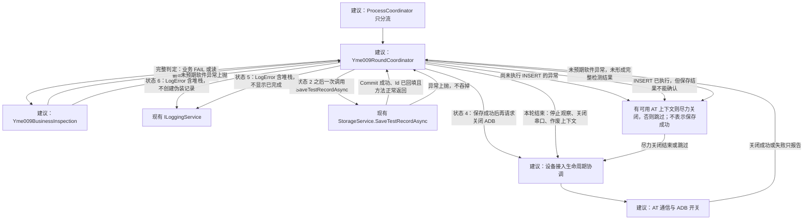

**图后约束：**

- `ProcessCoordinator` 不调用 `SaveTestRecordAsync`，不捕获后改写 YME009 的失败类型。
- 业务判定、数据库保存、ADB 关闭在图中是三段不同的边，不能合并成一个 PASS / FAIL 节点。
- 保存成功是指 Commit 成功、Id 已回填且方法正常返回，不得仅因 INSERT 成功或已经读到 `LastInsertRowId` 而走「保存成功后再关闭」这条边。
- 图中把尚未执行 INSERT 的异常、INSERT 已执行但保存结果不能确认、以及未形成完整检测结果的未预期软件异常区分为三类技术状态。它们汇入同一条尽力关闭边，因为关闭条件相同：仍有可用 AT 控制上下文则按 2.6.2 关闭，否则跳过。三类的保存状态仍然不同。
- 「本轮结束：停止观察、关闭串口、作废上下文」是统一资源清理，适用于成功和失败，不等于已经发送关闭 AT。关闭尝试在该清理之前。作废上下文和关闭串口遵循第二章 2.6.4。保存成功后的关闭已经确认；保存未完成时，只要上下文仍可用也尽力关闭。关闭失败不改变已形成的业务结果或保存结果。
- 关闭失败的边不得回到保存步骤，也不得修改已保存记录。
- 任何异常都不能仅凭内存中的 Id 判断数据库保存成功，也不得据此改走状态 4 的关闭边。

---

## 4.10 本章待确认问题

本章已经给出独立保存路径、INSERT 与主键获取的推荐方案、保存状态和异常出口。下列事项继续开放，不把它们写成已确认结论。

| 事项 | 状态 | 说明 |
|---|---|---|
| 保存失败的界面文案 | 待确认 | 已确认的只有不得显示为已保存或已完成。不得使用现有 `Completed` 加 PASS / FAIL 来凑一条提示。是否关闭 ADB 已由 2.6.2 和 4.6.2 确定，不再作为待决策 |
| 未预期软件异常的界面文案 | 待确认 | 处理边界已在第三章 3.9.4 和本章 4.5：记完整日志，不创建伪装记录，不显示为 PASS 或已保存 |
| 等待期间取消、等待期间再次扫码、等待提示文案 | 仍开放 | 继续留在第二章 2.6.3、2.7.3，本章不展开 |
| Q17、Q20，以及第一章、第二章已列出的跨章节问题 | 仍开放 | 包括订单内目标版本一致性、`ProductName` 跨产品复用、MES、`EndTime` 等。本章不定案 |

完成本章后停止。不开始第五章，不开始编码，不修改 PRD，不修改设备审查报告，不修改源码。
# 5. YME009 生命周期与资源管理

本章说明一次 YME009 检测轮次如何完整开始、结束和释放资源，以及停止机制、UI / Session 协调、自检互斥和窗口关闭时应遵守的边界。业务依据仍是 `docs/YME009-Packaging-Station-PRD.md` V0.6。设计依据是已经评审冻结的第一至第四章，以及前置审查报告 `docs/YME009-Lifecycle-Resource-Audit.md`。

本章不重新设计设备接入协议、业务判定或数据库保存方案，只把已有原则落实为可实施的轮次协调约定。不建设全局生命周期框架或通用资源管理框架，不把技术能力预留写成已经确认的操作员功能，也不为尚未确认的事项擅自补充业务规则。

本章继续使用结论标记：源码事实、设计判断、建议方案、待确认问题。建议组件名和交互关系均尚未实施，不构成接口或实现代码。

---

## 5.1 轮次生命周期与过程锁

### 5.1.1 一次轮次的起点与完整过程

**建议方案：** 一次 YME009 检测轮次是一个完整过程，由建议的 `Yme009RoundCoordinator` 串联，而不是一次规则链调用。顺序固定为：

CDC 设备观察与确认 → AT 接入 → ADB Ready → 设备身份关联与 Transport ID 锁定 → 业务检测 → TestRecord 保存 → ADB 关闭 → 资源释放。

这与第二章 2.2 已经确定的两个生命周期一致：前半段属于设备接入生命周期，唯一成功出口是接入成功并交付正式设备连接上下文；只有接入成功之后，才进入业务检测生命周期。接入失败的各出口在进入业务检测之前结束本轮，不创建 `TestRecord`，见 2.2.1、2.6.1。保存语义遵循第四章。关闭 ADB 遵循 2.6.1、2.6.2 和 PRD D14：它发生在全部 ADB 业务操作完成之后，正常路径在保存成功之后；有可用 AT 控制上下文的异常出口尽力关闭。D13 的记录边界不变。

**源码事实：** 现有扫码入口仍是 `MainViewModel.HandleScanInputAsync`。Phase3 产品经 `StartPhase3VerificationAsync` 进入 `ProcessCoordinator.ProcessScanAsync`。依据见第一章 1.2.3。

**建议方案：** 继续沿用第一章 1.6.1 和第二章 2.2.3 已经确定的挂载点：`ProcessScanAsync` 在取得 `ProductProfile` 之后按 `ProductCode` 分流。若为 `YME009`，把本轮扫码 SN、当前 Session 和参数交给 YME009 轮次协调，然后等待其结束；不调用现有 `RulePipelineExecutor`，也不调用现有 `SavePhase3ResultAsync`。KM001、KM008 仍走原路径，一行行为都不改。

结束整个检测过程的是轮次协调，不是设备接入协调，也不是 `ProcessCoordinator`。`ProcessCoordinator` 在分流之后只等待本轮结束，不直接逐步调用 CDC、AT、Ready、保存或关闭。

### 5.1.2 过程锁必须覆盖整个轮次

**源码事实：** 现有一轮扫码以 Snapshot 的 `IsProcessing` 做过程锁。检测处理中的新扫码会被忽略，不引入并行检测。该边界与 D08、PRD 5.3 以及第一章 1.2.2 一致。现有实现在忙碌时是静默忽略；忙碌提示文案仍待确认，见本章 5.7。

**设计判断：** YME009 的 30 秒等待也必须落在这一过程锁之内。若只在正式业务检测期间持锁，等待期间的新扫码会误启动第二轮，从而破坏「一次扫码对应一轮、不引入并行检测」的既有原则。

**建议方案：** 继续沿用现有 `IsProcessing` 过程锁，不另做一套并行检测门闩，也不设计新的批次系统。轮次协调在接管本轮之后，必须在该锁仍然持有的情况下完成从设备等待到资源清理的全部工作。过程锁至少覆盖：

- 30 秒 CDC 观察与唯一性确认，包括 0 台、1 台、多台在窗口内的来回等待；
- AT 开启、ADB Ready 和身份关联；
- 正式业务检测；
- `TestRecord` 保存；
- 关闭 ADB 的尝试：正常路径在保存成功之后；接入失败按 2.6.1；状态 5、SessionId 映射失败、状态 6，以及其他仍有可用 AT 控制上下文的结束，按 2.6.2 尽力关闭；
- 本轮资源清理。

`ProcessCoordinator` 在 YME009 分流之后，不得提前把 Snapshot 置为非处理中，也不得在轮次返回后自动调用带有业务 `PASS` / `FAIL` 的 `Completed`。全部分流出口，包括接入失败和各种早返回，都必须先完成本轮资源清理，最后进行 Snapshot 受控投影并释放过程锁，再向 `ProcessCoordinator` 返回本轮结果，以免界面残留「正在检验...」。不得在 ADB 关闭或资源清理完成之前，因为投影 `Completed` 而提前释放 `IsProcessing`。`Snapshot.Completed` 是界面检测完成状态，不等同于第四章的保存成功状态 4；只有状态 4 才允许在清理完成之后投影为 `Completed`，保存未完成时不得投影为 `Completed`。

在未另作需求确认前，检测处理中的新扫码仍被过程锁挡住，不启动第二轮。等待期间再次扫码的具体处理方式和忙碌提示文案仍为待决策，见 5.7；本章不把现有的静默忽略写成新的业务规则。

### 5.1.3 过程锁与现有扫码入口的关系

下图是**图 11：YME009 一轮检测生命周期与过程锁范围**。阅读目的是一次看清：轮次从现有扫码分流开始；过程锁覆盖等待、接入、业务检测、保存、关闭和清理；正常路径是 ADB 业务检测、保存、关闭 ADB，然后资源清理；有可用 AT 控制上下文的异常出口尽力关闭，无可用上下文或第二章禁止补发的出口跳过关闭；两种情况都进入统一资源清理。资源清理完成之后，才进行 Snapshot 受控投影并释放过程锁。

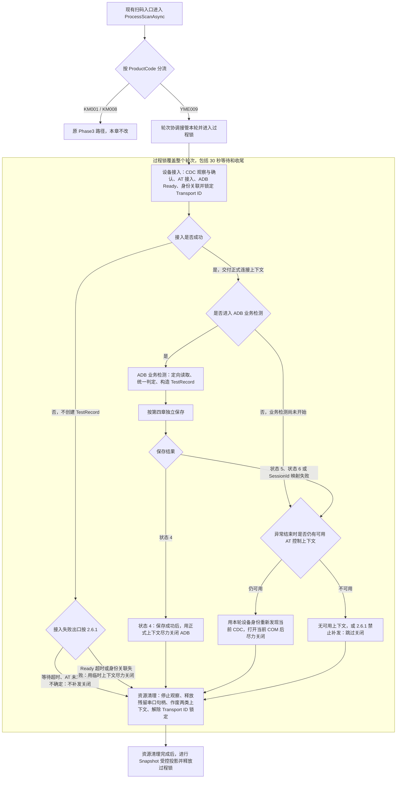

**图后约束：**

- 过程锁从轮次协调接管本轮时开始，到资源清理完成并准备返回时才释放，不能只覆盖正式业务检测。
- 正常路径的先后依赖是：ADB 业务检测 → 保存 → 关闭 ADB → 资源清理。不得在属性读取或身份关联尚未完成时关闭 ADB。
- 接入失败各出口仍按第二章 2.6.1 分类。等待超时、AT 未发送、AT 结果不确定不补发关闭。Ready 超时和身份关联失败使用临时上下文尽力关闭。
- 对于图中未单独列出的接入过程异常结束，只要本轮 AT 开启已确认成功，且临时设备身份上下文与 AT 通道仍可用，也应按照第二章 2.6.2 尽力尝试关闭 ADB；AT 未发送、AT 结果不确定等明确禁止补发关闭命令的特殊出口除外。关闭尝试结束或跳过后，继续统一资源清理。
- 状态 5、SessionId 映射失败和状态 6 是不同出口。三者都不构造伪造的 TestRecord。状态 6 不伪装成业务 FAIL 或设备读取异常。只要仍有可用 AT 控制上下文，就尽力关闭；没有则跳过。关闭成功不表示保存成功。
- 保存成功是指第四章已经确定的条件：保存方法正常返回、Commit 成功且 `record.Id > 0`。INSERT 成功或取得 `LastInsertRowId` 都不算保存成功。
- 关闭 ADB 与 5.4.3 的资源清理不是同一件事。关闭交换自己的串口在该交换结束时释放。统一清理负责停止观察、释放残留串口句柄、作废两类上下文并解除 Transport ID 锁定。不得把开启时的 COM 留到统一清理里继续使用。
- 状态 4 代表数据库保存成功，定义不变。`Snapshot.Completed` 是界面检测完成状态，不等同于数据库保存成功。
- Completed 投影和过程锁释放必须发生在本轮资源清理完成之后。不得在 ADB 关闭或资源清理完成之前，因为投影 `Completed` 而提前释放 `IsProcessing`。
- 状态 5、状态 1 的 SessionId 映射失败，以及状态 6，不得投影为 `Completed`。

---

## 5.2 轮次状态与结束出口

本节只编排已经确定的出口及其收尾顺序，不重新定义第二章的接入失败分类，也不重新定义第四章的六种保存状态和保存成功条件。

### 5.2.1 出口分类，只引用既有规则

一轮 YME009 检测可能从下列出口结束。分类依据已经写在第二至第四章，这里只作对照：

| 出口 | 依据 | 是否创建 TestRecord | 运行时可否宣布保存成功或显示完成 | 关闭 ADB |
|---|---|---|---|---|
| 接入失败：等待超时、门禁未通过、AT 未发送、AT 结果不确定、ADB Ready 超时、身份关联失败 | 2.6.1、D11、D13 | 否。不计入业务 FAIL | 否 | 按 2.6.1：前四类不补发关闭；Ready 超时或身份关联失败时，使用临时上下文尝试关闭 |
| 目标软件版本为空等「不创建记录」的会话参数出口 | 3.6.1、4.4.2 | 否。停留在状态 1 | 否 | 不创建 TestRecord。若正式连接上下文已经形成且 AT 通道仍可用，使用正式上下文尽力关闭。若正式连接上下文尚未形成，但 AT 开启已确认成功，且临时上下文与 AT 通道仍可用，则使用临时上下文尽力关闭。AT 未发送、AT 结果不确定等 2.6.1 明确禁止补发关闭命令的出口除外。关闭结束或跳过后，继续统一资源清理 |
| 业务 PASS、业务 FAIL 或正式检测中的读取异常，且保存成功 | 3.7、3.8、3.9、4.4.2 状态 4、D09、D14 | 是。且 `record.Id > 0` | 是。只有状态 4 才允许向界面宣布保存成功，并在关闭尝试和资源清理完成之后投影为现有 `Completed` | 保存成功后，全部 ADB 业务操作已经完成，再使用正式连接上下文尽力关闭。关闭失败不改变已保存结果 |
| 已构造完整检测结果，但保存失败或保存结果不能确认 | 4.4.2 状态 5、2.6.2 | 不能确认已持久化。不得仅凭内存中的 Id 判断成功 | 否 | 状态 5。若仍有可用 AT 控制上下文，使用正式上下文尽力关闭。关闭成功不表示保存成功。关闭失败不改写保存结果 |
| SessionId 映射失败 | 4.2.2、4.4.2 状态 1、2.6.2 | 否。属于状态 1 的终止，尚未进入保存过程 | 否。界面和导出规则与状态 5 相同，但不是状态 5 | 若仍有可用 AT 控制上下文，尽力关闭。不为此构造 TestRecord |
| 未预期软件异常，未形成完整检测结果 | 3.9.4、4.4.2 状态 6、4.5、2.6.2 | 否。不得补写伪装 FAIL | 否 | 状态 6。不得伪装成业务 FAIL 或设备读取异常。若仍有可用 AT 控制上下文，尽力关闭。不得改写成检测记录后再走保存成功后的关闭 |
| 正式检测期间设备断开 | 3.11、2.5.1、PRD Q12 | 已开始的正式检测按读取异常保存，不重连、不切换设备 | 随后的保存结果而定：只有随后进入状态 4，并在关闭尝试和资源清理完成之后，才可投影为完成 | 关闭前仍按 2.6.2 重新发现当前 CDC。发现失败、身份不能确认或当前 COM 打不开则跳过发送，不复用开启时的 COM，不重做 Ready，不切换设备。其余恢复方式仍待确认 |

**设计判断：** 业务判定结果、数据库保存结果和设备资源关闭结果仍是三个独立事实，不能合并成一个 PASS / FAIL，见 4.4.1。关闭结果不得写回保存结果，也不得把未预期软件异常伪装成业务 FAIL 或设备读取异常。

**待确认问题：** 因窗口关闭或其他工作停止，导致正式检测读取被停止且尚未形成完整检测结果时，不得将其归入第四章状态 6，也不得伪装成业务 FAIL 或读取异常。状态 6 仅适用于真正发生未预期软件异常、未形成完整检测结果的情形。若停止时已经形成完整检测结果，仍遵守第四章保存流程。正式检测期间设备断开，继续遵守第三章 3.11：按读取异常保存，不重连、不切换设备。此类工作停止的结果如何保存、如何分类、如何显示，仍为待确认的生命周期结果处理问题，见 5.7。本章不新增第七种状态，也不自行定案。

### 5.2.2 各出口的收尾顺序

**建议方案：** 各出口的收尾统一采用以下顺序。保存方法不能被工作 Token 取消打断。关闭 ADB 不改变保存结果。

1. 停止本轮尚未完成的业务工作。
2. 如果需要保存，按第四章规则执行保存。
3. 根据当前出口和上下文可用性，尽力尝试关闭 ADB。不满足 2.6.1 或 2.6.2 的条件则跳过。
4. 执行 5.4.3 的统一资源清理。
5. 进行 Snapshot 受控投影并释放过程锁。

状态 4 才允许在第 5 步投影为 `Completed`。状态 5、SessionId 映射失败所在的状态 1，以及状态 6，不得投影为 `Completed`。状态 4 只代表数据库保存成功；`Snapshot.Completed` 是界面检测完成状态，二者不等同。不得在关闭尝试或资源清理完成之前释放 `IsProcessing`。

各出口的差异如下。资源清理的共同清单见 5.4.3。

1. **接入失败。** 按 2.6.1 停止观察并给出相应提示。等待超时、AT 未发送、AT 结果不确定不补发关闭。Ready 超时或身份关联失败时，使用临时设备身份上下文尽力关闭。不创建 `TestRecord`，不计入业务 FAIL。然后执行 5.4.3。清理完成之后，进行受控投影并释放过程锁。界面不得投影为带业务结果的完成。等待或失败提示的具体文案仍待确认。
2. **正式检测已形成完整结果，且保存成功。** 先按第四章进入状态 4。全部 ADB 业务操作已经完成，再由轮次协调请求设备接入协调，使用正式连接上下文尽力关闭 ADB。关闭失败只报告异常，不修改、不删除、不回滚已经保存的记录，也不得因此把随后的界面投影改成未完成或把已保存的 PASS 改掉。然后执行 5.4.3。清理完成之后，才把业务判定投影为现有 `Completed`，并释放过程锁。
3. **未能确认保存成功。** 这里要区分两种情况。状态 5 表示保存失败或保存结果不能确认。SessionId 映射失败表示尚未进入保存过程，属于状态 1，不是状态 5。两者均不得显示已保存或已完成，不得仅凭内存中的 `record.Id` 宣布成功，也不得投影为 `Completed`。若仍有可用 AT 控制上下文，尽力关闭；没有则跳过。关闭不改变保存结果，关闭成功也不表示保存成功。4.6.2 对保存未完成技术场景的区分仍然有效，但不再决定是否允许关闭。然后执行 5.4.3。清理完成之后，进行受控投影并释放过程锁。
4. **未预期软件异常，未形成完整检测结果。** 这是状态 6。按 3.9.4 和 4.5 记录完整异常日志，不创建伪装记录，不显示 PASS 或已保存，不伪装成业务 FAIL 或设备读取异常。不得为了关闭而构造 TestRecord。若仍有可用 AT 控制上下文，尽力关闭；没有则跳过。然后执行 5.4.3。清理完成之后，进行受控投影并释放过程锁，且不得投影为 `Completed`。
5. **正式检测期间设备断开。** 不得擅自重连或切换到其他设备，也不得重做 Ready 或身份关联。已开始的检测按读取异常保存。保存之后分别走上面第 2 项或第 3 项。关闭前仍按 2.6.2 重新发现当前 CDC 并尝试打开当前 COM；发现失败、身份不能确认或打开失败则跳过发送。然后执行 5.4.3，作废已锁定的 Transport ID 和两类上下文。除「不重连、按读取异常保存」之外的恢复方式，仍是 PRD Q12 的待确认项。
6. **因窗口关闭或其他工作停止，尚未形成完整检测结果。** 不得归入第四章状态 6，也不得伪装成业务 FAIL 或读取异常。不新增第七种状态，也不自行决定是否保存部分结果、如何分类或如何显示。该事项保留为待确认，见 5.7。结果分类未决，不阻止设备收尾：若仍有可用 AT 控制上下文，尽力关闭；没有则跳过。不得为关闭构造 TestRecord。然后执行 5.4.3。清理完成之后，进行受控投影并释放过程锁，且不得投影为 `Completed`。若停止时已经形成完整检测结果，不走本项，而遵守第四章保存流程，再按上面第 2 项或第 3 项继续。正式检测期间设备断开，不走本项，而遵守第三章 3.11 和上面第 5 项。

事务与共享长连接只把第四章 4.2.4 图 8 的 Rollback 与释放约束接到轮次结束：保存方法内部负责事务收尾和连接占用结束，轮次结束不得因此提前 Dispose 共享的 `StorageService`，也不增加连接恢复框架。

---

## 5.3 取消与停止机制

### 5.3.1 工作停止与资源清理必须分开

**设计判断：** 必须区分三件事，不能把「停止本轮工作」理解成「本轮已经结束」：

- **轮次工作停止：** 停止等待、设备观察，以及尚未完成的设备操作，例如仍在进行的 Ready 检查、身份关联或属性读取。工作停止不得提前关闭 ADB。
- **关闭 ADB：** 属于随后的清理阶段，但不是 5.4.3 的资源释放本身。只有本轮 AT 控制上下文仍可用，且不属于 2.6.1 禁止补发的出口时，才使用清理令牌尽力尝试。失败或无法执行，不阻塞后续资源清理。
- **资源清理：** 停止观察循环、释放残留串口句柄、作废临时上下文和正式连接上下文、解除 Transport ID 锁定。见 5.4.3。关闭交换自己的串口不在这项里复用。

工作停止不能直接跳过资源清理。一轮在工作已经停止之后，仍必须走完 5.4.3 的清理，才能释放过程锁。

### 5.3.2 技术能力预留，不是已确认的操作员功能

**已确认规则：** 第三章 3.11 已经明确，检测中途不新增操作员取消入口。本章不改变这一决定，不把取消画成检测过程中已经对操作员开放的功能。

**待确认问题：** 等待期间是否允许操作员主动取消，仍是 PRD 5.4、第二章 2.6.3、2.7.3 留下的未决项。本章只保留技术挂钩，不自行定案。

**建议方案：** 接入协调和 30 秒等待循环必须能够响应取消令牌或停止请求，以便一旦业务确认允许取消，不必再改门禁结构。即便业务上暂不允许操作员取消，窗口关闭或必须停止观察时，等待循环也需要能够被中断。这是技术能力预留，不代表当前已经允许操作员在等待或检测过程中取消。

若将来允许在等待期间取消，第二章 2.6.3 已经给出建议的清理原则，本章沿用，仍不把它写成已确认业务规则：仍处于 CDC 观察、尚未确认发送开启命令时，只停止观察，不创建记录，不发送关闭 AT；若 AT 已经确认成功，则按 2.5.1 的上下文形成条件选择清理上下文，见 5.4.1，不得仅以是否已经进入业务检测为依据。随后仍须执行 5.4.3 的资源清理。

### 5.3.3 Token 生命周期与作用范围

**源码事实：** 现有正式 Phase3 扫码路径没有轮次级 `CancellationTokenSource`，`ProcessScanAsync` 和 `SaveTestRecordAsync` 也不接收取消令牌。现有代码里出现的令牌主要用于 ADB 超时；`ProcessRunner` 在取消时若进程未退出则 Kill，并返回 `Timeout()`，不会向外抛出 `OperationCanceledException`。依据见生命周期审查报告第 1.2 节，以及该报告第 2 节关于复用 `ProcessRunner` 的约束。

**建议方案：** 由 YME009 轮次协调在接管本轮时创建本轮**工作** `CancellationTokenSource`。该工作令牌只用于本轮尚未完成的等待和设备操作，建议传递范围包括：

- CDC 观察与 30 秒等待循环；
- 仍在进行的 AT 开启；
- ADB Ready 与身份关联；
- 正式检测中的属性读取。

收到停止请求时，轮次协调取消该工作令牌，这只表示工作停止，不表示清理已经完成。

随后的关闭尝试和资源清理必须使用单独的清理令牌，或在不依赖本轮工作令牌的情况下执行。**不能直接使用同一个已经取消的工作 Token 去执行关闭 ADB 或资源清理。** 关闭 ADB 属于清理阶段，不能因为工作 Token 已取消而被跳过；只有现有 AT 控制上下文仍可用，且该出口允许关闭时，才实际发送。关闭失败或无法执行，不阻塞 5.4.3。

每一轮使用新的工作 `CancellationTokenSource`，不得跨轮次复用。清理结束后再释放该对象，避免遗漏释放。不为此增加全局取消总线或统一任务框架。

若复用现有 `ProcessRunner` 执行定向 ADB 命令，不得把取消返回的 `Timeout()` 直接当成「设备读取超时」或读取异常记录。已经识别的命令失败、超时和 Transport 断开，仍按第三章 3.4、3.8 分类；工作停止本身不是业务 FAIL，也不是设备读取异常代码。

### 5.3.4 数据库保存不受轮次取消打断

**建议方案：** 数据库保存不能被轮次取消机制打断，必须遵守第四章的事务和保存语义。具体约束如下：

- 一旦进入保存调用，即第四章 4.4.2 的状态 3，本轮不得用工作令牌取消、回滚或中断 `SaveTestRecordAsync`。现有保存方法不接收取消令牌；YME009 也不应把轮次取消传递进该保存调用，以免破坏方案 B 的事务边界。
- 保存过程中若同时发生窗口关闭或停止请求，只能等待保存方法返回，再按返回结果进入状态 4 或状态 5。
- 不得把尚未确认提交的结果当成保存成功，也不得仅凭内存中的 `record.Id` 判断成功，见 4.2.3、4.3.5、4.4。
- 保存方法返回之后，再按 2.6.2 决定是否尽力关闭 ADB，然后执行 5.4.3 的资源清理。清理完成之后，才进行 Snapshot 受控投影并释放过程锁。

### 5.3.5 各阶段收到停止请求时的技术动作

下表只说明技术动作，不决定操作员是否被允许发起取消。检测中途仍然没有操作员取消入口。窗口关闭等外部原因引起的停止，按本表和 5.6 处理。

| 当前阶段 | 工作停止时做什么 | 随后的清理 |
|---|---|---|
| CDC 观察中，尚未确认发送开启 AT | 停止等待和观察循环 | 不创建记录，不补发关闭 AT；执行 5.4.3，清理完成后进行受控投影并释放过程锁 |
| AT 已成功，但 ADB Ready 或身份关联尚未成功，正式连接上下文尚未形成 | 停止尚未完成的 Ready 或身份关联 | 正式连接上下文尚未形成时，只要本轮 AT 开启已确认成功，且临时设备身份上下文与 AT 通道仍可用，就尽力尝试关闭 ADB；AT 未发送、AT 结果不确定等 2.6.1 明确禁止补发关闭命令的出口除外。随后执行 5.4.3，清理完成后进行受控投影并释放过程锁。不创建 `TestRecord` |
| ADB Ready 和身份关联成功，正式连接上下文已经形成，但业务检测尚未开始 | 停止进入业务检测前的本轮工作 | 不创建 `TestRecord`。若正式上下文中的设备身份仍在，按 2.6.2 重新发现当前 CDC 并尽力关闭。发现失败、身份不能确认或当前 COM 打不开则跳过发送，不复用开启时的 COM，不重做 Ready。再执行 5.4.3，清理完成后进行受控投影并释放过程锁 |
| AT 已发送但结果不确定 | 停止本轮后续接入尝试 | 按 2.6.1 不自动补发开启或关闭命令；再执行 5.4.3，清理完成后进行受控投影并释放过程锁。不创建 `TestRecord` |
| 正式检测读取尚未得到完整结果 | 停止尚未完成的设备读取 | 已识别的字段结果按第三章处理。若因此已经形成完整检测结果，则遵守第四章保存流程，再按 5.2.2 继续。若因窗口关闭或其他工作停止而尚未形成完整结果，不得归入第四章状态 6，也不得伪装成业务 FAIL 或读取异常；该类结果如何保存、分类和显示仍为待确认，见 5.7。正式检测期间设备断开，仍按第三章 3.11 以读取异常保存，不重连、不切换设备。已开始的正式检测不得退回「接入失败、不创建记录」。关闭前按 2.6.2 重新发现当前 CDC；发现失败、身份不能确认或当前 COM 打不开则跳过发送，不复用开启时的 COM，不重做 Ready，不切换设备。然后执行 5.4.3，清理完成后进行受控投影并释放过程锁 |
| 正在保存 | 不得停止保存本身 | 等待保存方法返回，再按 5.2.2 第 2 项或第 3 项继续 |
| 保存方法已返回 | 不再有可停止的检测工作 | 状态 4 使用正式连接上下文尽力关闭。状态 5 与 SessionId 映射失败仍分开处理：二者只要 AT 控制上下文仍可用就尽力关闭，否则跳过。状态 6 同样尽力关闭，且不构造检测记录。然后执行 5.4.3，清理完成后进行受控投影并释放过程锁。只有状态 4 可投影为 `Completed` |
| 正在执行关闭 ADB | 关闭属于清理阶段，不是可跳过的检测工作 | 使用清理令牌或等价机制执行，不得因工作令牌已取消而跳过。失败或无法执行后继续 5.4.3 |

---

## 5.4 设备资源生命周期

### 5.4.1 临时上下文与正式连接上下文

本章不重新定义两类上下文的职责和内容，只补齐持有、交接和作废时机。定义仍以第二章 2.5.1 为准：

- **临时设备身份上下文**在 CDC 门禁通过、发送前身份复核仍然通过之时产生，只服务于本轮接入过程中的 AT 发送和必要清理，不得交给业务检测，也不包含尚未完成身份关联的 Transport ID。
- **正式设备连接上下文**只在 ADB Ready 成功并且身份关联成功之后形成，必须包含已验证的 CDC 设备身份、已锁定且已完成身份关联的 Transport ID，以及本轮接入世代或就绪令牌。它只属于当前轮次，不得被下一轮复用。
- 二者是生命周期和数据职责上的区分，不要求设计成两个独立类，也不为此扩展上下文管理框架。正式阶段必须在身份关联通过之后才能成立。

**建议方案：** 设备接入协调创建并持有临时上下文，在身份关联成功后形成正式连接上下文，交给轮次协调。轮次协调再把正式连接上下文交给业务检测。业务检测只使用该正式上下文做定向读取，不再重新做 CDC 发现或默认设备选择。轮次结束时，由轮次协调请求接入协调作废本轮两类上下文。具体关联算法和 CDC 身份字段仍按 2.7.2、2.7.3 保留，本章不定案。

关闭 ADB 按 2.5.1 和 2.6 选择上下文，不得仅以「是否已经进入业务检测」作为唯一依据：

- 正式连接上下文已经形成：优先使用正式上下文尽力关闭。正常路径还要等保存成功，并且全部 ADB 业务操作已经完成。
- 正式连接上下文尚未形成，但本轮 AT 开启已确认成功，且临时设备身份上下文仍在：使用临时上下文中的设备身份，按 2.6.2 重新发现当前 CDC 并尽力关闭。该规则不局限于 Ready 超时和身份关联失败。AT 未发送、AT 结果不确定等 2.6.1 明确禁止补发关闭命令的出口仍不补发。重新发现失败、身份不能确认、不唯一或当前 COM 打不开时跳过发送。不得复用开启时的 COM 或串口句柄。无论是否发送关闭命令，都继续统一资源清理。
- 设备身份已不在，或关闭前不能确认当前 CDC 属于本轮目标：跳过发送关闭 AT。不得为此重做 Ready、身份关联或切换设备。USB 重新枚举后的重新发现和重新打开当前 COM 不属于这里所说的跳过。
- 无论是否关闭 ADB，都执行 5.4.3 的统一资源释放。

### 5.4.2 观察、串口、AT 与 Transport ID 的时机

| 资源 | 何时创建或启动 | 由谁持有 | 何时停止、关闭或作废 |
|---|---|---|---|
| 本轮 CDC 观察循环 | 扫码后启动设备接入和 30 秒窗口时 | 设备接入协调 | 任何结束出口、等待期间窗口关闭，或工作停止之后，都必须停止本轮观察 |
| 本轮串口 | 每次 AT 交换按当次发现的当前 COM 打开 | 设备接入协调经 AT 通信职责使用 | 该次交换结束时释放。开启和关闭各打开、各释放。不得把开启时的句柄留到关闭 |
| AT 交换 | 开启：门禁通过并形成临时上下文之后。关闭：2.6.2 允许尝试关闭，且重新发现已得到唯一、身份相符的当前 COM 之后 | 同一时刻只进行一次，见 2.6.4 | 命令结束或被判定不能发送后释放本次交换。不把参考工程的 SMT 拔板状态机迁入 |
| 临时设备身份上下文 | CDC 门禁通过之后 | 设备接入协调 | 本轮结束时作废。不得交付给业务检测，也不得留给下一轮 |
| 正式设备连接上下文 | Ready 成功且身份关联成功、锁定 Transport ID 之后 | 先由接入协调形成，再由轮次协调持有并交给业务检测 | 本轮结束时作废。下一轮必须重新接入，不得沿用 |
| Transport ID 锁定状态 | 与正式上下文同时成立 | 只属于正式上下文，作为后续 ADB 属性读取的唯一定向依据 | 本轮结束或设备丢失后必须解除并作废。关联未通过时不得写入，也不得把未关联的 Transport ID 交给业务检测 |
| 本轮接入世代或就绪令牌 | 本轮接入开始时 | 两类上下文都可以携带 | 每一轮接入开始时清零 Ready 观察、关联结果和锁定结果，防止上一轮状态被下一轮误用，见 2.5.1 |
| 本轮工作 CTS | 轮次协调接管本轮时 | 轮次协调 | 资源清理结束后释放。不得用已取消的工作令牌执行清理 |

设备断开后不得擅自重连或切换到其他设备，也不得重做 Ready 或身份关联，遵守第二章已经确认的设备接入规则。正式读取中断开，已按 3.11 和 D09 归为读取异常且不重连。关闭前仍按 2.6.2 尝试重新发现；不能确认目标或打不开当前 COM 时跳过发送。断开后仍须停止本轮观察、释放残留串口句柄，并作废已锁定的 Transport ID 和两类上下文。Q12 的其他恢复方式仍待确认，本章不补充。

### 5.4.3 轮次结束时必须完成的释放清单

**建议方案：** 每一轮结束时，无论成功或失败，也无论是否发送关闭 AT，都必须完成下列资源清理。这与第二章 2.6.4 一致。本章把它明确为关闭尝试结束或被跳过之后、Snapshot 受控投影和释放过程锁之前的必要清单：

1. 停止本轮 CDC 观察，以及本轮 Ready、身份关联等观察循环。
2. 释放仍未关闭的串口句柄。关闭交换自己的串口在该交换结束时释放，不得把开启 ADB 时的 COM 或句柄当作这次清理要继续使用的连接。
3. 作废本轮临时设备身份上下文和正式设备连接上下文。
4. 解除本轮 Transport ID 锁定状态。

完成上述 1 至 4 项之后，最后进行 Snapshot 受控投影，并释放过程锁和本轮工作 CTS。只有状态 4 才允许投影为 `Completed`；保存未完成时不得投影为 `Completed`。不得在 ADB 关闭或上述资源清理完成之前，因为投影 `Completed` 而提前释放 `IsProcessing`。

发送关闭 ADB 不是这份清单的替代项，也不属于清单中的四项。满足 2.6.1 或 2.6.2 时，关闭尝试发生在本清单之前；不满足时跳过关闭。上面 1 至 4 项在两种情况下都要执行，然后再做受控投影并释放过程锁。关闭失败或被跳过，不阻止这四项。

不在每轮结束时 Dispose 共享的 `StorageService` 或 `LoggingService`。单次 ADB 子进程仍由现有 `ProcessRunner` 在命令结束或异常路径中 Kill 并 Dispose，不把该进程对象留到下一轮。

下图是**图 12：轮次工作停止与资源释放顺序**。阅读目的是看清：工作停止之后先按出口决定是否尽力关闭 ADB，再进入统一资源清理。关闭 ADB 不是资源清理本身。清理不得使用已取消的工作 Token。`pendingLife` 仍表示结果分类待确认，`pendingClose` 表示有可用 AT 上下文则尽力关闭、否则跳过。资源清理完成之后，才进行 Snapshot 受控投影并释放过程锁。

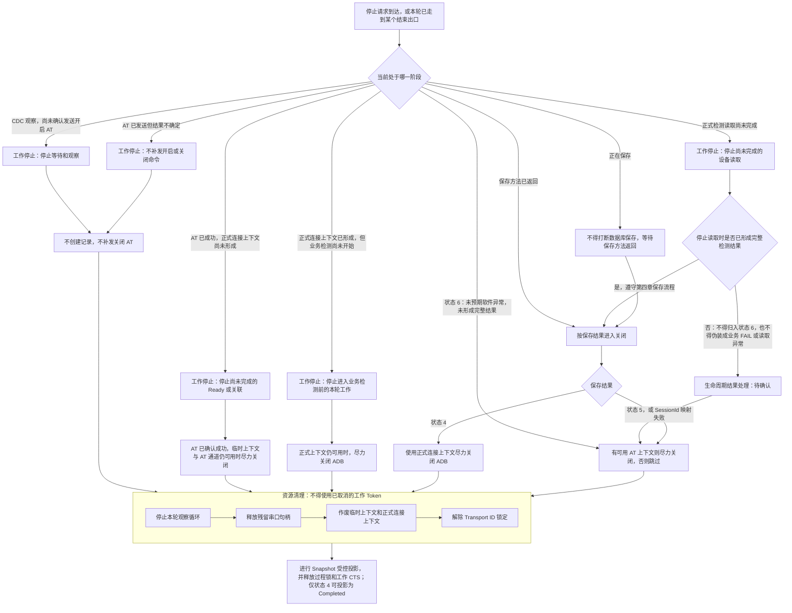

**图后约束：**

- 工作停止节点之后都必须先处理关闭尝试或明确跳过，再进入资源清理，不能从工作停止直接结束本轮。
- 关闭 ADB 位于统一资源清理之前。有可用 AT 上下文时尽力尝试，不可执行时跳过，两种情况都进入资源清理。
- 清理子图不得标注为使用本轮已经取消的工作 Token。关闭尝试同样使用清理令牌。
- 「不补发关闭 AT」只适用于尚未确认发送开启命令的等待停止，以及 2.6.1 中 AT 未发送、AT 结果不确定等已经规定不补发的出口。
- `pendingLife` 与 `pendingClose` 保持独立。前者仍是结果分类待确认。后者不是待决策，而是尽力关闭或跳过。状态 5 与 SessionId 映射失败都进入 `pendingClose`，但二者仍是不同出口。
- Commit 失败或保存结果不能确认，不得因为随后做了资源清理或关闭成功，就被理解成保存成功。导出仍以数据库中实际存在的行为准，见 4.8。
- 关闭时的上下文，按 2.5.1 的形成条件选择。正式上下文中的设备身份优先。关闭前按 2.6.2 重新发现当前 CDC 并打开当前 COM。不得复用开启时的 COM 或串口句柄，也不得重做 Ready 或身份关联。
- 因窗口关闭或其他工作停止而尚未形成完整结果时，不得归入第四章状态 6，也不得伪装成业务 FAIL 或读取异常；其结果处理仍为待确认，见 5.7。
- Completed 投影和过程锁释放必须发生在资源清理完成之后。只有状态 4 才允许投影为 `Completed`。

---

## 5.5 UI、Session 与自检协调

### 5.5.1 Snapshot 的受控投影

本章沿用现有 Session 和 Snapshot 机制，以及第四章 4.4.3 已经推荐的「YME009 专属轮次结果，再向现有 Snapshot 做受控投影」。不修改旧产品使用的 `Completed` 语义。

投影规则继续以第四章为准，本章只把它接到轮次生命周期：

- 状态 4 代表数据库保存成功，定义不变。`Snapshot.Completed` 是界面检测完成状态，不等同于数据库保存成功状态。
- 只有状态 4，也就是保存方法正常返回、Commit 成功且 `record.Id > 0` 之后，才允许把业务判定投影为现有 `VerificationSnapshot.Completed`。该投影必须发生在已确认的 ADB 关闭尝试和本轮资源清理完成之后，不得在关闭或清理完成之前投影为 `Completed`，也不得因此提前释放 `IsProcessing`。
- 正在保存时保持处理中，不调用 `Completed`。
- 保存失败、保存结果不能确认、未预期软件异常，以及 SessionId 映射失败，不得显示为检测完成，不得调用带有业务 `PASS` / `FAIL` 的 `Completed`，也不得把软件异常伪装成业务 FAIL。保存未完成时不得投影为 `Completed`。
- 关闭失败只作为附加异常报告，不得因此改写已经形成的保存结果，也不得把已保存的 PASS 改掉，也不得阻止清理完成后把状态 4 的业务判定投影为 `Completed`。
- 不得因为窗口关闭或 UI 清理而改变已经形成的保存结果。若本轮已经进入状态 4，界面拆除或窗口关闭不能把该结果改回未保存，也不能改写其业务判定。

**源码事实：** 现有 Snapshot 和 `StatusText` 只有「等待检验 / 正在检验... / PASS / FAIL」，没有等待设备接入、多台等待或保存未完成等状态。依据见第一章 1.2.4、1.8 第 10 项。

**设计判断：** 30 秒等待若只置 `IsProcessing` 而不做额外投影，界面只会显示「正在检验...」，不足以表达 D11、D15 要求的等待提示。等待态、多设备等待、两类 FAIL，以及保存失败、未预期软件异常的具体界面文案仍待确认，见 5.7。本章只要求：服务层通过轮次结果给出事实，ViewModel 只做投影；等待期间必须能区别于「正在检验中的正式检测」和「检测已完成」；接入失败和保存未完成必须能区别于「等待检验」和「检测已完成」。不在本章预先写定文案，也不把等待循环放进 `MainViewModel`。

### 5.5.2 Session 门禁与残留状态

**源码事实：** 现有 Session 级门禁为：Session 激活后不能改产品、不能再「开始测试」、不能导出；检验进行中不能「结束测试」。新 Session 会创建新的 `VerificationFlowService` / `ProcessCoordinator`，初始 Snapshot 为 Idle。结束测试会把界面校验区刷回 Idle，但不取消任何任务，也不调用 Coordinator.Reset。`EndTime` 未落库的既有缺陷本期不修，YME009 不得拿库中 `EndTime` 判断批次是否结束。依据见第一章 1.2.2、1.8 第 8 项，以及生命周期审查报告第 1.5、2 节。

**建议方案：** Session 结束、产品切换、开始新 Session、导出等操作继续遵守现有门禁，不为 YME009 另做一套 Session 生命周期服务，也不设计新的批次系统或全局生命周期框架。由于 5.1.2 已经要求过程锁覆盖等待阶段，现有「检验进行中不能结束测试、不能启动新轮次」的门禁，在等待期间同样有效。

补充约束：

- 本轮尚未结束时，不得用 `Reset()` 或等价操作清掉过程锁，也不得把尚未完成的轮次界面直接刷成 Idle 或 Completed。
- 结束测试或开始新 Session，只能发生在本轮过程锁已经释放之后。
- 上一轮的临时上下文、正式上下文、Transport ID 锁定和等待观察结果，不得进入下一轮；每一轮接入开始时清零相关观察和锁定状态，见 2.5.1、2.6.2。
- 导出和会话计数继续遵守第四章 4.8：运行时只有状态 4 可宣布保存成功；导出器仍以数据库中实际存在的 `TestRecord` 为数据源。

### 5.5.3 YME009 轮次与自检的双向互斥

**已确认规则：** YME009 正式检测轮次与现有自检功能双向互斥。轮次执行期间禁止启动自检；自检执行期间禁止启动 YME009 轮次。互斥应覆盖实际资源占用期间，避免只在 UI 层做表面禁用。

**源码事实：** 现有扫码在自检中会被忽略，开始 / 结束测试在自检中也会被禁用。但 `SelfCheckCommand` 的可执行条件目前只有「自检未在进行」，不以 `IsProcessing` 或 `IsSessionActive` 为门闩，因此源码允许在一轮检验进行中启动自检；自检会调用进程级设备访问能力。依据见生命周期审查报告第 1.5 节。正式扫码检测不得接入现有 `CheckMultipleDevices` 或 `ReadDeviceSnAsync`，见 1.5.2、2.8 第 6 项。

**建议方案：** 只增加必要的互斥门禁，不重构现有自检架构，也不改变 KM001、KM008、SOLTAG25 的检测行为。YME009 轮次与现有自检必须通过同一互斥门禁完成原子性获取。

- YME009 启动前必须原子性确认并取得互斥资格。
- 自检启动前也必须通过同一互斥门禁确认并取得资格。
- 不能仅依赖双方分别读取状态变量后再启动，否则存在并发竞争窗口。
- 当 YME009 本轮过程锁仍然持有，也就是从轮次协调接管到本轮资源清理完成之前，禁止启动自检。YME009 互斥资格持续到本轮资源清理完成。该门禁必须作用在自检的实际启动路径上，而不能只把按钮显示为禁用、后台仍可进入自检。
- 当现有自检仍在占用设备访问资源，包括其已经启动、尚未释放的 ADB 读取或多设备检查，禁止启动 YME009 轮次。自检互斥资格持续到自检实际设备资源占用结束。扫码入口已有的「自检中忽略」可以继续作为启动侧门禁，但必须以自检实际占用结束为准，而不是以按钮状态或提示文本为准。
- 上述门禁只约束 YME009 正式轮次与自检的并存，不把旧产品在检验进行中是否允许自检的现有行为改掉。
- 不把 YME009 的临时上下文、正式上下文或已锁定 Transport ID 借给现有自检使用，也不让自检的默认 ADB 设备假设进入本轮正式检测。

**待确认问题：** YME009 是否使用现有 ADB 自检，以及具体自检形态，仍是第一章 1.9 第 7 项和第二章 2.8 第 6 项的未决项。本章只给出互斥门禁，不决定自检的产品形态，也不把现有 ADB 自检写成 YME009 已经采用的方案。

---

## 5.6 窗口关闭与资源最终释放

### 5.6.1 窗口关闭时的收尾

窗口关闭不是新的业务出口，不另造一套关闭规则。它只是把 5.2、5.3 和第二章已经确定的收尾，应用到「界面正在消失」这一时机。不得因为窗口关闭而把未完成的保存显示为成功，也不得改变已经形成的保存结果。

| 关闭时本轮所处阶段 | 技术动作 | 不得做的事 |
|---|---|---|
| 等待期间，尚未确认发送开启 AT | 发出工作停止，停止设备观察循环，并执行 5.4.3 的必要清理；清理完成后进行受控投影并释放过程锁 | 不创建 `TestRecord`，不补发关闭 AT，不显示为检测完成 |
| AT 已成功，但 ADB Ready 或身份关联尚未成功，正式连接上下文尚未形成 | AT 开启已确认成功，且临时设备身份上下文与 AT 通道仍可用时，尽力尝试关闭 ADB；AT 未发送、AT 结果不确定等 2.6.1 明确禁止补发关闭命令的出口除外。随后执行 5.4.3；清理完成后进行受控投影并释放过程锁 | 不创建 `TestRecord`，不把清理成功理解成检测通过，不沿用该临时上下文到下一轮 |
| ADB Ready 和身份关联成功，正式连接上下文已经形成，但业务检测尚未开始 | 使用正式设备连接上下文中的设备身份，按 2.6.2 重新发现当前 CDC 并尽力关闭 ADB，再执行 5.4.3；清理完成后进行受控投影并释放过程锁 | 不创建 `TestRecord`，不把关闭成功理解成检测通过，不沿用该正式上下文到下一轮。发现失败、身份不能确认或当前 COM 打不开则跳过发送，不复用开启时的 COM，不重做 Ready |
| AT 已发送但结果不确定 | 遵守 2.6.1：不自动补发开启或关闭命令，再执行 5.4.3；清理完成后进行受控投影并释放过程锁 | 不把不确定状态当成已关闭或已进入正式检测 |
| 正式检测读取尚未完成 | 按 5.3.5 停止尚未完成的设备读取。若已经形成完整检测结果，遵守第四章保存流程，再按 5.2.2 继续。若因窗口关闭或其他工作停止而尚未形成完整结果，不得归入状态 6，也不得伪装成业务 FAIL 或读取异常；结果处理见 5.7，本章不定案。正式检测期间设备断开，仍按 3.11 以读取异常保存，不重连、不切换设备。关闭前按 2.6.2 重新发现；不能确认目标或打不开当前 COM 则跳过发送 | 不得把未形成的完整结果投影为完成，不得擅自重连或切换设备，不得为关闭构造 TestRecord |
| 正在执行数据库保存 | 不得打断保存，必须等待 `SaveTestRecordAsync` 返回；共享数据库连接不得提前释放 | 不得将未完成保存误判为成功，不得仅凭内存中的 Id 宣布已保存，不得在保存尚未返回时 Dispose `StorageService` |
| 保存方法已返回，或正式检测已结束 | 状态 4 使用正式上下文尽力关闭，再执行 5.4.3；清理完成之后，才投影为 `Completed` 并释放过程锁。状态 5、SessionId 映射失败和状态 6 在 AT 控制上下文仍可用时也尽力关闭，然后执行 5.4.3，且不得投影为 `Completed` | 不得改写已经形成的保存结果，不得因关闭成功把未保存显示为已保存，也不得因 UI 清理把状态 4 改回未保存 |

窗口关闭若落在保存未完成阶段，关闭 ADB 仍按 2.6.2：有可用 AT 控制上下文则尽力关闭，否则跳过。不另开新规则。关闭成功不表示保存成功。上下文选择按 2.5.1 和 5.4.1。

### 5.6.2 轮次资源与进程级共享资源的边界

**设计判断：** 必须区分本轮资源和进程级共享资源。轮次结束或窗口关闭时，释放的是本轮资源；共享资源继续按现有进程或 Session 生命周期持有，不在每轮结束时拆除。

本轮资源包括：本轮 CDC 观察循环、尚未释放的串口句柄、临时上下文、正式连接上下文、Transport ID 锁定状态、本轮工作 CTS，以及本轮过程锁。它们必须在本轮结束时释放，且不得交给下一轮。开启时的 COM 和串口句柄不是可以留给关闭或下一轮的资源。

进程级共享资源包括：`StorageService` 的长连接和 `_lockObject`、当前 Session 的 `LoggingService` 写入器，以及现有进程级 ADB 执行原语。它们不是某一轮检测私有的对象。一轮结束时不得 Dispose 这些共享对象。正在保存时尤其不得提前释放共享数据库连接。会话日志写入器在 Session 结束时关闭，而不是在每一轮检测结束时关闭。`EndTime` 未落库的既有缺陷本期默认不修复，见 1.8 第 8 项。

**建议方案：** 应用退出时，若仍有未结束的 YME009 轮次，先按 5.6.1 完成本轮工作停止、进行中的保存和资源清理，再让进程退出回收共享资源。不建设通用的全局生命周期管理框架，不为应用退出新增统一 Dispose 总线。若退出发生在保存过程中，仍然必须等待保存方法返回，不能把未确认的提交当成成功，也不能在返回前关闭共享连接。

下图是**图 13：窗口关闭与应用退出时的收尾边界**。阅读目的是区分等待关闭、AT 结果不确定、正式连接上下文尚未形成或已经形成、正在保存，以及轮次资源与共享资源的边界。关闭 ADB 在统一资源清理之前：有可用 AT 上下文则尽力尝试，不可执行或属于禁止补发的出口则跳过。`pendingLife` 与 `pendingClose` 保持独立。资源清理完成之后，才进行 Snapshot 受控投影并释放过程锁。

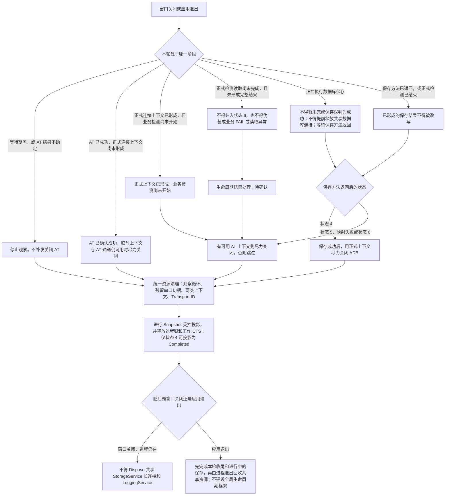

**图后约束：**

- 正在保存的分支必须先等待保存方法返回，不能直接画到「释放共享数据库连接」。
- 状态 4 之后的关闭边，不得改写已经形成的保存结果。关闭成功也不把状态 5 或状态 6 变成保存成功。
- `pendingLife` 仍表示结果分类待确认。`pendingClose` 表示尽力关闭或跳过，不再是待决策。二者保持独立节点。
- 等待期间和 AT 结果不确定不补发关闭，直接进入资源清理。
- 关闭尝试位于统一资源清理之前。有可用 AT 上下文和不可执行两种情况都进入 `roundRes`。
- 窗口关闭且进程仍在时，共享 `StorageService` 和 `LoggingService` 必须保持可用。
- 本图不引入全局生命周期管理组件。
- 关闭时的上下文按 2.5.1 的形成条件选择。关闭前按 2.6.2 重新发现当前 CDC 并打开当前 COM。不得复用开启时的 COM，也不得重做 Ready 或身份关联。
- 因窗口关闭尚未形成完整结果时，不得归入第四章状态 6，也不得伪装成业务 FAIL 或读取异常。
- Completed 投影和过程锁释放必须发生在资源清理完成之后。只有状态 4 才允许投影为 `Completed`。

---

## 5.7 本章待确认问题

本章已经给出轮次过程锁范围、结束出口的收尾顺序、工作停止与资源清理的区分、设备资源释放清单、UI / Session / 自检协调，以及窗口关闭与应用退出时的资源边界。下列事项继续开放，不把它们写成已确认结论。

| 事项 | 状态 | 说明 |
|---|---|---|
| 等待期间是否允许操作员主动取消 | 待决策 | 与 PRD 5.4、第二章 2.6.3、2.7.3 对齐。本章只预留可中断的等待循环和停止清理能力，不新增检测中途的操作员取消入口，也不擅自允许或禁止等待期取消 |
| 等待期间再次扫码的具体处理方式 | 待决策 | 与 2.6.3、2.7.3 对齐。已确认的只是过程锁覆盖等待、不引入并行检测。现有静默忽略只是源码现状，不是本章新定的业务规则 |
| 忙碌期间再次扫码的提示文案 | 待确认 | 对应 PRD Q19、5.3。未决的只是提示方式，不是过程锁本身 |
| 保存失败、未预期软件异常的具体界面文案 | 待确认 | 与 3.11、4.10 对齐。已确认的只有不得显示为已保存或已完成，不得伪装成业务 FAIL。是否关闭 ADB 已由 2.6.2 确定，不再作为待决策 |
| 等待态、多设备等待、两类 FAIL 的具体界面表达 | 待确认 | 与 1.9 第 6 项、2.7.3、2.8 第 5 项对齐。本章只要求等待和保存未完成不能只显示为「正在检验...」或「检测已完成」，不预设文案 |
| 正式检测期间设备断开后的其他恢复方式（Q12） | 待确认 | 3.11 已确认不重连，已开始的检测按读取异常保存。其余恢复方式仍待确认，本章不补充 |
| YME009 是否使用现有 ADB 自检，以及具体自检形态 | 待决策 | 与 1.9 第 7 项、2.8 第 6 项对齐。本章只确认正式轮次与自检双向互斥，不决定自检产品形态 |
| 因窗口关闭或其他工作停止导致未形成完整检测结果时，如何处理该轮结果 | 待确认 | 不得归入第四章状态 6，也不得伪装成业务 FAIL 或读取异常。不新增第七种状态。是否保存部分结果、如何分类以及如何显示，本章不定案。若停止时已形成完整检测结果，仍遵守第四章保存流程。正式检测期间设备断开，仍按 3.11 以读取异常保存，不重连、不切换设备 |
| Q17、Q20，以及第一章、第二章已列出的其他跨章节问题 | 仍开放 | 包括订单内目标版本一致性、`ProductName` 跨产品复用、MES、`EndTime` 未落库等。本期默认不修复 `EndTime`。本章不定案 |

完成本章后停止。不开始第六章，不开始编码，不修改 PRD，不修改设备审查报告，不修改生命周期审查报告，不修改源码。
# 6. YME009 测试策略与测试范围

本章说明 YME009 接入 SnVerify 后的测试总体策略、核心功能测试范围、测试环境与测试条件，以及实施阶段划分和阶段验收标准。业务依据仍是 `docs/YME009-Packaging-Station-PRD.md` V0.6。设计依据是项目目录中当前已经写入的第一至第五章，包括 2026-11-23 对第二章与第五章关闭 ADB 出口的定向修订，以及随后对 AT / ADB 串口生命周期的定点修订。现有工程测试基础依据是对 `SnVerify.Tests` 的只读盘点结论；撰写本章时不修改测试项目，也不运行测试套件。

**本章现已完整包含 §6.1 至 §6.5。** §6.1、§6.2、§6.3 给出测试策略与测试范围，其已结论正文不再改写。§6.4 与 §6.5 给出实施阶段划分和阶段验收标准，并已按 2026-11-23 对当前工作区源码的定点查验收紧，补足各阶段的复用、改造和新增范围。本章完成技术设计收尾，不开始实施阶段，不开始编码。

本章继续使用结论标记：源码事实、设计判断、建议方案、待确认问题。本章不新增接口、类或具体实现方案，也不把待确认或待决策事项写成已定案。

---

## 6.1 测试总体策略

### 6.1.1 四层测试策略

**建议方案：** YME009 采用四层测试策略。下文简称 L1～L4，供 §6.2 矩阵引用。各层证明边界不同，不得互相替代。

| 层次 | 名称 | 验证对象 | 主要方法 | 证明边界 |
|---|---|---|---|---|
| L1 | 单元测试 | 独立业务逻辑 | 在 `SnVerify.Tests` 中用 NUnit 直接验证纯逻辑；外部依赖可用 Moq 替换 | 证明解析、比较、判定、状态转换和异常分类规则本身正确。**不证明**真实 CDC、串口、AT、ADB 协议或真机时序正确 |
| L2 | 组件集成测试 | CDC、AT、ADB、数据库事务和资源生命周期等组件协作 | 在可替换边界上自动化；存储使用临时 SQLite；设备通信依赖在对应模块实现时再补充可替换边界 | 证明组件协作、事务边界和资源清理顺序在受控替身下正确。**不能代替**完整业务验收，也**不能代替**真机联调 |
| L3 | 设备联调测试 | 真实 YME009 设备上的 CDC、串口、AT、ADB、属性读取、设备断开和异常收尾 | 使用实际设备与对应环境手工或半自动执行，并保留证据 | 证明设备协议、识别条件和真机异常路径。**Mock 测试不能代替**本层 |
| L4 | 完整业务验收 | 从操作员扫码开始，到检测、综合判定、记录保存、设备收尾和下一轮准备的完整流程 | 等价环境可以用于提前验证完整业务流程，但不能替代真实设备的最终业务验收。最终 L4 验收必须在真实 YME009 设备参与的工位条件下，按 PRD 与前五章已确认路径走通 | 证明端到端业务闭环。组件集成测试通过**不能代替**本层；等价环境通过也**不能代替**最终真实设备验收 |

四层的具体职责如下。

1. **L1 单元测试。** 验证不依赖真实硬件即可判定对错的独立业务逻辑，至少包括：八项属性原始值的解析与字段状态分类；SN 与软件版本比较；五项必要条件及综合 PASS / FAIL；`FailReason` 主代码选择；第四章六种保存相关状态的转换与分类；已识别异常与未预期软件异常的区分。判定函数按第三章应能在不连接设备的情况下验证。

2. **L2 组件集成测试。** 验证多个组件在受控替身下的协作，至少包括：产品分流与 YME009 轮次挂载点；CDC 唯一性门禁与等待窗口的状态推进；AT 开启三种结果（未发送、已确认成功、已发送但结果不确定）后的不同出口；ADB Ready 与身份关联分开检查后才锁定 Transport ID；`SaveTestRecordAsync` 事务路径上的保存成功 / 保存失败 / Commit 结果不确定；本轮资源清理清单是否在工作停止之后仍会执行；有可用 AT 控制上下文时是否按 2.6.2 进入尽力关闭，以及 2.6.1 明确禁止补发关闭的出口是否被跳过。能够通过替换外部依赖实现的场景优先自动化；当前盘点显示尚无可复用的 CDC、串口、AT、Transport ID 和显式事务失败测试实现，这些能力随对应功能实施逐步补齐，不要求先建设完整模拟框架。

3. **L3 设备联调测试。** 使用真实 YME009 设备验证：CDC 识别与唯一性确认、串口 AT 开启与关闭、ADB Ready、身份关联与 Transport ID 定向读取、八项属性真机返回、正式检测期间断开，以及 2.6.2 已确认的尽力关闭与跳过关闭路径上的异常收尾。设备侧协议与识别条件仍以设备审查报告中的待验证项为准，真机结果只校正解析与超时等实现细节，不改写 PRD 已确认的业务规则。

4. **L4 完整业务验收。** 验证完整闭环：操作员扫码 → 设备接入 → 业务检测 → 综合判定 → 记录保存 → 设备收尾 → 资源清理 → 下一轮准备。同时核对界面不得把保存未完成显示为已保存或已完成，统计与导出只消费数据库中实际存在的 `TestRecord`，并确认 KM001、KM008、SOLTAG25 原有路径未被改写。等价环境可以用于提前验证完整业务流程，但不能替代真实设备的最终业务验收。最终 L4 验收必须在真实 YME009 设备参与的工位条件下完成。

### 6.1.2 各层证明边界

**设计判断：** 必须明确下列证明边界，避免把某一层的通过误当成最终交付证据。

- Mock 测试不能代替真实硬件联调。
- 组件集成测试不能代替完整业务验收。
- 单元测试通过不代表真实设备协议正确。
- 最终交付需要自动化测试结果与真机验证证据共同支撑。

因此：

- L1 通过，只说明业务规则在受控输入下正确。
- L2 通过，只说明组件协作与事务、清理边界在替身下正确。
- L3 通过，才说明设备协议与真机异常路径可用。
- 最终 L4 验收在真实 YME009 设备参与的工位条件下通过，才说明包装工位完整流程可交付。等价环境可用于提前验证完整业务流程，但不能单独作为最终验收证据。

任一单层通过，都不足以单独宣布 YME009 功能交付完成。

### 6.1.3 覆盖原则与工程约束

**建议方案：** 测试策略还遵守以下原则。

1. **正常路径与异常路径均需覆盖。** 正常路径包括唯一 CDC 连续两次确认、AT 已确认成功、Ready 与身份关联成功、八项读取、五项全 Pass、保存成功后关闭 ADB。异常路径至少包括：0 台或多台等待与超时、AT 未发送、AT 已发送但结果不确定、Ready 超时、身份关联失败、必要字段读取异常、业务 FAIL、保存失败、Commit 结果不确定、SessionId 映射失败、未预期软件异常、正式检测期间设备断开，以及已确认关闭路径上的 ADB 关闭异常或跳过关闭。
2. **保存结果和设备收尾应分别验证。** 业务判定结果、数据库保存结果和设备资源关闭结果是三个独立事实，见第四章 4.4.1。测试不得把关闭成功当成保存成功，也不得把保存失败改写成业务 FAIL 或读取异常。
3. **测试应可重复执行，测试数据与生产数据隔离。** 自动化存储测试沿用临时 SQLite 文件和独立测试数据，不得写入生产或工位在用数据库。
4. **不要求为测试引入不必要的架构重构。** YME009 的测试基础沿用现有 `SnVerify.Tests`、NUnit、Moq 和临时 SQLite 方案。新增测试能力随对应功能实施逐步补齐，不要求先建设完整硬件模拟平台，也不要求全项目架构重构。
5. **不把现有 KM001 / KM008 规则链测试直接当作 YME009 的测试。** 现有规则链、`SN_DUPLICATE` 和 KM001 导出分桶等用例继续服务旧产品；YME009 有独立的分流、判定、保存和导出边界，必须建立对应用例。
6. **MES 不属于本项目范围。** MES 接入、MES 上报及相关流程不属于本项目范围。不列入测试范围、实施计划和交付验收标准。除非后续明确提出项目范围变更，否则不再作为本项目待决策事项。

---

## 6.2 核心功能测试范围

### 6.2.1 范围矩阵说明

**建议方案：** 下表按第一至第五章已经确认的设计，列出 YME009 核心功能的测试范围。每行给出需要验证的行为、主要正常场景、主要异常场景、推荐测试层次，以及是否必须依赖真实设备。

阅读约定：

- 「推荐层次」给出该域主要应落在哪几层；同一域可以跨层验证不同侧面。
- 「必须依赖真实设备」为「是」时，该域的协议正确性或真机时序必须以 L3 / L4 证据支撑；其逻辑分支仍可用 L1 / L2 先行覆盖。
- 表中只引用已确认规则。待确认或待决策事项只作为「不得误写成已定案」的边界，不在本轮把它们变成验收条件。
- MES 接入、MES 上报及相关流程不属于本项目范围，不列入测试范围、实施计划和交付验收标准；除非后续明确提出项目范围变更，否则不再作为本项目待决策事项。

### 6.2.2 测试范围矩阵

| 测试域 | 需要验证的行为 | 主要正常场景 | 主要异常场景 | 推荐层次 | 必须依赖真实设备 |
|---|---|---|---|---|---|
| 1. 工程及产品接入 | `ProductRegistry` 注册 `ProductCode = YME009`、`Mode = Phase3`；`ProcessScanAsync` 按 `ProductCode` 分流到 YME009 轮次；不调用 `RulePipelineExecutor` / `SavePhase3ResultAsync`；KM001、KM008、SOLTAG25 原路径不变；复用项目名、订单号、Session 与目标软件版本参数 | YME009 扫码进入专属轮次；旧产品在相同输入下行为与现有实现一致；目标软件版本已配置时可进入正式检测准备 | 目标软件版本为空时不读取、不判定、不创建 `TestRecord`；误把 YME009 送入现有规则链；改写旧产品结果分类或导出 | L1、L2、L4 | 否。端到端工位验收时在 L4 复核；产品注册与分流本身不依赖真机 |
| 2. 设备接入 | CDC 发现与 30 秒窗口；目标 CDC 唯一性门禁与连续两次同一台确认；AT 开启三种结果分类；ADB Ready 与身份关联分开；正式连接上下文交付；Transport ID 锁定后定向使用 | 0 台变为 1 台并连续两次确认同一台后发送 AT；AT 已确认成功 → Ready 成功 → 身份关联成功 → 锁定 Transport ID → 交付正式上下文 | 等待超时或门禁未通过：不创建记录、不补发关闭；AT 未发送：不补发关闭；AT 已发送但结果不确定：不自动重发开启或关闭、不创建记录；Ready 超时或身份关联失败：不交付 Transport ID，使用临时上下文尝试关闭；不得把「当前只有一台 ADB 设备」单独作为关联依据 | L2、L3、L4 | 是。门禁状态机可用 L2 替身覆盖；CDC、串口、AT、Ready 与关联协议必须以真机验证 |
| 3. 属性读取 | 按已锁定 Transport ID 定向读取八项属性；每字段独立状态；必要文本、必要二值与信息字段分类；失败后继续可读字段；Transport 丢失后不再改选设备 | 八项均命令成功；二值恰好为 `0` 或 `1`；必要文本非空；信息字段可空 | 命令失败、超时、断开；必要文本空值；二值协议非法；某一字段确认 Transport 丢失后，后续未读字段记为断开且不重连、不切换设备；信息字段失败不影响综合 PASS 条件本身 | L1、L2、L3 | 部分。解析与状态分类可用 L1；定向读取协作可用 L2；真机返回形态、退出码与超时必须以 L3 验证 |
| 4. 综合判定 | 五项必要条件；分项和综合都只有 PASS / FAIL；D18 主代码优先级；D17 二值规则；`FailReason` 稳定代码与统计分桶；不执行 `SN_DUPLICATE` | 五项全部明确 PASS → PASS；没有更高优先级时，SN 或版本不一致、二值精确为 `0` → 对应业务 FAIL 主代码 | 命令失败、超时、断开优先于非空非法值，二者优先于任一必要字段为空；空值使用 `YME009_REQUIRED_VALUE_MISSING`，不得按 `0` 或 `ProtocolInvalid`；分项原因同时保留；IMEI / MAC 缺失不导致综合 FAIL | L1、L4 | 否。判定为纯逻辑，以 L1 为主；L4 复核展示与统计口径 |
| 5. 检测记录 | 独立调用底层 `SaveTestRecordAsync`；保存前有效内部 `SessionId`；方案 A 列映射；六种状态；保存成功定义；事务中 Rollback 与资源释放；统计与导出只认库中实际行 | 判定完成后一次 INSERT；方法正常返回 + Commit 成功 + `record.Id > 0` → 状态 4；状态 4 才可宣布保存成功并在收尾后投影 `Completed`；导出读取实际 `TestRecord` 行 | SessionId 映射失败：状态 1，尚未进入保存；保存失败或 Commit 结果不确定：状态 5；未预期软件异常未形成完整结果：状态 6；INSERT 成功不等于保存成功；`LastInsertRowId` 不等于保存成功；不得仅凭内存 `record.Id` 宣布成功；不得吞异常后显示完成；不得把保存失败改写成读取异常或业务 FAIL | L1、L2、L4 | 否。以临时 SQLite 的 L1 / L2 为主；L4 复核界面与导出不得把未保存显示为完成 |
| 6. 生命周期 | 过程锁覆盖整轮；工作停止、关闭 ADB 与资源清理分开；按 2.6.2 在有可用 AT 控制上下文时尽力关闭；关闭异常不影响保存结果；清理清单；自检双向互斥；取消能力仅为技术预留 | 保存成功后使用正式连接上下文尽力关闭；关闭失败只报告，不回滚记录；随后完成 5.4.3 清理，再投影并释放过程锁；YME009 与自检不能并发占用 | 等待超时、AT 未发送、AT 结果不确定不补发关闭；Ready 超时或身份关联失败使用临时上下文尽力关闭；状态 5、SessionId 映射失败、状态 6，以及正式上下文已形成但业务尚未开始：有可用 AT 控制上下文则尽力关闭，关闭成功不表示保存成功；不为关闭重新建立完整接入流程；关闭前重新发现当前 CDC、获取当前 COM 并建立本次短生命周期串口，不复用开启阶段的 COM 或串口句柄，不重做 Ready、身份关联或 Transport ID 锁定；重新发现失败、不唯一、身份不匹配或 COM 打不开则跳过关闭 AT 并继续统一资源清理；正式检测期间断开按读取异常保存且不重连；工作 Token 已取消时仍用清理令牌执行关闭与清理；保存过程不得被轮次取消打断 | L2、L3、L4 | 部分。锁、清理顺序和互斥可用 L2；关闭 AT、串口与断开收尾需要 L3；完整收尾在 L4 复核 |
| 7. UI 和数据 | Snapshot 受控投影；等待或处理中不得假显示完成；检测记录展示；会话统计；YME009 独立导出；旧产品导出不变 | 状态 4 且收尾完成后投影业务 PASS / FAIL；统计显示 PASS、业务 FAIL、读取异常和业务通过率；导出明细含 PRD 要求字段，汇总按 3.8.3 分类 | 状态 1、状态 5、状态 6 不得投影为 `Completed`；保存未完成不得显示已保存；读取异常不得计入业务 FAIL 或通过率分母；Q20 关闭前过渡为范围内记录全部导出、不去重；不得套用 KM001 的 FAIL 去重 | L1、L2、L4 | 否。导出与分类可用 L1 / L2；工位界面与操作闭环在 L4 验收 |

### 6.2.3 必须覆盖的已确认边界

下列边界已在前五章确认或明确保留，测试范围不得遗漏；其中仍为待决策或待确认的，只验证「不得误当作已定案」的约束，不在本轮发明新规则。

1. **保存失败。** 进入状态 5；不得显示已保存或已完成；不得投影为 `Completed`；不得改写成 `YME009_READ_FAIL` 或其他设备失败码。
2. **Commit 结果不确定。** 仍按状态 5「不能确认已持久化」解释；不得因为随后做了资源清理，就断言库中一定没有行；导出仍以数据库中实际存在的行为准，见 4.8。
3. **SessionId 映射失败。** 属于状态 1，尚未进入保存过程；界面和导出规则与「不得显示完成」一致，但不得与状态 5 混写成同一种保存失败技术状态。
4. **AT 开启结果不确定。** 不创建 `TestRecord`；不自动重发开启或关闭命令；本轮接入结束并报告异常。
5. **设备中途断开。** 若已开始正式检测，按第三章 3.11 以读取异常保存，不重连、不切换设备。关闭仍按 2.6.2 尽力进行：允许重新发现当前 CDC、获取当前 COM，并为本次 AT 交互建立短生命周期串口连接；不复用开启阶段的 COM 或串口句柄，也不重新执行 ADB Ready、身份关联或 Transport ID 锁定。重新发现失败、设备缺失、不唯一、身份不匹配或 COM 打开失败时，跳过关闭 AT，继续统一资源清理。保存成功后使用正式上下文中的设备身份做这次匹配；保存未完成且设备身份仍在时同样尽力关闭。
6. **ADB 关闭异常。** 在 2.6.2 已确认应尽力关闭的路径上，关闭失败或不确定只报告异常，不修改、不删除、不回滚已保存记录，也不改变业务 PASS / FAIL；关闭成功也不得把未保存解释为已保存。
7. **关闭 ADB 的上下文选择。** 遵循 2.5.1 的形成条件，不得仅以「业务检测是否已开始」为准。测试应分别覆盖：仅有临时上下文时的尽力关闭，以及已形成正式上下文后的关闭。
8. **保存未完成、SessionId 映射失败和未预期软件异常时的关闭。** 以第二章 2.6.2 和第五章已对齐规则为准：只要仍有可用 AT 控制上下文，就尽力关闭；没有则跳过。该范围覆盖状态 5、SessionId 映射失败（状态 1）、状态 6，以及正式上下文已形成但业务检测尚未开始的结束。等待超时、AT 未发送、AT 结果不确定仍按 2.6.1 不补发关闭。ADB 关闭属于尽力清理，不为关闭操作重新建立完整设备接入流程，不重新执行 ADB Ready、身份关联或 Transport ID 锁定。关闭前允许重新发现当前 CDC、获取当前 COM，并为本次 AT 交互建立短生命周期串口连接；不复用开启阶段的 COM 或串口句柄。若设备无法重新发现、无法确认唯一性、身份不匹配或本次串口打不开，则跳过关闭 AT 并继续统一资源清理。第四章 4.6.2 正文在该次定向修订中未改写，其中三类技术场景的区分仍然有效，但不再决定是否允许关闭。
9. **工作停止但尚未形成完整结果。** 不得归入状态 6，不得伪装成业务 FAIL 或读取异常，不新增第七种状态；结果如何保存、分类和显示仍为待确认。结果分类未决不阻止设备收尾：有可用 AT 控制上下文则尽力关闭，不得为关闭构造 `TestRecord`。测试可验证资源清理仍会发生，且不得投影为 `Completed`，但不得把未定案的结果处理写成验收标准。
10. **取消能力。** 检测中途不新增操作员取消入口；等待期间是否允许取消仍待确认。测试只覆盖技术预留的可中断能力与清理令牌分离，不把操作员取消写成已交付功能。

### 6.2.4 明确不纳入本轮测试范围的事项

- MES 接入、MES 上报及相关流程。这些事项不属于本项目范围，不列入测试范围、实施计划和交付验收标准；除非后续明确提出项目范围变更，否则不再作为本项目待决策事项。
- 修复旧产品路径上「保存失败仍显示完成」、`EndSession` 未写 `EndTime` 等既有缺陷。
- 把 KM001 / KM008 规则链、`SN_DUPLICATE` 或 KM001 导出去重直接当作 YME009 用例。
- 先建设完整硬件模拟平台或全项目测试架构重构。
- 实施阶段划分、里程碑和阶段验收标准；这些属于后续 §6.4、§6.5。

---

## 6.3 测试环境与测试条件

### 6.3.1 自动化测试环境

**源码事实（测试基础设施只读盘点）：**

- 独立测试项目：`SnVerify.Tests`
- 测试框架：NUnit 4.3.2
- 模拟库：Moq 4.20.72
- 目标框架：.NET Framework 4.7.2
- 当前未被排除的测试文件中，约有 445 处 [Test] / [TestCase] 标记。该数字是源码静态统计，不代表实际测试发现数量或执行通过数量。
- 现有测试可覆盖业务逻辑、部分存储、ADB 进程调用等
- 数据库测试使用临时 SQLite 文件
- 当前没有可复用的 CDC、串口、AT、Transport ID 和显式事务失败测试实现
- 当前没有 CI 工作流
- 本次盘点没有运行测试，因此不能声称现有测试全部通过

**建议方案：** YME009 自动化测试继续落在现有 `SnVerify.Tests` 中，沿用 NUnit 与 Moq，不新建测试项目，不更换测试框架。存储相关自动化测试继续使用临时 SQLite 数据库和独立测试数据，与工位或生产数据库隔离。

设备通信相关自动化测试，需要在对应模块实现时补充可替换边界，例如 CDC 发现、串口 AT、ADB 列表与按 Transport ID 定向执行等。当前缺少这些可复用替身，不作为「现有能力已经具备」来描述，也不要求本轮先补齐完整模拟框架。

### 6.3.2 真机联调环境

**建议方案：** 真机测试使用实际 YME009 设备，以及对应的 CDC 识别、串口 AT、ADB 环境。联调至少覆盖：

- 目标 CDC 的发现、唯一性确认和 30 秒窗口行为；
- AT 开启与关闭的真机响应，以及三种结果分类；
- ADB Ready、身份关联和 Transport ID 定向读取；
- 八项属性的真机返回、空值与非法值形态；
- 正式检测期间断开后的读取异常保存与资源清理；
- 2.6.2 已确认的尽力关闭路径，包括保存成功后关闭，以及仍有可用 AT 控制上下文时对保存未完成等出口的关闭；
- 等待超时、AT 未发送、AT 结果不确定时不补发关闭。ADB 关闭属于尽力清理，不为关闭重新建立完整设备接入流程，不重新执行 ADB Ready、身份关联或 Transport ID 锁定。关闭前允许重新发现当前 CDC、获取当前 COM，并为本次 AT 交互建立短生命周期串口连接；不复用开启阶段的 COM 或串口句柄。若设备无法重新发现、无法确认唯一性、身份不匹配或本次串口打不开，则跳过关闭 AT 并继续统一资源清理。

真机环境中的协议原文、结束符、串口参数和超时等，仍以设备审查报告中的待验证项为准；验证结果用于校正实现细节，不改写 PRD 已确认规则。

### 6.3.3 自动化测试与真机验证的区分

**设计判断：** 必须把默认可重复执行的自动化套件，与依赖真实设备的联调与验收分开。

| 类别 | 运行条件 | 允许依赖 | 不允许混入的内容 | 证据作用 |
|---|---|---|---|---|
| 自动化测试（主要 L1 / L2） | 开发机或测试机上可重复执行；使用 `SnVerify.Tests` | NUnit、Moq、临时 SQLite、进程级可替换边界 | 真实 YME009 设备、真实 CDC 或串口占用、工位生产库、手工目视步骤 | 回归业务逻辑、事务和协作边界 |
| 真机联调（L3） | 具备实际设备与驱动环境时执行 | 真实设备、CDC、串口、AT、ADB | 不得作为默认可重复自动化套件的前置条件 | 证明协议与真机异常路径 |
| 完整业务验收（L4） | 按工位操作路径执行 | 提前验证可使用等价环境；最终验收必须具备真实 YME009 设备参与的工位条件，以及实际操作流程 | 不得用纯 Mock 结果冒充验收通过；等价环境不能替代真实设备的最终业务验收 | 提前验证可证明流程可走通；最终交付仍需真实设备验收证据 |

补充约束：

1. 不能把真机依赖混入默认可重复执行的自动化测试套件。
2. 不能把 Mock 通过写成「设备协议已验证」。
3. 不能把组件集成通过写成「完整业务已验收」。
4. 当前没有 CI 工作流，不得写成已有 CI 验证能力；后续若增加 CI，也只应调度不依赖真机的自动化子集。
5. 上述约 445 处 [Test] / [TestCase] 标记是源码静态统计，本次盘点未执行测试，不得写成全部通过，也不得把它们直接计为 YME009 已具备同等覆盖。
6. 等价环境可以用于提前验证完整业务流程，但不能替代真实设备的最终业务验收。最终 L4 验收必须在真实 YME009 设备参与的工位条件下完成。L3 仍负责真实设备协议与异常路径联调，L4 仍负责完整业务闭环，二者职责划分不变。

### 6.3.4 执行环境要求

**源码事实：** 主工程与测试项目目标框架均为 .NET Framework 4.7.2。主工程实际使用 `System.Data.SQLite.Core`；测试项目同样引用该驱动以便进行临时库测试。设备侧参考实现使用 Windows 上的 SetupAPI、串口和 ADB 能力；SnVerify 本身是 Windows WPF 上位机。

**建议方案：** 自动化测试与真机联调均在 Windows 上的 .NET Framework 4.7.2 环境执行。前五章和工程文件均未规定具体 Windows 版本号，本轮不虚构版本号。真机联调另需可用的 YME009 设备、对应 CDC 驱动与串口可见性，以及本机 ADB 工具；这些属于联调前置条件，不是自动化套件的默认前置条件。

本轮不建立新的测试项目、测试框架或完整硬件模拟平台。新增 YME009 测试随对应功能实施逐步加入现有 `SnVerify.Tests`。

---

完成本轮后停止。不编写 §6.4、§6.5，不锁定实施计划，不开始编码，不修改 PRD，不修改设备审查报告，不修改生命周期审查报告，不修改源码或测试项目。

---

## 6.4 实施阶段划分

**建议方案：** 本章按可验证的交付结果划分实施阶段，不按技术章节或类的数量切分，也不沿用任何旧版六阶段草案。阶段数量依据当前工作区源码与已确认设计之间的差距，以及第一至第五章已经确认的实施依赖确定。176 个源码及测试文件的大小与最后写入时间和既有快照一致，本轮调用链以当前工作区源码为依据。下面的复用、改造和新增范围以这次源码查验为准，不以现有实现迁就或改写已经确认的目标设计。本轮没有做逐文件内容哈希校验。

经查验后仍采用五个阶段。理由是：产品分流必须先从现有 Legacy / Phase3 入口中独立出来，才能避免 YME009 落入既有规则链；属性解析与综合判定是可离线验证的纯逻辑，不必等待设备接入；设备接入在现有工程中几乎全部缺失，可以在不创建 `TestRecord` 的前提下单独验收接入期闭环；记录保存与设备收尾有固定先后顺序，但必须在同一阶段交付，以免在真机路径上留下「已保存但本轮不收尾」的中间状态；工位统计、独立导出和最终 L4 需要在检测、保存和收尾已经可验证之后再补齐。不为数目整齐再拆出第六阶段，也不把第 1、第 2 阶段或第 3、第 4 阶段强行合并。

划分时遵守下列原则：

1. 每一阶段完成后都能独立检查和验收，不把本阶段能否完成建立在尚未实施的后续阶段上。
2. 不提前实现后续阶段的核心交付。为当前阶段提供必要的最小验证入口是允许的，尤其是界面上的等待、分流和结果投影，但不能借此提前完成导出、完整工位验收或尚未具备前置条件的设备协议能力。
3. 不遗漏设备接入、业务检测、综合判定、检测记录和设备收尾之间的依赖关系。记录保存与设备收尾有固定先后顺序和相互独立的结果边界，但二者必须在同一阶段内一起交付。
4. 完整业务验收必须有真实 YME009 设备参与。等价环境可以用于提前验证完整业务流程，但不能写成真实设备的最终验收，见 §6.1.1、§6.1.2 和 §6.3.3。
5. MES 接入、MES 上报及相关流程不属于本项目范围，不列入实施计划和交付验收标准，见 §6.1.3 第 6 项。
6. 不要求为测试或实施引入全项目依赖注入重构、完整硬件模拟平台，或不相关的测试框架。与 YME009 无关的其他产品业务路径不得改写。尚未确认的额外功能不得擅自纳入某一阶段。
7. 异常路径必须在引入相应能力的阶段完成验证，不得把保存失败、Commit 结果不确定、AT 开启结果不确定、设备中途断开和 ADB 关闭异常全部推迟到最终验收。

已有待确认或待决策事项，若不阻断阶段边界的确定，不在本章重新定案，也不把它们写成该阶段必须先关闭的验收项。真正仍须真机证明的协议细节，作为相应阶段的完成门禁，而不是现在需要用户另行决定的实施阻塞。

本节不新增接口、类或具体实现方案。需要指出接入位置时，只说明在现有方法中按产品分流接入，不设计新的类型签名或 API。

### 6.4.1 源码现状、差距与实施依赖

**源码事实：** 与 YME009 实施直接相关的现有调用链如下。路径均按用户机书写。

**A. 产品分流与业务入口。** 产品事实来源是 `SnVerify\Infrastructure\Product\ProductRegistry.cs` 的静态构造函数，经 `ProductRegistryAdapter.Get` / `GetProductProfile` / `GetProductCodes` 提供给界面和流程。当前只注册三个产品：`SOLTAG25`（`VerificationMode.Legacy`）、`KM001` 和 `KM008`（均为 `VerificationMode.Phase3`）。源码中没有 `YME009` 标识。操作员开始测试时，`MainViewModel.StartBatchAsync` 调用 `SessionLifecycleService.CreateAndStartSession`，再由 `VerificationFlowServiceFactory.Create` 按 Session 构造 `ProcessCoordinator` 与 `VerificationFlowService`。运行时扫码入口不是 `ServiceFactory` 里实例化但未注入 `MainViewModel` 的 `ScanInputService`，而是 `MainWindow.ScanInputTextBox_KeyDown` 以及 `MainViewModel.ScanInputText` 赋值，二者都进入 `MainViewModel.HandleScanInputAsync`。该方法按 `IsPhase3Product` 分流：为真时调用 `IVerificationFlowService.StartPhase3VerificationAsync`，再进入 `ProcessCoordinator.ProcessScanAsync` 和 `RulePipelineExecutor.ExecuteAsync`；否则调用 `StartVerificationAsync`，再进入 `ProcessCoordinator.StartVerificationAsync` 的 Legacy 决策树（含 SOLTAG25 的 Android 合一检验）。`IsPhase3Product` / `IsLegacyProduct` 由 `MainViewModel.UpdateCurrentProductProfile` 根据 `ProductProfile.Mode` 赋值。因此，如果只把 YME009 注册为 `Phase3` 而不改分流，它会直接进入 KM001 / KM008 规则链。

**B. 设备接入。** 在 `SnVerify` 源码中检索不到 CDC 设备发现、`SerialPort` / 串口打开、AT 命令发送与响应、Transport ID，以及按 `-t` 定向的 ADB 调用。现有与设备有关的能力是：`ServiceFactory` 解析 `tools\adb\adb.exe` 路径；`ProcessRunner` 启动进程；`AdbAccessService.ReadDeviceSnAsync` 先执行 `shell ylzero`，再执行未定向的 `shell getprop sys.skyroam.osi.sn`；`AdbAccessService.CheckMultipleDevices` 与 `DeviceSessionManager.CheckMultipleDevices` 解析 `adb devices`；`DeviceSessionManager.EnsureSessionReadyAsync` 做进程内 `shell exit` 预热，并按产品配置执行 Bootstrap（SOLTAG25 为 `shell ylzero`）；`DeviceCommandExecutor.ExecuteAsync` 把参数交给 `adb.exe`，不附加 Transport ID；`AdbDeviceService.ReadDeviceInfoAsync` 在 Session 就绪后按 `ProductProfile.AdbConfig` 执行聚合命令或逐字段 `getprop` / `dumpsys`。`MainViewModel.SelfCheckAsync` 使用 `CheckMultipleDevices` 和 `IDeviceAccessService.ReadDeviceInfoAsync`，只写日志，不写校验表。现有检验流程默认设备已经处于可执行 ADB 命令的状态，没有「先开 ADB、再 Ready、再锁定身份」的接入生命周期。参考工程中的 CDC / AT / Transport ID 实现已经在第二章引用，那是参考能力，不是 `SnVerify` 现状。

**C. 设备检测。** 属性读取结果落在 `DeviceInfo`（`DeviceSn`、`WifiMac`、`ChipId`、`AndroidVersion`、`BoardVersion`、`ChargeBoardVersion`）。`DeviceInfoField` 只有这六项，没有 IMEI1、IMEI2、产测结果、重启老化和恢复出厂老化。解析器只有 `TrimParser`、`Km001McuVersionAggregateParser` 和 `Km008AndroidVersionAggregateParser`。Phase3 判定在 `RulePipelineExecutor.ExecuteAsync`：参数检查、按 Profile 读设备、贴纸 SN 与设备 SN 匹配、批次内 SN 历史 PASS 唯一、可选 ChipId 以 `F50` 开头且批次唯一，再调用 `VersionVerificationService.VerifyAsync` 做 Android / Board / ChargeBoard 版本比较。Legacy 判定在 `ProcessCoordinator.StartVerificationAsync`，依据历史 PASS 绑定关系。这些规则都不是 YME009 的五项必要条件。YME009 的八项属性键和判定规则以第三章为准，不得把现有规则链当作目标设计。

**D. 数据与记录。** `StorageService` 使用 SQLite，连接对象带锁。`CreateSessionAsync` 与 `SaveTestRecordAsync` 都是 `INSERT` 后立刻 `SELECT last_insert_rowid()`，源码中不存在 `BeginTransaction` / `Commit` / `Rollback`。`ProcessCoordinator.SavePhase3ResultAsync` 始终新插入一条 `TestRecord`，但保存异常被吞掉，调用方仍会 `UpdateSnapshot(VerificationSnapshot.Completed(...))`。`SaveOrUpdateFailResultAsync` 在同一 Session 且同一 `StickerSN` 已有非 PASS 记录时执行 `UpdateTestRecordAsync`，映射不到内部 `SessionId` 时直接不落库，异常同样被吞掉。`TestRecord.Result` 现为 `PASS` / `FAIL` / `TIMEOUT`，没有第四章的六种保存状态。`SessionLifecycleService.EndSession` 只更新内存中的 `SessionSnapshot`，`StorageService` 没有把 `EndTime` 写回 `TestSession` 的更新语句。导出方面，`ProductExportRegistry` 只注册了 KM001、KM008；`SessionExporterFactory.GetExporter` 对任何 `VerificationMode.Phase3` 产品返回 `Km001SessionExporter`。历史查询复用 `GetTestRecordsBySessionAsync` 等方法。

**E. UI 和生命周期。** `MainViewModel` 负责产品选择、开始 / 结束测试、扫码路由、Snapshot 展示、自检和导出。`HandleScanInputAsync` 在自检、处理中或 Session 未激活时直接忽略新扫码。`ProcessCoordinator` 用 `_lockObject` 和 `Snapshot.IsProcessing` 防止并发检验，结束后由 `Reset` 回到 Idle。源码中没有覆盖「30 秒等待窗口 + 接入 + 检测 + 保存 + 收尾」整轮的过程锁，也没有操作员取消正在进行轮次的已确认功能（第五章仅预留技术能力）。窗口关闭时的最终释放见第五章设计，不在本轮把 `MainWindow` 尚未实现的关闭收尾写成已有能力。下一轮检测依赖本次投影结束并清空 `ScanInputText` 后，操作员再次扫码。

**F. 测试能力。** 现有测试项目为 `SnVerify.Tests`，框架为 NUnit，模拟库为 Moq，存储测试使用临时 SQLite。已有测试覆盖产品注册、Legacy 决策树、Phase3 规则链、版本比较、`StorageService` 增删查与导出过滤、`AdbDeviceService` / `DeviceSessionManager` 在替换 `IProcessRunner` 后的命令协作、`MainViewModel` 的 Session 与界面规则、KM001 / KM008 导出配置等。没有可复用的 CDC、串口、AT、Transport ID 或显式事务失败测试实现，也没有 YME009 八项解析、五项判定和六种保存状态的测试。本轮不重新统计 `[Test]` / `[TestCase]` 数量，也不运行测试。

**设计判断：** 由此形成的主要差距是：YME009 尚未注册，且不能复用现有两路检验入口；CDC / AT / 身份关联 / Transport ID / 关闭前重新发现当前 CDC 全部需要新增；八项属性与五项判定需要独立于 KM / Legacy 规则的纯逻辑；保存需要显式事务和六种状态，并允许同一订单同一 SN 每次独立插入；UI 需要专属分流、等待投影和独立导出口径。现有 Session、订单、项目、SQLite 访问、进程调用和日志可以复用。不得把 `RulePipelineExecutor`、`VersionVerificationService`、`SaveOrUpdateFailResultAsync` 或未定向的 `AdbDeviceService.ReadDeviceInfoAsync` 自动视为 YME009 的目标实现。

**设计判断：** 依据上述差距和前五章，核心能力的依赖关系如下。

- **工程及产品接入**可以先独立实施。它复用现有产品注册表、Session 创建和扫码入口，并为后续轮次提供挂载点。没有这一分流，不得把 YME009 送入现有 `RulePipelineExecutor`、`ProcessCoordinator.ProcessScanAsync`、`StartVerificationAsync` 或 `SavePhase3ResultAsync`。
- **属性解析与综合判定**是纯逻辑能力，不依赖真实设备，也不依赖产品分流已经完成。它可以与工程及产品接入并行实施。判定函数按第三章应能在不连接设备的情况下验证，PRD 15.4 是其直接用例来源。
- **设备接入**依赖产品分流挂载点，以便把 30 秒窗口、CDC 门禁、AT 开启、ADB Ready、身份关联和正式连接上下文接到 YME009 轮次中。它不依赖综合判定已经完成。接入失败按 2.6.1 和 2.6.2 收尾，不创建 `TestRecord`。身份关联仍是正常接入的必要步骤，沿用第二章 2.4.3 和 2.7.2 已经确认的实现原则。关联未成功不得交付正式连接上下文和 Transport ID。不把其他 ADB 设备同时在线等额外并发场景写成阶段验收门槛，也不另设身份专项验证。
- **业务检测**必须使用已锁定且已通过身份关联的 Transport ID，因此依赖设备接入成功交付正式连接上下文；它同时依赖已经锁定的解析和判定规则。八项读取完成后再统一判定。
- **检测记录保存**发生在判定完成之后，一次调用底层保存。保存成功的定义、六种状态和事务步骤以第四章为准。同一订单同一 SN 可以重复检测，每次独立保存。
- **设备收尾**发生在保存方法返回之后，或接入失败等无需保存的出口之后。顺序固定为：先停止尚未完成的业务工作，需要保存时再保存，然后按 2.6.2 尽力关闭或跳过，再执行 5.4.3 的统一资源清理，最后才做 Snapshot 受控投影并释放过程锁。PASS / FAIL、保存结果与设备收尾结果相互独立。关闭 ADB 与资源清理不是同一动作。AT 交换的串口资源与整轮资源清理必须分开，见 2.6.2、2.6.4、5.4.2：每次交换都是发现当前 CDC、取得当前 COM、打开串口、完成 AT、释放串口；开启与关闭是两次独立交换。上下文保存的是设备身份，不是可跨 USB 重新枚举复用的 COM 号或串口句柄。关闭前必须按本轮设备身份重新发现当前 CDC，并打开当前 COM；这次发现属于关闭流程本身，不属于被禁止的异常重连。不得复用开启时的 COM 或串口句柄，也不得为关闭重做 Ready 或身份关联。

据此，实施分为五个阶段。第 1 阶段与第 2 阶段没有相互前置关系，可以并行。第 3 阶段只前置第 1 阶段。第 4 阶段同时前置第 2 阶段和第 3 阶段，并在本阶段内按上述顺序完成读取、判定、保存和收尾。第 5 阶段前置第 4 阶段，补齐统计、导出和操作员可见的数据闭环，并在真实 YME009 设备参与的工位条件下完成最终 L4 验收。

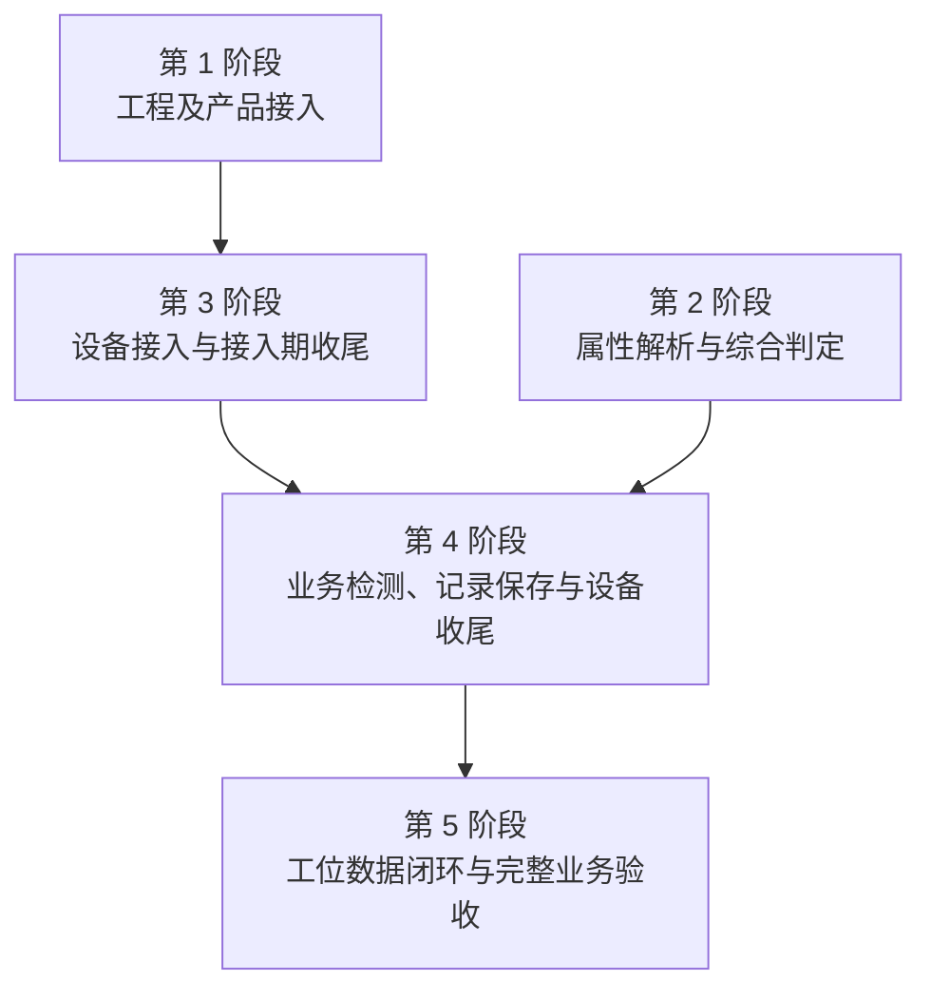

图 14：YME009 实施阶段依赖。第 1 阶段与第 2 阶段可以并行；第 4 阶段必须同时具备判定规则和正式连接上下文。

各阶段与 §6.2.2 测试域、§6.1.1 测试层次的对应关系如下。

| 阶段 | 阶段名称 | 主要对应测试域 | 本阶段测试层次 | 是否必须使用真实 YME009 设备 |
|---|---|---|---|---|
| 第 1 阶段 | 工程及产品接入 | 域 1 | L1、L2 | 否 |
| 第 2 阶段 | 属性解析与综合判定 | 域 3 的解析与状态分类，域 4 | 以 L1 为主 | 否 |
| 第 3 阶段 | 设备接入与接入期收尾 | 域 2，以及域 6 中的接入期关闭与清理 | L2、L3 | 是。门禁状态机可用 L2 先行覆盖；CDC、串口、AT、Ready 和接入期关闭在正常接入的 L3 中取证。身份关联随该正常流程完成，不另设专项验证或其他 ADB 并发场景作为验收门槛 |
| 第 4 阶段 | 业务检测、记录保存与设备收尾 | 域 3 的定向读取，域 5，域 6 的保存后收尾，域 7 的最小结果投影 | L1、L2、L3 | 部分。保存与状态转换以临时 SQLite 的 L1 / L2 为主；真机读取、中途断开和关闭路径必须 L3 |
| 第 5 阶段 | 工位数据闭环与完整业务验收 | 域 7，并在最终 L4 复核全部七个测试域 | L1、L2、L4；最终 L4 必须有真实设备 | 是。导出与分类可用 L1 / L2；最终完整业务验收必须在真实 YME009 设备参与的工位条件下完成 |

### 6.4.2 第 1 阶段：工程及产品接入

1. **阶段目标。** 把 YME009 注册为 SnVerify 中的独立产品，使操作员能够建立项目、订单和 `TestSession`，并在扫码后进入 YME009 专属轮次挂载点。本阶段结束时，YME009 不再落入 `ProcessCoordinator.ProcessScanAsync`、`RulePipelineExecutor.ExecuteAsync`，或 `ProcessCoordinator.StartVerificationAsync` 的 Legacy 决策树。

2. **前置依赖。** 无本项目新增阶段作为前置。本阶段直接建立在现有工程能力之上。

3. **现有代码复用范围。** 复用 `ProductRegistry.Get`、`GetProductProfile`、`GetProductCodes` 以及 `ProductRegistryAdapter` 作为产品事实来源。复用 `MainViewModel.StartBatchAsync` 已有的项目名、订单名校验和 `SessionLifecycleService.CreateAndStartSession`，以及 `IStorageService.CreateSessionAsync`、`GetInternalSessionIdBySessionNameAsync`。复用运行时扫码入口 `MainWindow.ScanInputTextBox_KeyDown`、`MainViewModel.ScanInputText` 和 `HandleScanInputAsync` 的调用位置。复用 `LoggingService.StartSession`。KM001、KM008、SOLTAG25 的注册内容、`ProcessScanAsync` 和 `StartVerificationAsync` 保持原状，供对照验证「旧产品路径未被改写」。

4. **需要改造的代码范围。** 仅允许在 `ProductRegistry` 静态构造中追加 YME009 注册，不得改写已有三个产品的 `ProductProfile` 字段、`AdbConfig` 或规则开关。必须改造 `MainViewModel.UpdateCurrentProductProfile` 与 `HandleScanInputAsync` 的分流判断：不得只把 YME009 标成 `VerificationMode.Phase3`，否则现有 `IsPhase3Product` 会把它送进 Phase3 规则链。开始测试时，`StartBatchAsync` 里「Phase3 目标 Android / Board / ChargeBoard 至少填写一项」的校验不得原样套用到 YME009；YME009 只按已确认设计准备目标软件版本，不引入主板或充电板目标版本。不得修改 `RulePipelineExecutor`、`VersionVerificationService` 或 Legacy 决策树来「兼容」YME009。

5. **需要新增的能力。** 新增 YME009 的产品注册，以及从现有扫码入口进入的专属轮次挂载点。界面提供最小验证入口：产品列表中可选 YME009，能够创建 Session，扫码后进入该挂载点而不是现有两路检验。不在本阶段设计新的类签名或接口。

6. **明确不包含的后续工作。** 不实施 CDC、AT、ADB 开启与身份关联。不实施八项属性读取和五项综合判定。不实施 YME009 保存事务、六种状态和设备收尾。不实施统计、独立导出和最终 L4。不处理 MES。

7. **独立交付结果。** 操作员可以选择 YME009，建立项目、订单和 `TestSession`，扫码后进入 YME009 挂载点。KM001、KM008、SOLTAG25 的选择、扫码入口和原有检验路径保持原行为。用现有测试或等价对照证明旧产品没有被改写。

8. **测试要求。** 对应域 1，层次为 L1、L2，不依赖真实设备。至少验证：`GetProductCodes` 能得到 YME009；按产品代码进入专属挂载点；YME009 扫码不会调用 `StartPhase3VerificationAsync` / `ProcessScanAsync` / `StartVerificationAsync`；旧产品注册和原有分流仍然成立。不得把现有 `RulePipelineExecutorTests` 或 KM001 / KM008 规则链测试当作本阶段 YME009 测试。

9. **阶段完成标准。** 上述交付结果可在不连接 YME009 设备的情况下重复验证。缺少独立分流、或 YME009 仍会进入现有规则链，则本阶段不能验收通过。

### 6.4.3 第 2 阶段：属性解析与综合判定

1. **阶段目标。** 按第三章把八项原始值解析、字段状态分类、五项必要条件和综合 PASS / FAIL 锁成可离线验证的规则，不连接设备也能判定对错。

2. **前置依赖。** 无本项目新增阶段作为前置。可与第 1 阶段并行。

3. **现有代码复用范围。** 复用 `SnVerify.Tests`、NUnit 和 Moq 作为本阶段自动化载体。去尾部连续 `\r` / `\n` 的处理可以参照 `TrimParser` 的既有行为，但不得把 `TrimParser` 的「整段 Trim」自动写成已确认的 YME009 分类规则；YME009 对成功值的分类以 3.4.2 为准。现有 `DeviceInfo`、`VersionVerificationService` 和 `RulePipelineExecutor` 只作为「不得误用」的对照，不作为本阶段实现基础。

4. **需要改造的代码范围。** 本阶段不改造 `VersionVerificationService.VerifyAsync`、`RulePipelineExecutor.ExecuteAsync`、`Km001McuVersionAggregateParser`、`Km008AndroidVersionAggregateParser`，也不为了 YME009 去改 KM001 / KM008 / SOLTAG25 的字段判定。不得把 ChipId `F50` 校验、批次内 SN 唯一或三版本比较扩展成 YME009 规则。

5. **需要新增的能力。** 新增 YME009 自己的八项属性解析与字段分类、五项必要条件比较、综合判定和 `FailReason` 主代码选择。必要文本、必要二值和信息字段按第三章区分；读取异常不得计入业务 FAIL。本阶段只交付纯逻辑，不设计新的对外接口签名。

6. **明确不包含的后续工作。** 不实施真机定向读取，不绑定 Transport ID，不实施保存和设备收尾，不实施导出统计，不把待确认的真机退出码写成已定案协议。

7. **独立交付结果。** 一组不连接设备即可重复执行的判定规则和 L1 测试，覆盖 PRD 15.4 的主要正常与异常分类，以及第三章已经确认的综合判定顺序。

8. **测试要求。** 对应域 3 的解析与状态分类、域 4，以 L1 为主，不必依赖真实设备。至少覆盖：八项成功值分类；SN 与软件版本比较；五项必要条件同时满足才 PASS；任一必要项失败则 FAIL；必要值缺失或协议数据异常不可判定；信息字段缺失不影响综合结果；主代码优先级。不得使用现有 `RulePipelineExecutorTests`、`VersionVerificationServiceTests` 代替本阶段测试。

9. **阶段完成标准。** L1 测试能够证明规则本身正确。把 KM / Legacy 规则或现有 `DeviceInfo` 六字段当作 YME009 判定，则本阶段不能验收通过。

### 6.4.4 第 3 阶段：设备接入与接入期收尾

1. **阶段目标。** 在 YME009 轮次挂载点上完成设备接入生命周期：30 秒窗口、CDC 发现与唯一性门禁、AT 开启 ADB、ADB Ready、身份关联并锁定 Transport ID，交付正式连接上下文；接入失败则按已确认规则关闭或跳过，并做统一资源清理，不创建 `TestRecord`。

2. **前置依赖。** 第 1 阶段已完成，YME009 拥有独立挂载点。不前置第 2 阶段。

3. **现有代码复用范围。** 复用 `ServiceFactory` 中的 `adb.exe` 路径解析，以及 `IProcessRunner` / `ProcessRunner` 作为进程启动基础设施。复用 `MainViewModel` 已有的 `IsProcessing`、`IsSelfChecking` 与 Session 激活门禁，作为互斥的起点，但覆盖范围要按第五章扩大到包含等待窗口的整轮，不能只沿用 `ProcessCoordinator` 在 `StartVerificationAsync` / `ProcessScanAsync` 内部的短锁。`AdbAccessService.CheckMultipleDevices` 和自检中的 `adb devices` 计数只能说明「现有工程会检查 ADB 设备列表」，不能代替 CDC 唯一性门禁，也不得在本阶段被改写成 YME009 的身份关联。

4. **需要改造的代码范围。** 在第 1 阶段已经切开的挂载点上，把接入流程接到 YME009 轮次，并让过程锁覆盖等待窗口。`MainViewModel.SelfCheckAsync` 不得改成 YME009 的 CDC / AT / Transport ID 流程，也不得把现有自检失败当成接入失败出口。不得修改 `AdbDeviceService.ReadDeviceInfoAsync`、`DeviceCommandExecutor.ExecuteAsync` 或 `AdbAccessService.ReadDeviceSnAsync` 的现有产品行为，去充当 YME009 的开启 ADB 或身份关联。不得在共享的 `CheckMultipleDevices` 上叠加 CDC 逻辑而影响 KM / Legacy 自检。

5. **需要新增的能力。** 新增 SnVerify 中目前不存在的设备接入能力：CDC 发现、唯一性门禁、每次 AT 交换独立发现当前 CDC 并打开当前 COM、AT 开启 ADB、ADB Ready、CDC 与 ADB 的身份关联、Transport ID 锁定、临时上下文与正式连接上下文、接入失败时的尽力关闭或跳过，以及与关闭分离的统一资源清理。关闭前重新发现当前 CDC 并打开当前 COM，属于关闭流程本身。参考工程中的对应实现只作第二章已引用的参考，不把它当作已经迁入 SnVerify 的代码。

6. **明确不包含的后续工作。** 不实施八项业务属性读取和综合判定。不创建或保存 `TestRecord`。不实施保存成功后的业务收尾以外的导出和最终 L4。不另设身份专项验证，也不把其他 ADB 设备同时在线等额外并发场景作为本阶段验收门槛。身份关联未成功时，不得把正式连接上下文交给第 4 阶段。

7. **独立交付结果。** 本阶段在真实 YME009 设备上完成既定 CDC 与 ADB 身份关联流程，取得正常设备接入的 L3 证据。成功路径交付已锁定 Transport ID 的正式连接上下文。失败路径按 2.5.1 选择关闭上下文，按 2.6.1 和 2.6.2 关闭或跳过，再按 5.4.3 清理，不落检测记录，也不把失败显示为已保存或已完成。身份关联未成功时，不得交付正式连接上下文。

8. **测试要求。** 对应域 2，以及域 6 中的接入期关闭与清理。门禁、上下文选择和关闭 / 跳过顺序可用 L2 在可替换边界上先行覆盖。CDC、串口、AT、ADB Ready、设备断开和接入期关闭在正常接入流程中以真实 YME009 设备做 L3。身份关联沿用第二章已经确认的实现原则，作为该正常流程的一步取得 L3 证据，不另设身份专项验证或其他 ADB 设备并发场景。自动化套件不得混入真机依赖。关键异常路径必须在本阶段验证：等待超时且未发送 AT、AT 开启结果不确定、接入过程中设备断开、ADB 关闭异常，以及「有可用 AT 控制上下文时尽力关闭」。

9. **阶段完成标准。** 成功路径在真实设备上完成既定接入流程并交付正式连接上下文。失败路径不创建 `TestRecord`，资源按已确认规则释放。身份关联未成功时不得交付正式连接上下文，也不得开始第 4 阶段的正式读取。实际联调中如发现身份匹配问题，再针对性调整，不把该调整写成另一轮专项验收。用 `adb devices` 计数或未定向 ADB 命令冒充身份关联，不能通过本阶段。

### 6.4.5 第 4 阶段：业务检测、记录保存与设备收尾

1. **阶段目标。** 在正式连接上下文上完成八项定向读取、综合判定、独立保存，以及保存方法返回后的设备收尾和统一资源清理。本阶段交付一条可验证的「读取 → 判定 → 保存 → 关闭或跳过 → 清理 → 最小结果投影」闭环。

2. **前置依赖。** 第 2 阶段的解析与判定规则已经锁定。第 3 阶段已经通过正常接入流程交付正式连接上下文。身份关联未成功时，第 3 阶段不得交付该上下文，第 4 阶段也不得开始正式读取。两条前置缺一不可。不要求另有一轮身份专项验证。

3. **现有代码复用范围。** 复用第 2 阶段已经锁定的解析和判定，以及第 3 阶段交付的正式上下文和 Transport ID。复用 `IStorageService.GetInternalSessionIdBySessionNameAsync` 取得内部 `SessionId`，复用 `TestSession` / `TestRecord` 表以及可承载的现有列，复用 `GetTestRecordsBySessionAsync` 供最小查询。复用 `IProcessRunner` 发起定向 ADB 进程，复用 `ILoggingService` 记录关键节点。第 1 阶段的 Session 与扫码挂载点继续作为入口。

4. **需要改造的代码范围。** 不得把 `AdbDeviceService.ReadDeviceInfoAsync` 或 `DeviceCommandExecutor.ExecuteAsync` 的未定向命令用于 YME009 生产读取，必须按第三章使用已锁定的 Transport ID。不得调用 `ProcessCoordinator.SaveOrUpdateFailResultAsync`：它会在同一 Session 同一 SN 上更新已有非 PASS 行，映射失败时不落库，而且吞掉保存异常。不得调用 `SavePhase3ResultAsync` 来保存 YME009：它同样吞掉异常，并且随后仍可能把界面投影为 `Completed`。不得把 Legacy / Phase3 的「历史 PASS 则 FAIL」套用到 YME009；同一订单同一 SN 每次检测都要独立插入。若对共享的 `StorageService.SaveTestRecordAsync` 做事务加固，必须保持对 KM001、KM008、SOLTAG25 现有调用的兼容，不得把六种状态或 YME009 判定写入旧路径。`MainViewModel` 只允许增加最小结果投影，不得在保存未确认时投影为 `Completed`。

5. **需要新增的能力。** 新增按 Transport ID 逐项读取八项属性、读取结果传递到第 2 阶段判定、YME009 独立保存路径（映射内部 `SessionId`，把 `INSERT` 与 `last_insert_rowid` 放入显式事务，以方法正常返回、Commit 成功且 `record.Id > 0` 为保存成功），以及保存后按 2.6.2 尽力关闭或跳过、再按 5.4.3 清理。需要表达第四章六种状态，并区分业务 PASS / FAIL、保存结果和设备收尾结果。需要覆盖保存失败、Commit 结果不确定和 SessionId 映射失败，且均不得显示已保存或已完成。

6. **明确不包含的后续工作。** 不实施完整的历史统计页面、独立导出的全部工位口径，以及最终 L4。允许提供最小验证入口，例如本轮结果的受控投影和记录已写入的确认，但不把等价环境或单轮最小投影写成最终验收。

7. **独立交付结果。** 在正式上下文上能够完成读取、判定、独立保存和收尾。正常路径下，保存成功与关闭成功互不替代。异常路径下，保存结果和收尾结果分别可观察。下一轮准备在清理和投影完成后可以进行。

8. **测试要求。** 对应域 3 的定向读取、域 5、域 6 的保存后收尾，以及域 7 的最小投影。保存失败、Commit 结果不确定和 SessionId 映射失败，通过临时 SQLite 和受控故障注入做 L1 / L2 验证，不要求等待真实产线发生数据库故障。六种状态和第四章的保存成功条件不因此减少。真机 L3 重点验证真实设备定向读取、读取中断、保存后关闭或跳过，以及资源清理。重复 SN 独立插入仍用临时 SQLite。不得把源码静态的 `[Test]` / `[TestCase]` 数量当作通过证据。本阶段必须验证的异常路径包括：保存失败、Commit 结果不确定、SessionId 映射失败、设备中途断开、ADB 关闭异常。前三项用受控故障注入；后两项用真机 L3。

9. **阶段完成标准。** 正常路径能够从正式上下文走到保存和收尾；保存成功条件与第四章一致；未确认保存不得投影为已完成；旧产品保存行为不被破坏。缺少真机读取或关闭证据、或仍走 `SavePhase3ResultAsync` / `SaveOrUpdateFailResultAsync` 语义，则本阶段不能验收通过。

### 6.4.6 第 5 阶段：工位数据闭环与完整业务验收

1. **阶段目标。** 补齐 YME009 的检测记录展示、统计和独立导出，并在真实 YME009 设备参与的工位条件下完成从扫码到下一轮准备的最终 L4 验收。

2. **前置依赖。** 第 4 阶段已经交付可验证的读取、判定、保存和收尾闭环。

3. **现有代码复用范围。** 复用 `MainViewModel.StartBatchAsync`、`EndBatchAsync`、`ExportAsync` 的操作框架，以及 `IStorageService.GetTestRecordsBySessionAsync`、`IExportAggregationService` 的会话导出流程。复用 Session 开始 / 结束、扫码输入框清空和焦点恢复等已有交互，作为工位操作骨架。

4. **需要改造的代码范围。** `ProductExportRegistry` 和 `SessionExporterFactory.GetExporter` 必须为 YME009 提供独立导出口径。不得因为产品模式或遗漏注册，把 YME009 送进 `Km001SessionExporter` 或 Legacy 导出口径。`MainViewModel` 的结果展示和统计只能消费数据库中实际存在的行，不得把内存中的 `record.Id` 或尚未确认的保存显示为已完成。不得改写 KM001、KM008、SOLTAG25 的导出列和现有过滤行为。

5. **需要新增的能力。** 新增面向 YME009 的记录展示、统计分类和独立导出，使读取异常与业务 FAIL 可区分，并使同一 SN 的多次独立记录都能被查询和导出。补齐真实设备参与的完整业务验收，而不是只停留在第 4 阶段的最小投影。

6. **明确不包含的后续工作。** 不包括 MES，不包括旧产品既有缺陷修复，不包括最终 Q20 方案的选定，也不包括把待确认文案、自检形态或 `EndTime` 未落库等问题提前关闭。

7. **独立交付结果。** 操作员可以在工位上完成选择 YME009、开始测试、扫码、查看本轮结果、查询本 Session 记录、统计和独立导出，并在一轮结束后准备下一轮。最终 L4 在真实 YME009 设备参与的工位条件下通过。

8. **测试要求。** 对应域 7，并在最终 L4 复核全部七个测试域。导出字段、统计分类和「只消费库中实有行」以 L1 / L2 验证。最终完整业务验收必须有真实 YME009 设备，层次为 L4。等价环境可以提前走通流程，但不能替代最终验收。不得把 Mock 或 L2 通过写成最终 L4 通过。

9. **阶段完成标准。** 独立导出和统计口径正确；未保存不得显示为已完成；旧产品导出不被改写；最终 L4 有真实设备证据。缺少真实设备参与，或把等价环境写成最终验收，则本阶段不能验收通过。

### 6.4.7 跨阶段约束

1. 第 1 阶段与第 2 阶段可以并行，但任何一方未完成，都不得开始第 4 阶段。
2. 第 3 阶段可以在第 2 阶段完成前开始，但不得提前做正式业务读取或创建 `TestRecord`。
3. 第 4 阶段不得拆成「先上线保存、下一阶段再收尾」。
4. 过程锁必须按第五章覆盖整轮；不得只在现有 `ProcessCoordinator` 的短锁范围内认为已经满足。
5. 不得把 MES、全项目依赖注入重构、或其他产品业务路径改造写入任一阶段。
6. 现有待确认事项保持原状态，不因进入实施计划而被写成已定案。

## 6.5 阶段验收标准

**建议方案：** 下列验收标准与 §6.4 的五个阶段一一对应，并与 §6.1 的四层测试策略、§6.2 的测试范围矩阵保持一致。每条标准都应可观察、可执行、可判定。不得把源码静态统计的 `[Test]` / `[TestCase]` 数量作为测试通过证据。本轮盘点没有运行测试，不得把现有测试写成全部通过。最终完整业务验收必须有真实 YME009 设备参与；等价环境通过不能代替最终 L4。

### 6.5.1 验收原则

1. 每个阶段只验收本阶段交付边界内的结果，不把后续阶段的能力当作本阶段通过条件，也不把本阶段尚未承诺的功能写成遗留缺陷以外的否决项。
2. 测试证据必须说明测试层次和环境。L1 / L2 使用 `SnVerify.Tests`、NUnit、Moq 和临时 SQLite，且不得混入真机依赖。L3 / 最终 L4 必须标明真实 YME009 设备及相关环境。
3. 关键正常路径和关键异常路径都要有结果记录。异常路径在引入相应能力的阶段验收，不推迟到第 5 阶段一次性补做。
4. 数据和状态以实际落库和已确认的状态定义为准，不以内存对象或界面口头宣布为准。
5. 允许遗留的问题必须不破坏本阶段已经确认的安全边界。阻断验收的问题一旦出现，本阶段不得判为通过。

### 6.5.2 第 1 阶段验收标准

- **测试范围。** 域 1：YME009 产品注册，以及现有工程适配中的独立分流。
- **测试层级。** L1、L2。不要求真实设备。
- **正常路径。** 产品列表包含 YME009；操作员可建立项目、订单和 `TestSession`；扫码进入 YME009 挂载点。选择 KM001、KM008 或 SOLTAG25 时，仍分别进入 `StartPhase3VerificationAsync` / `ProcessScanAsync` 或 `StartVerificationAsync`。
- **关键异常路径。** 未选择产品、Session 未激活或正在处理时，现有拒绝或忽略规则仍然有效。不得因为增加 YME009 而使旧产品无法开始测试或被错误分流。
- **数据和状态。** `ProductRegistry.GetProductCodes` 包含 YME009，且原有三个产品条目未被改写。YME009 的 Session 能够通过 `GetInternalSessionIdBySessionNameAsync` 映射到内部 Id。
- **测试证据。** 注册与分流的自动化测试结果；旧产品既有测试或对照记录。不得用规则链测试冒充本阶段证据。
- **通过条件。** 独立分流可重复验证；YME009 不会调用 `ProcessScanAsync`、`RulePipelineExecutor.ExecuteAsync` 或 Legacy `StartVerificationAsync`；旧产品行为保持不变。
- **阻断验收的问题。** YME009 未注册；因 `IsPhase3Product` 或 `Mode = Phase3` 落入现有规则链；旧产品注册或入口被改写；本阶段测试证据缺失。

### 6.5.3 第 2 阶段验收标准

- **测试范围。** 域 3 的解析与状态分类，域 4 的五项必要条件及 PASS / FAIL。
- **测试层级。** 以 L1 为主。不要求真实设备。
- **正常路径。** 八项成功值按 3.4.2 分类；五项必要条件全满足时综合 PASS；信息字段缺失不影响综合结果。
- **关键异常路径。** SN 不匹配、软件版本不匹配、产测或老化结果为失败、必要值缺失、协议数据异常、读取异常主代码选择。这些情况不得被写成业务 FAIL 与读取异常不分。
- **数据和状态。** 本阶段不要求落库。判定输入和输出在测试中可观察，且不依赖 `DeviceInfo` 的六字段全集或 ChipId / 三版本规则。
- **测试证据。** L1 自动化测试结果，须能对应 PRD 15.4 与第三章已确认规则。
- **通过条件。** 纯逻辑规则可重复判定，并且与 KM001 / KM008 / Legacy 规则明确分离。
- **阻断验收的问题。** 综合判定套用 `RulePipelineExecutor` 或 `VersionVerificationService`；读取异常被当作业务 FAIL；必要值缺失被写成 D16 或 SN 不匹配；本阶段 L1 证据缺失。

### 6.5.4 第 3 阶段验收标准

- **测试范围。** 域 2 的设备接入，以及域 6 中接入失败或接入结束后的关闭与清理。
- **测试层级。** 状态机、上下文选择和关闭 / 跳过顺序为 L2。CDC、串口、AT、ADB Ready、断开和接入期关闭在正常接入流程中为 L3，必须使用真实 YME009 设备。身份关联是该正常流程中的必要步骤，不另设专项验证层级，也不把其他 ADB 设备并发场景作为验收门槛。
- **正常路径。** 30 秒窗口内完成 CDC 唯一性门禁、AT 开启、ADB Ready、既定身份关联和 Transport ID 锁定，交付正式连接上下文。每次 AT 交换都独立管理串口资源。身份关联未成功时，不得交付正式连接上下文。
- **关键异常路径。** 等待超时且未发送 AT、AT 开启结果不确定、接入中设备断开、有可用 AT 控制上下文时关闭异常。失败出口不创建 `TestRecord`。
- **数据和状态。** 正式上下文只在身份关联成功后建立。失败路径没有检测记录，也不投影为已保存或已完成。过程锁覆盖等待窗口，释放发生在清理之后。
- **测试证据。** L2 自动化结果。L3 真机记录至少包括成功接入一次，以及上述关键失败 / 关闭路径的证据。成功接入记录应能看出既定身份关联已经完成并交付正式连接上下文。不要求另附身份专项验证或其他 ADB 设备并发场景的记录。
- **通过条件。** 本阶段在真实 YME009 设备上完成既定 CDC 与 ADB 身份关联流程，取得正常设备接入的 L3 证据。身份关联沿用第二章已经确认的实现原则，不另设身份专项验证或其他 ADB 设备并发场景作为阶段验收门槛。成功路径能交付正式上下文；失败路径按已确认规则关闭或跳过并清理。身份关联未成功时，不得交付正式连接上下文。
- **阻断验收的问题。** 身份关联未成功仍交付正式连接上下文或 Transport ID；用 `CheckMultipleDevices` 或未定向 ADB 命令冒充关联；失败路径写入 `TestRecord` 或显示已完成；接入期该关闭时未按 2.6.2 处理；把参考工程能力写成 SnVerify 已实现；正常接入的 L3 证据缺失。实际联调中发现的身份匹配问题按针对性调整处理，不把「未完成额外专项验证」本身写成阻断项。

### 6.5.5 第 4 阶段验收标准

- **测试范围。** 域 3 的定向读取，域 5 的检测记录与六种状态，域 6 的保存后收尾，域 7 的最小结果投影。
- **测试层级。** 保存失败、Commit 结果不确定、SessionId 映射失败，以及六种状态和重复 SN，为 L1 / L2，使用临时 SQLite 和受控故障注入。定向读取、读取中断、保存后关闭或跳过、资源清理为 L3。
- **正常路径。** 使用已锁定 Transport ID 读取八项属性，完成判定，独立保存成功，再按 2.6.2 关闭，按 5.4.3 清理，然后做受控投影并允许下一轮准备。同一订单同一 SN 连续两次检测产生两条独立记录。
- **关键异常路径。** 保存失败、Commit 结果不确定、SessionId 映射失败由受控故障注入验证。读取过程中断开、ADB 关闭异常由真机 L3 验证。保存结果与收尾结果分别记录，互不替代。不要求等待真实产线发生数据库故障。
- **数据和状态。** 保存成功必须同时满足：保存方法正常返回、Commit 成功、`record.Id > 0`。状态 5 与 SessionId 映射失败（状态 1）按 5.2.2 区分。不得仅凭内存中的 `record.Id` 宣布成功，也不得把未确认保存投影为 `Completed`。不得更新同一 Session 同一 SN 的旧行来代替新插入。六种状态和上述保存成功条件不因故障注入方式而减少。
- **测试证据。** 临时 SQLite 上的 L1 / L2 结果，包括保存失败、Commit 结果不确定和 SessionId 映射失败的受控故障注入。L3 真机证据覆盖定向读取、读取中断、保存后关闭或跳过，以及资源清理。不得用 `[Test]` / `[TestCase]` 静态数量代替这些证据，也不得用尚未发生的产线数据库故障代替故障注入证据。
- **通过条件。** 正常闭环可验证；六种状态分类正确；旧产品保存路径不被破坏；真机读取与收尾证据齐全。
- **阻断验收的问题。** 仍使用 `SavePhase3ResultAsync` 或 `SaveOrUpdateFailResultAsync` 的吞异常 / 覆盖更新语义；无显式事务仍把保存写成已确认成功；未保存显示为已完成；业务结果、保存结果和收尾结果被混为一谈；用未定向读取代替 Transport ID；旧产品行为被改写；本阶段 L1 / L2 或必要 L3 证据缺失。

### 6.5.6 第 5 阶段验收标准

- **测试范围。** 域 7 的操作流程、检测记录展示、统计和导出，并在最终 L4 复核域 1 至域 7。
- **测试层级。** 导出和统计分类为 L1 / L2；最终完整业务验收为 L4，且必须有真实 YME009 设备参与。
- **正常路径。** 从选择 YME009、开始测试、扫码、接入、读取、判定、保存、收尾，到界面展示、本 Session 查询、统计、独立导出和下一轮准备，全部在真实设备参与的工位条件下走通。
- **关键异常路径。** 在最终 L4 中至少复核：保存失败或不能确认时不得显示已完成；读取异常不得计入业务 FAIL；设备中途断开后的收尾与清理；重复 SN 的多条记录均可导出。接入期失败路径若已在第 3 阶段完成 L3，本阶段复核其在完整操作流程中的表现。
- **数据和状态。** 导出和界面统计只消费数据库中实际存在的行。Commit 结果不确定时，不得因为已经做过清理就断言库中一定没有行；若库中实际有行，导出以数据库为准，但本轮界面仍不得宣布保存成功。YME009 不得依赖库中 `EndTime` 判断会话是否正常结束。YME009 导出不得落入 KM001 或 Legacy 口径。
- **测试证据。** 导出与统计的 L1 / L2 结果；最终 L4 的真机工位验收记录，需标明真实 YME009 设备及环境。等价环境记录只能作为提前验证，不能作为最终 L4 证据。
- **通过条件。** 工位数据闭环可操作；独立导出口径正确；最终 L4 在真实设备条件下通过；旧产品展示和导出保持原行为。
- **阶段交付边界。** 本阶段是技术设计规划的最后实施阶段，验收的是本项目范围内的工位数据闭环和最终 L4。不包括 MES，不包括旧产品既有缺陷修复，不包括最终 Q20 方案的选定，也不包括把待确认文案全部关闭。
- **允许遗留与阻断验收。** 允许遗留：等待、保存失败、未预期软件异常和忙碌再扫的具体文案；Q17 的最终确认；Q20 的最终历史导出策略；Q12 的额外恢复方式；等待期间是否允许取消；工作停止未形成完整结果时的结果分类与显示；YME009 自检形态；`EndTime` 未落库。上述遗留必须以已经确认的约束为前提，例如不得显示未保存为已完成，不得重连，不得把读取异常计入业务 FAIL。阻断验收：最终 L4 没有真实 YME009 设备参与；等价环境被写成最终验收；完整流程不能从扫码走到下一轮准备；未保存被显示为已完成；导出落入 KM001 导出口径或把读取异常计入业务 FAIL；旧产品行为被改写；保存结果与收尾结果被混为一谈；本阶段 L1 / L2 或最终 L4 证据缺失。

完成本章后停止。不开始实施阶段，不开始编码，不修改 PRD，不修改设备审查报告，不修改生命周期审查报告，不修改源码或测试项目。
